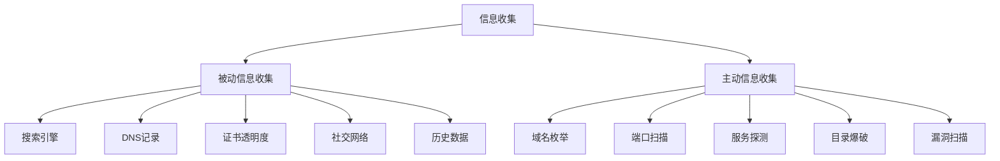

# 信息收集全技巧

> 渗透测试的第一步——全面、系统的信息收集方法论与工具链

---

## 一、信息收集框架

### 1.1 信息分类



### 1.2 收集层次

| 层次 | 内容 | 方法 |
|:----|:-----|:-----|
| 外层 | 域名/子域/IP/CDN | DNS/证书/搜索引擎 |
| 边界 | 端口/服务/WAF | 扫描/探测/指纹 |
| 应用层 | Web应用/API/框架 | 爬取/指纹/目录 |
| 内层 | 员工/邮件/内部系统 | 社交/泄露/钓鱼 |
| 技术层 | 版本/补丁/漏洞 | 漏洞扫描/识别 |

---

## 二、被动信息收集

### 2.1 搜索引擎

#### Google Dorks

```text
# 基础语法
site:target.com                      # 限定域名
inurl:admin                          # URL中包含
intitle:"login"                      # 标题中包含
filetype:pdf                         # 文件类型
intext:"password"                    # 页面文本
link:target.com                      # 链接到目标
cache:target.com                     # 缓存的页面
info:target.com                      # 页面摘要

# 安全相关Dorks
site:target.com filetype:sql          # SQL文件泄露
site:target.com filetype:log          # 日志文件泄露
site:target.com filetype:env          # 环境变量泄露
site:target.com inurl:php?            # PHP参数
site:target.com intitle:"index of"    # 目录遍历
site:target.com intext:"index of /"   # 目录列表
site:target.com inurl:wp-admin        # WordPress后台
site:target.com inurl:phpmyadmin      # phpMyAdmin
site:target.com inurl:server-status   # Apache状态
site:target.com inurl:git             # Git仓库
site:target.com "password" filetype:log  # 日志密码
site:target.com "FTP" "login"         # FTP登录信息
site:target.com intext:"sql syntax"   # SQL错误
site:target.com intext:"Warning:"     # PHP错误信息

# 组合搜索
site:target.com (inurl:admin | inurl:login | inurl:panel)
site:target.com filetype:pdf (password | confidential | secret)
site:target.com intitle:"index of" (config | backup | dump)
```

#### 其他搜索引擎

```bash
# Shodan - 网络设备搜索引擎
shodan search "hostname:target.com"
shodan search "org:\"Target Organization\""
shodan search "ssl:target.com"
shodan search "http.title:\"target\""
shodan search "port:3389 country:CN"
shodan stats --facets port country:CN

# Censys
censys search "target.com"
censys search "services.service_name: HTTP and services.http.response.html_title: \"target\""

# ZoomEye
zoomeye search "site:target.com"
zoomeye search "port:8080 + country:CN"

# FOFA
fofa search "domain=\"target.com\""
fofa search "cert=\"target.com\""
fofa search "title=\"login\" && domain=\"target.com\""

# Hunter (鹰图)
hunter search "domain=target.com"
hunter search "web.title=\"Login\"&&domain=target.com"
```

### 2.2 DNS记录收集

#### DNS记录类型

| 记录 | 用途 | 信息价值 |
|:----|:-----|:---------|
| A | IPv4地址 | 服务器真实IP |
| AAAA | IPv6地址 | IPv6资产发现 |
| CNAME | 别名 | 关联服务/CDN |
| MX | 邮件服务器 | 邮件网关信息 |
| NS | 域名服务器 | DNS服务器信息 |
| TXT | 文本记录 | SPF/DKIM/DMARC验证 |
| SOA | 权威起始 | DNS服务器信息 |
| SRV | 服务定位 | 特定服务发现 |

```bash
# DNS查询
dig target.com ANY +noall +answer
dig target.com A +short
dig target.com AAAA +short
dig target.com MX +short
dig target.com NS +short  
dig target.com TXT +short
dig target.com CNAME +short
dig target.com SOA +short

# 域传送测试
dig axfr @ns1.target.com target.com
dnsrecon -d target.com -t axfr -n 8.8.8.8

# 反向DNS
dig -x 192.168.1.1 +short
```

#### 子域名收集

```bash
# Passive DNS
# VirusTotal
curl -s "https://www.virustotal.com/api/v3/domains/target.com/subdomains" -H "x-apikey: $API_KEY"

# SecurityTrails
curl -s "https://api.securitytrails.com/v1/domain/target.com/subdomains" -H "APIKEY: $API_KEY"

# crt.sh (证书透明度)
curl -s "https://crt.sh/?q=%25.target.com&output=json" | jq -r '.[].name_value' | sort -u
curl -s "https://crt.sh/?q=%25.target.com&output=json" | jq -r '.[].name_value' | sed 's/\*\.//g' | sort -u

# RapidDNS
curl -s "https://rapiddns.io/subdomain/target.com?full=1" | grep -oP '(?<=<td>)[^<]+' | sort -u

# AlienVault OTX
curl -s "https://otx.alienvault.com/api/v1/indicators/domain/target.com/passive_dns" | jq -r '.passive_dns[]?.hostname' | sort -u

# Riddler
curl -s "https://riddler.io/search?q=target.com" -H "Authorization: Bearer $API_KEY"
```

### 2.3 证书透明度日志

```bash
# crt.sh 查询
python3 -c "
import requests, json
domains = set()
data = requests.get('https://crt.sh/?q=%25.target.com&output=json').json()
for cert in data:
    if isinstance(cert, dict) and 'name_value' in cert:
        for name in cert['name_value'].split('\n'):
            if name and name != '':
                domains.add(name.strip())
for d in sorted(domains):
    print(d)
"

# CertSpotter
curl -s "https://api.certspotter.com/v1/issuances?domain=target.com&include_subdomains=true&expand=dns_names" | jq -r '.[].dns_names[]' | sort -u

# Google Transparency Report
curl -s "https://transparencyreport.google.com/transparencyreport/api/v3/httpsreport/ct/certsearch?domain=target.com&include_subdomains=true"
```

### 2.4 WHOIS查询

```bash
# 基础查询
whois target.com
whois 192.168.1.1

# 信息提取
whois target.com | grep -E "Registrar|Creation|Expiry|Name Server|Admin|Tech"
whois target.com | grep "Registrant" -A 5

# 批量查询
for domain in $(cat domains.txt); do whois $domain | grep "Name Server"; done
```

### 2.5 GitHub泄露

```bash
# GitHub搜索
# 搜索语法: "target.com" "password"
# 搜索语法: "target.com" "api_key"  
# 搜索语法: "target.com" "token"
# 搜索语法: "target.com" filename:.env
# 搜索语法: "target.com" filename:config
# 搜索语法: "target.com" "aws_access_key"
# 搜索语法: org:target "secret"

# gitrob
gitrob -o target-org -s $GITHUB_TOKEN

# truffleHog
trufflehog --regex --entropy=True https://github.com/target/repo.git
trufflehog git https://github.com/target/repo.git --json

# git-secrets
git secrets --scan

# GitHub Dorks
git-hound --subdomain-file subdomains.txt --dig-files --dig-commits --many-results
```

### 2.6 泄露数据查询

```bash
# Dehashed (付费)
dehashed -q domain:target.com

# LeakCheck
leakcheck -k $API_KEY -q "target.com"

# Have I Been Pwned (单一邮箱)
curl -s "https://haveibeenpwned.com/api/v3/breachedaccount/email@target.com" -H "hibp-api-key: $API_KEY"

# Firefox Monitor / SpyCloud / IntelX
# SN_Breach / WeLeakInfo
```

### 2.7 社交网络

```bash
# LinkedIn
# 搜索: "target" company -> 员工列表
# Sherlock - 用户名搜索
sherlock username

# theHarvester
theHarvester -d target.com -b linkedin,google,bing,yahoo,baidu
theHarvester -d target.com -b pgp
theHarvester -d target.com -b dnsdumpster
```

### 2.8 技术栈识别

```bash
# Wappalyzer (命令行)
wappalyzer https://target.com

# WhatWeb
whatweb -v https://target.com
whatweb --aggression 3 https://target.com

# BuiltWith
curl -s "https://api.builtwith.com/v12/api.json?KEY=$API_KEY&LOOKUP=target.com"

# Netcraft
curl -s "https://searchdns.netcraft.com/?host=target.com"

# Retire.js (JS库漏洞)
retire --path /path/to/webapp
```

---

## 三、主动信息收集

### 3.1 子域名爆破

```bash
# 字典爆破
ffuf -w subdomains.txt -u https://target.com -H "Host: FUZZ.target.com" -fc 400,403,404

# ffuf 高级用法
ffuf -w subdomains.txt -u https://target.com -H "Host: FUZZ.target.com" -fs 1234 -t 100 -c
ffuf -w subdomains.txt -u https://target.com -H "Host: FUZZ.target.com" -mc 200,301,302,401

# gobuster
gobuster dns -d target.com -w subdomains.txt -t 100

# dnsx
dnsx -d target.com -w subdomains.txt -t 100 -a -cname -ns

# puredns
puredns bruteforce subdomains.txt target.com -r resolvers.txt

# massdns
massdns -r resolvers.txt -t A -o S -w results.txt subdomains.txt
```

### 3.2 端口扫描

```bash
# Nmap
# 快速扫描
nmap -sn 192.168.1.0/24                    # 主机发现
nmap -F target.com                          # 快速扫描
nmap -T4 -p- target.com                    # 全端口

# 详细扫描
nmap -sC -sV -O target.com                 # 默认脚本+版本+OS
nmap -sC -sV -p- -T4 target.com            # 全端口详细
nmap -sC -sV -p 80,443,8080,8443 target.com # 只扫Web端口

# NSE脚本
nmap --script http-headers target.com
nmap --script http-enum target.com
nmap --script http-title target.com
nmap --script ssl-enum-ciphers target.com
nmap --script vuln target.com
nmap --script=banner target.com

# 输出格式
nmap -oA scan_output target.com            # 所有格式
nmap -oN scan.txt target.com               # 正常格式
nmap -oX scan.xml target.com               # XML格式
nmap -oG scan.grep target.com              # Grepable

# Masscan (极速)
masscan 192.168.1.0/24 -p80,443,22,3389,445 --rate=10000
masscan target.com -p0-65535 --rate=10000

# RustScan
rustscan -a target.com -- -sC -sV
rustscan -a 192.168.1.0/24 -t 500 -p 22,80,443,445,3389
```

### 3.3 服务指纹

```bash
# HTTP指纹
curl -sI https://target.com | grep -i "server\|x-powered-by\|x-aspnet"
curl -s https://target.com | grep -i "generator\|wordpress\|drupal\|joomla"

# Banner抓取
nmap -sV --version-intensity 9 target.com -p 80,22,443

# 应用指纹
whatweb -v https://target.com
wafw00f https://target.com                    # WAF检测

# 自定义指纹
python3 -c "
import requests
r = requests.get('https://target.com')
print('Server:', r.headers.get('Server'))
print('X-Powered-By:', r.headers.get('X-Powered-By'))
print('Set-Cookie:', r.headers.get('Set-Cookie'))
"
```

### 3.4 目录爆破

```bash
# gobuster
gobuster dir -u https://target.com -w /usr/share/wordlists/dirb/common.txt -t 50
gobuster dir -u https://target.com -w /usr/share/wordlists/dirbuster/directory-list-2.3-medium.txt -x php,html,asp,aspx,jsp,txt

# ffuf
ffuf -u https://target.com/FUZZ -w /usr/share/wordlists/dirb/common.txt
ffuf -u https://target.com/FUZZ -w directories.txt -e .php,.asp,.aspx,.jsp,.txt
ffuf -u https://target.com/FUZZ -w directories.txt -recursion -recursion-depth 3

# dirsearch
dirsearch -u https://target.com -e php,asp,aspx,jsp,txt -t 50
dirsearch -u https://target.com -w /usr/share/wordlists/dirb/big.txt -r -R 2
```

### 3.5 参数发现

```bash
# 参数扫描
arjun -u https://target.com/api/endpoint
arjun -u https://target.com -t 20

# x8 (参数枚举)
x8 -u https://target.com -w params.txt

# 常用参数列表
# id, page, file, path, dir, action, cmd, exec, cmd, command, url, src, data, 
# search, query, callback, jsonp, format, type, method, function, debug, test
```

### 3.6 技术漏洞扫描

```bash
# Nuclei
nuclei -u https://target.com -t ~/nuclei-templates/
nuclei -u https://target.com -t cves/ -severity critical,high
nuclei -l urls.txt -t ~/nuclei-templates/ -o results.txt
nuclei -u https://target.com -t exposures/ -w workflows/

# Nikto
nikto -h https://target.com
nikto -h https://target.com -ssl -Format html -o report.html
nikto -h https://target.com -Tuning 123456789

# Skipfish
skipfish -o output_dir https://target.com

# WPScan (WordPress)
wpscan --url https://target.com --enumerate u,vp,vt,tt,cb,dbe
wpscan --url https://target.com --api-token $API_TOKEN
```

---

## 四、Web应用指纹

### 4.1 CMS识别

```bash
# 通用
whatweb https://target.com
wappalyzer https://target.com

# WordPress
wpscan --url https://target.com
curl -s https://target.com/readme.html
curl -s https://target.com/wp-json/
curl -s https://target.com/xmlrpc.php
curl -s https://target.com/license.txt

# Joomla
curl -s https://target.com/administrator/
curl -s https://target.com/README.txt
curl -s https://target.com/language/en-GB/en-GB.xml
joomscan -u https://target.com

# Drupal
curl -s https://target.com/CHANGELOG.txt
curl -s https://target.com/node/1
droopescan scan drupal -u https://target.com

# Magento
curl -s https://target.com/RELEASE_NOTES.txt
curl -s https://target.com/downloader/
magescan scan https://target.com
```

### 4.2 服务器指纹

```bash
# Web服务器
curl -sI https://target.com | grep Server
curl -sI https://target.com | grep X-Powered-By
openssl s_client -connect target.com:443 2>/dev/null | head -10

# 数据库
curl -sI https://target.com | grep -i db
nmap --script ms-sql-info -p 1433 target.com
nmap --script mysql-info -p 3306 target.com

# 框架
whatweb https://target.com --aggression 3
```

### 4.3 WAF识别

```bash
# wafw00f
wafw00f https://target.com -a
wafw00f https://target.com -l                         # 列出所有WAF

# 手动检测
curl -sI https://target.com | grep -i "cloudflare|akamai|incapsula|sucuri"
curl -sk https://target.com -H "User-Agent: ' OR 1=1 --" -w "%{http_code}"
```

---

## 五、内网信息收集

### 5.1 内网探测

```bash
# 主机存活
fping -ag 192.168.1.0/24
arp-scan --local

# 端口扫描
nmap -sn 192.168.1.0/24                              # 同网段
nmap -PS445,3389,22 192.168.1.0/24                  # TCP SYN Ping

# NetBIOS
nbtscan 192.168.1.0/24
nmblookup -A 192.168.1.1                             # 获取主机名
```

### 5.2 Windows域信息

```powershell
# 域信息
net group "Domain Admins" /domain
net user /domain
nltest /dclist:DOMAIN

# PowerShell
Get-ADUser -Filter * -Properties *
Get-ADComputer -Filter * -Properties *
Get-ADGroup -Filter * -Properties *
```

### 5.3 SMB枚举

```bash
# SMB共享
smbclient -L //192.168.1.1 -N
smbmap -H 192.168.1.1
enum4linux -a 192.168.1.1
cme smb 192.168.1.1 -u '' -p '' --shares
```

---

## 六、移动端信息收集

### 6.1 APK分析

```bash
# APK工具
apktool d app.apk -o output/
dex2jar app.apk -o app.jar
jadx-gui app.apk

# 敏感信息
strings app.apk | grep -i "password\|api_key\|token\|secret\|http"
grep -r "https\?://" output/
grep -r "api\." output/
```

### 6.2 iOS分析

```bash
# IPA分析
unzip app.ipa
strings Payload/App.app/App | grep -i "password\|api_key"
otool -L Payload/App.app/App
```

---

## 七、自动化信息收集框架

### 7.1 推荐工具

```bash
# Amass - 深度子域名收集
amass enum -d target.com
amass enum -d target.com -o subdomains.txt
amass intel -whois -d target.com
amass db -names -d target.com

# Subfinder - 快速子域名
subfinder -d target.com -o subdomains.txt
subfinder -d target.com -all -recursive

# Assetfinder
assetfinder --subs-only target.com

# Findomain
findomain -t target.com -o

# httpx - HTTP探测
cat subdomains.txt | httpx -title -status-code -tech-detect
cat subdomains.txt | httpx -follow-redirects -silent

# naabu - 端口扫描
naabu -host target.com -p 80,443,8080,8443
naabu -list subdomains.txt -p 80,443 -rate 1000

# Haktrails - SecurityTrails API
haktrails subdomains target.com
haktrails domain target.com
```

### 7.2 完整流程脚本

```bash
#!/bin/bash
# recon.sh - 自动化信息收集
DOMAIN=$1
OUTPUT="recon_$DOMAIN"

mkdir -p $OUTPUT

# 1. Subdomain Enumeration
echo "[*] 子域名收集..."
subfinder -d $DOMAIN -o $OUTPUT/subfinder.txt
amass enum -d $DOMAIN -o $OUTPUT/amass.txt
assetfinder --subs-only $DOMAIN > $OUTPUT/assetfinder.txt
cat $OUTPUT/*.txt | sort -u > $OUTPUT/all_subs.txt

# 2. DNS解析
echo "[*] DNS解析..."
cat $OUTPUT/all_subs.txt | dnsx -a -cname -resp -o $OUTPUT/resolved.txt

# 3. HTTP探测
echo "[*] HTTP探测..."
cat $OUTPUT/all_subs.txt | httpx -title -status-code -tech-detect -o $OUTPUT/live_hosts.txt

# 4. 端口扫描
echo "[*] 端口扫描..."
naabu -list $OUTPUT/resolved.txt -p 80,443,8080,8443,22,445,3389 -o $OUTPUT/ports.txt

# 5. 截屏
echo "[*] Web截图..."
gowitness file -f $OUTPUT/live_hosts.txt

# 6. Nuclei扫描
echo "[*] 漏洞扫描..."
nuclei -l $OUTPUT/live_hosts.txt -t ~/nuclei-templates/ -o $OUTPUT/vulns.txt

echo "[*] 完成！结果保存在 $OUTPUT/"
```

---

## 八、信息收集清单

### 8.1 检查清单

| 项目 | 工具 | 完成 |
|:----|:-----|:----:|
| 域名WHOIS | whois | ☐ |
| DNS记录 | dig | ☐ |
| 子域名 | subfinder/amass | ☐ |
| 证书日志 | crt.sh | ☐ |
| 搜索引擎 | Google/Bing/Baidu | ☐ |
| 泄露数据 | GitHub/Dehashed | ☐ |
| 社交网络 | LinkedIn/theHarvester | ☐ |
| 技术栈 | whatweb/wappalyzer | ☐ |
| CDN/WAF | wafw00f | ☐ |
| 端口扫描 | nmap/masscan | ☐ |
| 服务指纹 | nmap -sV | ☐ |
| 目录枚举 | gobuster/ffuf | ☐ |
| 参数发现 | arjun | ☐ |
| 漏洞扫描 | nuclei | ☐ |
| 备份文件 | 字典爆破 | ☐ |
| 监听目录 | 递归扫描 | ☐ |
| JavaScript分析 | LinkFinder | ☐ |
| 截图验证 | gowitness | ☐ |

### 8.2 常用字典

| 类型 | 推荐字典 |
|:----|:---------|
| 子域名 | `seclists/Discovery/DNS/subdomains-top1million-5000.txt` |
| 目录 | `seclists/Discovery/Web-Content/common.txt` |
| 目录(深度) | `seclists/Discovery/Web-Content/raft-large-directories.txt` |
| 文件 | `seclists/Discovery/Web-Content/raft-large-files.txt` |
| 参数 | `seclists/Discovery/Web-Content/burp-parameter-names.txt` |
| JS文件 | `seclists/Discovery/Web-Content/JS.txt` |
| 备份文件 | `seclists/Discovery/Web-Content/backups.txt` |

### 8.3 推荐资源

| 资源 | URL |
|:-----|:----|
| SecLists | github.com/danielmiessler/SecLists |
| nuclei-templates | github.com/projectdiscovery/nuclei-templates |
| OneForAll | github.com/shmilylty/OneForAll |
| ReconFTW | github.com/six2dez/reconftw |
| ProjectDiscovery | github.com/projectdiscovery |
| PayloadsAllTheThings | github.com/swisskyrepo/PayloadsAllTheThings |

---

> **参考资源**
>
> - Bug Bounty Hunter's Methodology v3
> - reconftw methodology
> - ProjectDiscovery Tools Documentation
> - HackTricks Recon Methodology


[OWASP Top 10 速查表](08-owasp-top10.md)
