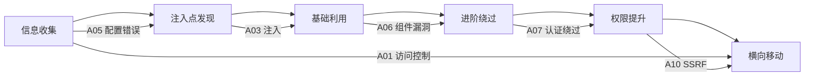

# 📊 OWASP Top 10 2021 速查表

> 本文件是「网络安全知识」文件夹的**索引页**，汇总 OWASP Top 10 2021 所有漏洞及其关联文件。
> 每个文件均包含：**基础原理 → 检测技巧 → 进阶利用 → 防御方案 → 实战检查清单**

---

## 🗂️ 文件夹结构总览

| 编号 | 漏洞类别 | 文件 | 难度 |
|:---:|:---|:---|:---:|
| **A01** | 🔐 失效的访问控制 | [失效的访问控制（A01）全技巧](21-a01-broken-access-control.md) | ⭐⭐ |
| **A02** | 🔒 加密机制失效 | [加密机制失效（A02）全技巧](22-a02-cryptographic-failures.md) | ⭐⭐⭐ |
| **A03** | 💉 **注入（Injection）** | **见下方细分** | ⭐ ~ ⭐⭐⭐⭐⭐ |
| **A04** | 🏗️ 不安全设计 | [不安全设计（A04）全技巧](23-a04-insecure-design.md) | ⭐⭐⭐ |
| **A05** | ⚙️ 安全配置错误 | [安全配置错误（A05）全技巧](24-a05-security-misconfiguration.md) | ⭐⭐ |
| **A06** | 📦 易受攻击和过时的组件 | [易受攻击和过时的组件（A06）全技巧](25-a06-vulnerable-components.md) | ⭐⭐⭐ |
| **A07** | 🔑 身份认证失效 | [身份认证失效（A07）全技巧](26-a07-auth-failures.md) | ⭐⭐ |
| **A08** | 🔄 软件和数据完整性失效 | [软件和数据完整性失效（A08）全技巧](27-a08-integrity-failures.md) | ⭐⭐⭐⭐ |
| **A09** | 📝 安全日志与监控失效 | [安全日志与监控失效（A09）全技巧](28-a09-logging-monitoring.md) | ⭐⭐ |
| **A10** | 🌐 服务端请求伪造 | [服务端请求伪造SSRF（A10）全技巧](15-ssrf.md) | ⭐⭐⭐ |

---

## 💉 A03 — Injection（注入）细分

| 注入类型 | 文件 | 难度 | 说明 |
|:---|:---|:---:|:---|
| 🗡️ SQL 注入 | [SQL注入全技巧](09-sql-injection.md) | ⭐⭐ | 关系型数据库注入（MySQL、MSSQL、Oracle） |
| 🎯 XSS（跨站脚本） | [XSS全技巧](12-xss.md) | ⭐⭐ | 客户端注入，反射/存储/DOM 型 |
| 🎯 XSS 实战案例 | [XSS实战思路之打击灰黑产1](57-xss-real-world.md) | ⭐⭐ | XSS 实战攻防案例（钓鱼网站） |
| 💻 命令注入 | [命令注入全技巧](11-command-injection.md) | ⭐⭐⭐ | 系统命令执行，RCE |
| 🍃 NoSQL 注入 | [NoSQL注入全技巧](10-nosql-injection.md) | ⭐⭐⭐ | MongoDB、Redis、CouchDB 等 |
| 🎨 模板注入（SSTI） | [模板注入SSTI全技巧](17-ssti.md) | ⭐⭐⭐⭐ | Jinja2、Twig、Freemarker RCE |
| 📄 XXE 注入 | [XXE注入全技巧](16-xxe.md) | ⭐⭐⭐ | XML 外部实体，文件读取/SSRF |
| 🔄 反序列化注入 | [反序列化注入全技巧](18-deserialization.md) | ⭐⭐⭐⭐⭐ | Java/PHP/Python 反序列化 RCE |

> 💡 **A03 Injection** 是本知识库中**内容最丰富**的类别，覆盖了从基础到进阶的 8 种注入类型。

---

## 🔗 快速导航

### 按攻击阶段



### 按漏洞关联性

```
SQL注入 ──┬── 命令注入（SQLMap --os-shell 获取 Shell）
          └── NoSQL注入（对比学习，异同分析）

XSS ────┬── 模板注入SSTI（一个客户端一个服务端，注意区分）
        └── 反序列化（Cookie/Session 中的序列化数据）

命令注入 ──── 反序列化（反序列化 RCE 后常用于执行命令）
         ──── SSRF（命令注入可用于 SSRF 探测内网）

XXE ──── SSRF（XXE 常用于 SSRF 访问云元数据）
    ──── 命令注入（PHP expect:// 协议 RCE）

反序列化 ──── NoSQL注入（Redis 反序列化组合攻击）
         ──── 身份认证（Session 反序列化绕过认证）
         ──── 软件和数据完整性（A08 总览）

SSRF ──── 安全配置错误（云元数据泄露）
    ──── 失效的访问控制（内网横向移动）
```

---

## 📋 推荐学习路径

### 🟢 入门（零基础）
1. [SQL注入全技巧](09-sql-injection.md) — 最经典的 Web 漏洞
2. [XSS全技巧](12-xss.md) — 客户端攻击入门
3. [失效的访问控制（A01）全技巧](21-a01-broken-access-control.md) — 越权测试基础
4. [安全配置错误（A05）全技巧](24-a05-security-misconfiguration.md) — 信息收集基础

### 🟡 进阶
1. [命令注入全技巧](11-command-injection.md) — 系统级攻击
2. [NoSQL注入全技巧](10-nosql-injection.md) — 现代数据库攻击
3. [身份认证失效（A07）全技巧](26-a07-auth-failures.md) — 认证机制绕过
4. [XXE注入全技巧](16-xxe.md) — 服务端攻击进阶
5. [服务端请求伪造SSRF（A10）全技巧](15-ssrf.md) — 云环境攻击

### 🔴 高阶
1. [模板注入SSTI全技巧](17-ssti.md) — 多种模板引擎 RCE
2. [反序列化注入全技巧](18-deserialization.md) — Java/PHP/Python 反序列化
3. [易受攻击和过时的组件（A06）全技巧](25-a06-vulnerable-components.md) — 供应链攻击
4. [软件和数据完整性失效（A08）全技巧](27-a08-integrity-failures.md) — CI/CD 投毒

---

## 🛠️ 推荐工具速查

## 🎯 SRC实战报告合集

> **实战出真知**！以下报告均来自真实SRC授权测试案例，覆盖信息收集、漏洞挖掘、报告提交全流程。

| 报告 | 内容亮点 | 关联漏洞 |
|:---|:---|:---|
| 🏰 [SRC实战报告之Sitecore渗透全过程](53-src-sitecore.md) | 7天完整渗透，CMS攻防+SOAP接口+SQL盲注 | SQL注入、敏感信息泄露、Vue XSS |
| 🧠 [SRC实战报告之逻辑漏洞挖掘案例集](55-src-logic-bugs.md) | 14个真实逻辑漏洞案例，越权/支付/验证码/OAuth | 越权、支付篡改、认证绕过 |
| 🔍 [SRC实战报告之信息收集与工具联动](52-src-recon.md) | 完整工具链+FOFA语法+端口扫描+GitHub泄露 | 信息收集方法论 |
| 📝 [SRC实战报告之报告撰写与避坑指南](56-src-reporting.md) | 报告模板+平台对比+六大避坑+成长路线 | SRC规范与合规 |
| 📂 [SRC实战报告之文件上传与API安全](54-src-upload-api.md) | 文件上传RCE+Swagger泄露+GraphQL+SSRF+XXE | 文件上传、API安全、SSRF |

> 💡 **学习建议**：先看 [SRC实战报告之信息收集与工具联动](52-src-recon.md) 掌握方法论，再看 [SRC实战报告之Sitecore渗透全过程](53-src-sitecore.md) 理解实战思路，最后用 [SRC实战报告之报告撰写与避坑指南](56-src-reporting.md) 规范提交。


| 工具 | 用途 | 相关漏洞 |
|:---|:---|:---|
| **SQLMap** | SQL 注入自动检测与利用 | SQL注入 |
| **Commix** | 命令注入自动检测与利用 | 命令注入 |
| **tplmap** | SSTI 自动检测与利用 | 模板注入 |
| **ysoserial** | Java 反序列化 Payload 生成 | 反序列化 |
| **PHPGGC** | PHP 反序列化 Payload 生成 | 反序列化 |
| **NoSQLMap** | NoSQL 注入检测 | NoSQL注入 |
| **BeEF** | XSS 浏览器利用框架 | XSS |
| **JNDIExploit** | JNDI 注入利用 | 反序列化 |
| **nuclei** | 模板化漏洞扫描 | 通用 |

---

> 🎯 **建议**：对照 [SQL注入全技巧](09-sql-injection.md) 的详细度和格式标准来学习其他文件，每个文件都遵循相同的知识结构。
