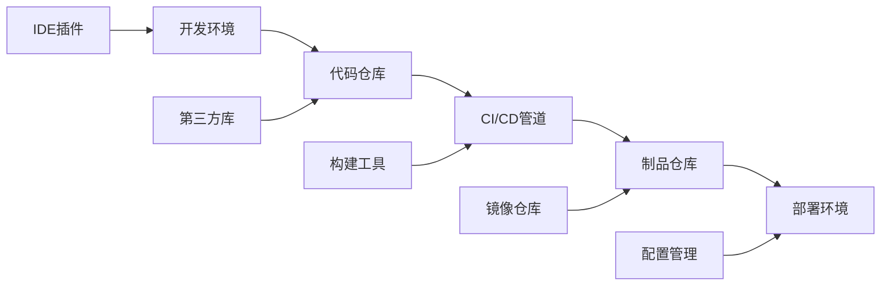

# 供应链安全

> 从依赖管理到CI/CD安全，系统化掌握软件供应链防护

---

## 一、供应链攻击概述

### 1.1 攻击面



### 1.2 典型攻击

| 攻击类型 | 目标 | 案例 |
|:---------|:-----|:-----|
| 依赖混淆 | 包管理器 | event-stream (npm) |
| 恶意包投毒 | PyPI/npm/rubygems | colors.js, faker.js |
| 代码仓库入侵 | GitHub/GitLab | SolarWinds |
| CI/CD攻击 | Jenkins/GitHub Actions | Codecov |
| 镜像投毒 | Docker Hub | Docker Hub恶意镜像 |
| 证书/密钥泄露 | TLS/SSH | 基础设施被控 |
| 后门植入 | 硬件/固件 | Supermicro BMC |

---

## 二、依赖管理安全

### 2.1 包管理器安全

```bash
# npm安全
npm audit                    # 安全审计
npm audit fix                # 自动修复
npm outdated                 # 过时包
npm ls --depth=0             # 查看顶层依赖

# npm配置
npm config set audit-level high
npm config set fund false
npm set audit true

# Python (pip)
pip freeze > requirements.txt
pip list --outdated
safety check --file=requirements.txt

# pip-audit
pip install pip-audit
pip-audit

# Maven
mvn dependency-check:check
mvn versions:display-dependency-updates
mvn dependency:tree

# Nuget
dotnet list package --vulnerable
dotnet list package --outdated
dotnet list package --deprecated
```

### 2.2 依赖混淆攻击

```bash
# 依赖混淆 (Dependency Confusion)
# 原理: 内部包名与公共包名冲突
# npm/yarn/pip优先使用公共注册表(如果设置了scope/pubilc)

# 检查内部包名是否在公共注册表已存在
npm view @company/package-name
pip search package-name

# 防御
# .npmrc
@company:registry=https://internal-npm.company.com/
registry=https://registry.npmjs.org/

# pip.conf
[global]
index-url = https://internal-pypi.company.com/simple
extra-index-url = https://pypi.org/simple

# GitHub - Dependabot
# Dependabot自动检测依赖混淆
```

### 2.3 软件物料清单

```json
// SPDX SBOM格式
{
  "spdxVersion": "SPDX-2.2",
  "dataLicense": "CC0-1.0",
  "SPDXID": "SPDXRef-DOCUMENT",
  "name": "myapp-1.0.0",
  "packages": [
    {
      "name": "lodash",
      "versionInfo": "4.17.21",
      "supplier": "NOASSERTION",
      "downloadLocation": "https://registry.npmjs.org/lodash/-/lodash-4.17.21.tgz",
      "checksums": [
        {
          "algorithm": "SHA256",
          "checksumValue": "a1b2c3d4..."
        }
      ],
      "licenseConcluded": "MIT"
    }
  ]
}

// CycloneDX格式
{
  "bomFormat": "CycloneDX",
  "specVersion": "1.4",
  "serialNumber": "urn:uuid:...",
  "components": [
    {
      "type": "library",
      "name": "log4j-core",
      "version": "2.17.1",
      "purl": "pkg:maven/org.apache.logging.log4j/log4j-core@2.17.1",
      "licenses": [{"license": {"id": "Apache-2.0"}}]
    }
  ]
}

# 生成SBOM
# Node.js
npx @cyclonedx/bom

# Python
pip install cyclonedx-bom
cyclonedx-py

# Java
mvn org.cyclonedx:cyclonedx-maven-plugin:makeBom
```

---

## 三、CI/CD安全

### 3.1 GitHub Actions安全

```yaml
# ❌ 不安全的Actions配置
on:
  pull_request_target:  # 危险！有仓库令牌
    types: [opened]

jobs:
  build:
    steps:
      - uses: actions/checkout@v2
        with:
          fetch-depth: 0
      - run: npm install
      - run: npm test
      
# ✅ 安全配置
name: CI
on:
  pull_request:  # 使用pull_request而不是pull_request_target
    branches: [main]

jobs:
  security-scan:
    runs-on: ubuntu-latest
    permissions:
      contents: read
      security-events: write
    steps:
      # 1. 使用固定版本(而不是@main)
      - uses: actions/checkout@v3
      
      # 2. 依赖审计
      - name: Run npm audit
        run: npm audit --audit-level=high
      
      # 3. SAST扫描
      - name: CodeQL Analysis
        uses: github/codeql-action/analyze@v2
      
      # 4. 依赖扫描
      - name: Dependency Review
        uses: actions/dependency-review-action@v2
      
      # 5. 密钥泄露检测
      - name: Secret Scanning
        uses: trufflesecurity/trufflehog@main
        with:
          path: ./
          base: ${{ github.event.repository.default_branch }}
          head: ${{ github.head_ref }}

# ❌ 不要在Actions中
# 1. 使用pull_request_target（有写入令牌权限）
# 2. 使用不固定的第三方Actions版本
# 3. 在日志中输出秘密
# 4. 使用自托管runner运行不受信任的代码
```

### 3.2 Jenkins安全

```groovy
// Jenkinsfile - 安全配置
pipeline {
    agent any
    environment {
        // 安全：使用凭证管理
        DOCKER_REGISTRY_CREDS = credentials('docker-registry-cred')
        GIT_CREDS = credentials('git-cred')
    }
    stages {
        stage('Checkout') {
            steps {
                // 验证Git签名
                checkout([
                    $class: 'GitSCM',
                    branches: [[name: '*/main']],
                    extensions: [[$class: 'VerifyCommitSignature']],
                    userRemoteConfigs: [[
                        url: 'https://git.company.com/repo.git',
                        credentialsId: 'git-cred'
                    ]]
                ])
            }
        }
        stage('Dependency Check') {
            steps {
                // OWASP Dependency Check
                dependencyCheck additionalArguments: """
                    -f ALL
                    --format HTML
                    --format JSON
                    --nvdApiKey ${NVD_API_KEY}
                """, odcInstallation: 'default'
            }
        }
        stage('Build') {
            steps {
                // 签名构建产物
                signBuild steps: [[$class: 'SignBuildStep']]
            }
        }
    }
    post {
        always {
            // 清理凭证
            cleanWs()
        }
    }
}

// Jenkins安全配置
// 1. 使用Pipeline共享库(受控)
// 2. 凭证存储: 使用Credential Binding插件
// 3. 最小权限: 限制项目/文件夹权限
// 4. 审计: 开启所有操作的审计日志
// 5. 沙箱: 使用Groovy沙箱限制脚本权限
```

### 3.3 制品签名

```bash
# GPG签名
gpg --full-generate-key
gpg --list-keys

# 签名文件
gpg --sign --armor file.tar.gz
gpg --verify file.tar.gz.asc

# Docker镜像签名 (Notary/DCT)
# Docker Content Trust
export DOCKER_CONTENT_TRUST=1
docker push myapp:latest  # 自动签名

# Cosign (Sigstore)
cosign sign --key cosign.key myimage:tag
cosign verify --key cosign.pub myimage:tag

# cosign密钥对
cosign generate-key-pair

# SBOM签名
cosign sign-blob --key cosign.key sbom.json
cosign verify-blob --key cosign.pub --signature sbom.json.sig sbom.json
```

---

## 四、依赖扫描工具

### 4.1 工具对比

| 工具 | 语言 | 特点 | 定价 |
|:-----|:-----|:-----|:-----|
| Dependabot | 多语言 | GitHub原生 | 免费 |
| Snyk | 多语言 | 实时监控 | 免费/付费 |
| Renovate | 多语言 | 自动更新PR | 免费 |
| OWASP DC | Java/.NET | CVE数据库 | 免费 |
| Trivy | 多语言 | 容器+依赖 | 免费 |
| Grype | 多语言 | 快速扫描 | 免费 |
| Black Duck | 多语言 | 商业强大 | 付费 |
| Sonatype | Java | 组件分析 | 付费 |
| Socket | JS/Go | 行为分析 | 付费 |

### 4.2 使用示例

```bash
# Dependabot配置 (.github/dependabot.yml)
version: 2
updates:
  - package-ecosystem: "npm"
    directory: "/"
    schedule:
      interval: "weekly"
      day: "monday"
    open-pull-requests-limit: 10
    labels:
      - "dependencies"
      - "security"
    reviewers:
      - "team-security"
    assignees:
      - "security-lead"
    ignore:
      - dependency-name: "lodash"
        update-types: ["version-update:semver-patch"]

# Snyk CLI
snyk test
snyk monitor
snyk code test
snyk iac test

# Trivy
trivy filesystem --severity CRITICAL,HIGH .
trivy repo https://github.com/org/repo
trivy image alpine:latest

# Grype
grype .
grype docker:alpine:latest

# OWASP Dependency Check
dependency-check --scan ./ --format HTML --out ./reports
```

---

## 五、密钥与凭证管理

### 5.1 密钥发现

```bash
# TruffleHog
trufflehog --regex --entropy=True https://github.com/org/repo
trufflehog git https://github.com/org/repo.git --results=verified
trufflehog filesystem --directory=./

# GitLeaks
gitleaks detect --source ./
gitleaks detect --source ./ --report-path report.json
gitleaks detect --verbose

# Git Secrets
git secrets --scan
git secrets --scan-history

# 检测模式
# AWS Key: AKIA[0-9A-Z]{16}
# GitHub Token: ghp_[0-9a-zA-Z]{36}
# Slack Token: xox[baprs]-[0-9a-zA-Z]{10,}
# Google API: AIza[0-9A-Za-z\-_]{35}
# Private Key: -----BEGIN (RSA|DSA|EC|OPENSSH|PGP) PRIVATE KEY-----
```

### 5.2 安全管理

```bash
# 使用密钥管理器
# HashiCorp Vault
vault kv put secret/api/production key=value
vault kv get secret/api/production

# AWS Secrets Manager
aws secretsmanager create-secret --name prod/db --secret-string '{"username":"admin","password":"secret"}'
aws secretsmanager get-secret-value --secret-id prod/db

# Azure Key Vault
az keyvault secret set --vault-name myvault --name "db-password" --value "secret"
az keyvault secret show --vault-name myvault --name "db-password"

# GitHub Secrets (Actions)
gh secret set DEPLOY_KEY --body "private-key-content"
gh secret list

# 环境变量 vs 配置文件
# ❌ 不要: 
# config.json: {"api_key": "ABC123"}

# ✅ 正确:
# config.json: {"api_key": "${API_KEY}"}
# 环境变量: API_KEY=ABC123
```

---

## 六、容器供应链安全

### 6.1 镜像安全

```dockerfile
# ❌ 不安全的Dockerfile
FROM ubuntu:latest
RUN apt-get update && apt-get install -y curl
COPY . /app
RUN pip install -r requirements.txt
USER root
CMD ["python", "app.py"]

# ✅ 安全的Dockerfile
# 使用指定版本而非latest
FROM python:3.11-slim@sha256:a1b2c3d4...

# 设置维护者标签
LABEL maintainer="security@company.com"

# 更新系统并清理缓存
RUN apt-get update && \
    apt-get install -y --no-install-recommends \
        curl=7.* \
        ca-certificates \
    && rm -rf /var/lib/apt/lists/* \
    && apt-get clean

# 复制依赖文件优先（利用缓存）
COPY requirements.txt .
RUN pip install --no-cache-dir -r requirements.txt

# 安全复制应用代码
COPY --chown=1000:1000 . /app

# 使用非root用户
USER 1000

# 设置只读根文件系统
RUN chmod 444 /etc/passwd

# 添加健康检查
HEALTHCHECK --interval=30s --timeout=3s \
    CMD curl -f http://localhost:8080/health || exit 1

# 使用exec格式
CMD ["python", "app.py"]

# 多阶段构建
FROM golang:1.20 AS builder
WORKDIR /app
COPY go.mod go.sum ./
RUN go mod download
COPY . .
RUN CGO_ENABLED=0 go build -o /app/server

FROM scratch
COPY --from=builder /app/server /server
COPY --from=alpine:latest /etc/ssl/certs/ca-certificates.crt /etc/ssl/certs/
EXPOSE 8080
CMD ["/server"]
```

### 6.2 镜像扫描

```bash
# Docker Scout (Docker Desktop)
docker scout quickview
docker scout cves
docker scout recommendations

# Trivy (容器扫描)
trivy image python:3.11
trivy image --severity CRITICAL,HIGH alpine:latest
trivy image --ignore-unfixed alpine:latest

# Clair
clair-scanner --ip 192.168.1.100 image:tag

# Anchore
anchorectl image add alpine:latest
anchorectl image list

# 在CI中集成
# GitHub Actions
- name: Scan image
  uses: aquasecurity/trivy-action@master
  with:
    image-ref: 'myapp:latest'
    format: 'sarif'
    output: 'trivy-results.sarif'
    severity: 'CRITICAL,HIGH'
```

---

## 七、代码签名

### 7.1 Git签名

```bash
# 配置GPG签名
gpg --full-generate-key
gpg --list-secret-keys --keyid-format LONG

# Git配置
git config --global user.signingkey ABCDEF1234567890
git config --global commit.gpgsign true
git config --global tag.gpgsign true

# 签名提交
git commit -S -m "Signed commit"
git tag -s v1.0 -m "Signed tag"

# 验证
git verify-commit HEAD
git verify-tag v1.0
git log --show-signature

# SSH签名 (Git 2.34+)
git config --global gpg.format ssh
git config --global user.signingkey ~/.ssh/id_rsa.pub
git commit -S -m "SSH signed commit"
```

### 7.2 SLSA框架

```yaml
# SLSA (Supply-chain Levels for Software Artifacts)
# Level 1: 构建过程文档化
# Level 2: 构建环境隔离
# Level 3: 构建过程可重复/防篡改
# Level 4: 构建过程完全审计

# SLSA GitHub Action示例
steps:
  - name: Generate provenance
    uses: slsa-framework/slsa-github-generator/.github/workflows/generator_generic_slsa3.yml@v1.0.0
    with:
      base64-subjects: "${{ needs.build.outputs.digest }}"
      provenance-name: "attestation.intoto.jsonl"
```

---

## 八、供应商安全评估

### 8.1 评估清单

```
□ 供应商是否有安全认证(ISO 27001/SOC 2)
□ 供应商是否提供SBOM
□ 供应商是否使用安全开发流程
□ 供应商是否有漏洞披露计划
□ 供应商是否进行第三方审计
□ 供应商是否有事件响应计划
□ 供应商的依赖是否安全
□ 供应商是否有数据保护措施
□ 供应商是否有SLA/合同条款
□ 供应商是否有退出/迁移计划
```

### 8.2 合同条款

```yaml
安全条款:
  - 安全事件通知: 24小时内
  - 漏洞修复SLA: 
      严重: 24小时
      高危: 72小时
      中危: 2周
      低危: 30天
  - 审计权利: 年度第三方审计
  - 数据保护: GDPR/CCPA合规
  - 保险要求: 网络安全保险 >100万
  - 终止条款: 安全违规可立即终止
  - 数据删除: 合同终止30天内删除
```

---

## 九、安全事故案例

### 9.1 SolarWinds (2020)

```
攻击:
- 入侵SolarWinds构建系统
- 在Orion平台植入后门(SUNBURST)
- 通过OTA更新分发到18000+客户
- 影响美国政府、财富500强

教训:
- 构建系统需严格隔离
- 产物需签名验证
- 更新需安全验证
- 第三方依赖风险
```

### 9.2 Log4j (2021)

```
攻击:
- Apache Log4j JNDI注入漏洞(CVE-2021-44228)
- 影响数百万应用
- 攻击者可通过日志消息执行远程代码
- 几乎所有Java应用受影响

教训:
- 依赖扫描的重要性
- SBOM的必要性
- 快速响应补丁
- 组件最小化原则
```

### 9.3 Codecov (2021)

```
攻击:
- 攻击者获取Codecov Docker镜像创建凭证
- 修改Bash Uploader脚本
- 从CI/CD管道窃取环境变量
- 影响数千客户的凭证

教训:
- CI/CD凭证保护
- Bash脚本完整性验证
- 环境变量安全性
- 第三方CI/CD工具风险
```

---

## 十、供应链安全框架

### 10.1 开源框架

| 框架 | 组织 | 内容 |
|:-----|:-----|:-----|
| SLSA | Google | 供应链完整性 |
| SPDX | Linux基金会 | SBOM标准 |
| CycloneDX | OWASP | SBOM标准 |
| Scorecard | OpenSSF | 开源安全评分 |
| Sigstore | Linux基金会 | 签名+透明度 |
| in-toto | 多组织 | 供应链完整性 |

### 10.2 安全评分

```bash
# OpenSSF Scorecard
scorecard --repo=https://github.com/org/repo
scorecard --show-details

# 评分维度
# - 分支保护: 是否启用
# - CI测试: 是否有CI
# - 代码审查: PR是否必须
# - 依赖更新: Dependabot
# - 令牌权限: 最小权限
# - SAST: 静态分析
# - 已签名提交: GPG签名
# - 漏洞披露: 是否有策略
```

---

## 十一、法规与合规

| 法规 | 区域 | 供应链要求 |
|:-----|:-----|:-----------|
| EO 14028 | 美国 | 软件供应链安全 |
| NIST SP 800-218 | 美国 | 安全开发实践 |
| EU CSA | 欧盟 | 网络安全认证 |
| GDPR | 欧盟 | 数据处理安全 |
| SHIELD Act | 美国 | 安全措施 |
| SB-327 | 加州 | IoT安全 |
| PIPL | 中国 | 个人信息保护 |

---

## 十二、速查总表

### 12.1 命令速查

```bash
# 依赖审计
npm audit
pip-audit
mvn dependency-check:check

# SBOM生成
npx @cyclonedx/bom
cyclonedx-py

# 镜像扫描
docker scout quickview
trivy image alpine:latest
grype .

# 密钥扫描
trufflehog git https://github.com/org/repo
gitleaks detect --source ./

# 签名
git commit -S -m "message"
cosign sign --key key.pem image:tag

# 安全评分
scorecard --repo=https://github.com/org/repo
```

### 12.2 检查清单

```
□ SBOM管理
□ 依赖扫描
□ 镜像安全扫描
□ CI/CD管道安全
□ 密钥凭证管理
□ 制品签名验证
□ 供应商安全评估
□ 安全开发培训
□ 事件响应计划
□ 合规性审计
```

### 12.3 推荐工具

| 工具 | 用途 | 链接 |
|:-----|:-----|:-----|
| Snyk | 全链安全 | snyk.io |
| Trivy | 容器+依赖 | github.com/aquasecurity/trivy |
| Sigstore | 签名服务 | sigstore.dev |
| Scorecard | 开源安全 | github.com/ossf/scorecard |
| Dependabot | 依赖更新 | GitHub内置 |
| TruffleHog | 密钥检测 | github.com/trufflesecurity/trufflehog |
| SBOM工具 | CycloneDX/SPDX | cyclonedx.org |
| OpenVAS | 漏洞扫描 | openvas.org |

---

> **参考资源**
>
> - OWASP Dependency Check
> - OpenSSF Security Framework
> - SLSA Framework
> - NIST SP 800-218
> - CISA Supply Chain Guidance
