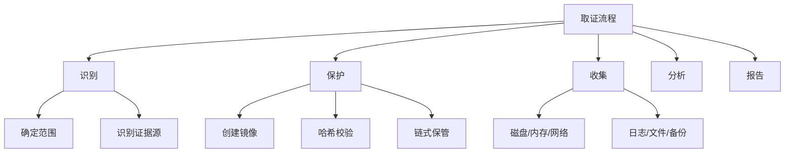

# 取证分析

> 从磁盘取证到内存分析，系统化掌握数字取证技术

---

## 一、取证基础

### 1.1 取证原则



### 1.2 基本原则

```
1. 不改变原始数据
2. 在原始数据的副本上工作
3. 记录所有操作
4. 保持链式保管(Custody Chain)
5. 遵守法律法规
6. 及时响应
7. 专业保密
```

### 1.3 证据类型

| 类型 | 来源 | 易失性 |
|:-----|:-----|:-------|
| CPU/缓存 | 硬件 | 极高(毫秒级) |
| 内存 | RAM | 高(秒级) |
| 网络连接 | 系统 | 高 |
| 进程信息 | OS | 中 |
| 磁盘 | HDD/SSD | 低 |
| 日志 | 文件系统 | 低 |
| 备份 | 外部存储 | 低 |

---

## 二、磁盘取证

### 2.1 镜像创建

```bash
# 创建磁盘镜像
# 使用dd
sudo dd if=/dev/sda of=/mnt/evidence/image.dd bs=4M conv=noerror,sync status=progress

# 使用dcfldd (增强版dd)
dcfldd if=/dev/sda of=/mnt/evidence/image.dd bs=4M hash=sha256 hashwindow=1G

# 使用Guymager (GUI)
guymager

# 使用FTK Imager (Windows)
# GUI工具

# 创建E01镜像 (压缩+哈希)
ewfacquire /dev/sda -o /mnt/evidence/image.E01

# 验证哈希
sha256sum /dev/sda > /mnt/evidence/hash.txt
sha256sum -c hash.txt

# 链式保管文档
echo "Evidence: /dev/sda" > chain_of_custody.txt
echo "Hash: $(sha256sum /dev/sda)" >> chain_of_custody.txt
echo "Date: $(date)" >> chain_of_custody.txt
echo "Collector: $(whoami)" >> chain_of_custody.txt
```

### 2.2 文件系统分析

```bash
# 挂载镜像(只读)
sudo mount -o ro,loop image.dd /mnt/analysis

# 使用Sleuth Kit
# 列出分区
mmls image.dd

# 查看文件系统
fsstat -o 2048 image.dd

# 列出文件
fls -o 2048 image.dd -r / > file_list.txt

# 恢复已删除文件
icat -o 2048 image.dd 12345 > recovered_file

# 时间线分析
fls -m / -o 2048 image.dd > body.txt
mactime -b body.txt > timeline.csv

# 文件分类
# 图片
find /mnt/analysis -type f -name "*.jpg" -o -name "*.png" > images.txt
# 文档
find /mnt/analysis -type f \( -name "*.pdf" -o -name "*.doc*" -o -name "*.xls*" \) > docs.txt
```

### 2.3 文件恢复

```bash
# 使用foremost
foremost -t all -i image.dd -o /mnt/recovered/

# 使用scalpel
scalpel -c /etc/scalpel/scalpel.conf -o /mnt/recovered/ -i image.dd

# 使用photorec
photorec /d /mnt/recovered/ /log image.dd

# 使用testdisk (分区恢复)
testdisk image.dd

# 文件雕刻
# 签名匹配恢复(不依赖文件系统)
foremost -t jpg,pdf,doc -i image.dd -o /mnt/foremost/
```

### 2.4 Windows注册表

```bash
# 挂载Windows镜像
# SAM - 用户密码hash
# SYSTEM - 系统信息
# SOFTWARE - 软件配置
# NTUSER.DAT - 用户配置
# UsrClass.dat - 用户类

# 使用regripper
rip.pl -r SYSTEM -f system
rip.pl -r SAM -f sam
rip.pl -r SOFTWARE -f software
rip.pl -r NTUSER.DAT -f ntuser

# 使用Registry Explorer (Windows)
# GUI工具

# 关键位置
# 启动项: SOFTWARE\Microsoft\Windows\CurrentVersion\Run
# 用户启动: NTUSER.DAT\Software\Microsoft\Windows\CurrentVersion\Run
# USB设备: SYSTEM\CurrentControlSet\Enum\USBSTOR
# 网络连接: SOFTWARE\Microsoft\Windows NT\CurrentVersion\NetworkList
# MRU: NTUSER.DAT\Software\Microsoft\Windows\CurrentVersion\Explorer\RecentDocs
```

---

## 三、内存取证

### 3.1 内存获取

```bash
# Linux
# 使用LiME
insmod lime.ko "path=/mnt/evidence/mem.lime format=lime"

# 使用fmem
./fmem
dd if=/dev/fmem of=/mnt/evidence/mem.dd bs=4M

# /dev/mem (可能不可用)
dd if=/dev/mem of=/mnt/evidence/mem.dd bs=4M

# Windows
# 使用DumpIt (Windows)
DumpIt.exe

# 使用winpmem
winpmem_x64.exe -o mem.raw

# 使用FTK Imager
# File → Capture Memory

# 使用Comsvcs.dll
rundll32.exe C:\Windows\System32\comsvcs.dll, MiniDump (Get-Process lsass).Id dump.dmp full

# VMware
# 直接从.vmem文件复制
cp vm.vmem /mnt/evidence/
```

### 3.2 Volatility分析

```bash
# 识别操作系统
volatility -f mem.raw imageinfo
volatility -f mem.raw kdbgscan

# 选择profile
volatility -f mem.raw --profile=Win10x64 pslist
volatility -f mem.raw --profile=Win7SP1x64 netscan

# 进程分析
volatility -f mem.raw pslist           # 进程列表
volatility -f mem.raw psscan           # 隐藏进程
volatility -f mem.raw pstree           # 进程树
volatility -f mem.raw psxview          # 进程交叉视图

# 网络连接
volatility -f mem.raw netscan          # 网络连接
volatility -f mem.raw netstat          # 网络状态
volatility -f mem.raw sockets          # Socket列表

# DLL信息
volatility -f mem.raw dlllist          # 加载的DLL
volatility -f mem.raw modscan          # 内核模块
volatility -f mem.raw cmdline          # 命令行参数

# 文件操作
volatility -f mem.raw filescan         # 打开的文件
volatility -f mem.raw handles          # 句柄
volatility -f mem.raw dumpfiles -Q 0x12345678 -D output/

# 注册表
volatility -f mem.raw hivelist         # 注册表hive
volatility -f mem.raw printkey -K "Software\Microsoft\Windows\CurrentVersion\Run"

# 恶意软件
volatility -f mem.raw malfind          # 可疑内存区域
volatility -f mem.raw yarascan -Y "strings"  # YARA扫描
volatility -f mem.raw hollowfind       # 进程空洞检测

# MFT
volatility -f mem.raw mftparser -D output/

# 剪切板
volatility -f mem.raw clipboard

# 提取进程
volatility -f mem.raw procdump -p 1234 -D output/
volatility -f mem.raw memdump -p 1234 -D output/

# 命令历史
volatility -f mem.raw cmdscan          # 命令历史
volatility -f mem.raw consoles         # 控制台信息

# IE历史
volatility -f mem.raw iehistory        # IE浏览历史
```

### 3.3 内存分析场景

```bash
# 场景1: 检测恶意进程
# 查找可疑进程
volatility -f mem.raw psscan | grep -E "svchost|rundll32"
# 检查网络连接
volatility -f mem.raw netscan | grep -E "ESTABLISHED|192\.168"
# 提取进程
volatility -f mem.raw procdump -p 1234 -D output/
# 分析dump

# 场景2: 提取凭证
volatility -f mem.raw hashdump
volatility -f mem.raw lsadump
volatility -f mem.raw cachedump

# 场景3: MFT分析
volatility -f mem.raw mftparser -D output/
# 查看已删除文件
# 查看文件创建时间线
```

---

## 四、网络取证

### 4.1 网络流量捕获

```bash
# 实时捕获
tcpdump -i eth0 -w capture.pcap -C 100 -W 10
tcpdump -i eth0 -w capture.pcap port 80 or port 443

# 使用dumpcap (Wireshark)
dumpcap -i eth0 -b filesize:100000 -w capture.pcapng

# 使用netsh (Windows)
netsh trace start capture=yes tracefile=c:\capture.etl
netsh trace stop
```

### 4.2 流量分析

```bash
# 使用Wireshark/TShark
tshark -r capture.pcap -Y "http.request" -T fields -e http.host -e http.request.uri
tshark -r capture.pcap -Y "dns" -T fields -e dns.qry.name
tshark -r capture.pcap -Y "tls.handshake.type == 1" -T fields -e tls.handshake.extensions_server_name

# 统计
tshark -r capture.pcap -z io,phs
tshark -r capture.pcap -z conv,tcp
tshark -r capture.pcap -z endpoints,ip

# 提取文件
tshark -r capture.pcap --export-objects http,/mnt/extracted/

# 流量特征
# DNS隧道: 频繁/长域名
# 数据外传: 大POST请求
# C2通信: 定期心跳
# 端口扫描: 多端口SYN

# 使用Zeek (Bro)
zeek -r capture.pcap
ls *.log
cat conn.log | zeek-cut ts proto service duration orig_bytes resp_bytes
cat http.log | zeek-cut ts method host uri status_code
cat dns.log | zeek-cut ts query qtype_name
cat ssl.log | zeek-cut ts server_name cipher
```

### 4.3 时间线分析

```bash
# 网络时间线
# 创建时间线
tshark -r capture.pcap -T fields -e frame.time -e ip.src -e ip.dst -e tcp.srcport -e tcp.dstport -E separator=, > timeline.csv

# Zeek连接时间线
zeek-cut ts proto service id.orig_h id.resp_h < conn.log | sort -t, -k1 > network_timeline.csv
```

---

## 五、日志分析

### 5.1 Windows事件日志

```bash
# 导出事件日志
wevtutil epl Security security.evtx
wevtutil epl System system.evtx
wevtutil epl Application application.evtx
wevtutil epl "Windows PowerShell" powershell.evtx

# 查询特定事件
wevtutil qe Security /q:"*[System[EventID=4624]]" /f:text /c:10
wevtutil qe Security /q:"*[System[EventID=4688]]" /f:text

# 使用LogParser
LogParser.exe "SELECT TimeGenerated, EventID, Message FROM security.evtx WHERE EventID=4624" -i:EVT -o:CSV

# 使用PowerShell
Get-WinEvent -FilterHashtable @{LogName='Security';ID=4624} -MaxEvents 100
Get-WinEvent -Path security.evtx -MaxEvents 100

# 关键事件ID
# 4624: 登录成功
# 4625: 登录失败
# 4648: 显式凭据登录
# 4688: 进程创建
# 4698: 计划任务创建
# 4719: 审计策略更改
# 4720: 用户创建
# 4732: 添加到组
# 4768: Kerberos TGT请求
# 4769: Kerberos服务票据请求
# 4776: NTLM认证
# 5140: 文件共享访问
# 7045: 服务创建
```

### 5.2 Linux日志

```bash
# 系统日志
cat /var/log/syslog
cat /var/log/auth.log
cat /var/log/kern.log

# 认证日志
grep "Failed password" /var/log/auth.log
grep "Accepted password" /var/log/auth.log
grep "sudo" /var/log/auth.log

# 进程审计
ausearch -m execve -ts recent
ausearch -m USER_LOGIN -ts today

# 查看文件访问
ausearch -f /etc/shadow
aureport -f

# 系统启动
journalctl -b
journalctl -k

# 使用auditd
auditctl -w /etc/passwd -p rwxa -k password_change
ausearch -k password_change
```

### 5.3 Web服务器日志

```bash
# Apache访问日志
cat /var/log/apache2/access.log
awk '{print $1}' /var/log/apache2/access.log | sort | uniq -c | sort -rn
grep "404" /var/log/apache2/access.log
grep -E "(SELECT|UNION|DROP|INSERT)" /var/log/apache2/access.log

# Nginx
cat /var/log/nginx/access.log
cat /var/log/nginx/error.log

# IIS (Windows)
# %SystemDrive%\inetpub\logs\LogFiles
LogParser.exe "SELECT c-ip, cs-uri-stem, sc-status FROM u_ex*.log WHERE sc-status=404" -i:IISW3C -o:CSV
```

---

## 六、恶意软件分析

### 6.1 静态分析

```bash
# 文件识别
file suspicious.exe
strings suspicious.exe | grep -i "http\|url\|download\|keylog\|password"

# PE分析
exiftool suspicious.exe
# 使用pecheck
pecheck suspicious.exe
# 使用PEiD (检测加壳)
pedump suspicious.exe

# 使用capa检测
capa suspicious.exe
capa -v suspicious.exe | grep -E "persist|steal|keylog|inject"

# 虚拟机检测
strings suspicious.exe | grep -i "vmware\|virtualbox\|vbox\|qemu"
```

### 6.2 动态分析

```bash
# 在沙箱中运行
# 使用Process Monitor监控
# 使用API Monitor捕获API

# 网络行为
# 使用Wireshark抓包
# 使用INetSim模拟网络

# 使用Cuckoo沙箱
cuckoo submit suspicious.exe
cuckoo status
```

---

## 七、工具速查

### 7.1 取证工具

| 工具 | 用途 | 安装 |
|:-----|:-----|:------|
| Autopsy | 磁盘取证 | apt install autopsy |
| Sleuth Kit | 文件系统分析 | apt install sleuthkit |
| Volatility | 内存取证 | pip install volatility |
| Foremost | 文件恢复 | apt install foremost |
| Scalpel | 文件雕刻 | apt install scalpel |
| Wireshark | 网络分析 | apt install wireshark |
| Zeek | 网络分析 | apt install zeek |
| Binwalk | 固件分析 | apt install binwalk |
| Guymager | 镜像制作 | apt install guymager |

### 7.2 命令速查

```bash
# 磁盘取证
sudo dd if=/dev/sda of=image.dd bs=4M
mmls image.dd
fls -o 2048 image.dd
foremost -t all -i image.dd -o recovered/

# 内存取证
volatility -f mem.raw imageinfo
volatility -f mem.raw --profile=Win10x64 pslist
volatility -f mem.raw --profile=Win10x64 netscan
volatility -f mem.raw --profile=Win10x64 malfind

# 网络取证
tcpdump -i eth0 -w capture.pcap
tshark -r capture.pcap -Y "http"
zeek -r capture.pcap

# 日志分析
wevtutil qe Security /q:"*[System[EventID=4624]]"
ausearch -m execve
```

### 7.3 检查清单

```
□ 现场保护(拍照/记录)
□ 证据收集顺序(易失→非易失)
□ 哈希验证
□ 链式保管文档
□ 创建镜像(非原始)
□ 文件系统分析
□ 文件恢复
□ 注册表分析(Windows)
□ 内存分析
□ 网络流量分析
□ 日志分析
□ 恶意软件分析
□ 时间线构建
□ 报告撰写
```

---

> **参考资源**
>
> - SANS FOR500/FOR508
> - NIST SP 800-86 (Forensic Techniques)
> - Volatility Documentation
> - Sleuth Kit Documentation
> - Digital Forensics with open source tools
> - Practical Forensic Imaging
