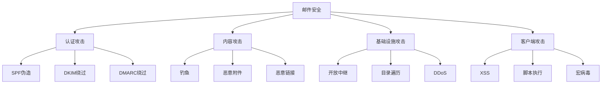

# 邮件安全

> 从SPF/DKIM到钓鱼检测，全面掌握电子邮件安全技术

---

## 一、邮件安全基础

### 1.1 邮件安全协议

| 协议 | DNS记录 | 作用 | 检查 |
|:-----|:--------|:-----|:-----|
| SPF | TXT | 授权发送服务器 | `dig txt domain.com` |
| DKIM | TXT (选择器) | 邮件签名验证 | `dig default._domainkey.domain.com txt` |
| DMARC | TXT (_dmarc) | 策略执行/报告 | `dig _dmarc.domain.com txt` |
| MTA-STS | TXT (_mta-sts) | TLS强制 | `dig _mta-sts.domain.com txt` |
| TLS-RPT | TXT (_smtp._tls) | TLS报告 | `dig _smtp._tls.domain.com txt` |
| ARC | 认证链 | 转发邮件认证 | 邮件头检查 |
| BIMI | TXT | 品牌标识 | `dig default._bimi.domain.com txt` |

### 1.2 邮件攻击面



---

## 二、SPF配置

```bash
# SPF语法
# v=spf1 [机制] [修饰符]

# 常用机制
# all - 所有 (通常用-all或~all)
# ip4 - IPv4地址
# ip6 - IPv6地址
# a - 域名A记录
# mx - 域名MX记录
# include - 包含其他SPF记录
# exists - 存在性检查

# SPF示例
# 仅允许特定IP发送
v=spf1 ip4:203.0.113.0/24 -all

# 允许MX服务器 + 特定IP
v=spf1 mx ip4:203.0.113.10 -all

# 包含第三方服务
v=spf1 include:_spf.google.com include:spf.mailgun.org ~all

# 使用 ~all (softfail) 或 -all (hardfail)
# ~all: 软失败(仍可投递但标记)
# -all: 硬失败(应拒绝)

# SPF记录长度限制: DNS UDP 512字节
# 超过需要分片或使用include

# 检查SPF
dig txt domain.com
nslookup -type=txt domain.com

# SPF验证失败原因
# - 发送IP不在白名单
# - SPF记录语法错误
# - SPF查询超时(太多include)
# - PTR查找失败(ptr机制)
```

---

## 三、DKIM配置

```bash
# DKIM密钥生成
opendkim-genkey -d domain.com -s default

# 生成的文件
# default.private - 私钥 (服务器保存)
# default.txt - DNS记录内容

# DNS记录
default._domainkey.domain.com TXT "v=DKIM1; k=rsa; p=MIGfMA0GCSqGSIb4..."

# DKIM参数
# v=DKIM1 (版本)
# k=rsa (密钥类型, rsa/ed25519)
# p=... (公钥Base64)
# s=email (服务类型)
# h=sha256 (哈希算法)
# t=y (测试模式)

# 多个选择器
# default._domainkey - 常规
# 2024._domainkey - 轮换用

# DKIM签名示例(邮件头)
DKIM-Signature: v=1; a=rsa-sha256; c=relaxed/relaxed;
  d=domain.com; s=default;
  h=from:to:subject:date:message-id;
  bh=abc123...; b=def456...

# DKIM验证
opendkim-testkey -d domain.com -s default -k default.private

# 检查DKIM
# https://www.appmaildev.com/en/dkim
# dig default._domainkey.domain.com txt

# 密钥轮换建议
# - 每6个月轮换一次
# - 保留旧选择器直到缓存过期
# - 使用日期或版本号作为选择器名
```

---

## 四、DMARC配置

```bash
# DMARC策略
_dmarc.domain.com TXT 

# 基础配置
"v=DMARC1; p=none; rua=mailto:dmarc@domain.com"

# 报告配置
"v=DMARC1; p=quarantine; pct=100; 
 rua=mailto:dmarc@domain.com; 
 ruf=mailto:forensic@domain.com; 
 fo=1"

# 严格配置
"v=DMARC1; p=reject; pct=100; 
 rua=mailto:dmarc@domain.com; 
 sp=reject; 
 adkim=s; aspf=s"

# DMARC标签
# p - 策略 (none/quarantine/reject)
# sp - 子域名策略
# pct - 应用百分比
# rua - 聚合报告地址
# ruf - 鉴证报告地址
# fo - 失败选项 (0/1/d/s)
# adkim - DKIM对齐模式 (r/s)
# aspf - SPF对齐模式 (r/s)
# ri - 报告间隔(秒)

# 策略说明
# p=none: 监控模式(仅报告)
# p=quarantine: 隔离(标记为垃圾邮件)
# p=reject: 拒绝(不投递)

# 对齐模式
# r=relaxed: 宽松(子域名也可)
# s=strict: 严格(必须完全匹配)

# 报告
# rua: XML格式聚合报告(每日)
# ruf: 失败详情报告(每条失败)

# DMARC验证在线工具
# https://dmarctester.com
# https://www.mail-tester.com

# 实施步骤
# 1. 配置SPF (确保准确)
# 2. 配置DKIM (所有发送服务)
# 3. p=none (监控3-7天)
# 4. 分析报告
# 5. p=quarantine (pct=1逐步增加)
# 6. p=reject (最终目标)
```

---

## 五、钓鱼邮件检测

### 5.1 邮件头分析

```bash
# 查看完整邮件头
# Outlook: 邮件 → 查看 → 邮件头
# Gmail: 三点 → 显示原始邮件
# Thunderbird: Ctrl+U

# 关键检测字段
Received: from mail.source.com (192.0.2.1) by...
  # 追踪邮件路径
  # 第一跳: 发件服务器
  # 最后一跳: 接收服务器

From: "CEO" <ceo@company.com>
  # 显示名称可伪造
  # 实际地址可能不同

Reply-To: attacker@evil.com
  # 回复地址指向攻击者

Return-Path: bounce@evil.com
  # 退信地址

Authentication-Results: spf=pass; dkim=fail; dmarc=fail
  # 认证结果
  # 关键：是否全部通过

DKIM-Signature: ...
  # 签名是否存在/是否有效

Message-ID: <random@server.com>
  # 通常包含域名
  # 可疑：与声称的发件域不匹配

# 邮件头分析工具
# https://mha.azurewebsites.net
# https://toolbox.googleapps.com/apps/messageheader/
```

### 5.2 钓鱼特征检测

```bash
# URL检测
# - 域名相似但不同 (g00gle.com)
# - IP地址代替域名
# - URL缩短服务 (bit.ly, t.co)
# - 子域名欺骗 (login.company.com.evil.com)
# - 编码URL (十六进制/Unicode)

# 内容检测
# - 紧急/恐吓语气
# - 语法错误
# - 泛化称呼(尊敬的客户)
# - 要求点击链接/下载附件
# - 索要敏感信息
# - 未预期的附件

# 附件检测
# - .docm/.xlsm (含宏)
# - .js/.vbs/.ps1
# - .exe/.scr/.com
# - .zip/.rar (密码保护)
# - .iso/.img
# - .lnk

# 发送时间
# - 非工作时间
# - 节假日期间
# - 周一早/周五下午

# 邮件评分工具
# python3 << 'EOF'
import email
import re
import dns.resolver

def analyze_email(raw_email):
    msg = email.message_from_string(raw_email)
    score = 0
    warnings = []
    
    # 1. 检查SPF
    from_domain = msg['From'].split('@')[-1].rstrip('>')
    try:
        spf_record = dns.resolver.resolve(from_domain, 'TXT')
        # 解析检查
    except:
        warnings.append("SPF记录不存在")
        score += 1
    
    # 2. 检查DKIM
    if 'DKIM-Signature' not in msg:
        warnings.append("无DKIM签名")
        score += 1
    
    # 3. 检查DMARC
    try:
        dmarc_record = dns.resolver.resolve(f'_dmarc.{from_domain}', 'TXT')
    except:
        warnings.append("DMARC未配置")
        score += 1
    
    # 4. 检查URL
    urls = re.findall(r'https?://[^\s<>"]+|www\.[^\s<>"]+', str(msg))
    suspicious_urls = []
    for url in urls:
        # 检查缩短URL
        if any(s in url for s in ['bit.ly', 'tinyurl', 't.co', 'goo.gl']):
            suspicious_urls.append(url)
    
    return score, warnings, suspicious_urls
# EOF
```

---

## 六、SMTP安全

### 6.1 安全配置

```bash
# Postfix安全配置
# /etc/postfix/main.cf

# 限制连接
smtpd_client_connection_rate_limit = 10
smtpd_client_connection_count_limit = 10
smtpd_client_message_rate_limit = 50

# 限制发件人
smtpd_sender_restrictions = 
    check_sender_access hash:/etc/postfix/sender_access,
    reject_unknown_sender_domain,
    reject_non_fqdn_sender

# 限制收件人
smtpd_recipient_restrictions = 
    reject_unauth_destination,
    check_recipient_access hash:/etc/postfix/recipient_access,
    reject_rbl_client zen.spamhaus.org,
    reject_rhsbl_reverse_client dbl.spamhaus.org

# TLS配置
smtpd_tls_security_level = may
smtpd_tls_cert_file = /etc/ssl/certs/mail.pem
smtpd_tls_key_file = /etc/ssl/private/mail.key
smtpd_tls_protocols = !SSLv2, !SSLv3, !TLSv1, !TLSv1.1

# 防止开放中继
smtpd_recipient_restrictions = 
    permit_mynetworks,
    permit_sasl_authenticated,
    reject_unauth_destination

# SASL认证
smtpd_sasl_auth_enable = yes
smtpd_sasl_type = dovecot
smtpd_sasl_path = private/auth

# 速率限制
anvil_rate_time_unit = 60s
smtpd_client_connection_rate_limit = 10
smtpd_client_event_limit_exceptions = 127.0.0.0/8
```

### 6.2 SMTP枚举

```bash
# SMTP用户枚举
smtp-user-enum -M VRFY -U users.txt -t mail.domain.com
smtp-user-enum -M EXPN -U users.txt -t mail.domain.com
smtp-user-enum -M RCPT -U users.txt -t mail.domain.com

# 手工枚举
telnet mail.domain.com 25
EHLO test
VRFY admin
VRFY root
VRFY test
EXPN all
EXPN users
RCPT TO:admin@domain.com
RCPT TO:test@domain.com

# 暴力破解
hydra -l admin -P passwords.txt smtp://mail.domain.com
# Nmap脚本
nmap -p25 --script smtp-enum-users mail.domain.com
nmap -p25 --script smtp-commands mail.domain.com
nmap -p25 --script smtp-open-relay mail.domain.com
```

---

## 七、邮件服务器漏洞

### 7.1 常见漏洞

```bash
# 开放中继测试
telnet mail.domain.com 25
HELO test.com
MAIL FROM: attacker@evil.com
RCPT TO: victim@gmail.com
DATA
Subject: Test
This is a test relay
.
QUIT

# Heartbleed (CVE-2014-0160) - OpenSSL
nmap -p 443 --script ssl-heartbleed mail.domain.com

# Shellshock (CVE-2014-6271) - Bash
nmap -p 80 --script http-shellshock --script-args uri=/cgi-bin/email mail.domain.com

# 目录遍历
curl -v "http://webmail.domain.com/../../../etc/passwd"

# XSS in Webmail
curl "http://webmail.domain.com/search?q=<script>alert(1)</script>"

# SQL注入
curl "http://webmail.domain.com/login?user=admin'--"
```

### 7.2 暴力破解防护绕过

```bash
# X-Forwarded-For绕过
curl -H "X-Forwarded-For: 127.0.0.1" -d "username=admin&password=test" https://webmail.domain.com/login

# 慢速爆破
hydra -l admin -P passwords.txt -t 1 -s 30 imap://mail.domain.com

# 分布式爆破
# 使用代理池/多个IP
```

---

## 八、邮件加密

### 8.1 传输加密

```bash
# SMTP TLS (STARTTLS)
# 端口: 587 (Submission)
# 端口: 25 (SMTP with STARTTLS)

# SMTPS (隐式TLS)
# 端口: 465

# IMAPS
# 端口: 993

# POP3S
# 端口: 995

# 强制TLS (MTA-STS)
# _mta-sts.domain.com TXT
"v=STSv1; id=20240101;"

# MTA-STS配置文件
# https://mta-sts.domain.com/.well-known/mta-sts.txt
version: STSv1
mode: enforce
mx: mail.domain.com
mx: mail2.domain.com
max_age: 86400

# TLS报告 (TLS-RPT)
# _smtp._tls.domain.com TXT
"v=TLSRPTv1; rua=mailto:tls@domain.com"
```

### 8.2 端到端加密

```bash
# PGP/GPG
gpg --gen-key
gpg --encrypt --recipient user@domain.com email.txt
gpg --decrypt email.txt.gpg

# S/MIME
# 需要证书
# 在邮件客户端配置
# Outlook: 文件 → 选项 → 信任中心 → 电子邮件安全
```

---

## 九、邮件服务器安全配置

### 9.1 Dovecot配置

```conf
# /etc/dovecot/dovecot.conf

# 协议
protocols = imap pop3 lmtp

# SSL/TLS
ssl = required
ssl_cert = </etc/ssl/certs/mail.pem
ssl_key = </etc/ssl/private/mail.key
ssl_min_protocol = TLSv1.2
ssl_cipher_list = ECDHE-ECDSA-AES128-GCM-SHA256:ECDHE-RSA-AES128-GCM-SHA256

# 认证
auth_mechanisms = plain login
auth_username_format = %Ln

# 密码数据库
passdb {
    driver = pam
}
userdb {
    driver = passwd
}

# 限制
mail_max_userip_connections = 10
```

### 9.2 邮件过滤器

```bash
# SpamAssassin
# /etc/spamassassin/local.cf

required_score 5.0
report_safe 1
rewrite_header Subject [***** SPAM *****]

# RBL检查
use_rbl 1
rbl_timeout 10

# 自定义规则
header LOCAL_FREEMAIL From =~ /@(gmail|yahoo|hotmail)\./
score LOCAL_FREEMAIL 1.5

# ClamAV (病毒扫描)
# /etc/clamav/clamd.conf
# 集成到邮件管道

# Amavis
# /etc/amavis/conf.d/50-user
@bypass_virus_checks_maps = ();
@bypass_spam_checks_maps = ();
$final_virus_destiny = D_DISCARD;
$final_spam_destiny = D_DISCARD;
```

---

## 十、邮件安全审计

### 10.1 审计工具

```bash
# 在线检查
# https://www.mail-tester.com
# https://dkimvalidator.com
# https://mxtoolbox.com

# Python检查脚本
pip install checkdmarc
checkdmarc domain.com

# Command line
# SPF
dig txt domain.com | grep spf

# DKIM
dig default._domainkey.domain.com txt

# DMARC
dig _dmarc.domain.com txt

# MX记录
dig mx domain.com

# MTA-STS
dig _mta-sts.domain.com txt

# 批量检查
for domain in $(cat domains.txt); do
    echo "=== $domain ==="
    dig txt $domain | grep -E "spf|dkim|dmarc" || echo "No security records"
done
```

### 10.2 检查清单

```
□ SPF记录配置正确
□ DKIM签名正常
□ DMARC策略为reject
□ MTA-STS配置
□ TLS-RPT报告
□ SSL/TLS版本正确
□ 非开放中继
□ 账户安全策略
□ 密码强度要求
□ 速率限制
□ 日志审计
□ 备份邮件服务器
□ 垃圾邮件过滤
□ 病毒扫描
□ 邮件头分析
□ 用户培训
□ 钓鱼演练
□ 应急响应计划
```

---

## 十一、应急响应

### 11.1 钓鱼事件响应

```bash
# 1. 确认事件
# 2. 收集证据(完整邮件头+附件)
# 3. 隔离受影响用户
# 4. 检查已泄露数据
# 5. 重置凭证
# 6. 通知相关方
# 7. 更新过滤器规则
# 8. 总结教训

# IOC提取
# URL
# IP地址
# 附件hash
# 发件地址
# 主题行

# 报告平台
# https://phishtank.com
# https://apwg.org
# https://reportphishing.com
```

### 11.2 邮件服务器入侵响应

```
1. 断开服务器网络
2. 保护日志
3. 检查异常登录
4. 检查配置修改
5. 检查后门
6. 检查开放中继
7. 检查邮件队列
8. 重置所有密码
9. 更新系统补丁
10. 逐步恢复服务
```

---

## 十二、速查总表

### 12.1 DNS记录速查

| 记录 | 主机 | 类型 | 示例值 |
|:-----|:-----|:-----|:-------|
| SPF | @ | TXT | `v=spf1 mx -all` |
| DKIM | default._domainkey | TXT | `v=DKIM1; k=rsa; p=...` |
| DMARC | _dmarc | TXT | `v=DMARC1; p=reject` |
| MTA-STS | _mta-sts | TXT | `v=STSv1; id=1` |
| TLS-RPT | _smtp._tls | TXT | `v=TLSRPTv1; rua=...` |
| BIMI | default._bimi | TXT | `v=BIMI1; l=...` |

### 12.2 端口速查

| 协议 | 端口 | 加密 |
|:-----|:-----|:-----|
| SMTP | 25 | STARTTLS(可选) |
| SMTPS | 465 | SSL/TLS |
| Submission | 587 | STARTTLS(推荐) |
| IMAP | 143 | STARTTLS |
| IMAPS | 993 | SSL/TLS |
| POP3 | 110 | STARTTLS |
| POP3S | 995 | SSL/TLS |

### 12.3 命令速查

```bash
# DNS查询
dig mx domain.com
dig txt domain.com
dig _dmarc.domain.com txt
dig default._domainkey.domain.com txt

# SMTP测试
telnet mail.domain.com 25
openssl s_client -connect mail.domain.com:465 -starttls smtp

# 安全扫描
nmap -p 25,465,587 --script smtp-* mail.domain.com
nmap -p 143,993 --script imap-* mail.domain.com

# 批量验证
checkdmarc domain.com
python3 -c "import dns.resolver; [print(r) for r in dns.resolver.resolve('_dmarc.domain.com', 'TXT')]"
```

---

> **参考资源**
>
> - RFC 7208 (SPF)
> - RFC 6376 (DKIM)
> - RFC 7489 (DMARC)
> - RFC 8461 (MTA-STS)
> - OWASP Mail Security
> - M3AAWG Best Practices
